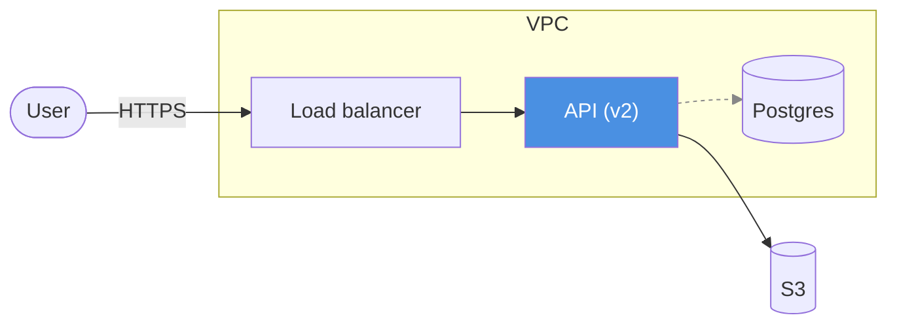
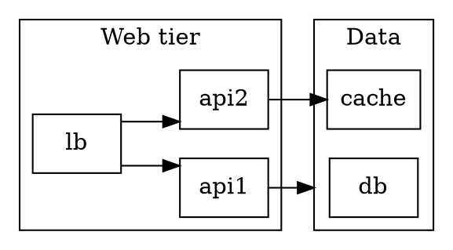

# Field survey: diagram-as-code tools, layout engines, and the literature on good architecture diagrams

Research date: 2026-10-26. Prepared for a new code-first diagramming product whose target is Ilograph-grade interactive, multi-perspective, nested-box diagrams with Lucidchart-grade layout, authored by AI agents, plus flowcharts and sequence diagrams.

How this report was built: six parallel research passes (D2/Mermaid/PlantUML; Ilograph and C4 tools; layout engines; canvas and commercial cloud products; niche DSLs and infra visualizers; academic literature) plus a direct verification pass over npm, GitHub, and the ELK docs. Every factual claim cites a URL inline. Guesses are labelled. Where two passes disagree the discrepancy is noted in Part 9.

Two headline facts that change the landscape as of this month:

1. TALA, the one layout engine purpose-built for nested software architecture boxes, went open source under MPL-2.0 on 2026-09-07 and is bundled in D2 v0.9.0 (https://d2lang.com/blog/tala-is-open-source/). Terrastruct is shutting down; D2 is now a Hack Club non-profit with one part-time maintainer (https://d2lang.com/blog/d2-non-profit/).
2. draw.io has replaced its legacy auto layouts with Eclipse ELK and added libavoid orthogonal routing as a position-preserving pass, exposed through a JSON layout spec (https://www.drawio.com/docs/reference/json-layout-specification/). Mermaid 12 made ELK its default engine. elkjs plus libavoid-js is therefore a production-proven browser stack.

## Contents

- Part 1. D2, Mermaid, PlantUML
- Part 2. Ilograph, Structurizr DSL, LikeC4, IcePanel, Multiplayer
- Part 3. Layout engines: Graphviz, ELK, dagre, yFiles, Cytoscape.js, others
- Part 4. Canvas SDKs, AI diagram generators, commercial cloud-diagram products
- Part 5. Niche DSLs, ASCII tools, Terraform and Kubernetes visualizers, icon standards, Wardley, ArchiMate
- Part 6. Academic and algorithmic survey (aesthetics, layered layout, constraints, routing, compound graphs, LLM diagram generation)
- Part 7. Verified TypeScript library landscape and the ELK options that matter
- Part 8. Synthesis: (a) what makes a diagram good or bad, (b) what makes diagram-as-code good or bad for agents, (c) ranked ideas to combine, (d) library recommendation
- Part 9. Discrepancies and open questions


---

## Part 1. D2, Mermaid, PlantUML

Researched 2026-10-26. Every claim carries a URL. Statements marked "guess" are not verified.

Headline context that changes how to read this section: Terrastruct, the company behind D2, is shutting down. On 2026-09-05 Alexander Wang announced D2 is now a non-profit project fiscally sponsored by Hack Club (https://d2lang.com/blog/d2-non-profit/). On 2026-09-07 the previously closed-source TALA layout engine was released under MPL-2.0 and bundled into D2 v0.9.0 (https://d2lang.com/blog/tala-is-open-source/, https://github.com/d2lang/d2/releases). The GitHub repo moved from `terrastruct/d2` to `d2lang/d2` (old URLs redirect). This means the best "architecture-aware" open layout engine in the text-to-diagram space is now readable Go source, and the project is maintained part-time by one person seeking volunteers.

---

### D2 (Terrastruct, now d2lang / Hack Club)

#### 1. Language

D2 stands for "Declarative Diagramming" (https://d2lang.com/tour/intro). The FAQ states the design philosophy: "The syntax is kept minimal and unstructured to make small diagrams with as little lines as possible," with large diagrams supported through IDE-style features (autoformatter, error messages, comments) (https://d2lang.com/tour/faq/). The parser reports multiple errors from one broken program, and there is an official autoformatter (`d2 fmt`) and a planned LSP (https://github.com/d2lang/d2).

Syntax sample (reconstructed from the docs at https://d2lang.com/tour/containers/, https://d2lang.com/tour/classes/, https://d2lang.com/tour/vars/):

```d2
direction: right
vars: { primary: "#4A90E2" }
classes: { svc: { style.fill: ${primary}; shape: rectangle } }

aws: AWS {
  vpc: VPC {
    api: API Server { class: svc }
    db: Postgres { shape: cylinder }
    api -> db: reads
  }
  s3: S3 { shape: cylinder }
  vpc.api -> s3: uploads
}
user -> aws.vpc.api: HTTPS
aws.vpc.db -> _.user: never   # `_` refers to the parent scope
```

Key language features, each verified on the linked doc page:

- **Containers and nesting.** Any object with a map body is a container. Children are addressed by dot-notation (`aws.vpc.api`). `_` refers to the parent container when writing a connection from inside a container to something outside it (https://d2lang.com/tour/containers/). Limitation stated in the FAQ: "objects can't belong to more than one container" (https://d2lang.com/tour/faq/). Overlapping or cross-cutting containers (an auto-scaling group spanning availability zones) have been requested since Dec 2022 and remain unimplemented; the maintainer floated `constraint`, `encompass` and `groups` keywords but noted "Dagre and ELK couldn't reliably keep grouped nodes close together." The FAQ answer quoted in Jul 2026 is "Not currently and not in the near future" (https://github.com/terrastruct/d2/discussions/328).
- **Edges.** `->`, `<-`, `<->`, `--`. Edge labels after a colon. Connections are addressed by index for programmatic edits (https://d2lang.com/tour/api/).
- **Classes.** `classes` block defines reusable attribute sets; apply with `class: name` or an array for multiple classes (applied left to right, later wins). Object attributes override class attributes. Applied classes are emitted as SVG `class` attributes so you can target them with CSS/JS (https://d2lang.com/tour/classes/).
- **Vars and substitutions.** `vars` block, `${name}` substitution, nested via dots, lexical scoping (closest scope wins), single quotes disable substitution, `...${x}` spreads maps/arrays. `vars.d2-config` holds per-file config (`theme-id`, `pad`, `layout-engine`, `tala-seeds`), but CLI flags and env vars take precedence (https://d2lang.com/tour/vars/, https://github.com/d2lang/d2/releases).
- **Imports.** `@file` imports a file as a map value; `...@file` spreads it into the enclosing map (only legal inside maps); `@file.key` imports one object; paths resolve relative to the importing file; only `.d2` files (https://d2lang.com/tour/imports/).
- **Multi-board composition.** Three keywords with different inheritance rules: `layers` (no inheritance, each is a fresh base), `scenarios` (inherit from the base board), `steps` (each inherits from the previous step). "Boards can't be visible at the same time, so exports must handle these more dynamic diagrams" (https://d2lang.com/tour/composition/). Objects can `link` to other boards for drill-down navigation (guess: the linking page exists in the sidebar as "Linking between boards"; I did not fetch it).
- **Grid diagrams.** `grid-rows` and/or `grid-columns` on a container; the first declared keyword is the dominant fill direction; `grid-gap`, `vertical-gap`, `horizontal-gap`; grids, sequence diagrams, and normal diagrams all nest inside grid cells. Cells in a column share width and cells in a row share height, so one long label pads the whole column (https://d2lang.com/tour/grid-diagrams/).
- **Sequence diagrams.** `shape: sequence_diagram` on a container. Unlike the rest of D2, declaration order matters (actors appear in defined order). Spans (activation bars) are nested objects on an actor that have connections; notes are nested objects without connections; groups (fragments) are containers inside the sequence diagram that hold connections. Actors used inside a group must be declared at top level first (https://d2lang.com/tour/sequence-diagrams/).
- **sql_table.** `shape: sql_table`; each key is a column, the primary value is the type, the constraint value is `primary_key`/`foreign_key`/`unique` (rendered PK/FK/UNQ) or any string. Foreign-key edges target exact rows "with the TALA or ELK layout engine" (https://d2lang.com/tour/sql-tables/).
- **Positioning hooks.** `near` with a constant (`top-left`, `center-right`, etc.) works everywhere. `near` set to another object's absolute ID "Works in TALA only". `top`/`left` absolute coordinates (both required together) are TALA only (https://d2lang.com/tour/positions/).
- **direction.** `direction: up|down|right|left` globally on all engines; per-container `direction` is TALA only, because "the other engines' hierarchical algorithms work in only one direction" (https://d2lang.com/tour/layouts).
- **Other.** Tooltips (HTML title text, so no Markdown), links to URLs (`#` must be escaped), icons from any URL, Markdown/LaTeX/code labels (edges too since 0.7.1), `cross` arrowhead, `--sketch` hand-drawn mode, legends (https://d2lang.com/tour/interactive/, https://d2lang.com/tour/sketch/, https://github.com/d2lang/d2/releases).

#### 2. Layout

D2 ships three engines, selectable with `--layout`, `D2_LAYOUT`, or `vars.d2-config.layout-engine`. `d2 layout` lists engines, `d2 layout <engine>` lists that engine's flags (https://d2lang.com/tour/layouts).

**dagre (default).** Layered/hierarchical, "based on Graphviz's DOT algorithm". As of v0.8.2 the embedded JavaScript dagre 0.8.5 was replaced by a native Go port called "Dagro" that tracks dagre 3.1.1 behaviour, with a stated 7 to 9x median speedup; the release warns this "intentionally changes node ordering, coordinates, edge routes, self-loops, and compound sizing" (https://github.com/d2lang/d2/releases). D2's own docs list dagre's cons bluntly (https://d2lang.com/tour/dagre/):
- "Unmaintained. Development stopped in 2018."
- "Makes some inexplicable edge routing decisions occasionally" (links dagrejs/dagre#256, "Some strange layout decisions", open since Dec 2018: https://github.com/dagrejs/dagre/issues/256).
- "The layout is strictly hierarchical, even when the diagram isn't."
- "Container-to-container (or container-to-container-child) connections aren't natively supported. D2 adds a shim, but some core algorithm considerations are missed."
- "Multi-segment edges are curved rather than orthogonal, which can produce unattractive squiggly lines."

**ELK.** As of v0.8.2 the embedded ELK.js 0.8.2 was replaced by native Go `elk-go` with an "ELK.js 0.12.0 profile" (40 to 53x median speedup); DisCo was removed; ELK now routes ancestor-to-descendant connections around intermediate containers (https://github.com/d2lang/d2/releases). Exposed algorithms via `--elk-algorithm`: `layered` (default), `force`, `stress`, `mrtree`, `radial`. D2's stated pros: clean orthogonal routes, good crossing minimisation, "handles container-to-container routing natively, better than dagre", routes to exact SQL table rows. Cons: "Strictly hierarchical, like dagre", "Some routes have unnecessary bends", "Minimal consideration for symmetry" (https://d2lang.com/tour/elk/). The docs do not enumerate individual ELK layered options (nodeNodeBetweenLayers, padding, etc.); the user is told to run `d2 layout elk`.

**TALA ("Terrastruct's AutoLayout Algorithm").** Now MPL-2.0 and bundled since v0.9.0 (`--layout=tala`); runs client-side in the Playground and in the WASM build (https://d2lang.com/blog/tala-is-open-source/, https://github.com/d2lang/d2/blob/master/d2js/js/README.md). What makes it different, from the primary sources:
- "primarily an orthogonal layout engine", closer to "whiteboard" diagrams than the DAG-based layouts of dagre and ELK. "It is not limited to hierarchical, tree, or radial layouts" (https://d2lang.com/tour/tala/, https://d2lang.com/blog/tala-is-open-source/).
- It optimises several aesthetic objectives at once: "symmetry, median distance, flow, and clustering of like nodes", blending ideas from cited graph-drawing papers with original techniques (https://d2lang.com/blog/tala-is-open-source/).
- It runs 3 seeds by default and keeps the best-scoring layout; `--tala-seeds` / `D2_TALA_SEEDS` controls the count. Output is deterministic for the same seeds and input, but "adding one node can change the whole layout, unlike Dagre and ELK" (https://d2lang.com/blog/tala-is-open-source/, https://github.com/d2lang/d2/releases).
- Containers are "first-class"; `direction` per container; `near` another object; `top`/`left` locking with the engine still routing edges; partial positioning where pinned nodes keep coordinates and the rest are placed automatically. Labels are moved dynamically to avoid obstructions. Edges between grid cells use TALA's router instead of straight lines (https://d2lang.com/tour/tala/, https://d2lang.com/tour/grid-diagrams/).
- Explicitly tied to agents: "agentic use cases benefit from locked coordinates, since models can place nodes in 2D space but still struggle with routing" (https://d2lang.com/blog/tala-is-open-source/).
- Stated weaknesses: "It handles DAGs less well than Dagre or ELK" and "Runtime scales nonlinearly with diagram size" (https://d2lang.com/blog/tala-is-open-source/).
- Ports: the FAQ says "ports can't be specified yet" for any engine (https://d2lang.com/tour/faq/). The architecture-style "port" that TALA has is limited to sql_table rows.

Feature support matrix straight from the docs (https://d2lang.com/tour/layouts):

| Feature | dagre | ELK | TALA |
|---|---|---|---|
| `near` constant | yes | yes | yes |
| `near` another object | no | no | yes |
| `width`/`height` on containers | no | yes | yes |
| `top`/`left` locking | no | no | yes |
| per-container `direction` | no | no | yes |
| ancestor-to-descendant edge | shim | routed around containers since 0.8.2 | yes |

Grid edge routing: under dagre and ELK, connections between grid cells "are straight center-to-center segments with no path-finding"; the maintainer closed d2lang/d2#2635 ("Grid-Rows / Grid-Columns Breaks Nested Connections ... Overlapping Lines") as "not planned" because this is expected (https://github.com/terrastruct/d2/issues/2635, https://github.com/terrastruct/d2/issues/1145).

Engines are not pluggable in the sense of a stable API; D2 writes "shims" for dagre and ELK and says full support "would require forking them, which the team may eventually do" (https://d2lang.com/tour/layouts). The 0.8.2 move to native Go ports was effectively that fork.

#### 3. Interactivity

Output is SVG (default), PNG, PDF, PPTX, GIF, ASCII (`.txt`, ELK/TALA only). SVG is "the most interactive format": links clickable, tooltips on hover (object shows an icon), `class` attributes for CSS/JS targeting. PDF keeps links but not animation; PNG numbers tooltips into an appendix (https://d2lang.com/tour/exports/, https://d2lang.com/tour/interactive/). Multi-board compositions export as an animated SVG with `--animate-interval` (the JS API exposes `animateInterval` and requires it to be > 0 to render multiple boards), or as paged PDF/PPTX, or GIF (https://github.com/d2lang/d2/blob/master/d2js/js/README.md, https://d2lang.com/tour/exports/). There is no built-in collapse/expand of containers or client-side perspective switching; views are separate boards. `--watch` live-reloads a browser preview; `--target` selects a board (https://github.com/d2lang/d2).

Tooling: official playground https://play.d2lang.com (source d2lang/d2-playground), official VS Code extension https://github.com/d2lang/d2-vscode, Vim plugin, Obsidian plugin. D2 Studio (the former paid IDE, "purely client-side, usable completely offline") is promised to be open-sourced (https://d2lang.com/blog/d2-non-profit/). Kroki renders D2 but SVG only (https://kroki.io/). GitHub does not natively render D2 (https://text-to-diagram.com/ lists "native GitHub rendering" as a feature row).

#### 4. Agent / LLM friendliness

- **Programmatic API.** `d2oracle` (Go) provides pure AST-level `Create`, `Set`, `Delete`, `Rename`, `Move` plus `MoveIDDeltas`/`DeleteIDDeltas`/`RenameIDDeltas` for tracking ID changes; it auto-creates missing parent containers and renumbers colliding IDs (https://d2lang.com/tour/api/). `d2lib` compiles and renders. This is the strongest "edit a diagram as a structure, not as text" API among the three tools.
- **JS/WASM.** `@d2lang/d2` (alias `@terrastruct/d2`) runs in browser and Node via a web worker; `compile()` accepts `layout: 'dagre' | 'elk' | 'tala'`, `render()` returns SVG with `sketch`, `themeID`, `pad`, `animateInterval`, etc. (https://github.com/d2lang/d2/blob/master/d2js/js/README.md).
- **Validation.** `d2 --check` validates without rendering; errors include line and position and the parser reports multiple errors per run (https://github.com/d2lang/d2, https://lobehub.com/skills/svetlovtech-skills_and_agents-d2-diagrams).
- **MCP servers (all community).** h0rv/d2-mcp (Go, validate/compile without rendering, embedded cheat sheet), itsjool/d2-mcp (WASM, ships a "D2 agent skill" teaching LLMs the syntax), RecursiveFunctions/d2mcp and i2y/d2mcp (Go, incremental diagram building via d2oracle) (https://deepwiki.com/h0rv/d2-mcp, https://lobehub.com/mcp/itsjool-d2-mcp, https://github.com/i2y/d2mcp). The maintainer's stated non-goals for D2 core include "LLM integration in the diagramming tool" and "server-dependent features such as MCP, an API" but the goal list includes "serving as a strong harness for agents" and "a stable 1.0 with a formalized grammar" (https://d2lang.com/blog/d2-non-profit/).
- **LLM error rate.** I found no quantitative study of D2 validity. Indirect evidence: a Pintora author reports Gemini 3 Pro and Claude Sonnet 4.5 "generated a lot of syntactically incorrect code" for a niche language and names D2 alongside it (https://www.huy.rocks/everyday/12-01-2025-ai-teaching-an-llm-a-niche-diagraming-language); a community skill lists the common LLM mistakes as "undefined shape referenced in connection, invalid shape type, syntax errors (missing colons, brackets), and invalid property names" (https://lobehub.com/skills/svetlovtech-skills_and_agents-d2-diagrams). Guess: D2 is roughly 10x less represented in training data than Mermaid, so first-shot validity is lower, but the error messages are good enough for a fix loop.
- **Determinism.** dagre and ELK are deterministic. TALA is deterministic per seed but layout-unstable under small edits (https://d2lang.com/blog/tala-is-open-source/).
- **Position hints for agents.** TALA's `top`/`left` partial pinning is explicitly pitched as the agent story: the model places, the engine routes (https://d2lang.com/blog/tala-is-open-source/).

#### 5. What it does well

- Terse syntax, no begin/end wrappers, nested containers are natural, `_` parent reference keeps cross-boundary edges readable.
- The only one of the three with a non-hierarchical, container-aware, symmetry-seeking orthogonal engine (TALA), now open source.
- Layers/scenarios/steps is a real multi-view model with inheritance, which maps onto "perspectives".
- Grid layouts give deterministic table/matrix structure for things auto-layout does badly.
- Sequence diagrams, sql_table with row-level edges, Markdown/LaTeX labels, icons, sketch mode, themes.
- d2oracle AST editing and ID-delta tracking.
- Native Go, no JS runtime, fast after 0.8.2/0.9.0 (SVG rendering "about 10x faster") (https://github.com/d2lang/d2/releases).

#### 6. Where it fails and why

- **Default engine is the weakest.** dagre is the default; it is unmaintained upstream, strictly hierarchical, curves multi-segment edges, and needs a shim for any container-to-container edge (https://d2lang.com/tour/dagre/). Most D2 output people see online is dagre output, which is why D2 diagrams often still look like "hierarchy graphs".
- **Container labels overlap.** d2lang/d2#1812 "Container labels don't respect margins in Dagre and TALA" (open since Jan 2024): labels "cross the shape outline and overlap with other objects" (https://github.com/terrastruct/d2/issues/1812).
- **Grid plus edges.** No routing between grid cells on dagre/ELK; straight centre-to-centre lines cross everything (https://github.com/terrastruct/d2/issues/2635, https://github.com/terrastruct/d2/issues/1145).
- **No overlapping/cross-cutting containers**, which cloud diagrams need (AZ x ASG) (https://github.com/terrastruct/d2/discussions/328).
- **No ports** on shapes (https://d2lang.com/tour/faq/).
- **TALA instability and scaling.** One extra node can reflow the whole diagram; nonlinear runtime (https://d2lang.com/blog/tala-is-open-source/).
- **Not built for scale.** "D2 is not designed for big data" and is not tested on thousands of nodes (https://d2lang.com/tour/faq/).
- **Multiple views are static exports.** No in-SVG collapse/expand or perspective switcher; you get one SVG per board or an animated SVG.
- **Engine shim gaps.** Per-container direction, `near` object, `top`/`left`, container sizing: all absent on dagre and partly on ELK (https://d2lang.com/tour/layouts).
- **Governance risk.** Single part-time maintainer, company gone, "All contributions will be AI-driven, and AI will be used for review" (https://d2lang.com/blog/d2-non-profit/).

#### 7. License and maturity

- License: MPL-2.0 for D2 and, since 2026-09-07, for TALA (https://github.com/d2lang/d2, https://d2lang.com/blog/tala-is-open-source/).
- Stars: 25.7k (https://github.com/d2lang/d2, fetched 2026-10-26).
- Releases: v0.7.1 (19 Aug 2026), v0.8.2 (28 Aug 2026), v0.9.0 (7 Sep 2026) (https://github.com/d2lang/d2/releases). First release 2022 (https://text-to-diagram.com/).
- Maintainers: Alexander Wang, part time, under Hack Club fiscal sponsorship, soliciting paid contributors funded by donations (https://d2lang.com/blog/d2-non-profit/).
- Written in Go; outputs SVG/PNG/PDF/PPTX/GIF/ASCII; no telemetry (https://github.com/d2lang/d2).

#### 8. Ideas to steal

- Layers/scenarios/steps as three inheritance modes for boards; this is the cleanest text model of "perspectives" found.
- `_` parent reference and dotted absolute IDs for cross-container edges.
- TALA's objective mix (symmetry, median distance, flow, clustering) and its "pin some, route the rest" contract for agents. The code is now MPL-2.0 Go; read `d2layouts` in https://github.com/d2lang/d2.
- `classes` emitted as SVG class attributes for styling and scripting.
- Multi-error parser plus `--check` as the agent fix loop.
- d2oracle-style structural edit API with ID-delta maps.
- Running N seeds and scoring layouts aesthetically, then keeping the best.
- Grid containers for things that should never be auto-laid-out (tables, matrices, steps).

---

### Mermaid (mermaid.js.org)

#### 1. Language

Mermaid is a JavaScript library with "20+ diagram types": flowchart, sequence, class, state, ER, Gantt, pie, git graph, mindmap, timeline, sankey, C4, user journey, block, architecture, use case (new in v12), and more (https://github.com/mermaid-js/mermaid). Each diagram type has its own grammar; there is no shared object model across families.

Flowchart sample (https://mermaid.js.org/syntax/flowchart.html):



- **Containers.** `subgraph id [Title] ... end`. Edges to and from a subgraph as a whole are allowed. A `direction` inside a subgraph applies only if no node inside links outside: "if any subgraph node links to the outside, the subgraph inherits the parent's direction" (https://mermaid.js.org/syntax/flowchart.html). Collapsible subgraphs arrived in v11.17.0 via `id@{ view: collapsed }` (crossing edges re-target the collapsed node) (same page).
- **Styling.** `classDef`, `class`, `style`, `linkStyle N` (by edge definition order, so inserting an edge renumbers every later style), `:::class` shorthand.
- **Special characters.** Node labels containing `(`, `)`, `[`, `{`, `|` must be quoted; `#` must be written `#35;`; a lowercase node text `end` breaks the chart; node IDs starting with `o` or `x` can create circle/cross edge types (https://mermaid.js.org/syntax/flowchart.html).
- **architecture-beta** (v11.1.0+): `group id(icon)[Title] in parent`, `service id(icon)[Title] in group`, `junction id`, edges with explicit ports `db:R --> L:server`, `{group}` modifier to attach an edge to a group boundary, `align row|column` directives (v11.16.0+), Iconify icon packs. Layout is cytoscape fcose (force-directed) with knobs `nodeSeparation`, `idealEdgeLengthMultiplier`, `edgeElasticity`, `numIter`, `seed`; "randomize: false does not guarantee identical renders" and "Layout knobs cannot separate siblings that overlap because of the layout heuristic (tracked in issue #6120)" (https://mermaid.js.org/syntax/architecture.html).
- **block-beta.** Explicit grid: `columns N`, `block:id:width`, `space`, `space:n`, nested composite blocks. The docs position it against flowcharts: "Flowcharts use automatic layout, which can move shapes to positions the author didn't intend. Block diagrams instead give the author full control" (https://mermaid.js.org/syntax/block.html).
- **C4 (experimental).** C4Context/Container/Component/Dynamic/Deployment with C4-PlantUML-compatible macros (`Person`, `System_Boundary`, `Rel_R`, ...). Layout "is not fully automatic. Shape positions follow the order of statements," `Lay_U/D/L/R` "are not planned", `UpdateLayoutConfig` sets shapes per row (default 4) and boundaries per row (default 2). No sprites, tags, links, legends (https://mermaid.js.org/syntax/c4.html).
- **mindmap** (indentation-based, cose-bilkent layout), **gitgraph**, **sequence** (participants, activations, `alt/opt/loop/par`, notes, autonumber), **class**, **state**.

#### 2. Layout

- **Pre v12:** dagre-d3-es (a maintained ES fork of dagre-d3) for flowchart/class/state; ELK via the separate `@mermaid-js/layout-elk` package and `layout: elk` in YAML frontmatter (older form `%%{init: {"flowchart": {"defaultRenderer": "elk"}}}%%`).
- **v12.0.0 (released roughly Sept 2026, "one month ago" on the capture date):** ELK is bundled and is the default for flowchart, state, class, ER, requirement, and use case diagrams; `defaultRenderer` was removed (configs still setting it are silently ignored); `layout: dagre` restores the old engine; variants `elk.stress`, `elk.force`, `elk.mrtree`, `elk.sporeOverlap`, `elk.box`, `elk.rectpacking` and `elk.radial`; per-subgraph algorithm via `@{ algorithm: ... }`; the tiny build omits ELK and falls back to dagre; new default theme `redux-color` and look `neo` (https://newreleases.io/project/github/mermaid-js/mermaid/release/mermaid@12.0.0, https://mermaid.js.org/config/layouts.html). Other layouts: `cose-bilkent` (force, mindmaps) and `tidy-tree` (https://mermaid.js.org/config/layouts.html).
- **ELK options exposed** (YAML `config: elk:`): `mergeEdges: true|false`, `nodePlacementStrategy: SIMPLE | NETWORK_SIMPLEX | LINEAR_SEGMENTS | BRANDES_KOEPF` (default BRANDES_KOEPF), `cycleBreakingStrategy: GREEDY | DEPTH_FIRST | INTERACTIVE | MODEL_ORDER | GREEDY_MODEL_ORDER`, plus `forceNodeModelOrder` and `considerModelOrder` (https://mermaid.js.org/config/schema-docs/config-properties-elk.html, https://mermaid.js.org/intro/syntax-reference.html).
- **Edge labels are placed after layout.** A reimplementation project describing Mermaid's pipeline: labels are "placed at the segment midpoint, so it overlaps nodes and other labels and falls outside the viewBox", and layout reserves no room for them in flowchart, state, class and ER diagrams (https://github.com/jjbaumert/OgreNotes/issues/274; third-party but consistent with the many overlap reports below).
- **Manual hooks:** `~~~` invisible links (users report they have no visible placement effect: https://gitlab.com/gitlab-org/gitlab/-/issues/554190), `linkStyle`, subgraph `direction`, and the block-beta grid as the escape hatch. No coordinates, no ports (outside architecture-beta), no `near`.

#### 3. Interactivity

Rendered SVG supports `click` callbacks and links, tooltips, and (v11.17+) collapsible subgraphs. Rendering happens in the browser, which is why GitHub, GitLab, Notion, Obsidian, Confluence, Jira, VS Code, draw.io and most Markdown tools embed it; the official Live Editor is https://mermaid.live. No multi-view model: a "perspective" is a separate code block. Mermaid Chart (commercial, now at https://mermaid.ai) adds a hosted editor, a shared canvas, AI generation from text, uploaded docs, or transcripts, an AI chat that keeps context, plugins for VS Code, JetBrains, Cursor, Claude, ChatGPT, GitHub Copilot, Google Docs, Jira and Confluence, a free Basic tier, paid tiers with more AI credits, and Enterprise with SSO. It states it has an MCP server (remote HTTP) that lets "Claude, VS Code, and Cursor ... generate, validate, and render diagrams" (https://mermaid.ai/, https://mcp.directory/publishers/mermaid-chart).

#### 4. Agent / LLM friendliness

- **Training-data ubiquity.** Mermaid is what LLMs emit by default. GitHub renders it natively in Markdown.
- **Known failure modes** (consistent across many reports): unquoted parentheses or brackets inside `[...]` labels (`D[Core Service (Business Logic)]`) parse-fail; lowercase `end`; IDs beginning with `o`/`x`; `1. ` inside quoted labels misread as a list in some hosts; invented keywords (`actor` inside `graph TD`); semicolons in sequence messages (https://github.com/AsRanjan007/SDLC_Agents/pull/6, https://github.com/jregeimbal/homelab/pull/86, https://github.com/logancyang/obsidian-copilot/issues/3769, https://github.com/Kilo-Org/kilocode/issues/1675, https://github.com/awesome-skills/mermaid-syntax-skill). An ecosystem of fixers exists because of this: lvy010/mermaid-validator ("Ensure 100% correct Mermaid syntax from LLM outputs"), mermaidfix.com, the Claude Code "mermaid-syntax-skill". GenAIScript reports that "in most cases, the LLM is able to fix the syntax error and generate a valid diagram using the error message" (https://microsoft.github.io/genaiscript/blog/mermaids/).
- **MCP.** Official Mermaid Chart MCP (hosted) plus community hustcc/mcp-mermaid (validate, png/svg) and others (https://mcpservers.org/servers/hustcc/mcp-mermaid).
- **Validation.** `mermaid.parse()` in JS; no CLI `--check` equivalent without `@mermaid-js/mermaid-cli` and a headless browser.
- **Determinism.** dagre and ELK are deterministic; architecture-beta (fcose) needs `seed` for reproducibility (https://mermaid.js.org/syntax/architecture.html).
- **Layout instability across versions** is the agent-relevant risk: v11.16.0 changed subgraph direction handling and clipped incoming edges, v11.17.0 reverted part of it, v12 changed default engine and theme (https://github.com/mermaid-js/mermaid/issues/8066, https://github.com/mermaid-js/mermaid/issues/2509).

#### 5. What it does well

- Everywhere: native rendering in GitHub, GitLab, Notion, Obsidian, Confluence, VS Code, draw.io.
- Best LLM recall of any diagram language.
- Sequence diagrams and gitgraph are solid; mindmap and timeline are quick wins.
- v12 ELK default with per-subgraph algorithms and `mergeEdges` is a real improvement over dagre; draw.io and GitLab adopted ELK rendering (https://www.drawio.com/blog/mermaid-elk-layout/, https://gitlab.com/gitlab-org/gitlab/-/merge_requests/242816).
- block-beta and architecture-beta `align` show the project knows auto-layout is not enough.

#### 6. Where it fails and why

- **Subgraph direction is ignored whenever an edge crosses the boundary.** Maintainer knsv in Dec 2021: "the direction only works when the subgraph is 'isolated'." Issue #2509 (56 and 39 reaction comments) was closed in Jul 2026, but the fix shipped in 11.16.0 "broke cross-subgraph links, so it was reverted in 11.17.0" and a user reported in Sep 2026 the original example still fails (https://github.com/mermaid-js/mermaid/issues/2509). Duplicates: #6438 (maintainer: "the global layout is inherited during recursive layout and overrides the subgraph's own direction", and "no warning is shown"), #8066 (open, "every edge coming into that subgraph from outside stops at the subgraph border"), #6785, #6428, #4159, #3096 (https://github.com/mermaid-js/mermaid/issues/6438, https://github.com/mermaid-js/mermaid/issues/8066). Root cause: Mermaid lays out each subgraph recursively as a separate graph then nests the result; dagre has no compound-graph direction concept, so any cross-boundary edge forces the parent's rank direction.
- **Edge labels collide with nodes and each other** because layout does not reserve space for them; labels are dropped onto path midpoints after layout (https://github.com/jjbaumert/OgreNotes/issues/274, https://github.com/zkrebbekx/go-mermaid/issues/46, https://github.com/warpdotdev/warp/issues/10182).
- **Edges to a subgraph as a whole and edges to its members produce different layouts**, and `~~~` invisible links do not move subgraphs (https://gitlab.com/gitlab-org/gitlab/-/issues/554190).
- **Edge bundling at subgraph borders** after version changes: "several edges get bundled together where they cross a subgraph border" (Sep 2026, https://claudeissues.com/issue/92892-artifact-live-mermaid-renderer-pinned-to-11-16-1-lays-out-complex-flowcharts-inc).
- **Self-loops look awkward** (mermaid#6336 via https://forum.obsidian.md/t/mermaid-self-looping-in-diagrams-looking-weird/117077).
- **Node order follows statement order and rank**, not meaning; there is no `near`, no pinning, no per-node hints. The only remedies are `linkStyle` cosmetics, reordering source lines, and invisible edges, all of which are brittle.
- **architecture-beta uses a force layout**, so siblings overlap (#6120) and renders differ between runs unless seeded (https://mermaid.js.org/syntax/architecture.html).
- **C4 is a fixed row packer**, not a layout engine: positions follow statement order and "shapes per row" (https://mermaid.js.org/syntax/c4.html).
- **Parser fragility** with punctuation inside labels (section 4).
- **Breaking visual changes between minors** (11.16, 11.17, 12.0) make stored diagrams drift.
- Scale: a secondary source claims Mermaid's layout "collapses after about fifteen nodes" (opinion, https://www.besthub.dev/articles/why-d2-s-24k-star-open-source-diagram-language-beats-plantuml-and-mermaid-23470d5d142b).

#### 7. License and maturity

- License: MIT (https://github.com/mermaid-js/mermaid).
- Stars: 90.9k (fetched 2026-10-26).
- Latest major: 12.0.0, with 12.1.0 published on npm (https://app.unpkg.com/mermaid@12.1.0/files/dist/rendering-util/layout-algorithms/elk/render.d.ts). Requires ES2024, Safari 17.4+, Node 22.12+ (https://newreleases.io/project/github/mermaid-js/mermaid/release/mermaid@12.0.0).
- Maintainers: Knut Sveidqvist (knsv) and the Mermaid Chart company; frequent releases.
- ELK itself is EPL-2.0 (Eclipse); Mermaid bundles the elkjs build.

#### 8. Ideas to steal

- Being renderable inside Markdown hosts is the distribution story; design the new language so a Markdown fence can carry it, or ship a Mermaid export.
- block-beta's explicit `columns`/`space` grid and architecture-beta's `align row|column` and port syntax (`db:R --> L:server`) are the manual hooks users reach for.
- Collapsible subgraphs (`@{ view: collapsed }`) with edge re-targeting is the right semantics for collapse.
- Per-container layout algorithm selection (`@{ algorithm: elk.stress }`).
- The failure list above is a checklist of what a compound-graph layout must handle: cross-boundary edges without losing child direction, label space reservation, stable incremental layout.

---

### PlantUML

#### 1. Language

PlantUML is Java, started 2009, and covers sequence, usecase, class, object, activity, component, deployment, state, timing, ER, Gantt, mindmap, WBS, JSON/YAML, network (nwdiag), wireframe (salt), ArchiMate, and more (https://plantuml.com/, https://text-to-diagram.com/). Every diagram sits between `@startuml` and `@enduml`. The preprocessor supports `!include` (including URLs), `!define`, `!procedure`, `!function`, `!pragma`, variables, and conditionals, which is what makes the C4-PlantUML macro library possible.

Deployment/component sample (https://plantuml.com/deployment-diagram, https://plantuml.com/class-diagram):

```plantuml
@startuml
left to right direction
skinparam linetype ortho
cloud "AWS" {
  node "VPC" as vpc {
    component "API Server" as api
    database "Postgres" as db
  }
  storage "S3" as s3
}
actor User
User -> api : HTTPS
api --> db : reads
api -right-> s3 : uploads
api -[hidden]down- s3
together { api db }
@enduml
```

- **Nesting.** Nestable elements: action, artifact, card, cloud, component, database, file, folder, frame, hexagon, node, package, process, queue, rectangle, stack, storage; braces nest arbitrarily (https://plantuml.com/deployment-diagram).
- **Edges.** `-->`, `..>`, `==>`, `~~>`, with inline `-[bold]->`, `-[dashed]->`, `-[#red,thickness=2]->`, and the layout-affecting `-[hidden]->`. Direction hints are embedded in the arrow: `-left->`, `-d->`, `-up->`; the docs say "Graphviz usually lays out diagrams well without them" but every real diagram ends up using them (https://plantuml.com/class-diagram).
- **Layout keywords.** `left to right direction` (whole diagram), `together { }` ("place them together, as if they were in the same package"), hidden links, `skinparam nodesep`/`ranksep`, `skinparam linetype ortho|polyline` (https://plantuml.com/class-diagram, https://forum.plantuml.net/15405/broken-class-diagram-when-linetype-set-to-ortho).
- **Styling.** `skinparam`, `<style>` CSS-like blocks, stereotypes, sprites, themes.
- **C4-PlantUML** (plantuml-stdlib, MIT, 7.4k stars) defines `Person`, `Person_Ext`, `System`, `SystemDb`, `SystemQueue`, `System_Ext`, `Container`, `ContainerDb`, `ContainerQueue`, `Component`, `Enterprise_Boundary`, `System_Boundary`, `Container_Boundary`, `Boundary`, `Rel`, `Rel_U/D/L/R`, `BiRel`, `Lay_U/D/L/R`, `Lay_Distance`, `LAYOUT_TOP_DOWN()`, `LAYOUT_LEFT_RIGHT()`, `LAYOUT_LANDSCAPE()`, `LAYOUT_WITH_LEGEND()`, `SHOW_LEGEND()`, `SHOW_FLOATING_LEGEND()`, `LAYOUT_AS_SKETCH()`, `HIDE_STEREOTYPE()`, `AddElementTag`/`AddRelTag`, plus deployment nodes and dynamic diagrams (https://github.com/plantuml-stdlib/C4-PlantUML).

#### 2. Layout

- **Graphviz dot is the engine** for usecase, class, object, component, deployment, state, and legacy activity diagrams; PlantUML spawns `dot` per diagram and reads back SVG. Tested Graphviz versions 2.26.3 to 2.44, 9.0.0, 10.0.1; 2.39 to 2.42 "do not work very well" (https://plantuml.com/faq, https://plantuml.com/smetana02). Sequence, timing, Gantt, salt, mindmap/WBS and new-style activity diagrams use PlantUML's own placement code (teoz/classic), which is why sequence diagrams are reliable (https://plantuml.com/sequence-diagram).
- **Smetana** is a C-to-Java port of Graphviz/dot built into plantuml.jar; enable with `!pragma layout smetana` or `-Playout=smetana`. It removes the external process dependency. It orders nested vs simple elements differently from Graphviz ("Graphviz: nested element first, then simple element. Smetana: simple element first, then nested") (https://plantuml.com/smetana02, https://plantuml.com/deployment-diagram). `skinparam linetype ortho` silently does nothing on Smetana (https://mohammed-brueckner.com/plantuml-how-to/skinparam/).
- **ELK** via `!pragma layout elk` or `-Playout=elk`, bundled since V1.2024.6, officially "really an alpha-version", recommended for testing class and deployment diagrams, and maintainers are "collecting user feedback on whether to continue supporting ELK" (https://plantuml.com/elk). A forum answer notes "ELK doesn't respect positional hints" (https://forum.plantuml.net/15405/broken-class-diagram-when-linetype-set-to-ortho).
- **Algorithm family.** dot is the Sugiyama layered method (rank assignment by network simplex, ordering by median/transposition heuristics, coordinate assignment, spline routing). Clusters (nested elements) become Graphviz `subgraph cluster_*`, which dot handles as a compound graph but with known weaknesses: cluster edges are routed via `compound=true` lhead/ltail tricks, ranks are global across clusters, and there is no per-cluster rankdir.
- **Manual positioning hooks.** None absolute. Direction hints on arrows, hidden arrows, `together`, `nodesep`/`ranksep`, and ordering of declarations. A forum user concluded PlantUML "doesn't allow explicit node positions or per-node widths" (https://forum.plantuml.net/16836/how-to-produce-this-simple-dot-graph-graphviz-with-plantuml?show=16867). C4-PlantUML's `Lay_*` macros are hidden links under the hood (guess based on the forum and blog descriptions; the LayoutOptions page only says "the layout is determined by Graphviz": https://github.com/plantuml-stdlib/C4-PlantUML/blob/master/LayoutOptions.md, https://blog.mrhaki.com/2017/10/plantuml-pleasantness-layout-elements.html).

#### 3. Interactivity

Output is PNG, SVG, PDF, EPS, LaTeX, ASCII, and base64; SVG keeps `[[url]]` hyperlinks and tooltips. No multi-view model, no collapse/expand, no in-diagram navigation beyond links; `newpage` splits sequence diagrams into pages. Rendering is server-side (plantuml.jar, PlantUML Server, Kroki, which outputs png/svg/pdf/txt/base64 for PlantUML and C4) (https://kroki.io/). GitHub does not render PlantUML natively; the project ships a browser extension "PlantUML for GitHub" instead (https://plantuml.com/news). Editors: VS Code (community), IntelliJ, Confluence/Jira plugins.

#### 4. Agent / LLM friendliness

- **Training data.** Second only to Mermaid; the syntax is older and heavily documented.
- **Validity evidence.** A UML-feedback study reports GPT-4 "did not produce a single syntax error after 36 generations" while other models made several (https://arxiv.org/pdf/2507.23470). A 29-LLM OO design benchmark found syntax errors in 6.69% of outputs versus semantic problems in 86.23% (https://arxiv.org/pdf/2601.07602). A multi-diagram study found "system context diagrams achieves the lowest mean validity (58.3%), mainly because of C4-style stereotypes and extended skinparam blocks" while component and deployment diagrams reached 100% (https://www.scitepress.org/publishedPapers/2025/135947/pdf/index.html). So plain PlantUML compiles reliably; C4-PlantUML macros are the risk.
- **Official MCP.** `@plantuml/mcp-js` (npm, 2026-06-09) is a local Node MCP server compiled with TeaVM so it needs no Java (https://plantuml.com/news). Community: antoinebou12/uml-mcp (via Kroki).
- **Validation.** `java -jar plantuml.jar -syntax` / `-checkonly`; error images carry the line. The PlantUML server returns error text.
- **Determinism.** dot is deterministic for identical input, but any added node can reshuffle everything (section 6). Smetana vs Graphviz vs ELK give different layouts for the same source; PNG and SVG exports can differ too (https://forum.plantuml.net/16903/different-layouts-exports-with-plantuml-graphviz-diagram?show=16903).
- **No structural API.** The preprocessor is text; there is no AST API comparable to d2oracle.

#### 5. What it does well

- Sequence diagrams: the richest in the field (participants types, `++`/`--` activation shorthand, `alt/opt/loop/par/break/critical/group`, `autonumber`, `teoz` parallel messages, boxes, delays, `newpage`) and laid out by PlantUML's own engine, not dot (https://plantuml.com/sequence-diagram).
- Breadth: every UML type plus Gantt, mindmap, WBS, JSON, YAML, network, wireframes, ArchiMate, C4.
- Deployment and component elements with real icons (cloud, node, database, queue, storage) and arbitrary nesting.
- Preprocessor: includes from URLs, macros, procedures, themes; this enabled C4-PlantUML and Archimate libraries.
- Mature, stable, huge install base; Kroki and PlantUML Server make it a drop-in service; MCP server exists.

#### 6. Where it fails and why

The failure story is the same across a decade of forum threads and issues: dot is a layered DAG algorithm with no notion of "architecture", and the only levers are hints that fight it.

- **Layout entangles as diagrams grow.** 2014 forum request for a FreezeLayout command: about seven classes "looked fine, but adding more items made the layout tangled"; the maintainers "agreed that Graphviz's instability, where new nodes can reshuffle everything, is frustrating" (https://forum.plantuml.net/2538/new-command-better-control-the-layout-class-state-diagrams).
- **"GraphViz is not good enough"** (2016, 22 votes): hidden arrows and hidden groups "are fragile tricks that waste more time than a visual tool would"; maintainers pointed at OGDF as a possible replacement (https://forum.plantuml.net/4842/graphviz-is-not-good-enough).
- **Hidden-link hacks break on the next real edge.** A class diagram arranged with hidden relations and groups broke when real relations were added (https://forum.plantuml.net/8965/proposed-way-to-define-fixed-layout-in-class-diagrams?show=8969). The `layli` author: "you add hidden connections (-[hidden]-> and play with the line lengths. All of a sudden you discover that your simple diagram becomes a mess of crossing lines and kludges" (https://dev.to/dnnrly/introducing-layli-31mn).
- **Grids are faked.** "Graphviz was designed for graphs, not grids"; PlantUML emulates grids with invisible links, which only works when the diagram has no real links (https://forum.plantuml.net/1291/grid-layout-for-nodes-in-a-package).
- **Orthogonal lines lose labels.** With `linetype ortho`, Graphviz cannot attach labels to ortho edges, so PlantUML emits floating xlabels you cannot position (https://github.com/Gamperle/PlantumlTricks). plantuml/plantuml#384 "Relation label hidden with linetype ortho and short relation" and #2326 "skinparam linetype ortho shows label overlapping elements" (open, Sep 2025; a contributor notes "this bug has been open since 2018") (https://github.com/plantuml/plantuml/issues/384, https://github.com/plantuml/plantuml/issues/2326).
- **C4-PlantUML admits unpredictability.** Its LayoutOptions page: automatic layout is "one of the biggest advantages" and "one of the biggest disadvantages"; practices are "based on trial and error - not a code review"; "do not trust the first rendering"; "Do not create an 'All enclosing' boundary, since relationship processing struggles with it"; `Lay_*` is "a last resort"; "Layout could be changed based on bugfix" (https://github.com/plantuml-stdlib/C4-PlantUML/blob/master/LayoutOptions.md, https://github.com/plantuml-stdlib/C4-PlantUML).
- **One global rank direction.** `left to right direction` applies to the whole diagram; nested clusters cannot flow differently.
- **No positions, no ports, no pinning.** Direction hints and hidden edges are the only vocabulary (https://forum.plantuml.net/16836/how-to-produce-this-simple-dot-graph-graphviz-with-plantuml?show=16867).
- **External process and Java.** Graphviz version sensitivity, `EmptySvgException`, 4096 px default size cap, JVM heap for big diagrams (https://plantuml.com/faq).
- **Alternative engines are not better.** Smetana reorders nested elements and ignores ortho; ELK is alpha and ignores positional hints (https://plantuml.com/elk, https://plantuml.com/smetana02).

#### 7. License and maturity

- License: user's choice of GPL-3.0-or-later (full build, includes DITAA), LGPL-3.0, Apache-2.0, EPL, or MIT builds which "miss few features (DITAA for example)" (https://plantuml.com/faq, https://plantuml.com/license, https://github.com/plantuml/plantuml). Generated images are not covered by the license. Graphviz itself is EPL-1.0 and runs as a separate process.
- Stars: 13.4k for plantuml/plantuml, 7.4k for C4-PlantUML (fetched 2026-10-26).
- Releases: V1.2026.9 on 2026-10-17; monthly-ish cadence; V1.2026.6 added the MCP server (https://plantuml.com/news). First release 2009.
- Maintainer: Arnaud Roques (plantuml org) with a small collaborator group; active forum.

#### 8. Ideas to steal

- Sequence-diagram feature set and the fact that it uses its own purpose-built layout rather than a general graph engine; purpose-built layouts per diagram family beat general engines.
- Element vocabulary with built-in icons for deployment (cloud, node, database, queue, storage) and nesting by braces.
- Preprocessor and include-from-URL as a library mechanism (C4-PlantUML, ArchiMate, AWS icon sets).
- `together { }` as a soft grouping constraint and `Lay_Distance` as a numeric spacing hint; useful ideas even if the implementation on dot is fragile.
- The C4-PlantUML "what not to do" list is a spec for a compound-graph engine: all-enclosing boundaries must work, directed hints must be rare, the first render must be trustworthy.

---

### Cross-tool summary for the new product

| | D2 | Mermaid | PlantUML |
|---|---|---|---|
| Engine family | dagre (Sugiyama), ELK layered, TALA (orthogonal, multi-objective, container-aware) | ELK layered (v12 default), dagre, fcose for architecture-beta | Graphviz dot (Sugiyama), Smetana port, ELK alpha |
| Per-container direction | TALA only | no (bug-ridden) | no |
| Pin positions | TALA `top`/`left` | no (block-beta grid only) | no |
| Ports | sql_table rows only | architecture-beta T/B/L/R | no |
| Multi-view | layers/scenarios/steps | none | none |
| Collapse | none | subgraph `view: collapsed` | none |
| Structural API | d2oracle (Go), d2js | `mermaid.parse` | none |
| LLM recall | lowest of the three | highest | high |
| License | MPL-2.0 | MIT | GPL/LGPL/Apache/EPL/MIT |
| Stars | 25.7k | 90.9k | 13.4k (+7.4k C4) |
| Risk | one part-time maintainer | breaking layout changes between minors | dot is the ceiling |

The common root cause of "terrible layouts" across all three is the same: every default engine is Sugiyama-layered. Rank assignment places nodes by graph distance, not by meaning; containers are bolted on as clusters; cross-boundary edges force a single global direction; labels are an afterthought. TALA is the only engine in this set that was designed for boxes-in-boxes architecture, and as of September 2026 its Go source is MPL-2.0 and readable.

---

## Part 2. Ilograph and the C4 model tools

Researched 2026-10-26. Sources are cited inline, from public pages only. Anything I could not verify is marked as a guess. The web search budget for this run was exhausted
near the end, so a couple of items (an HN or Reddit thread on LikeC4, a Structurizr "vNext" announcement post)
were not found; they are noted where relevant.

---

### Ilograph

Closed-source, single-founder product (Billy Pilger, Ilograph LLC; the brief's "Billy Whyte" is a mix-up, every
blog post and the X account are Billy Pilger: https://x.com/ilographs). Web app at https://app.ilograph.com,
Desktop app, Confluence Cloud plugin. The owner's favourite, so this section is the longest.

#### 1. Language

Ilograph is a YAML document with four top-level keys: `resources`, `perspectives`, `contexts`, `imports`,
plus `description` and `defaultContextDisplayName` (https://www.ilograph.com/docs/spec/).

Minimal diagram (shape taken from https://www.ilograph.com/docs/editing/resources/ and
https://www.ilograph.com/docs/editing/perspectives/relation-perspectives/):

```yaml
resources:
- name: My Company's AWS Instance
  subtitle: AWS Instance
  children:
  - name: getOrder
    icon: AWS/Compute/Lambda.svg
    subtitle: Lambda function
  - name: Order
    subtitle: DynamoDB table
    icon: AWS/Database/DynamoDB_Table.svg
- name: Customer
  subtitle: Person

perspectives:
- name: Runtime
  defaultArrowLabel: calls
  relations:
  - from: Customer
    to: getOrder
    label: GET /order
  - from: getOrder
    to: Order
    label: Reads
- name: Place Order
  sequence:
    start: Customer
    steps:
    - to: getOrder
      label: GET /order
    - toAndBack: Order
      label: Query
```

**Resource tree.** A resource has `name` (required, unique among siblings; `id` substitutes when the name has
`/ ^ * [ ] ,`), `subtitle` (one line, no markdown), `description` (markdown, multiline, or a key/value map that
renders as a table and is inherited and mergeable), `icon` and `iconStyle` (`default` or `silhouette`),
`color` (text colour, default `dimgray`), `backgroundColor`, `style` (`default`, `plural` for stacked boxes,
`dashed`, `outline`, `flat`), `url`, `children`, `abstract` and `instanceOf`, and `layout`
(https://www.ilograph.com/docs/spec/). `instanceOf` inherits all properties and children of an `abstract: true`
resource; local children override inherited ones by id; no multiple inheritance; abstract resources cannot
appear in perspectives (https://www.ilograph.com/docs/editing/resources/). The founder describes this as
TypeScript-inspired: declare a typed model first, then perspectives are checked against it, with model-aware
autocomplete in the editor (https://www.ilograph.com/blog/posts/how-typescript-inspired-ilograph).

**Relation perspectives.** `relations:` is a list of `{from, to, via, label, description, arrowDirection,
color, secondary}`. `from` and `to` accept comma-separated lists. `via` draws the relation passing through
intermediaries (chain by comma). `arrowDirection` is `forward` (default), `backward`, or `bidirectional`,
relative to the perspective orientation. `secondary: true` draws the arrow but "does not affect layout"
(https://www.ilograph.com/docs/spec/, https://www.ilograph.com/docs/editing/perspectives/relation-perspectives/).
Perspective-level `defaultArrowLabel`, `defaultArrowColor`, `color` (tray colour, default `royalblue`),
`orientation` (`leftToRight` default, `topToBottom`), `notes` (markdown shown in the notes panel).

**Sequence perspectives.** `sequence: {start, steps}`. Each step is one of `to`, `toAndBack` (adds the return
step), `toAsync` (dashed arrow, control stays), `restartAt` (no arrow), or `subSequence` (named, coloured,
nestable box with its own `steps` and `notes`). Steps take `label`, `description`, `color`, `bidirectional`.
`none` means off-screen (https://www.ilograph.com/docs/editing/perspectives/sequence-perspectives/). Sub-sequences
arrived Sep 2025 (https://www.ilograph.com/blog/posts/new-in-ilograph-sub-sequences/).

**References.** `Parent/Child` path, `Ancestor//Descendant` any-depth, `[Port *]` multi-match with wildcards,
`../` relative to the other end of the same relation (only one end may be relative; in `via`, `../` is relative
to `from` and `.../` to `to`), `Resource *2` clones so one resource appears twice, `Perspective::Name` embeds a
whole perspective as a box, `Namespace::Name` for imports, and `aliases: [{alias: RACK_A, for: "a, b, c"}]`
(https://www.ilograph.com/docs/editing/perspectives/references/,
https://www.ilograph.com/docs/editing/perspectives/advanced-references/). Ambiguous references "resolve to one
of the referenced resources", undefined which.

**Composition.** `extends: A, B` merges relations (later wins; a sequence replaces the extended one entirely);
`Perspective::X` embedding; `hidden: true` for helper perspectives; perspective groups via `Group//Sub//Name`
(https://www.ilograph.com/docs/editing/perspectives/extending-and-embedding/,
https://www.ilograph.com/docs/editing/perspectives/perspective-groups/).

**Overrides (per perspective).** `overrides: [{resourceId, parentId, scale, detail}]`. `parentId` re-parents for
that perspective only (or `none`); `scale` is a size multiplier; `detail: minimize|maximize` pins expansion
(https://www.ilograph.com/docs/editing/perspectives/parent-overrides/,
https://www.ilograph.com/docs/editing/perspectives/resource-sizes-and-positions/).

**Contexts.** Top-level `contexts: [{name, roots: [{resourceId, children: [...]}], extends, hidden}]` define an
alternate containment tree (for example by AWS region instead of by service) that the viewer picks from a
drop-down; arrows stay the same, the boxes around them change
(https://www.ilograph.com/docs/editing/contexts/). The founder's rationale: overrides were a flat list, mixing in
hidden "context" perspectives via `extends` cluttered the tray, and walkthroughs could not change context
(https://www.ilograph.com/blog/posts/why-ilograph-added-contexts).

**Walkthroughs.** `walkthrough: [{text, select, expand, highlight, detail, hide, context}]`; omitted values carry
over from the previous slide; `^` clears (https://www.ilograph.com/docs/editing/walkthroughs/).

**Imports.** `imports: [{from: user/diagram, namespace: NS}]`; imported perspectives and contexts are hidden
and must be extended; chained imports allowed, circular not (https://www.ilograph.com/docs/editing/imports/).
The built-in library `ilograph/aws` lives at https://github.com/billy-pilger/ilograph-standard-libraries, MIT,
24 stars, last push 2024-10-11 (gh api). This is the "small part that is open source" the founder mentioned on
HN (https://news.ycombinator.com/item?id=41264198 summary).

**Perspective options.** `options: {additionalContext: all|none|super-only|sub-only, unwrapContext,
initialDetailLevel, hideEmbedded, hidden, deduplicateImportedResources, defaultArrowColor, defaultArrowLabel,
arrowDirection, extendWalkthrough}` (https://www.ilograph.com/docs/spec/#perspective-options).

**Layout keys in the spec.** Only two exist, under a resource's `layout`: `compactness` (0.1 to 1, "only affects
context resources with more than one child") and `sizes: proportional|uniform|auto`
(https://www.ilograph.com/docs/spec/). Plus `orientation`, `unwrapContext`, `secondary`, `scale`, `detail`,
and relation ordering. There are no coordinates anywhere in the format.

#### 2. Layout

**Engine.** Proprietary and in-house. No blog post or doc describes the
algorithm; the founder has only said "diagrams are 100% laid out by machine" and "Trees work best in
perspectives of course, but there is some support for loops... There's no perfect way to display generic graphs
with loops, so I'm still experimenting with the algorithm to lay them out"
(https://news.ycombinator.com/item?id=20390560, Show HN 2019).

**What the docs do say about placement** (https://www.ilograph.com/docs/editing/perspectives/resource-sizes-and-positions/):

- "While the Ilograph layout engine determines the sizes, positions, and detail levels of resources
  automatically, these properties can be adjusted by diagram editors on a per-perspective basis."
- Size: "Resources with more relations generally render larger", overridable with `scale`; "Whether a resource
  scales horizontally, vertically, or both depends on how it is laid out relative to its neighbors."
- Horizontal position (relation perspectives): placed left to right "based on their relations and their parent
  (context) resources". `from` is the left side, `to` the right side (spec: "from: the dependent (left-side)
  resource(s)", "to: the independent (right-side) resource(s)").
- Vertical position: "Top-to-bottom order follows the order in which resources are first referenced in the
  perspective's relations." Comma lists read left to right as earlier to later. The documented trick to control
  order is a from-only relation at the top of the list: `- from: Service B, Service X, Service Y`.
- Detail level: the slider collapses or expands children; `detail: minimize|maximize` pins.
- `unwrapContext: false` (default): "context resources stay grouped inside their parent, even if that makes
  relation arrows point backward"; `true`: "context resources may be left out so that relation arrows always
  flow in one direction" (https://www.ilograph.com/docs/editing/perspectives/perspective-options/).
- `additionalContext: none` makes the perspective "appear very flat".

**What the release notes say** (https://www.ilograph.com/desktop/releaseNotes.txt):

- Sequence perspectives gained an ordering pass in 2.4.3: "Sequence resources
  will now be ordered left-to-right to make the sequence flow more natural with less backtracking"
  (https://www.ilograph.com/desktop/releaseNotes.txt).
- Width budget depends on the window: "Layout engine is now more responsive to window size" (1.5.6). The layout
  is therefore not a fixed-coordinate graph; it reflows to the viewport, which is why exported HTML is "mobile
  friendly".

**Why Ilograph layouts "tell a story" (owner's phrasing). My characterisation, partly verified:**

1. Containment first, relations second. The parent tree (or the chosen context) defines the boxes; relations
   only decide left/right order within and across boxes. The docs state both the parent-driven boxes ("By
   default, all perspectives will render context resources based on the resource hierarchy",
   https://www.ilograph.com/docs/editing/resources/) and the relation-driven horizontal placement. The
   `unwrapContext` option is the explicit knob for the one conflict between the two (an arrow that would have
   to go backward to stay inside its box). Verified from docs.
2. A single flow axis. Everything flows `from` (left) to `to` (right), or top to bottom with `orientation`.
   There is no notion of rank independent of the author's `from/to` choice, and backward arrows are a
   first-class, labelled exception (`arrowDirection: backward`) instead of something the engine decides.
   Verified from spec.
3. Deterministic, author-controlled vertical order. Top-to-bottom order is "the order in which resources are
   first referenced", so the author's narrative order in the YAML becomes the reading order on screen. Nothing
   is randomised, there is no stochastic crossing minimisation, and small edits do not reshuffle the picture.
   Verified from docs; and the release note 1.2.1 "Fixed resource order not always respecting relation order"
   shows this is an intended invariant.
4. Nothing is placed by graph rank alone. Because placement is by containment plus author order, two services
   in the same box stay side by side even if one has twice the fan-in. Graphviz or dagre would spread them
   across ranks.
5. Sizing carries meaning. Boxes grow with relation count and with selection (20x boost while selected),
   `scale` lets the author emphasise; the detail slider collapses by depth ("Detail slider now hides and shows
   resources based on their depth", 1.4.5). The picture reads as "big important thing, small supporting
   things".
6. The author is pushed to split. The founder's guidance is "many simple perspectives" over one master diagram,
   and the engine enforces it in practice: "The layout engine has to omit many arrow labels because so many
   overlap" (https://www.ilograph.com/blog/posts/breaking-up-the-master-diagram). Small perspectives with one
   concern each are what make the flow readable.
7. Guess: the engine is a recursive box-packing layout (each parent lays out its children in columns by
   from/to depth, then stacks within a column in first-reference order), not a general graph drawer. The
   founder's "trees work best" comment points that way. Loops are handled by reversing one edge, and `via` chains are drawn as
   merged pass-through arrows ("Fixed via arrows not merging in low-detail scenarios", 2.1.4).

**Manual positioning.** None. No x/y anywhere. The only hooks are `orientation`, relation order, from-only
relations, `secondary`, `unwrapContext`, `additionalContext`, `scale`, `detail`, `compactness`, `sizes`, and
re-parenting via overrides or contexts.

**Edge routing.** Arrows are straight or curved between box edges; since 1.7.6 "arrows will now route around
resources instead of jumping over them when space permits" and before that they drew "jump" arcs; intersecting
arrows fade (toggleable since 1.9.4); multiple relations between the same pair are merged unless label,
description or colour differ (1.4.4, 1.8.9); long labels wrap (1.4.6) then truncate with ellipsis (1.6.9);
labels avoid each other "in more cases" since 1.5.7 (https://www.ilograph.com/desktop/releaseNotes.txt).

#### 3. Interactivity

From https://www.ilograph.com/docs/getting-started/browsing-diagrams/ and https://www.ilograph.com/features.html:

- Click a resource to select it: "When a resource is selected, unrelated resources are hidden", its description
  and relations are shown, arrows to it get labels. Click again to select the parent. Dots on a selected resource
  switch perspective while keeping the selection.
- Detail slider (top right) expands or collapses children by depth; `initialDetailLevel` per perspective.
- Fullscreen (zoom into) any resource with children, via button or Ctrl/Alt-click; "Exit fullscreen" returns.
- Perspective tray at the bottom, grouped; notes panel on the right (resizable since 2.2.3); contexts drop-down;
  Source tab with the YAML and in-place editing for editors.
- Walkthroughs: "Start Walkthrough" plays slides with Next, Back (added 2.1.0), Finish.
- Sequence perspectives: zoom into sub-sequences; unrelated arrows fade when something is selected (2.0.8).
- Resource finder (search), dark mode, screen reader and keyboard navigation, "Bold arrows" and "Hide arrows"
  toggles, deep links to perspective and resource in exported HTML (1.3.4).
- Hover on an arrow shows its `description`; a `*` marks arrows that have one.

**Embedding and export.** HTML export produces "100% self-contained HTML files that can be hosted anywhere"
(https://www.ilograph.com/features.html). There is no documented iframe snippet or "Ilograph Live" product; I
found no page using that name. Export paths: Desktop CLI `./Ilograph\ Desktop diagram.ilograph --output out.html
--perspectives Code,Region` (https://www.ilograph.com/docs/cli-and-export-api/); the hosted Export API via
`npm install -g export-ilograph` then `export-ilograph PATH OUTPUT -k KEY`, priced $99.99/month for 750 exports
then 10 cents each, or $399.99/month for 5,000 (https://www.ilograph.com/export-api-online/). Only HTML is
documented as an output; an "Export to Image" menu item exists since 1.0.4 (release notes) but no SVG or PNG
CLI output is documented. The Team Workspace API (Team+ only) is GET/PUT/HEAD of diagram YAML by path with an
`accessKey` header and an IP allow-list; it cannot create or delete diagrams
(https://www.ilograph.com/docs/team-workspace-api/).

#### 4. Agent and LLM friendliness

- Official: "Ilograph Agent Skills" announced 2026-09-09, repo https://github.com/ilograph/skills (Apache-2.0,
  14 stars, created 2026-08-13, gh api). Installs as a Claude Code plugin (`/plugin marketplace add
  ilograph/skills`, `/plugin install ilograph-skills`) or via `npx skills add ilograph/skills`; commands
  `/generate-ilograph` and `/update-ilograph` write `ilograph.yaml` sequence diagrams of a codebase with code
  citation links. The README's pitch: "Ilograph diagrams are defined in a declarative syntax (YAML), allowing
  both humans and agents to iterate on existing diagrams instead of re-creating them from scratch" and
  "Sequence flows in Ilograph diagrams can be nested, meaning there is practically no limit to how large and
  detailed they can be." The skills only generate sequence perspectives, not relation perspectives.
- No official MCP server. An unofficial one exists, https://github.com/QuincyMillerDev/ilograph-mcp-server
  (MIT, 3 stars, 12 tools: fetch docs and spec, list and fetch examples, `validate_diagram_tool`, icon search).
- No public JSON schema or validator CLI from Ilograph; validation happens in the app editor (autocomplete and
  error markers). The founder's own view on LLMs: generic whiteboard diagrams work, "system diagrams from source
  code" produce vague, hallucinated output; he recommends sequence diagrams and multiple perspectives
  (https://www.ilograph.com/blog/posts/diagrams-ai-can-and-cannot-generate/, and mistake #7 in
  https://www.ilograph.com/blog/posts/more-common-diagram-mistakes/).
- Terseness: the YAML is flat and regular (name, subtitle, children; from, to, label), with no coordinates and no
  identifiers other than names, so an LLM has little to get wrong. Known failure modes (guess, from the spec's
  rules): names with `/`, `,`, `*`, `[`, `]` or `^` need an explicit `id`; ambiguous duplicate names silently
  resolve to one match; `abstract` resources cannot be referenced; sequences cannot reference non-leaf context
  boxes meaningfully. Determinism: layout is deterministic for a given YAML and viewport width.

#### 5. What it does well

- One model, many perspectives, with the containment tree shared and swappable via contexts.
- Nested boxes with a single left-to-right flow and author-ordered rows; no coordinates to maintain; the
  picture reflows to the viewport.
- Selection-driven hiding of unrelated resources, so a 200-node perspective remains explorable.
- Sequence perspectives drawn on the same resource boxes (not lifelines), nestable sub-sequences, walkthroughs.
- Export to a single interactive HTML file.
- Users: "what all these diagram-as-code tools should aspire to" and "next gen" in the D2 and Mermaid HN threads
  (https://news.ycombinator.com/item?id=33704254, https://news.ycombinator.com/item?id=41264198 summaries);
  "I love how it shows dependencies" and "The walkthrough was extremely well put together"
  (https://news.ycombinator.com/item?id=21999734); a G2 reviewer titled it "the best diagramming tool for
  communicating complex distributed systems" and complained only about site-licence cost
  (https://www.g2.com/products/ilograph/reviews, via search summary; the page itself returned 403).

#### 6. Where it fails and why

- Loops and dense graphs. Founder: "There's no perfect way to display generic graphs with loops"
  (https://news.ycombinator.com/item?id=20390560). Guess: the engine reverses one edge per cycle, so in a
  cyclic perspective one arrow goes backward and the author did not choose which. Fan traps collapse into one
  intermediary; the fix is modelling (topics inside the broker) or `via`
  (https://www.ilograph.com/blog/posts/avoid-fan-traps-in-system-diagrams/).
- Label omission under density: "The layout engine has to omit many arrow labels because so many overlap"
  (https://www.ilograph.com/blog/posts/breaking-up-the-master-diagram). Labels truncate with ellipsis; the full
  text only on hover.
- Text collisions on hover in Firefox: "It's not a great look for Ilograph's first example diagram to smash text
  on top of one another" (mdaniel, https://news.ycombinator.com/item?id=41264198); founder: "a known issue with
  FireFox... at least it only happens on hover"; reply: "That's... not better."
- Information overload on first open: "A bit disorienting due to information paralysis"; suggestion to show
  only top-level blocks by default (https://news.ycombinator.com/item?id=21999734). The detail slider exists
  but was missed by the commenter.
- Layout churn history: the release notes show the engine being patched continuously for width inconsistency,
  arrows clipped at margins, labels not appearing, via arrows not merging, sequence mis-alignment (for example
  2.2.3, 2.4.0, 2.1.7, 2.1.6, 1.9.8, 1.9.0). Layout quality is good but the algorithm is hand-tuned, not
  principled, and no spec guarantees anything.
- No manual nudge at all; when the auto layout is wrong the only tools are reordering relations, `secondary`,
  `scale`, re-parenting, or splitting the perspective.
- Closed source, single vendor, no self-hosted server (Desktop is the offline option). Pricing
  (https://www.ilograph.com/pricing.html): Free $0 (unlimited public and private diagrams, built-in icons, 14 days
  history, 2 viewers per private diagram per an older search snapshot); Pro $18 or $22/month (custom icons,
  unlimited history, 20 private viewers, share links, HTML export); Team $25 or $30 per editor/month (unlimited
  viewers, workspace); Team+ contact sales (SAML SSO, Workspace API); Desktop $11.99/month yearly or $14.99
  monthly, org tiers down to $6.49 (https://www.ilograph.com/desktop/); Confluence priced by team size.
  Desktop 2.4.8 released 2026-10-03; roughly two releases a month since 2021
  (https://www.ilograph.com/desktop/releaseNotes.txt).
- No SVG or PNG export path in the CLI, no API in the free or Pro tiers, no MCP server, no JSON schema.
- Not a flowchart or general-purpose tool: no decision diamonds, no free-form shapes, every node must be a
  resource in the tree.

#### 7. License and maturity

Proprietary. Launched Show HN 2019
(https://news.ycombinator.com/item?id=20390560), 1.0.0 Desktop 2021-02-09, 2.4.8 on 2026-10-03. Only the AWS
standard library (MIT) and the agent skills (Apache-2.0) are open.

#### 8. Ideas to steal

- The layout contract itself: containment tree first, `from` left and `to` right, rows in first-reference order,
  `secondary` for arrows that must not move anything, `unwrapContext` as the one escape hatch, `via` for
  pass-through, `scale` and `detail` as emphasis rather than coordinates.
- Selection hides unrelated nodes; perspective dots on a selected node; detail slider by depth.
- `contexts` as swappable containment trees over the same model; `overrides.parentId` per view.
- `abstract` plus `instanceOf` with child inheritance; key/value descriptions that inherit and merge.
- `Perspective::X` embedding (a whole view as a node); `extends` with later-wins merge.
- Sequence steps as `to`, `toAndBack`, `toAsync`, `restartAt`, `subSequence` drawn over the same boxes.
- Walkthrough slides with carry-forward properties; self-contained HTML export with deep links.
- The founder's content rules worth encoding as linter warnings: unconnected resources, master diagrams, fan
  traps, conveyor belts, missing names or types
  (https://www.ilograph.com/blog/posts/more-common-diagram-mistakes/).

---

### Structurizr DSL

Simon Brown's C4 reference implementation. Big change in 2026: the `java`, `dsl`, `cli`, `lite`, `onpremises`,
`ui` and `puppeteer` repos are archived and consolidated into https://github.com/structurizr/structurizr
(Apache-2.0, 501 stars, pushed 2026-10-26, tags `v2026.10.26`, `v2026.09.19`, `v2026.06.28`; gh api). The
`structurizr/dsl` repo no longer exists (404). "Local" replaces Lite and "Server" replaces on-premises
(https://structurizr.com/).

#### 1. Language

One `workspace` with `model` and `views` (https://docs.structurizr.com/dsl/language):

```
workspace "Shop" "Online book store" {
    model {
        customer = person "Customer"
        shop = softwareSystem "Online Book Store" {
            web = container "Web Application" "" "Spring Boot"
            db  = container "Database" "" "PostgreSQL" {
                tags "Database"
            }
        }
        customer -> web "Browses and makes purchases using"
        web -> db "Reads from and writes to" "JDBC"
    }
    views {
        systemContext shop "Context" { include * autoLayout lr }
        container shop "Containers" { include * autoLayout lr 300 300 }
        dynamic shop "PastOrders" { customer -> web "Requests past orders"  web -> db "Queries" autoLayout }
        styles { element "Database" { shape cylinder } }
    }
}
```

Elements: `person`, `softwareSystem`, `container`, `component`, `group` (nested boundaries), `element` (custom),
and deployment `deploymentEnvironment`, `deploymentNode`, `infrastructureNode`, `softwareSystemInstance`,
`containerInstance`. Relationships `a -> b "desc" "tech"`, implied source via `this`, archetypes like
`--https->`, `-/>` to remove. Views: `systemLandscape`, `systemContext`, `container`, `component`, `dynamic`,
`deployment`, `filtered` (by tag over a base view), `custom`, `image` (PlantUML, Mermaid, Kroki). Expressions:
`include *`, reluctant `*?`, `include "a -> b"`, `exclude`, tag expressions. `autoLayout [tb|bt|lr|rl]
[rankSeparation] [nodeSeparation]`, defaults 300 px and 300 px. `styles { element <tag> { shape icon colours
border } relationship <tag> { thickness colour routing } }`, `theme`, `!include`, `!docs`, `!adrs`,
`!identifiers hierarchical|flat`, `workspace extends <file|url>`
(https://docs.structurizr.com/dsl/language).

Philosophy: one model, many views; the model enforces C4 hierarchy (containers inside systems, components
inside containers), so views cannot drift from each other (https://docs.structurizr.com/ai). Dynamic views are
an ordered list of relationship instances describing one feature; the same static relationship may appear in
many steps (https://docs.structurizr.com/dsl/cookbook/dynamic-view/).

#### 2. Layout

Two engines, neither Structurizr's own:

- Dagre in the browser UI: "The Dagre library is used for automatic layout. It generally does a good job, but
  isn't perfect and may fail on diagrams that include lots of nested elements" (editor docs,
  https://docs.structurizr.com/server/diagrams/editor, verified in the docs repo
  `commands/03-server/21-diagrams/02-editor.md`).
- Graphviz `dot` on the server side via `structurizr-autolayout`: "Export the view to a DOT file. Run Graphviz
  (via the dot command), with the output format set to SVG. Parse the generated SVG to extract layout
  information, and apply this to the Structurizr view (element x,y positions, relationship vertices, and paper
  size)" (https://github.com/structurizr/structurizr/blob/main/structurizr-autolayout/README.md). Graphviz must
  be installed unless the Docker image is used.

Users cannot tell which runs when: "the layout engine is coming from either GraphViz or a library called Dagre...
I can't quite tell when it uses one or the other yet" (https://github.com/structurizr/ui/discussions/98).

Manual layout is the default and the product's tagline now says "manual layout" (https://structurizr.com/).
Drag elements in the browser editor, align left/centre/right/top/middle/bottom, distribute, add vertices to
relationships, `r` toggles routing between direct, orthogonal and curved, `j` toggles line jumps; positions are
saved into the workspace JSON. "You will not be able to modify the diagram layout if automatic layout is
enabled", and the magic-wand button runs Dagre once on a manual view
(https://docs.structurizr.com/server/diagrams/editor). Explicit view keys matter: auto-generated keys "are not
guaranteed to be stable over time, and you will likely lose manual layout information"
(https://docs.structurizr.com/dsl/language).

Nested boundaries are drawn as boxes around elements, but the layout engines treat them as afterthoughts: dagre
has no compound support and Graphviz clusters are known to be weak (see LikeC4 section for the same root cause).

#### 3. Interactivity

Viewer: zoom in/out/fit, fullscreen, diagram navigator (above, beside, below), keyboard navigation between
views, "double-click diagram elements to zoom-in and navigate to the diagram at the next level of detail",
documentation or decisions; dynamic views animate step by step (`.` and `,`), with play/stop controls
(https://docs.structurizr.com/server/diagrams/viewer, docs repo `01-viewer.md`). A sequence-diagram rendering
toggle for dynamic views is something I recall but could not confirm in the fetched docs. Embedding via iframe
and image embeds exists on the server. No hover-hiding of unrelated elements; no detail slider; views are fixed
pictures.

#### 4. Agent and LLM friendliness

Strong. The official position: "LLMs excel at generating text - the Structurizr DSL is text-based, version
controllable, and diff-friendly" (https://docs.structurizr.com/ai), with a DSL-generation walkthrough that admits
"a little cleanup is required" (https://docs.structurizr.com/ai/dsl-generation). An official MCP server
(`structurizr-mcp` module, hosted at `mcp.structurizr.com`, Docker `structurizr/mcp`) offers DSL validate,
parse to JSON, inspect, export to Mermaid and PlantUML, and CRUD against a server; Claude Desktop needs
`mcp-remote` because the transport is HTTP (https://docs.structurizr.com/ai/mcp). Inspections flag missing
descriptions or technology (https://docs.structurizr.com/workspaces/inspections). The DSL is verbose but very
regular; the parser gives line-numbered errors. LLM failure mode (guess, from the grammar): identifier scoping
under `!identifiers hierarchical`, and the rule that containers must be declared inside their system.

#### 5. What it does well

- The model is the product: C4 rules enforced, views derived, one source for context, container, component,
  deployment and dynamic diagrams.
- Mature export surface: PlantUML, C4-PlantUML, Mermaid, WebSequenceDiagrams, static HTML site, PNG, SVG, JSON,
  themes, custom exporters (https://docs.structurizr.com/export), plus a separate `structurizr-ilograph`
  exporter that emits a "Static Structure" perspective and one perspective per dynamic and deployment view, with
  `ilograph.icon` and `ilograph.imports` properties (https://docs.structurizr.com/export/ilograph, via search
  summary; the page itself 404s now, the Maven artifact `structurizr-ilograph` exists).
- Open core: Apache-2.0 DSL and libraries; Local (Docker) is free; the playground is free.

#### 6. Where it fails and why

- Auto layout is the number-one complaint. "the resulting layouts often end up with relationships crossing over
  elements or other relationthips... I find myself needing to manually reposition elements... I believe this is
  an area where Structurizr could improve significantly" (juanrferia, Apr 2025,
  https://github.com/structurizr/ui/discussions/98; no maintainer reply). "Overlapping Relationship Lines"
  (https://github.com/structurizr/ui/discussions/49). Graphviz "doesn't work well with multiple relations between
  two elements" (https://github.com/structurizr/java-extensions/issues/27). "system overlap layout in component
  diagram (using Graphviz)" (https://github.com/structurizr/onpremises/issues/191). "autoLayout not working in
  Deployment Diagrams with relationship between deployment nodes" (https://github.com/structurizr/dsl/issues/25).
- Why: dagre is a plain layered DAG layouter with no compound nodes, so C4 boundaries (system, container,
  group) are drawn after the fact around elements that were ranked without regard to their box; Graphviz
  clusters rank nodes globally and only wrap boxes around them. Neither places "by meaning"; both place by
  rank. Default 300 px rank and node separation spread small diagrams into sparse grids.
- Filtered views share one layout by design, so a filtered diagram keeps the gaps of the elements it hides:
  "Graphviz leaves components spread apart, while Dagre moves the components based on the filter, which looks
  a lot better"; maintainer: "This is actually how it's supposed to work, with all filtered views sharing the
  same layout" (https://github.com/structurizr/ui/issues/57).
- Manual positions live in `workspace.json`, not the DSL, so round-tripping with a code generator or an LLM
  loses them, and "things can get messy if you have many diagrams, or multiple people contributing"
  (https://github.com/bensmithett/structurizr-mini). Community exporters add PlantUML direction hints "because
  by default, Structurizr doesn't care much about layout"
  (https://github.com/matdurand/structurizr-c4plantuml-layout-exporter).
- Interactivity is view-to-view navigation only. No in-view focus, no hiding unrelated elements, no detail
  slider.
- Commercial: server pre-built binaries need a licence, £300/month for 1 to 20 unique users up to £2,400/month
  for 1001+, annual, non-refundable (https://docs.structurizr.com/server/pricing). The former cloud service is
  not mentioned on the homepage any more (https://structurizr.com/).

#### 7. License and maturity

Apache-2.0 for `structurizr/structurizr` (DSL, core, export, import, inspection, MCP, autolayout, application);
archived `lite` and `ui` were MIT. Active: tags monthly in 2026. Single maintainer (Simon Brown). C4 book
published 2026.

#### 8. Ideas to steal

- C4 hierarchy enforced by the model, with views as include/exclude expressions over it.
- `filtered` views that share positions, done right (stable positions across views when the author wants).
- Official MCP with validate, parse, inspect, and export tools, plus inspections as lint.
- The Ilograph exporter shows the mapping is straightforward: system/container nesting to `children`, views to
  perspectives.
- Keyboard-driven navigation and a diagram navigator (above, beside, below).

---

### LikeC4

https://likec4.dev, https://github.com/likec4/likec4. MIT, 5,972 stars, 187 open issues, pushed 2026-10-26,
v1.60.0 released 2026-10-15 with releases roughly monthly (v1.59.0 Jul 19, 1.59.1 Jul 20, 1.59.2 Jul 22,
1.59.3 Sep 2, 1.59.4 Sep 21; gh api). Author Denis Davydkov; several community contributors appear as
maintainers in 2026 (AndersHogqvist, yubrshen).

#### 1. Language

A Langium-based DSL with `specification`, `model`, `views` (and `deployment`). From
https://likec4.dev/dsl/model/, https://likec4.dev/dsl/views/, https://likec4.dev/dsl/views/predicates/,
https://likec4.dev/dsl/views/dynamic/, https://likec4.dev/dsl/styling/:

```
specification {
  element actor { style { shape person } }
  element system
  element component
  relationship async { line dashed }
}
model {
  customer = actor 'Customer'
  cloud = system 'Cloud' {
    backend = component 'Backend' {
      api = component 'API' { technology 'Node.js'; style { icon tech:nodejs } }
      db  = component 'Database' { style { shape cylinder } }
      api -> db 'reads/writes'
    }
    ui = component 'Web UI'
    ui -> backend.api 'HTTPS'
  }
  customer -> cloud.ui 'opens in browser'
  events <-[async]- cloud.backend.api            // backward hint, PR #3457, not yet merged
}
views {
  view index { include *; autoLayout LeftRight 120 110 ortho }
  view backend of cloud.backend {
    include *, -> cloud.backend.* ->
    exclude * where tag is #legacy
    rank same { api, db }
    style * { color muted }
    include cloud.backend.api with { color amber; navigateTo apiView }
  }
  dynamic view checkout {
    customer -> cloud.ui 'submit'
    cloud.ui -> cloud.backend.api 'POST /order'
    parallel { cloud.backend.api -> cloud.backend.db; cloud.backend.api -> events }
  }
}
```

You define your own element kinds (so it is "C4-like", not C4-bound). Elements nest arbitrarily and are
namespaced by parent. `description` and `summary` take markdown; `metadata { }` key/values with arrays; `link`;
`#tags`; `technology`; `extend element` to add children elsewhere. Relations `->`, `-[kind]->`, nested
relations inside blocks, `this`/`it`. Predicates: `*`, `el.*` (children), `el.**` (connected descendants),
`el._` (expand), `-> el`, `el ->`, `-> el ->`, `<->`, `where kind is ... and tag is not ...`,
`source.metadata.x`, `with { }` overrides applied last, `style` rules in order, `group 'Name' { include ... }`
boundaries, `predicateGroup` reuse, `extends` views, `view X of Y` scoping and default navigation targets,
`navigateTo`. Dynamic views: steps `a -> b 'label'`, `<-`, chains `a -> b -> c`, self-calls, `include` for
context, experimental `parallel|par`, `opt`, `loop`, `break`, `alt/when/else`, `try/catch/finally`; variant
`diagram` (default) or `sequence` (classic lifelines, leaf elements only, actor order from `include`). Views
organise into folders with `/` in titles and an `order` key (https://likec4.dev/dsl/views/organize/).

#### 2. Layout

`@likec4/layouts` (v1.60.0): Graphviz `dot` via `@hpcc-js/wasm-graphviz` by default, or a local `dot` binary
(https://www.npmjs.com/package/@likec4/layouts, https://doubleslashde.github.io/mkdocs-likec4/ notes the WASM
has "known memory issues"). Verified in source (`packages/layouts/src/graphviz/DotPrinter.ts`,
`ElementViewPrinter.ts`, gh api):

- Graph attributes: `compound=true`, `rankdir`, `TBbalance=min`, `splines=spline|ortho`,
  `outputorder=nodesfirst`, `nodesep` default 110 px, `ranksep` default 120 px, cluster `margin`;
  `newrank=true` when any subgraph has a rank.
- Compounds become `cluster_` subgraphs; edges that end on a compound use `lhead`/`ltail` with `xlabel`.
- Edge weights encode hierarchy distance (`weight = maxDistance - hierarchyDistance + 1`), orphans inside a
  compound are chunked into `rank=same` subgraphs to tile them, a heuristic sets `minlen=0` on some edges to
  stop them forcing ranks, back-edges between the same pair skip the weight.
- `rank same|min|max|source|sink { fqn, ... }` blocks are forwarded to dot (docs
  https://likec4.dev/dsl/views/predicates/#rank-constraints; "Use rank constraints sparingly").
- Routing: `routing ortho` or `autoLayout LeftRight 120 110 ortho`, new in 1.60.0; docs warn "Graphviz can route
  an orthogonal relationship through an unrelated group box. It can also place parallel routes so close
  together that they are hard to distinguish."
- Sequence variant uses its own Cassowary layouter (`@lume/kiwi`) in `packages/layouts/src/sequence/layouter.ts`
  with constants ACTOR_GAP, COLUMN_GAP, PORT_HEIGHT.
- Deployment and "projects" views have their own printers.
- An experimental AI layout pass (`packages/layouts/src/graphviz/ai/`): an LLM is given nodes, compounds, edges
  and direction as JSON and asked to return `ranks`, `edgeWeight`, `edgeMinlen`, `reverseRank`,
  `excludeFromRanking`, and `invisibleEdges`, which are applied to the DOT (`AiLayoutPrinter.ts`, prompt in
  `prompt-system.md`: "Suggest layout hints to produce readable and visually balanced diagram"; "Reduce rank
  separation, as AI tends to spread nodes too far apart"). This is LLM-as-layout-advisor over Graphviz.
- ELK was tried in a draft PR (https://github.com/likec4/likec4/pull/1629, open since 2025, "The arrows are not
  being rendered properly when using ELK"). TALA is requested (https://github.com/likec4/likec4/issues/3245).

Manual layout: drag nodes and edge control points in the VS Code preview or web editor; "Manual changes are
supported in VSCode extension, but functionality is limited" (https://likec4.dev/dsl/views/predicates/#auto-layout).
Positions are saved as overrides and reapplied; the maintainer tested `fdp` to keep manual positions when the
model changes but "edges with compounds are not supported" so manual layout is ignored in that case
(https://github.com/likec4/likec4/discussions/1142). Open requests: "Better tools for manual layouts" (no
align with children, no distribute, no equal size, https://github.com/likec4/likec4/issues/3282), "snap to grid"
(#1447), "View refreshing and loosing custom layout edits" (#2975), "codegen react doesn't respect manual
layouts" (#2553).

#### 3. Interactivity

`@likec4/diagram` is a React library on `@xyflow/react` (React Flow): `LikeC4View` and `ReactLikeC4` with
`pannable`, `zoomable`, `showNavigationButtons`, `onNavigateTo`, `enableDynamicViewWalkthrough`,
`enableElementDetails`, `enableRelationshipDetails` (https://likec4.dev/tooling/react/). The built-in app adds
search (Ctrl+K), element details dialog, relationship browser and relationship details, navigate-to between
views (scoped views are default targets), dynamic view step-through, and a new "Graph" display variant with
physics simulation (1.60.0, which "flattens the view hierarchy"). `likec4 start` dev server, `likec4 build`
static site, `likec4 export png|json`, Vite plugin, MkDocs plugin. VS Code extension with language server,
live preview, rename, go-to-definition (https://likec4.dev/tooling/vscode/).

#### 4. Agent and LLM friendliness

Official MCP server with 20 tools (list-projects, search-element, read-element, read-view, render-view,
preview-view which renders DSL text without saving, find-relationship-paths, query-graph, query-by-tags,
element-diff, subgraph-summary, open-view in the editor), via the VS Code extension, `likec4 mcp [--http]`, or
`npx -y @likec4/mcp`; Claude Code: `claude mcp add likec4 -- npx -y @likec4/mcp`
(https://likec4.dev/tooling/mcp/). The repo ships an `AGENTS.md`. The language server validates every
reference, so LLM mistakes surface as errors; the DSL generator can now emit views and dynamic views (1.60.0).
LLM failure modes (guess, from the grammar): dotted FQN scoping inside `view of`, predicate order sensitivity
("an exclude only affects elements included earlier"), `#tag` block must come first, and the `where` must
precede `with`.

#### 5. What it does well

- Custom notation (your own kinds, shapes, colours, icons from AWS, Azure, GCP, tech packs).
- Powerful view predicates; `extends`, `predicateGroup`, `group` boundaries; `navigateTo` drill-down.
- First-class React component and static site; MCP; VS Code; fast iteration (monthly releases, 6k stars).
- Dynamic views with both an on-diagram and a true sequence rendering, with par/opt/loop/alt frames.

#### 6. Where it fails and why

- Graphviz clusters are the structural weakness. "Graphviz/dot layout algorithm does not support the layout of
  cluster (sub-graph), but only the nodes layout" (maintainer yubrshen on
  https://github.com/likec4/likec4/issues/2465, where a `rank` on a nested element "moves it outside the box").
  "Specifying Rank for nested elements moves it outside the box" is open; "Support rank via predicate" (#2812)
  has no reply.
- Long edges and crossings: "automatic layout produced either very long edges or many edge crossings";
  "LikeC4 seems to orient things more strongly top-bottom somehow which produces quite long edges"; root cause
  found by the user: `TBbalance=min` which Graphviz leaves unset by default
  (https://github.com/likec4/likec4/discussions/1142).
- Upstream elements pushed the wrong way because `a -> b` always means rank(a) < rank(b): the motivation for the
  unmerged `<-` back-edge hint PR (https://github.com/likec4/likec4/pull/3457).
- Ortho routing through unrelated boxes and merged parallel routes (docs, above). Dense views lose or overlap
  labels ("Dense views can still contain label overlaps if no clear position is available").
- Groups are a boundary drawn by predicates, not by the model; users expect model containment: "the group frames
  are rendered, but the grouped elements are not placed inside them"; answer: "by design"
  (https://github.com/likec4/likec4/issues/2107).
- Stability: "Sporadic build errors (graphviz problem?)" with WASM out-of-bounds and hangs
  (https://github.com/likec4/likec4/issues/660); "Graphical issues for views with many connected elements"
  (#1624).
- Manual layout is fragile (issues above) and lives outside the DSL.
- Why, in one line: Graphviz ranks leaf nodes globally and then wraps clusters around them, so containment is
  an afterthought, rank is decided by edge direction not by meaning, and every fix is another hint (`rank`,
  `minlen`, `weight`, invisible edges, back edges, an LLM advisor) layered on top of a general graph drawer.

#### 7. License and maturity

MIT. 5,972 stars, 409 forks, 187 open issues, monthly releases, active maintainer plus contributors; v1.60.0
2026-10-15.

#### 8. Ideas to steal

- Predicate language for views (`*`, `.*`, `.**`, `._`, `-> x ->`, `where`, `with`) and `predicateGroup`.
- `view X of Y` sets both scope and default drill-down target; `navigateTo` on elements and steps.
- `rank same|source|sink` as author hints; `<-` as a semantic-preserving layout hint; `direction back` on a
  relationship kind.
- The AI-hints shape (ranks, weights, minlen, invisible edges, reverse) is a useful vocabulary even if we do not
  use Graphviz.
- Dynamic view flow blocks (`par`, `opt`, `loop`, `alt`, `try`) and the dual rendering.
- MCP tool set, especially `preview-view` (render unsaved DSL) and `element-diff`.
- React Flow for the viewer: pan, zoom, custom nodes, edge tracks; avoid its layout.

---

### IcePanel

https://icepanel.io. Closed-source SaaS, C4 modelling with manual diagrams. Launch HN Jan 2023
(https://news.ycombinator.com/item?id=34339387).

#### 1. Language / model

No code. A model tree of Organization, Landscape, Domain, Actor/Group/System, App/Store, Component; diagrams
at C4 levels 1 to 3 only ("Level 4 code diagrams aren't drawn in IcePanel; link model objects to code
instead"). Objects are reused across diagrams: "Make a change anywhere, and it will auto-sync everywhere"
(https://docs.icepanel.io/core-features/modelling). Model objects carry type, status (live, future,
deprecated, removed), technology choices, tags (tag groups as overlays), teams, links, decision records.
Imports: file import in IcePanel's own `LandscapeImportData` YAML/JSON, REST API and SDK; Structurizr via
"export your workspace as JSON with Structurizr's CLI, then upload" (JacobShadbolt on HN and the blog), and
only model objects are imported: "does not create the corresponding diagrams"
(https://docs.icepanel.io/core-features/imports). Export of flows as text, PlantUML, Mermaid.

#### 2. Layout

Entirely manual. Objects are added by double-click or toolbar and dragged into place; connections choose
among curved (default), straight, square-edged lines, with 12 connection points per object and movable labels
(https://docs.icepanel.io/core-features/diagramming.md). The IcePanel comparison page itself states "IcePanel
offers manual layout but no auto-layout" (https://icepanel.io/blog/icepanel-vs-structurizr). A public feature
request asks for auto-layout because "manual layout adjustments can be time-consuming, especially for complex
models"; a merged request asks for auto-spacing of selected items
(https://feedback.icepanel.io/feature-requests/p/request-for-auto-layout-feature). No alignment or distribute
tools are documented on the diagramming page.

#### 3. Interactivity

Zoom through levels: a magnifier icon on an object opens its nested diagram, a counter shows how many objects
are inside, a custom landing diagram can be set; diagram groups and versions. Flows: eight step types
(introduction, message, process, alternate paths, parallel paths, go to another flow, information,
conclusion), played with Back/Next/arrow keys, the current step's objects and connections are highlighted on
the diagram, pin tags overlay cost or risk, alternate paths cycle with Tab; Free gets 3 flows, paths need
Growth (https://docs.icepanel.io/visual-storytelling/flows.md). The brief's "animated sequence" is this
highlight-by-step playback, not an arrow animation.

#### 4. Agent and LLM friendliness

Hosted MCP server at `https://mcp.icepanel.io/mcp` (paid plans only, OAuth, MIT-licensed server code):
read model objects, domains, connections, diagrams, flows, teams, tags, ADRs; write objects, connections, ADRs;
"Diagram creation ... not supported" (https://docs.icepanel.io/experiments/mcp-server-beta). Other AI: OpenAI
based description generation and "Get insights", opt-in (https://docs.icepanel.io/other-information/ai-in-icepanel).
An agent therefore cannot draw a diagram; it can only populate the model.

#### 5. What it does well

Approachable for mixed audiences, reusable model objects, level drill-down, flows as guided stories, tag
overlays, decision records, Structurizr and Backstage import.

#### 6. Where it fails and why

- No diagrams-as-code and no auto-layout, so every diagram is hand-positioned and the MCP cannot create one.
- Only three levels, fixed C4 vocabulary.
- Pricing: Free (1 editor, 100 objects, 3 flows), Growth $40 per editor/month annual ($50 monthly), Scale $80
  per editor/month for 20+ editors, Enterprise custom for 50+, $10,000 training package
  (https://icepanel.io/pricing). HN founders framed stale diagrams as "more of a human/organizational problem
  rather than a technical one" (https://news.ycombinator.com/item?id=34339387).

#### 7. License and maturity

Proprietary SaaS; launched 2023; active docs and blog in 2025 and 2026; MCP server code MIT.

#### 8. Ideas to steal

- Flow step types, especially alternate and parallel paths and go-to-flow, played over a static picture.
- Object status (live, future, deprecated) and tag overlays as perspectives on one model.
- Nested-diagram counter badge and custom landing diagram per object.

---

### Multiplayer.app

https://www.multiplayer.app. The product has pivoted: the homepage and docs now describe "the open-source
debugging agent for developers" that routes production issues to Claude Code, Codex and Copilot
(https://github.com/multiplayer-app/multiplayer, MIT, 43 stars, pushed 2026-10-27; https://www.multiplayer.app/docs/).
I found no product or doc page named "System Sketch". The platform page still lists "Architecture sketches",
"Auto-generated architecture diagrams", "Architecture version control" and ADRs under "Platform Design"
(https://www.multiplayer.app/platform-design/).

#### 1. Language / model

None. The system map is built from OpenTelemetry traces: "integrates with OpenTelemetry to map your system
architecture in real time" and "those auto-detected components and dependencies can be used to instantly
generate your system map" (https://www.multiplayer.app/blog/no-more-whiteboards-multiplayer-auto-generates-architecture-diagrams/,
beta auto-documentation announced 2024-06-21,
https://www.multiplayer.app/blog/multiplayer-launches-ga-with-new-system-architecture-observability-features/).
A CSV import is mentioned. Sketches are the whiteboard side; no DSL.

#### 2. Layout

Undocumented. The blog mentions "smart layouts" without describing them. Guess: a force or layered service
map like any APM service graph; nothing suggests nested boundaries or story-telling layout.

#### 3. Interactivity

"Zoom out, Explore, Collaborate" walkthrough; tracing a request across services from session recordings;
real-time collaboration (https://www.multiplayer.app/system-dashboard/). Interactive API notebooks.

#### 4. Agent and LLM friendliness

Core product is now an AI debugging agent with an MCP server (`/docs/ai/mcp-server/`) and VS Code extension;
diagrams are a by-product of telemetry, not something an agent authors.

#### 5. What it does well

Diagrams that cannot go stale because they are derived from runtime data; dependency and API discovery.

#### 6. Where it fails and why

- No authored meaning: a trace graph shows what called what, not boundaries, ownership, deploy-time or
  intent. Their own taxonomy admits diagrams-as-code "don't auto-update when the system changes" while
  auto-documentation "covers only infrastructure" in some tools
  (https://www.multiplayer.app/blog/the-four-kinds-of-software-architecture-diagramming-tools/).
- Auto-documentation is "available on the Enterprise plan"; the pricing page redirects to the homepage, so no
  public prices (https://www.multiplayer.app/system-dashboard/).
- Closed source for the platform; only the agent is MIT.

#### 7. License and maturity

Platform proprietary; agent MIT (43 stars, very new). Observability features were "still in beta" per
GamesBeat (https://gamesbeat.com/multiplayer/). Direction of the company has moved to debugging.

#### 8. Ideas to steal

- Seeding a model from OpenTelemetry service and dependency data, then letting the author add boundaries and
  perspectives on top (the "link to reality" idea IcePanel also has).
- Diagrams versioned alongside ADRs.

---

### Cross-tool takeaways for the new product

- Only Ilograph places by containment and author order; all three C4 code tools hand the picture to a
  rank-based graph drawer (dagre, Graphviz) and then fight it with hints. Every layout complaint quoted above
  (long edges, crossings, elements pushed out of their box, filtered views with holes, ortho lines through
  unrelated boxes) traces to that choice.
- Ilograph's weak spots are exactly what a new engine can address with a principled algorithm: explicit cycle
  handling chosen by the author, deterministic label placement, and a documented layout contract instead of
  two years of "fixed inconsistent widths" patches.
- Agent support in 2026 is table stakes: Structurizr, LikeC4 and IcePanel all ship MCP servers; Ilograph ships
  Claude Code skills. A validator, a renderer-preview tool, and line-numbered errors are what the agents need.

---

## Part 3. Layout engines and libraries

Scope: this section covers layout ENGINES, not end-user products. For each engine the subheadings are
adapted from the shared brief: 1. Model and API (what the input looks like), 2. Algorithm and layout
(phases, hierarchy, edge routing, constraints, determinism, performance), 3. Interactivity hooks
(incremental, pinning, from-sketch), 4. Agent friendliness (JS/WASM availability, option surface,
error behaviour), 5. Strengths, 6. Failure modes, 7. License and maturity, 8. Ideas to steal.

All versions, dates, sizes and star counts below were read on 2026-10-26 from the npm registry, the
GitHub API, and unpkg unless another source is cited. Numbers labelled "guess" were not verified.

Cross-cutting summary (details in each section):

| Engine | Family | Compound | Orthogonal edges | Author-controlled order | Browser build | SPDX |
|---|---|---|---|---|---|---|
| Graphviz dot | Sugiyama (Gansner 93) | clusters (recursive) | `splines=ortho`, no labels/ports | `ordering=out`, `rank=same`, `group` | `@hpcc-js/wasm-graphviz`, `@viz-js/viz` | EPL-2.0 |
| ELK layered | Sugiyama + ports | INCLUDE_CHILDREN or per-level | yes, default | model order strategies, partitions, layer constraints | `elkjs` (GWT, 1.6 MB) | EPL-2.0 OR GPL-3.0-or-later |
| dagre | Sugiyama | weak `compound: true` | no | none | native JS, 49 KB | MIT |
| yFiles | Sugiyama, TSM, organic, router | first class, recursive groups, tables | yes, with integrated labels | layer and sequence constraints, from-sketch | yFiles for HTML | commercial |
| Cytoscape.js | force (cose, fcose) + adapters | first class in the data model | `taxi` curve style only | fcose constraints | native JS, 436 KB | MIT |
| msagljs | Sugiyama, MDS, IPSepCola | subgraphs | rectilinear, bundling | none for Sugiyama | `@msagl/core` | MIT |

---

### Graphviz dot

#### 1. Model and API

Input is the DOT language. Nodes, edges, attributes, and subgraphs. A subgraph whose name starts with
`cluster` is drawn as a box around its members ([clusterrank](https://graphviz.org/docs/attrs/clusterrank/)).
A representative architecture-style graph:



Attributes that matter for layout control (all from the official attribute reference):

- `rankdir` (TB, LR, BT, RL) sets flow direction ([dot layout page](https://graphviz.org/docs/layouts/dot/)).
- `rank=same|min|source|max|sink` on a subgraph pins nodes to one rank ([rank](https://graphviz.org/docs/attrs/rank/)).
- `constraint=false` on an edge: "If false, the edge is not used in ranking the nodes" ([constraint](https://graphviz.org/docs/attrs/constraint/)).
- `ordering=out|in`: outgoing edges appear left to right "in the same order in which they are defined in the input"; the graph attribute takes precedence over the node attribute, and the option is dot-only ([ordering](https://graphviz.org/docs/attrs/ordering/)).
- `group`: "Name for a group of nodes, for bundling edges avoiding crossings" ([group](https://graphviz.org/docs/attrs/group/)). The Graphviz forum explains that edges between nodes sharing a group value are made "more vertical" and crossings are avoided harder, but only for non-flat edges ([forum](https://forum.graphviz.org/t/how-to-align-nodes-using-a-group-attribute/1317)).
- `newrank=true`: "Whether to use a single global ranking, ignoring clusters." The original ranking is recursive on clusters, so a node "cannot be in a cluster and also be constrained by rank=same with a node not in the cluster"; newrank lifts that ([newrank](https://graphviz.org/docs/attrs/newrank/)).
- `nslimit`: "Sets number of iterations in network simplex applications"; used for x coordinates; "If defined, # iterations = nslimit * # nodes; otherwise, # iterations = INT_MAX" ([nslimit](https://graphviz.org/docs/attrs/nslimit/)).
- `compound=true` with `lhead`/`ltail` on an edge clips the edge at a cluster boundary: "If true, allow edges between clusters" ([compound](https://graphviz.org/docs/attrs/compound/)).
- `headport`/`tailport` accept a port name, a compass point (n, ne, e, se, s, sw, w, nw, c, `_`), or both; a port name that matches a compass name takes precedence ([portPos](https://graphviz.org/docs/attr-types/portPos/)).
- `concentrate=true`: "If true, use edge concentrators" ([concentrate](https://graphviz.org/docs/attrs/concentrate/)); it merges edges that share a head or tail, and older docs note it does not work for short edges because they have no virtual nodes to merge ([older reference](https://bazaar.launchpad.net/~ubuntu-branches/ubuntu/lucid/graphviz/lucid-security/revision/1/doc/Dot.ref)).
- `clusterrank=local|global|none`; `local` (default) lays each cluster out separately and inserts it as a unit; `global` and `none` turn cluster processing off ([clusterrank](https://graphviz.org/docs/attrs/clusterrank/)).

#### 2. Algorithm and layout

dot implements Gansner, Koutsofios, North, and Vo, "A Technique for Drawing Directed Graphs", IEEE TSE
19(3), 1993 ([PDF](https://www.graphviz.org/documentation/TSE93.pdf)). The abstract, read from the PDF text:
"We describe a four-pass algorithm for drawing directed graphs. The first pass finds an optimal rank
assignment using a network simplex algorithm. The second pass sets the vertex order within ranks by an
iterative heuristic incorporating a novel weight function and local transpositions to reduce crossings.
The third pass finds optimal coordinates for nodes by constructing and ranking an auxiliary graph. The
fourth pass makes splines to draw edges."

Detail from the paper body:

- Rank assignment: network simplex over edge weight times length. Cycles are broken first by DFS, reversing back edges.
- Ordering: the paper argues the median beats the barycenter ("The median method consistently performs better than the barycenter method") and adds two innovations: an interpolated weighted median biased toward the side where vertices are more tightly packed, and a `transpose` pass that repeatedly swaps adjacent nodes when it reduces crossings. Iterations stop when crossings stop improving by a few percent. Flat edges (same-rank edges) are aimed left to right.
- Coordinates: the "priority method" (place nodes at the median of neighbours, in priority order) or, in the production implementation, a second network simplex on an auxiliary graph. The paper notes the auxiliary-graph method is exact but memory can become "a limitation" for large graphs.
- Splines: box-constrained spline routing around virtual-node boxes. The paper admits a "drawback is that the splines sometimes bend sharply to turn inside virtual node boxes or to avoid nearby" obstacles.

Hierarchy: clusters are laid out recursively and inserted as a unit (`clusterrank=local`). This is why
cross-cluster constraints historically did not work and why `newrank` exists. Edges to a cluster are faked
with `lhead`/`ltail` (the edge is really node to node, then clipped at the cluster box).

Edge routing: `splines=true` (default in dot) routes splines around nodes; `polyline`; `curved`;
`ortho` routes axis-aligned polylines, but "Currently, the routing does not handle ports or, in dot,
edge labels" ([splines](https://graphviz.org/docs/attrs/splines/)). dot prints "Warning: Orthogonal edges
do not currently handle edge labels" and suggests `xlabel` ([forum](https://forum.graphviz.org/t/better-edge-labels-on-ortho-edges/2425)).
A Graphviz maintainer (erg) called the missing ports, compass points and edge labels in ortho "a major
hole in the Graphviz code base", and another regular (steveroush) says ortho "fails miserably if ports
are specified", citing GitLab issue #1415 ([forum thread](https://forum.graphviz.org/t/regarding-graphvizs-orthogonal-edge-routing/1889)).

Edge labels are modelled as dummy nodes, which "guarantees adequate space for the labels, but for
complicated graphs, this can dramatically distort the layout" ([FAQ](https://graphviz.org/faq/)).

Pinning: `pin` and `pos` input are "neato, fdp only" ([pin](https://graphviz.org/docs/attrs/pin/),
[pos](https://graphviz.org/docs/attrs/pos/)). The forum answer is blunt: "dot does not allow pinning nodes"
([forum](https://forum.graphviz.org/t/how-to-pin-centrain-nodes-how-to-preserve-edges-between-graphs/1250/2)).
The one workaround is `dot | neato -n` to keep dot's node positions and re-route edges.

Determinism: dot is deterministic for identical input. Reordering input statements changes the result
because the ordering heuristic's initial order comes from input order.

Performance: C, fast for hundreds of nodes. `nslimit`, `nslimit1`, `mclimit`, `searchsize` are the knobs
when a large graph takes long ([dot attributes list](https://graphviz.org/docs/layouts/dot/)).

Other engines ([layouts page](https://graphviz.org/docs/layouts/)): `neato` (spring model, stress
majorization), `fdp` (force-directed), `sfdp` (multiscale force-directed for large graphs), `circo`
(circular), `twopi` (radial), `osage` ("draws clustered graphs" by packing), `patchwork` (squarified
treemap of a clustered graph), `nop` (pretty print). Only `osage` and `patchwork` treat clusters as the
primary structure. None of them are narrative; for architecture diagrams only dot and osage matter.

#### 3. Interactivity hooks

None in the engine. Output is a static layout (`-Tjson`, `-Tsvg`, `-Tdot` with `pos`). Incremental or
mental-map-preserving layout does not exist for dot; neato `-n` and `pin` are the only partial-pin path.

#### 4. Agent friendliness and browser builds

- `@hpcc-js/wasm-graphviz` 1.30.0 (2026-10-21), Apache-2.0, 2.08 MB unpacked, wraps Graphviz v16.1.0 per the repo README; API `Graphviz.load()` then `graphviz.dot(src)` ([repo](https://github.com/hpcc-systems/hpcc-js-wasm), 392 stars).
- `@viz-js/viz` 3.31.0 (2026-09-28), MIT, 4.99 MB unpacked, 4.4k stars; packages `viz`, `dot2svg`, `lang-dot` ([repo](https://github.com/mdaines/viz-js)).
- `d3-graphviz` 5.6.0 (2024-08-18), BSD-3-Clause, 1.8k stars, wraps `@hpcc-js/wasm` and adds animated transitions between DOT graphs and pan/zoom ([repo](https://github.com/magjac/d3-graphviz)). Last push 2025-02-08, so it is slow-moving.
- ELK also ships Graphviz wrappers (`org.eclipse.elk.graphviz.dot` etc.) that shell out to a binary ([ELK algorithms](https://eclipse.dev/elk/reference/algorithms.html)).

LLMs emit DOT fluently; it is the most common graph language in training data. The failure is not syntax,
it is that the author has almost no control over the result, so an agent cannot iterate toward a layout.

#### 5. Strengths

- The reference Sugiyama implementation; 30 years of tuning. In an HN thread on Graphviz engines a commenter said for 50-plus node data-flow graphs "nothing else seems to produce layouts nearly as good as dot" ([HN](https://news.ycombinator.com/item?id=49707643)).
- Ranking with network simplex gives compact, balanced layers; `minlen`, `weight`, `constraint=false` give real control over rank.
- `ordering=out`, `group`, `rank=same`, `newrank` are enough to pin a narrative order when you know the trick.
- Many output formats, including `-Tjson` with full geometry, and WASM builds that run anywhere.

#### 6. Failure modes

- Cannot pin positions in dot at all. Users resort to invisible nodes and edges to steer placement ([forum](https://forum.graphviz.org/t/graph-formatting-1-centralising-clusters-2-avoiding-edge-intersections/2274)).
- Clusters: a forum regular calls cluster placement "very difficult to adjust"; with `rankdir=LR` clusters stacked bottom-up and the only remedy offered was `packmode` ([forum](https://forum.graphviz.org/t/position-of-subgraphs-in-the-graph-dot/2516)). Clusters are laid out as islands, so edges between clusters often take long detours around the cluster box.
- Orthogonal routing is incompatible with edge labels and ports (see section 2), so "clean orthogonal with labels" is impossible in dot.
- Edge labels distort the whole layout because they are dummy nodes (FAQ).
- Layout is sensitive to input order; adding one node can rearrange the drawing.
- Spline edges bend sharply around virtual nodes (the paper itself says so). Long edges spanning many ranks become spaghetti.
- HN: "The syntax is pedantic and the resulting output is pretty ugly for all but the simplest graphs" (aezart); "none of the layout engine are very good, they essentially apply the same algorithm to all the things" (meh2frdf), who built their own engine for cloud architecture diagrams ([HN](https://news.ycombinator.com/item?id=49707643)).
- Splotch (the yFiles customer story) rejected Graphviz because "Its arrangement of nodes was hard to read" ([yWorks blog](https://www.yworks.com/blog/interactive-ai-generated-diagrams)).

#### 7. License and maturity

- License: "Eclipse Public License - v 2.0" ([graphviz.org/license](https://graphviz.org/license/)). SPDX `EPL-2.0`. (The brief said EPL-1.0; the official page says 2.0.)
- Current engine version wrapped by hpcc-js: 16.1.0. Active, maintained by the Graphviz project (Magjac, Stephen North, et al.; GitLab issue tracker).
- Browser wrappers release monthly (hpcc 2026-10-21, viz 2026-09-28).

#### 8. Ideas to steal

- `rank=same`, `rank=min/max`, `constraint=false`, `minlen`, `weight`: an edge-level and group-level vocabulary for steering rank that authors understand.
- `ordering=out` as a one-word "keep my authored order" switch.
- `group` as a hint to straighten a path (the "critical path" idea, in a cheaper form).
- `lhead`/`ltail` semantics: an edge to a container is still an edge to a node, clipped at the box. Simple, robust.
- Compass-point ports: a terse, author-friendly way to say "leave from the right side".

---

### Eclipse ELK (and elkjs)

#### 1. Model and API

ELK is a Java library of layout algorithms; elkjs is the same code transpiled with GWT ("generated from
ELK's Java code base using GWT", [elkjs README](https://github.com/kieler/elkjs)). The input is a JSON graph:
nodes with `id`, `width`, `height`, `labels`, `ports`, `children`, `edges`, and `layoutOptions` on any
element; edges use `sources`/`targets` arrays; the output adds `x`, `y` and edge `sections` with
`startPoint`, `endPoint`, `bendPoints`, and optional `junctionPoints` for hyperedges ([JSON format](https://eclipse.dev/elk/documentation/tooldevelopers/graphdatastructure/jsonformat.html)).
An edge "can be defined under any node, not only the one connecting its endpoints, which supports
hierarchy-crossing edges" (same page). Labels need explicit `width`/`height`; "Layout algorithms don't
estimate text size".

```js
import ELK from 'elkjs/lib/elk.bundled.js';
const elk = new ELK();
const graph = {
  id: 'root',
  layoutOptions: { 'elk.algorithm': 'layered', 'elk.direction': 'RIGHT',
                   'elk.hierarchyHandling': 'INCLUDE_CHILDREN',
                   'elk.layered.considerModelOrder.strategy': 'NODES_AND_EDGES' },
  children: [
    { id: 'web', layoutOptions: { 'elk.padding': '[top=30,left=12,bottom=12,right=12]' },
      children: [ { id: 'lb', width: 80, height: 40 }, { id: 'api', width: 80, height: 40 } ] },
    { id: 'db', width: 80, height: 40 } ],
  edges: [ { id: 'e1', sources: ['lb'], targets: ['api'] }, { id: 'e2', sources: ['api'], targets: ['db'] } ]
};
const out = await elk.layout(graph);
```

API: `new ELK({ defaultLayoutOptions, algorithms, workerUrl })`, `layout(graph, { layoutOptions, logging, measureExecutionTime })`, `knownLayoutOptions()`, `knownLayoutAlgorithms()`, `terminateWorker()` ([README](https://github.com/kieler/elkjs)). Bundles: `elk-api.js`, `elk-worker.js`, `elk.bundled.js` (browser global), `main.js` (Node). Pass `workerUrl` to run in a Web Worker; Node needs the `web-worker` package or it falls back to the main thread (README). Coordinates are relative to the parent by default; `org.eclipse.elk.json.shapeCoords` and `edgeCoords` can be set to `ROOT` for flat global coordinates ([coordinate system](https://eclipse.dev/elk/documentation/tooldevelopers/graphdatastructure/coordinatesystem.html)).

Algorithms ([reference](https://eclipse.dev/elk/reference/algorithms.html)): `org.eclipse.elk.layered`,
`force`, `stress`, `mrtree`, `radial`, `rectpacking`, `box`, `disco`, `sporeOverlap`, `sporeCompaction`,
`topdownpacking`, `vertiflex` (new in 0.11, trees with vertical position constraints), `fixed`, `random`,
plus Graphviz and Libavoid wrappers. elkjs defaults include layered, stress, mrtree, radial, force, disco;
box, fixed, random are always in (README).

#### 2. Algorithm and layout

ELK Layered is Sugiyama with ports, described in Schulze, Spönemann, von Hanxleden, "Drawing Layered Graphs
with Port Constraints", J. Vis. Lang. Comput. 25(2):89-106, 2014 ([PDF](https://rtsys.informatik.uni-kiel.de/~biblio/downloads/papers/jvlc13.pdf)).
From the abstract: the algorithm "progresses from relaxed to more restricted port constraint levels as it
executes", extends crossing minimisation and edge routing to ports, and "produces fewer edge crossings and
bends" than previous port-aware layouts; it also introduces "intermediate processors to structure
[algorithms] in a modular way". The port constraint ladder is FREE, FIXED_SIDE, FIXED_ORDER, FIXED_RATIO,
FIXED_POS ([portConstraints](https://eclipse.dev/elk/reference/options/org-eclipse-elk-portConstraints.html)).
The 2023 overview paper is Domrös, von Hanxleden, Spönemann, Rüegg, Schulze, "The Eclipse Layout Kernel",
[arXiv 2311.00533](https://arxiv.org/abs/2311.00533).

Phases, per the ELK blog post "Layered (overview)" ([2025-08-21](https://eclipse.dev/elk/blog/posts/2025/25-08-21-layered.html)):

1. Cycle breaking `elk.layered.cycleBreaking.strategy`: `GREEDY` (default), `INTERACTIVE`, `MODEL_ORDER`, `DEPTH_FIRST`, `GREEDY_MODEL_ORDER`, `SCC_CONNECTIVITY`, `SCC_NODE_TYPE`, `DFS_NODE_ORDER`, `BFS_NODE_ORDER`. Honors partitions, `layerConstraint` FIRST/LAST, and `priority.direction`.
2. Layer assignment `elk.layered.layering.strategy`: `NETWORK_SIMPLEX` (default), `LONGEST_PATH`, `LONGEST_PATH_SOURCE`, `COFFMAN_GRAHAM`, `INTERACTIVE`, experimental `STRETCH_WIDTH`, `MIN_WIDTH`, `BF_MODEL_ORDER`, `DF_MODEL_ORDER`. Post-processing: node promotion (`layering.nodePromotion.strategy`: NONE, NIKOLOV, NIKOLOV_PIXEL, ..., `MODEL_ORDER_LEFT_TO_RIGHT`, [ref](https://eclipse.dev/elk/reference/options/org-eclipse-elk-layered-layering-nodePromotion-strategy.html)) and layer unzipping (0.10).
3. Crossing minimisation `elk.layered.crossingMinimization.strategy`: `LAYER_SWEEP` (default, barycenter), `MEDIAN_LAYER_SWEEP` (0.11), `INTERACTIVE`, `NONE`; post-processing greedy switch `greedySwitch.type`.
4. Node placement `elk.layered.nodePlacement.strategy`: `SIMPLE` ("not intended for a serious use case"), `INTERACTIVE`, `LINEAR_SEGMENTS`, `BRANDES_KOEPF` (default), `NETWORK_SIMPLEX`; post compaction `compaction.postCompaction.strategy` NONE, LEFT, RIGHT, LEFT_RIGHT_CONSTRAINT_LOCKING, LEFT_RIGHT_CONNECTION_LOCKING, EDGE_LENGTH ([ref](https://eclipse.dev/elk/reference/options/org-eclipse-elk-layered-compaction-postCompaction-strategy.html)); BK options `bk.edgeStraightening` and `bk.fixedAlignment`; network simplex `nodeFlexibility` for straightening; 0.12 adds "an option to run a second node placer after using the Network node flexibility option" ([0.12 notes](https://eclipse.dev/elk/downloads/releasenotes/release-0.12.0.html)).
5. Edge routing `elk.edgeRouting`: `ORTHOGONAL` (default), `POLYLINE`, `SPLINES` (with `splines.mode` SLOPPY default) ([layered option table](https://eclipse.dev/elk/reference/algorithms/org-eclipse-elk-layered.html)).

Author-controlled ordering (the key feature for narrative diagrams), from the ELK blog "Layered:
Constraining the Model" ([2023-01-09](https://eclipse.dev/elk/blog/posts/2023/23-01-09-constraining-the-model.html)) and the option pages:

- `elk.layered.considerModelOrder.strategy` = `NONE` | `NODES_AND_EDGES` | `PREFER_EDGES` | `PREFER_NODES`: "Preserves the order of nodes and edges in the model file if this does not lead to additional edge crossings. Depending on the strategy this is not always possible since the node and edge order might be conflicting" ([ref](https://eclipse.dev/elk/reference/options/org-eclipse-elk-layered-considerModelOrder-strategy.html)). `NODES_AND_EDGES` "preserves both orders, which can add crossings when they conflict" (blog).
- `elk.layered.crossingMinimization.forceNodeModelOrder=true`: "The node order given by the model does not change to produce a better layout ... This assumes that the node model order is already respected before crossing minimization. This can be achieved by setting considerModelOrder.strategy to NODES_AND_EDGES" ([ref](https://eclipse.dev/elk/reference/options/org-eclipse-elk-layered-crossingMinimization-forceNodeModelOrder.html)).
- `considerModelOrder.crossingCounterNodeInfluence` and `crossingCounterPortInfluence` weight order violations against crossings; the blog suggests about 0.1.
- To freeze everything: `crossingMinimization.strategy=NONE` and `greedySwitch.type=OFF` (blog).
- `elk.layered.considerModelOrder.components` orders connected components by model order instead of size (0.9).
- `considerModelOrder.portModelOrder=true` keeps port order (0.9).
- Group model order (0.11): `groupModelOrder.cmGroupOrderStrategy`, `cbGroupOrderStrategy`, `cycleBreakingId`, `crossingMinimizationId`, `componentGroupId` let node types be ordered as groups ([0.11 notes](https://eclipse.dev/elk/downloads/releasenotes/release-0.11.0.html)).
- `elk.layered.thoroughness` (default 7): "How much effort should be spent to produce a nice layout"; the blog warns it "limits the number of random tries, so the best ordered solution is not guaranteed unless it is increased".
- The academic basis: Domrös, Riepe, von Hanxleden, "Model Order in Sugiyama Layouts", IVAPP 2023 ([SciTePress](https://scitepress.org/PublishedPapers/2023/116567)); follow-up poster "Determining Sugiyama Topology with Model Order", GD 2024 ([LIPIcs](https://drops.dagstuhl.de/entities/document/10.4230/LIPIcs.GD.2024.48)).

Layer assignment by the author:

- `elk.partitioning.activate=true` plus `elk.partitioning.partition=<int>` per node: "Nodes with lower partition IDs will appear to the left of nodes with higher partition IDs" ([partition](https://eclipse.dev/elk/reference/options/org-eclipse-elk-partitioning-partition.html), [activate](https://eclipse.dev/elk/reference/options/org-eclipse-elk-partitioning-activate.html)). Caveat from issue #860: `nodePlacement NETWORK_SIMPLEX slows down drastically when enabling partitioning` ([elk#860](https://github.com/eclipse-elk/elk/issues/860)). Also partitions "work for children of the root node, but not for their children" under INCLUDE_CHILDREN ([elk#773](https://github.com/eclipse-elk/elk/issues/773)).
- `elk.layered.layering.layerConstraint` = `NONE` | `FIRST` | `FIRST_SEPARATE` | `LAST` | `LAST_SEPARATE` ([ref](https://eclipse.dev/elk/reference/options/org-eclipse-elk-layered-layering-layerConstraint.html)). The blog calls it "quite basic".
- `elk.layered.layering.layerId` and `crossingMinimization.positionId` with `generatePositionAndLayerIds` let you read back and later replay layer/position assignment.
- Interactive constraints: set cycleBreaking and layering to `INTERACTIVE`, `crossingMinimization.semiInteractive=true` ("Preserves the order of nodes within a layer but still minimizes crossings between edges connecting long edge dummies. Derives the desired order from positions specified by the org.eclipse.elk.position layout option", [ref](https://eclipse.dev/elk/reference/options/org-eclipse-elk-layered-crossingMinimization-semiInteractive.html)), `separateConnectedComponents=false`, and give every node an `elk.position`. `elk.layered.interactiveReferencePoint` = `CENTER` | `TOP_LEFT` picks which node point is read ([ref](https://eclipse.dev/elk/reference/options/org-eclipse-elk-layered-interactiveReferencePoint.html)). `layerChoiceConstraint` and `positionChoiceConstraint` exist but "ELK only specifies these constraints. Evaluating and enforcing them is outside ELK's scope ... Without a second layout run, the constraints are not applied correctly" (blog). In-layer relative constraints `inLayerPredOf`/`inLayerSuccOf` are listed as options with default `null` and were still "planned" in the 2023 blog.
- `elk.alignment` = AUTOMATIC | LEFT | RIGHT | TOP | BOTTOM | CENTER, "the exact meaning depends on the used algorithm" ([ref](https://eclipse.dev/elk/reference/options/org-eclipse-elk-alignment.html)). Not a cross-node alignment constraint.

Hierarchy:

- `elk.hierarchyHandling` = `INHERIT` (default, behaves as SEPARATE_CHILDREN at root) | `INCLUDE_CHILDREN` | `SEPARATE_CHILDREN`. "Setting a node's hierarchy handling to INCLUDE_CHILDREN will lay out that node and all of its descendants in a single layout run ... Including multiple levels of hierarchy in a single layout run may allow cross-hierarchical edges to be laid out properly" ([ref](https://eclipse.dev/elk/reference/options/org-eclipse-elk-hierarchyHandling.html)).
- Limitation, direction per compound: elkjs #26 asked for a different `elk.direction` on children under INCLUDE_CHILDREN; maintainer uruuru: "Due to the way we handle the hierarchical edges, it is not possible at the moment", closed 2020 as "not something we plan to work on". In 2023 a user noted `SEPARATE_CHILDREN` on the child gives a different direction "but the hierarchical edges are not allowed anymore"; Domrös pointed to elk#891 ([elkjs#26](https://github.com/kieler/elkjs/issues/26)).
- elk#891 (open since 2022-11-17, by a committer): "`hierarchyhandling: INCLUDE_CHILDREN` is generally a little bit buggy and requires that the graphs are handled a little bit different than everything else, which often creates problems." Proposes a new mode that creates dummy ports and lays out levels separately ([elk#891](https://github.com/eclipse-elk/elk/issues/891)).
- elk#773 (open): under INCLUDE_CHILDREN, "due to cross-hierarchy edge handling it's not possible to influence the aspect ratio on the inside" (uruuru), so unconnected children inside a compound ignore `aspectRatio`/direction ([elk#773](https://github.com/eclipse-elk/elk/issues/773)).
- Recent crashes: elk#1192 (2026-06, open) `IllegalStateException: Expected 1 hierarchical ports, but found only 0` with INCLUDE_CHILDREN + FIXED_ORDER, reproduced in elkjs 0.11.1; elk#1173 INCLUDE_CHILDREN + forceNodeModelOrder NPE; elkjs#396 INCLUDE_CHILDREN + postCompaction EDGE_LENGTH "Invalid hitboxes" ([issue search](https://github.com/eclipse-elk/elk/issues?q=INCLUDE_CHILDREN)).
- `elk.layered.mergeHierarchyEdges` (default true) and `elk.layered.mergeEdges` ("all such incoming edges share an input port, and all outgoing edges share an output port", [ref](https://eclipse.dev/elk/reference/options/org-eclipse-elk-layered-mergeEdges.html)) give a bus-like look.
- `elk.padding` (default 12) is the inset inside a compound; `elk.spacing.nodeNode` (20), `elk.layered.spacing.nodeNodeBetweenLayers` (20), `edgeNodeBetweenLayers` (10), `edgeEdgeBetweenLayers` (10), `elk.spacing.componentComponent` (20) control the rest ([option table](https://eclipse.dev/elk/reference/algorithms/org-eclipse-elk-layered.html)).

Top-down layout (0.9, [notes](https://eclipse.dev/elk/downloads/releasenotes/release-0.9.0.html)):
`elk.topdownLayout=true` means "hierarchical layout will be computed first for the root node and then for
its children recursively", each child layout then scaled down to fit the parent's space; parallel nodes
need hierarchical children, hierarchical nodes need a fixed graph size; "not supported when Hierarchy
Handling is set to INCLUDE_CHILDREN" ([ref](https://eclipse.dev/elk/reference/options/org-eclipse-elk-topdownLayout.html)).
Options `elk.topdown.nodeType` (HIERARCHICAL_NODE default), `hierarchicalNodeWidth` (150),
`hierarchicalNodeAspectRatio` (1.414), `scaleFactor`. The paper is Kasperowski and von Hanxleden, "Top-Down
Drawings of Compound Graphs", [arXiv 2312.07319](https://arxiv.org/abs/2312.07319): the idea "utilizes scale to
hide low-level details at high zoom levels" and is aimed at the macroscale where bottom-up layout "struggle[s]".
0.10 made it work "without a size approximator", and 0.11 added size approximators ([0.10](https://eclipse.dev/elk/downloads/releasenotes/release-0.10.0.html), [0.11](https://eclipse.dev/elk/downloads/releasenotes/release-0.11.0.html)).

Rectangle packing `org.eclipse.elk.rectpacking` ([ref](https://eclipse.dev/elk/reference/algorithms/org-eclipse-elk-rectpacking.html)):
"Algorithm for packing of unconnected boxes, i.e. graphs without edges. The given order of the boxes is
always preserved and the main reading direction of the boxes is left to right." Two phases: width
approximation, then row placement that "bundles rectangles with a similar height in blocks", a compaction
step, then expansion "to fill their bounding box and eliminate empty unused spaces". Options: aspect ratio
(1.3), `PackingStrategy.COMPACTION`, `WidthApproximationStrategy.GREEDY`, `OptimizationGoal.MAX_SCALE_DRIVEN`,
whitespace elimination, target width. This is the natural engine for "pack these sibling boxes inside a
container" when there are no edges, and it is what top-down layout composes with layered.

Wrapping: `elk.layered.wrapping.strategy` = OFF | SINGLE_EDGE | MULTI_EDGE splits a long layered drawing
into chunks placed side by side; "edges that connect different chunks are 'wrapped' around" and cut points
are chosen by `wrapping.cutting.strategy` (MSD) or `cutting.cuts` ([ref](https://eclipse.dev/elk/reference/options/org-eclipse-elk-layered-wrapping-strategy.html)).

Labels: `elk.edgeLabels.placement` CENTER | HEAD | TAIL ([ref](https://eclipse.dev/elk/reference/options/org-eclipse-elk-edgeLabels-placement.html)),
`elk.layered.edgeLabels.sideSelection` ALWAYS_UP | ALWAYS_DOWN | DIRECTION_UP | DIRECTION_DOWN | SMART_UP |
SMART_DOWN ([ref](https://eclipse.dev/elk/reference/options/org-eclipse-elk-layered-edgeLabels-sideSelection.html)),
`edgeLabels.centerLabelPlacementStrategy` MEDIAN_LAYER, `edgeLabels.inline`. Centre labels become label
dummy nodes in a layer, like dot.

Ports: `elk.port.side`, `elk.port.index`, `elk.port.borderOffset`, `elk.portConstraints`,
`elk.portAlignment.*`, `elk.layered.allowNonFlowPortsToSwitchSides`, `elk.layered.portSortingStrategy`.

Determinism: `elk.randomSeed` default 1; layered is deterministic for identical input and options.

Performance: elkjs runs in a worker; the README says execution times are in whole milliseconds. No
published benchmark; INCLUDE_CHILDREN is the slow and fragile path (issues above). `nodePlacement
NETWORK_SIMPLEX` with partitioning is reported as "drastically" slower (elk#860).

#### 3. Interactivity hooks

`elk.interactiveLayout`, the `INTERACTIVE` strategies, `elk.position`, `semiInteractive` and
`interactiveReferencePoint` give a crude "layout from sketch". The README lists incremental or dynamic
layout as an open topic (#100, elk#355, elk#627) and standalone edge routing as elk#315 (now partly covered
by the Libavoid wrapper with a `timeout` option since 0.10). `elk.fixed` honours `elk.position` for pure
pass-through.

#### 4. Agent friendliness

- One JSON document in, one out; options are flat string keys, which LLMs handle well. The option
  namespace is huge (153 options on the layered page alone) and the layered defaults are mostly sane.
- Danger: "If a layout option's suffix is not unique, the option may be ignored" (README), so an agent that
  guesses an option name gets silent no-ops. Invalid hierarchical crossing-minimisation configurations
  are "now reported rather than silently fixed" since 0.9.
- Size: `elk.bundled.js` is 1,609,707 bytes and `elk-worker.min.js` 1,595,334 bytes on unpkg for 0.12.0
  (measured); unpacked package 8.05 MB. The README warns about GWT artefacts ("g is not defined",
  "Can't resolve web-worker") with React and webpack.
- React Flow's layouting guide calls elkjs "the most configurable option", with sub-flow layout and edge
  routing, but "the most complicated option", largest bundle "by a wide margin", and "doesn't often
  recommend elkjs because of its complexity" ([reactflow.dev](https://reactflow.dev/learn/layouting/layouting)).
- Mermaid 12 switched its default to ELK: "ELK, which handles larger and more complex diagrams well and is
  bundled with Mermaid"; `layout: dagre` restores the old engine ([Mermaid flowchart docs](https://mermaid.js.org/syntax/flowchart.html)).
  mermaid 12.2.0 depends on `elkjs ^0.9.3` (npm registry), three minors behind.
- Ports: Dart (`elk` on pub.dev), Go (`elk-go`, used by D2) exist as re-implementations.

#### 5. Strengths

- The only open-source layered engine with real port constraints, orthogonal routing by default, model
  order, partitions, layer constraints, compound layout, wrapping, and top-down layout.
- Deterministic, pure function, runs in a worker, no DOM.
- Deep academic lineage (Kiel RTSYS group; KIELER, KLay, now ELK) with papers for every phase.
- In the HN Graphviz thread one commenter said ELK "gave the best results" among the declarative tools they tried.
- Active: ELK 0.12.0 2026-07-22, 0.11.0 2025-09-15, 0.10.0 2025-03-19, 0.9.1 2024-04-05 (GitHub releases). elkjs tracks within days (0.12.0 2026-07-17).

#### 6. Failure modes

- Compound graphs are the weak spot: INCLUDE_CHILDREN is "a little bit buggy" by the maintainers' own
  words (elk#891), cannot vary direction per compound (elkjs#26), ignores inner aspect ratio (elk#773),
  does not combine with top-down layout, and keeps producing exceptions (elk#1192, #1173, elkjs#396).
  SEPARATE_CHILDREN is robust but then cross-hierarchy edges must go through explicit hierarchical ports.
- Edge spaghetti in wide graphs: long edges become dummy chains; `mergeEdges` helps but there is no edge
  bundling. elkjs#204 "Edges don't want to be orthogonal", #162 "Port-to-Port Edge Overlap", elk#1174 "How
  do you make edges avoid touching each other?" (12 comments) show that edges touch and overlap in practice.
- Labels: elk#764 "Edge labels are overlapped" (open), elk#1091 PREFER_NODES ignored when `mergeEdges` and
  labelled edges combine, elkjs#138 wrong edge label placement for parent nodes.
- Spacing inside hierarchy: elkjs#166 "spacing between nested nodes and node padding is not always applied";
  elkjs#189 and elk#1014 "Nodes proceeding hierarchies are not centered".
- Layer constraints across compounds: elkjs#327 "Hierarchical layout, layer constraints not respected" for
  swimlane-style graphs.
- No built-in text measurement; the caller must size every label.
- Node placement is "centered on connections" (BK), so a diagram with few edges looks staggered rather than
  gridded, unless `nodePlacement.strategy=NETWORK_SIMPLEX` or `SIMPLE` plus compaction is used.
- Bundle size and GWT quirks.

#### 7. License and maturity

- ELK: EPL-2.0; 0.12.0 "Adds GPL-3.0 as a secondary license" ([0.12 notes](https://eclipse.dev/elk/downloads/releasenotes/release-0.12.0.html)). elkjs npm license field: `EPL-2.0 OR GPL-3.0-or-later`; the repo LICENSE.md is "Eclipse Public License - v 2.0".
- elkjs 0.12.0 (2026-07-17), 2,854 stars; ELK repo 379 stars. Maintainers: Kiel University RTSYS group (von Hanxleden, Domrös) with contributors spoenemann, le-cds, uruuru, eNBeWe (README). The 0.11.0 mailing-list note says "two committers were retired with this release" ([elk-dev](https://www.eclipse.org/lists/elk-dev/msg00258.html)).
- Cadence: roughly two minor releases a year since 0.9 (0.9.1 Apr 2024, 0.10 Mar 2025, 0.11 Sep 2025, 0.12 Jul 2026).

#### 8. Ideas to steal

- Model order as a first-class layout input (`NODES_AND_EDGES`, `forceNodeModelOrder`): the author's
  source order IS the narrative order. This is the single most valuable idea for an agent-authored
  language.
- Partitions as "columns the author names" and layer constraints FIRST/LAST as "entry" and "exit".
- Intermediate processors: a layout pipeline as a list of small passes, so a constraint can be injected
  between phases.
- Top-down layout: lay out the parent first, give each child a fixed box and a scale factor, then lay out
  inside. This is the Ilograph look (nested boxes that fit) and sidesteps the INCLUDE_CHILDREN mess.
- Rectpacking with preserved order and aspect ratio for edge-free siblings.
- `generatePositionAndLayerIds` to persist a layout decision and replay it (stable diagrams across edits).
- Wrapping for long pipelines.

---

### dagre (@dagrejs/dagre)

#### 1. Model and API

A graphlib `Graph` with `setGraph({ rankdir, align, nodesep, edgesep, ranksep, marginx, marginy,
acyclicer, ranker })`, `setNode(id, { width, height })`, `setEdge(v, w, { minlen, weight, width, height,
labelpos, labeloffset }, name)`, `setParent(child, parent)` when the graph is created with `{ compound: true }`,
then `dagre.layout(g)`, after which nodes have `x`, `y` and edges have `points` ([wiki](https://github.com/dagrejs/dagre/wiki)).

```js
import { Graph, layout } from '@dagrejs/dagre';
const g = new Graph({ compound: true, multigraph: true }).setGraph({ rankdir: 'LR', ranker: 'network-simplex' })
  .setDefaultEdgeLabel(() => ({}));
g.setNode('web', { label: 'Web' });            // cluster
g.setNode('lb', { width: 80, height: 40 }); g.setParent('lb', 'web');
g.setNode('db', { width: 80, height: 40 });
g.setEdge('lb', 'db', { minlen: 2 });
layout(g);
```

Options (wiki): `rankdir` TB | BT | LR | RL; `align` UL | UR | DL | DR; `nodesep` 50; `edgesep` 10;
`ranksep` 50; `acyclicer` undefined | `greedy`; `ranker` `network-simplex` | `tight-tree` | `longest-path`.
Edge `labelpos` l | c | r and `labeloffset` 10. The wiki does not document `compound`; it is a graphlib
constructor flag. Since 3.0 (2026-03) clusters can carry their own `rankdir` (PR #511, merged; "The layout
pipeline now recursively applies layout for clusters with a custom rankdir").

#### 2. Algorithm and layout

The wiki credits: Gansner et al. for the layered skeleton and network simplex; Jünger and Mutzel for
2-layer crossing minimisation; Barth et al. for bilayer cross counting; Brandes and Köpf for coordinate
assignment "with adjustments for widely varying node and edge sizes"; Sander, "Layout of Compound Directed
Graphs", for clustering; and two Forster papers on crossing reduction for layered compound graphs
([wiki](https://github.com/dagrejs/dagre/wiki)). So: cycle removal (DFS or greedy FAS), rank with network
simplex, normalise long edges into dummy chains, barycenter order with cross counting, Brandes-Köpf x
coordinates, and edge points through the dummy nodes. There is no edge routing phase: edge `points` are
the dummy node centres, so edges are polylines (or splines drawn by the renderer through those points).

Compound support: clusters are border-dummy-node boxes (the "type-2 conflict" handling for border dummies
was recently optimised, PR #518/#520). It is the Sander approach without the Forster-style constrained
crossing reduction fully realised. Issue #13 "Clustering support" has been open since 2012-10-14 with 32
comments, most of them "+1" and "any news about clustering support and linking graphs and subgraphs?"
([#13](https://github.com/dagrejs/dagre/issues/13)). Edges from a node to a cluster are not supported
("Cannot set property 'rank' of undefined", [#238](https://github.com/dagrejs/dagre/issues/238), open since
2018), and React Flow's guide notes "an open Dagre issue breaks sub-flow layout when sub-flow nodes connect
to nodes outside the sub-flow" ([reactflow.dev](https://reactflow.dev/learn/layouting/layouting)). The brand-new
per-cluster direction feature already has a hole: an edge from a child of an LR cluster to an outside node
returns `{}` with no points ([#525](https://github.com/dagrejs/dagre/issues/525), opened 2026-10-15).

Port constraints: requested in 2013 ([#106](https://github.com/dagrejs/dagre/issues/106)), still open.
No orthogonal routing, no labels avoidance beyond the label dummy node, no partitions, no model order.
Determinism: deterministic, but reordering input changes output ([#85](https://github.com/dagrejs/dagre/issues/85)
"Reordering of elements result in a different (sub-optimal) graph").

Performance: fast; `dagre.min.js` is 49,326 bytes (measured on unpkg for 3.1.3). React Flow calls it "close to a
drop-in solution" that "favors speed over the most optimal layout".

#### 3. Interactivity hooks

None. No from-sketch, no pinning, no incremental mode.

#### 4. Agent friendliness

Tiny API, five graph options, trivially emitted by an LLM. It is what most "AI generates a flow" demos use
through React Flow. The ceiling is low: nothing an agent can say will produce orthogonal edges, ports, or
good containers.

#### 5. Strengths

- Small, synchronous, MIT, no worker, no GWT. The React Flow guide "highly recommend[s] dagre" for
  tree-like flows.
- Fine for pure DAG flowcharts with uniform nodes and no containers.
- Revived: maintainers cpettitt, lutzroeder, davidnewell listed on npm; v1.0.0 tagged 2023-05-10 after
  v0.8.5 (2019-12-03), i.e. a 3.5-year gap; v2.0.0 2025-11-20 (tooling modernisation, adds `dagre.esm.js`),
  v3.0.0 2026-03-22, v3.1.3 2026-10-24 (npm). The legacy `dagre` package is frozen at 0.8.5 (2019).

#### 6. Failure modes

- Clusters: the oldest open issue in the repo; no node-to-cluster edges; clusters sized by border dummies so
  padding is poor (forks exist just to add cluster padding, e.g. WhimsicalCode's).
- No edge routing: edges pass straight through dummy node positions and cross nodes in wide graphs.
- Multi-edge labels drift ([#195](https://github.com/dagrejs/dagre/issues/195)) unless each edge gets a unique name.
- Mermaid's long-standing "flowchart looks like a hierarchy, not a story" complaint is mostly dagre; Mermaid 12 moved the default to ELK (see ELK section).
- Forks: `dagre-d3-es` 7.0.14 (tbo47, MIT, ES-module port of dagre-d3) is what Mermaid still pins for the dagre path; the fork tracks the old 0.8 algorithm, not the 3.x line.

#### 7. License and maturity

MIT. 5,838 stars, last push 2026-10-24. Releases above. 171 open issues, 1 open PR (GitHub page).

#### 8. Ideas to steal

- The size budget: a layered engine can be 50 KB if it does only the core pipeline. A custom engine
  should start from this pipeline, not from elkjs's.
- Per-cluster `rankdir` in 3.0 is the feature ELK refuses (elkjs#26); worth watching how they resolve #525.

---

### yFiles (yWorks)

#### 1. Model and API

yFiles for HTML is a commercial TypeScript SDK (current docs are 3.0.0.x). Layouts are classes applied to
an `IGraph` with a companion `LayoutData` object carrying per-item constraints:

```ts
const layout = new HierarchicalLayout({ layoutOrientation: 'left-to-right', fromSketchMode: false,
  edgeLabelPlacement: 'integrated', groupLayeringPolicy: 'recursive-compact', gridSpacing: 10 });
const data = new HierarchicalLayoutData();
data.layerConstraints.placeAtTop(entryNode);
data.layerConstraints.placeInSameLayer(api1, api2);
data.sequenceConstraints.placeNodeBeforeNode(lb, api1);
data.criticalEdgePriorities = e => e.tag.critical ? 10 : 0;
data.nodePortCandidates = n => NodePortCandidates.fromSides('right');
await graph.applyLayoutAnimated(layout, '1s', data);
```

(Option names from the developer guide and API; the snippet is illustrative.)

#### 2. Algorithm and layout

Hierarchical layout ([dev guide](https://docs.yfiles.com/yfiles-html/dguide/hierarchical_layout/),
[API](https://docs.yfiles.com/yfiles-html/api/HierarchicalLayout/)): Sugiyama in three phases "layering,
sequencing, and drawing". The docs never use the word Sugiyama. What makes it best in class is the
constraint and polish surface, all from the guide:

- Layering: `fromScratchLayeringStrategy` HIERARCHICAL_OPTIMAL, HIERARCHICAL_TIGHT_TREE, BFS, FROM_SKETCH, USER_DEFINED.
- Layer constraints: `HierarchicalLayoutData.layerConstraints` with `placeAtTop`, `placeAtBottom`, `placeInSameLayer`, `placeInOrder`, each with optional minimum distance and priority.
- Sequence constraints: `sequenceConstraints` with `placeNodeAtHead`, `placeNodeAtTail`, `placeNodeBeforeNode`; "Constraints set on a group child will be applied to the parent node instead" ([SequenceConstraintData](https://docs.yworks.com/yfiles-html/api/SequenceConstraintData.html)).
- Groups: `groupLayeringPolicy` IGNORE_GROUPS | RECURSIVE (default) | RECURSIVE_COMPACT ("adds a step to reduce layers within groups"); `groupAlignmentPolicy`; `recursiveEdgePolicy` DIRECTED | UNDIRECTED | OFF keeps attachment sides stable across collapse/expand; incremental folding via `alternativeGroupBounds`, `alternativeEdgePaths`, `folderNodes`; `groupBorderCrossingCosts` ("By default, crossing a group border costs more than crossing another edge").
- Tabular groups: `tabularGroups` draws a group as a single row or column; children on one layer spaced by `tabularGroupChildDistance`; order by implied crossing minimisation or `tabularGroupChildComparators`.
- Tables and swimlanes: `LayoutGrid` partitions the area into cells, "can model vertical/horizontal swimlanes"; nodes get a `LayoutGridCellDescriptor` (single cell, dynamic, or span via `createCellSpanDescriptor`, `createRowSpanDescriptor`, `createColumnSpanDescriptor`); `optimizeRowOrder`/`optimizeColumnOrder` let the layout reorder lanes to shorten edges; group nodes can span cells ([LayoutGrid](https://docs.yfiles.com/yfiles-html/api/LayoutGrid/)).
- Subcomponents: `HierarchicalLayoutSubcomponentDescriptor.layoutAlgorithm` lays out a node subset with another algorithm (tree, organic) inside the hierarchical frame; `placementPolicy` ISOLATED | ALWAYS_INTEGRATED | AUTOMATIC.
- Ports: `LayoutPortCandidate`, `NodePortCandidates`, `EdgePortCandidates`; "PortCandidates with multiple directions (e.g. EAST or WEST) are not supported ... define multiple candidates instead"; for group nodes only free edge port candidates are supported ([API search result](https://docs.yfiles.com/yfiles-html/api/HierarchicalLayout/)). `portAssignment` DEFAULT | ON_GRID | ON_SUBGRID.
- Edge routing: `defaultEdgeDescriptor` / `RoutingStyleDescriptor` orthogonal (default), polyline, octilinear, curved; `backLoopRouting` sends back edges out the bottom and in the top; `edgeDirectedness` 1 | -1 | 0 (undirected edges try to share a layer).
- Edge grouping and buses: `sourceGroupIds`, `targetGroupIds`, `automaticEdgeGrouping` ("routed in a bus-style manner"), `GridComponentDescriptor` / `gridComponents` for bus-node grids.
- Labels: `edgeLabelPlacement` INTEGRATED (default on HierarchicalLayout: "Default is integrated placement") places edge labels during layout so they never collide; `nodeLabelPlacement` CONSIDER (default).
- Critical path: `criticalEdgePriorities` aligns nodes along the highest-priority chain; "Critical path edges don't get higher crossing costs automatically. You must set those separately" via `edgeCrossingCosts`.
- Alignment and grid: `gridSpacing` (nodes and bends on a grid), `gridReference`, per-node alignment in `HierarchicalLayoutNodeDescriptor`, `nodeMargins`.
- Spacing: `minimumLayerDistance` 20, `nodeDistance` 30, `edgeDistance`, `nodeToEdgeDistance`; `componentArrangementPolicy`; `stopDuration` soft time limit.
- From sketch: `fromSketchMode` ("Calculates the layout from the current sketch so new elements can be inserted incrementally"), `incrementalNodes`, `incrementalEdges`, `incrementalNodeHints` INCREMENTAL | INCREMENTAL_WITH_LAYERS_FROM_SKETCH | KEEP_RELATIVE_ORDER (default) | FROM_SKETCH | EXACT_COORDINATES | INCREMENTAL_GROUP.

Orthogonal layout ([guide](https://docs.yfiles.com/yfiles-html/dguide/orthogonal_layout/)): "topology-shape-metrics approach" (Tamassia), three phases "calculating edge crossings, computing bends, and determining final coordinates"; `layoutMode` STRICT | FORCED_STRAIGHT_LINE | RELAXED; `gridSpacing`; `fromSketchMode`; substructure styles `chainSubstructureStyle`, `cycleSubstructureStyle`, `treeSubstructureStyle`; grouped graphs supported but force STRICT mode and disable substructures and from-sketch.

Organic layout ([guide](https://docs.yfiles.com/yfiles-html/dguide/organic_layout/)): force-directed with constraints (`OrganicLayoutData.constraints`: alignment on a line, shapes on a rectangle or ellipse), substructure detection (groups, cycles, stars, chains, parallel, trees), `compactnessFactor`, `deterministic` flag, group handling `FREE | FIX_CONTENTS | FIX_BOUNDS`.

EdgeRouter ([API](https://docs.yfiles.com/yfiles-html/api/EdgeRouter/)): a standalone router that "applies orthogonal, octilinear or curved routes" and leaves nodes alone. Four steps: build an `IRouterPartition` of `PartitionCell`s, cheapest path per edge, coordinate assignment, then sloped or curved segment insertion. `gridSpacing`, `minimumNodeToEdgeDistance` 10, `sourceGroupIds`/`targetGroupIds`, port groups, `buses` of `EdgeRouterBusDescriptor` with optional `busPoints`, `edgeLabelPlacement` GENERIC (default) | INTEGRATED ("can significantly increase runtime and change routes") | IGNORE, `rerouting`, `stopDuration`, `EdgeRouterCosts.LOW_QUALITY`. Respects `LayoutGrid` cells.

Other layouts in the product: tree, radial, circular, series-parallel, tabular, partial layout (lay out a subgraph into a fixed context), plus "generic labeling" as a separate stage. (The guide index page returned 404 on fetch; names are from the API pages above and the yFiles pricing/product pages.)

#### 3. Interactivity hooks

From-sketch and incremental modes on hierarchical, orthogonal, and router; partial layout; `graph.applyLayoutAnimated`. The product also ships the full interactive canvas (editing, folding, grouping), so layout and interaction are co-designed (e.g. `recursiveEdgePolicy` exists so collapsing a group does not flip edge sides).

#### 4. Agent friendliness

yWorks' own account ([blog, Oct 2025](https://www.yworks.com/blog/democratizing-graph-visualization-with-agents)):
early LLMs "often hallucinated our API"; the fix was retrieval over machine-readable docs and MCP tools
that "find API members by name or description, inspect class hierarchies ... locate demos". Crucially they
"deliberately kept LLMs out of the layout and algorithm critical path, since they are poor at precise
symbolic calculation without tools. The layout engine stays deterministic". The Splotch case study
([blog](https://www.yworks.com/blog/interactive-ai-generated-diagrams)): LLM output "couldn't drive a readable
layout, and early attempts produced overlapping nodes"; they built "a protocol that maps LLM text to a data
model" and valued yFiles for "coexisting edits: AI-suggested and manual changes can be applied over many
iterations without losing the layout" (from-sketch mode). They tried and rejected Graphviz ("hard to read"),
ReactFlow ("no layout engine that could handle LLM output"), D3 and Mermaid ("couldn't handle AI-driven
changes dynamically").

`yfiles-jupyter-graphs` (243 stars) is a Jupyter widget "powered by yFiles for HTML" under a bespoke "yFiles
Graphs for Jupyter Free License" (repo LICENSE.md), not OSS; it exposes hierarchical, organic, circular and
other layouts to Python.

#### 5. Strengths

Why outputs look human:

- Integrated edge labeling (labels are placed during routing, never overlap, never distort layers).
- Uniform orthogonal routing with grid snapping, bus routing and edge grouping, and back-loop routing so the main direction reads cleanly.
- Groups with real insets, recursive-compact layering, tabular groups, and tables/swimlanes with lane reordering.
- Critical path alignment and per-edge crossing costs so the "story" chain is straight.
- Layer and sequence constraints with priorities, plus from-sketch for stability across edits.
- Deterministic, time-boxed (`stopDuration`), and one API across hierarchic, orthogonal, organic, router.

#### 6. Failure modes

- Cost and closed source (next section). No OSS or self-hosted free tier; a free trial only.
- Heavy SDK; agents hallucinate the API without yWorks' MCP tools (their own words).
- Group nodes cannot have node port candidates; orthogonal layout drops substructures and from-sketch when groups are present; organic constraints only within one group.
- Integrated labeling and rerouting cost runtime on dense graphs ("Runtime grows for large graphs with densely packed nodes").

#### 7. License and maturity

Commercial, per year, net of VAT, from the pricing page ([yfiles.com/pricing](https://www.yfiles.com/pricing)):
yFiles for HTML Single Developer 9,200 EUR / 11,000 USD (1 named developer, 1 domain); Project License
18,400 EUR / 22,000 USD (3 floating seats, 2 domains); Site License 55,200 EUR / 66,000 USD (unlimited
developers at one site, 4 domains). Add-ons for unrestricted domains and VSDX export are unpriced. A separate
license-types page describes a one-time purchase with optional maintenance ([license types](https://www.yworks.com/products/yfiles-for-html/license-types)),
which conflicts with the "per year" wording on the pricing page; treat the exact term as unverified.
yWorks GmbH (Tübingen) has shipped yFiles since 2000; yFiles for HTML 3.0 is current. Mature, closed.

#### 8. Ideas to steal

- Integrated edge labeling as a layout phase, not a post-process.
- Layer constraints with priorities and `placeInSameLayer`, and sequence constraints `placeNodeBeforeNode`: a tiny constraint vocabulary that covers most narrative needs.
- `criticalEdgePriorities`: name the main path and the engine straightens it.
- `recursiveEdgePolicy` and `incrementalNodeHints`: stability across collapse/expand and edits is a design goal, not an afterthought.
- Tabular groups and `LayoutGrid` swimlanes with automatic lane reordering.
- Bus routing (`EdgeRouterBusDescriptor`) for fan-in/fan-out to shared services.
- `stopDuration`: a time budget rather than an iteration count.
- Keep the LLM out of geometry; it authors structure and constraints only.

---

### Cytoscape.js

#### 1. Model and API

Elements are JSON: `{ data: { id, parent, source, target }, position }`. Compound membership is the `parent`
field; "A compound parent node does not have independent dimensions", its bounds are inferred from
descendants; `eles.move()` changes the parent later ([docs](https://js.cytoscape.org/#notation/compound-nodes)).
Styling is a CSS-like stylesheet; layouts run via `cy.layout({ name, ... }).run()`.

```js
const cy = cytoscape({ container, elements: [
  { data: { id: 'web' } }, { data: { id: 'lb', parent: 'web' } }, { data: { id: 'db' } },
  { data: { id: 'e1', source: 'lb', target: 'db' } } ],
  style: [ { selector: 'edge', style: { 'curve-style': 'taxi', 'taxi-direction': 'rightward' } } ],
  layout: { name: 'fcose', quality: 'proof' } });
```

#### 2. Algorithm and layout

Built-in layouts ([docs](https://js.cytoscape.org/#layouts)): `null`, `random`, `preset` (positions you
supply), `grid`, `circle`, `concentric`, `breadthfirst` (hierarchical by BFS with `direction`, `roots`,
`depthSort`), and `cose` (compound spring embedder, "has additional logic to support compound graphs well").
Extensions: `cytoscape-fcose` 2.2.0 (2023-01, MIT, 187 stars): "spectral layout for speed with force-directed
layout for aesthetics", "full support for compound graphs", constraints for fixed node, alignment
(vertical/horizontal), and relative placement (above/below/left/right with a gap)
([repo](https://github.com/iVis-at-Bilkent/cytoscape.js-fcose)); `cytoscape-cose-bilkent` (138 stars, points
users to fcose as faster); `cytoscape-cola` (171 stars, WebCoLa with `alignment`, `flow: { axis, minSeparation }`,
`gapInequalities`, "supports noncompound and compound graphs well"); `cytoscape-dagre` 4.0.1 (2026-08-28);
`cytoscape-elk` 2.3.0 (2024-11-26, 56 stars); `cytoscape-klay` ("KLayJS is deprecated upstream in favour of
elkjs ... consider cytoscape.js-elk", [README](https://github.com/cytoscape/cytoscape.js-klay)); AVSDF and CiSE for
circular.

Edge drawing is a style, not a layout: `curve-style` `haystack` (default, "Fast, bundled straight edges.
Loops and compound parents are unsupported"), `straight`, `straight-triangle`, `bezier` (bundled), `unbundled-bezier`,
`segments` and `round-segments` (manual `segment-distances`/`segment-weights`), `taxi` and `round-taxi`
("Right-angled lines, hierarchically bundled") with `taxi-direction`, `taxi-turn`, `taxi-turn-min-distance`,
`taxi-radius` ([docs](https://js.cytoscape.org/#style/edge-line)). `taxi` is a fixed-shape orthogonal edge
(one turn), not an obstacle-avoiding router.

Determinism: cose/fcose are randomised unless `randomize: false` with preset positions; fcose's spectral
seed is deterministic but the force phase can drift. breadthfirst and dagre adapters are deterministic.

Performance: canvas renderer handles thousands of elements; `cytoscape.min.js` 435,649 bytes (unpkg 3.34.4).

#### 3. Interactivity hooks

This is the strength: pan/zoom, selection, drag, events, `preset` layout to restore positions, animated
layouts, compound collapse via `cytoscape-expand-collapse` extension, and `eles.layout()` on a subset.

#### 4. Agent friendliness

JSON elements are trivial to emit. But the agent can only choose a layout name and tweak force parameters;
there is no vocabulary for "this before that" except fcose's relative-placement constraints, which must be
expressed per node pair.

#### 5. Strengths

Compound nodes in the data model with layouts that understand them (fcose, cose-bilkent, cola, elk, klay);
mature renderer and interaction; MIT; 11,253 stars; 3.34.4 (2026-10-15); monthly releases.

#### 6. Failure modes

For architecture diagrams: force layouts are not narrative (no flow direction, no layers, no reading order);
no edge routing (edges are straight, bezier, or one-turn taxi, and cross nodes freely); fcose is the only
compound-aware constraint layout and it is still a force layout; breadthfirst is a tree only; to get a
layered result you plug in dagre or elk and inherit their compound problems. fcose has not released since
2023-01 (repo pushed 2026-04). Mermaid uses cytoscape + fcose/cose-bilkent only for mindmaps (npm deps).

#### 7. License and maturity

MIT core and first-party extensions ([factsheet on js.cytoscape.org](https://js.cytoscape.org/)). University
of Toronto (Bader lab) with Bilkent i-Vis contributing layouts.

#### 8. Ideas to steal

- `parent` in data is all a compound model needs; the engine infers the box.
- `taxi` edges: a cheap, always-clean orthogonal edge for simple cases.
- fcose constraint vocabulary: fixed, align, relative placement with gap.
- Layout as a pluggable extension with a tiny interface (`name`, `run`, positions), so engines compete.

---

### Other JS layout libraries (brief)

#### d3-dag

`d3-dag` 1.2.2 (2026-07-05), MIT, 1,527 stars, TypeScript, active (v1.2.x in 2026). Layouts: `sugiyama`
(default), `zherebko` (linear topological), `grid`. Sugiyama operators: layering (`layeringSimplex`,
`layeringLongestPath`, `layeringTopological`), decrossing (`decrossTwoLayer` with DFS/two-layer heuristics,
`decrossOpt` exact ILP), coordinate assignment (`coordQuad` quadratic, `coordGreedy`, `coordSimplex`);
"fast", "medium", "slow" quality presets ([repo](https://github.com/erikbrinkman/d3-dag)). No compound nodes,
no ports, no edge routing beyond dummy points. Good reference code for an exact decrossing option.

#### @antv/layout (G6)

`@antv/layout` 2.0.0 (2026-02-11), MIT, 280 stars; layouts: ForceAtlas2, Force, Fruchterman, D3Force,
D3Force3D, Dagre, AntVDagre, Circular, Concentric, Radial, Grid, MDS, ComboCombined ("Composite layout for
combos/subgraphs with per-level strategies and consistent bounds/spacing"), optional `enableWorker`
([repo](https://github.com/antvis/layout)). G6 adds tree layouts `compact-box`, `mindmap`, `dendrogram`,
`indented` ([G6 docs](https://g6.antv.antgroup.com/en/manual/layout/overview)). AntVDagre is dagre with
tweaks (radial mode, `nodeOrder`, `preset` for incremental), still no routing or ports. ComboCombined is the
interesting bit: outer layout for combos, inner layout per combo, with consistent bounds. Alibaba-maintained;
docs are Chinese-first.

#### graphology + sigma

`graphology` 0.26.0 (2025-01-26), MIT, 1,763 stars; `sigma` 4.0.3 (2026-10-15), MIT, 12,204 stars (WebGL
renderer). Standard library layouts: `graphology-layout` (circular, random, circlePack), `layout-forceatlas2`,
`layout-noverlap`, `layout-force` ([docs](https://graphology.github.io/standard-library/layout.html)). No
hierarchical or layered layout at all; network-science oriented. Not a candidate for architecture diagrams.

#### msagljs (@msagl/core)

`@msagl/core` 1.1.24 (2026-04-24), MIT, 175 stars, pushed 2026-10-26 (active; the old `msagl-js` package is
deprecated at 1.1.10). Port of Microsoft Automatic Graph Layout (.NET, 1,502 stars). Modules `core`,
`drawing`, `parser` (DOT, JSON, JGF), `renderer-svg`, `renderer-webgl`; "currently under development"
([docs intro](https://microsoft.github.io/msagljs/docs/intro)). `layoutType`: `'Sugiyama LR' | 'Sugiyama TB' |
'Sugiyama BT' | 'Sugiyama RL' | 'IPSepCola' | 'MDS'` (default picks IPSepCola for undirected, Sugiyama otherwise);
`edgeRoutingMode`: `Spline`, `SplineBundling`, `StraightLine`, `SugiyamaSplines`, `Rectilinear`,
`RectilinearToCenter`, `None`; subgraphs via `new Graph('a')` added as a node (clusters). The Sugiyama
"closely follows the paper of Dot/Graphviz authors" with GLEE differences and edge bundling (Pupyrev,
Nachmanson, Kaufmann, "Improving Layered Graph Layouts with Edge Bundling"); "The constraint functionality for
Sugiyama scheme is not implemented yet" ([configuration docs](https://github.com/microsoft/msagljs/blob/main/website/docs/configuration.md)).
So: real rectilinear routing and bundling in MIT JS, but no author constraints on the layered layout. Ships an
"Agent Skill" for AI coding agents (README). Worth benchmarking for its router alone.

#### vis-network

`vis-network` 10.1.3 (2026-10-25), `(Apache-2.0 OR MIT)`, 3,634 stars. Hierarchical layout options:
`direction` UD | DU | LR | RL, `sortMethod` hubsize | directed, `shakeTowards` roots | leaves,
`levelSeparation` 150, `nodeSpacing` 100, `treeSpacing` 200, `blockShifting`, `edgeMinimization`,
`parentCentralization`; enabling it switches physics to "hierarchical repulsion" and the physics "determines
the final layout" ([docs](https://visjs.github.io/vis-network/docs/network/layout.html)). A tree-ish heuristic
with physics on top; no compound, no routing. Not a candidate.

#### springy

`springy` 2.8.0 (2018-03-01), MIT, 1,881 stars, "A force directed graph layout algorithm in JavaScript". Dead and
force-only.

#### jsPlumb

Community edition moved to `jsplumb/community-edition` (372 stars), "dual-licensed under both MIT and GPLv2",
"quite old now"; the README redirects to VisuallyJs, "free for non-commercial usage"
([README](https://github.com/jsplumb/community-edition)). It is a connector and endpoint renderer (DOM/SVG) with
no layout in the community edition; layouts are in the commercial Toolkit. Not a layout engine.

#### React Flow / xyflow

`@xyflow/react` 12.12.0 (2026-09-24), MIT, 38,791 stars. "React Flow doesn't ship its own layout solution." Its
guide ranks dagre (simplest, tree-like, "an open Dagre issue breaks sub-flow layout when sub-flow nodes connect
to nodes outside the sub-flow", no edge routing), d3-hierarchy (single root, uniform sizes), d3-force
(non-tree, iterative, custom rectangular collision), and elkjs (most configurable, sub-flows and edge routing,
largest bundle, async, "we don't often recommend elkjs because of its complexity"). Edge routing is "more
limited": `react-flow-smart-edge`, a Pro example using libavoid for obstacle avoidance, and an editable-edge
example ([reactflow.dev](https://reactflow.dev/learn/layouting/layouting)). Conclusion: the standard
interactive canvas, which is exactly why the layout engine is the differentiator.

---

### Takeaways for a new engine

1. Every open-source option is Sugiyama. The gap is not the algorithm, it is the constraint vocabulary on top of it, and compound handling. ELK has the vocabulary (model order, partitions, layer constraints, ports) but its one-run compound mode is admittedly buggy; dagre has neither.
2. yFiles proves the recipe for "looks human": integrated labels, orthogonal routing with buses, groups with insets and compact layering, critical-path straightening, swimlanes, and from-sketch stability. None of it is magic; it is a list of extra passes.
3. ELK top-down layout plus rectpacking is the open-source route to Ilograph-style nested boxes: lay out the parent, give children fixed boxes, lay out inside. It avoids INCLUDE_CHILDREN entirely.
4. msagljs is the only MIT JS code with rectilinear routing and bundling; ELK's Libavoid wrapper is the EPL alternative. A custom engine could do layering itself and borrow a router.
5. For an agent-authored language, source order must be layout order (ELK `NODES_AND_EDGES` plus `forceNodeModelOrder`), and the constraint words should be yFiles-sized: same layer, before, first, last, critical, side.

---

## Part 4. Canvas, AI-generation, and commercial cloud-diagram products

Scope: whiteboard and canvas SDKs (Excalidraw, tldraw, draw.io), the commercial cloud-diagram products (Lucidchart and Lucidscale, Cloudcraft), the isometric open-source editors (Isoflow and FossFLOW), the AI-first "diagram as code" product (Eraser), and short notes on FigJam, Miro, Whimsical, Gliffy, Creately, Visio, OmniGraffle, and D2 Studio.

The common thread, stated up front: none of the canvas SDKs has a native auto-layout. Every one of them places elements only where the author (human or LLM) puts them by x and y. The only ones that produce clean layouts without a human are the ones that ingest a live cloud account and lay out by containment (Lucidscale, Cloudcraft), and draw.io, which bolts the Eclipse Layout Kernel on top of a manual canvas. That gap is the opening for the product this research supports.

Research date: 2026-10-26. Star counts and release dates were read from the GitHub API on that day unless a URL is cited.

---

### Excalidraw

#### 1. Language / model

Excalidraw has no language. Its model is a flat JSON array of elements in the open `.excalidraw` format, with `type`, `x`, `y`, `width`, `height`, style fields, and for arrows a `points` array plus `startBinding` and `endBinding` (https://github.com/excalidraw/excalidraw). There is no nesting in the element model except `frame` elements, which hold a `children` list of element ids, and text containers, which link a shape to a text element by `containerId`.

For programmatic authoring Excalidraw exposes a simplified "skeleton" format through `convertToExcalidrawElements(elements, { regenerateIds })` (https://docs.excalidraw.com/docs/@excalidraw/excalidraw/api/excalidraw-element-skeleton). The skeleton lets you write `label: { text }` on a shape and `start: { id }` / `end: { id }` (or `start: { type: "rectangle" }` to create the endpoint shape inline) on an arrow, and `type: "frame", children: [...]` for a frame. Minimal sample (verbatim shape from the docs page):

```js
convertToExcalidrawElements([
  { type: "rectangle", id: "box", x: 100, y: 100, label: { text: "Start" } },
  { type: "ellipse", id: "circle", x: 400, y: 100, label: { text: "End" } },
  { type: "arrow", x: 255, y: 140, label: { text: "next" }, start: { id: "box" }, end: { id: "circle" } },
  { type: "frame", children: ["box", "circle"], name: "Flow" },
], { regenerateIds: false });
```

Everything is positioned by absolute `x`/`y`. The docs state plainly that "Position comes only from x and y, with no automatic layout engine" (same page). The skeleton API is marked beta.

There are no views or perspectives. One file is one canvas; frames are the closest thing to a scoped view (you can export a frame on its own).

#### 2. Layout engine

None. The only layout path is the Mermaid bridge: `@excalidraw/mermaid-to-excalidraw` calls `mermaid.render` to get an SVG, reads element positions and sizes from that SVG, then separately parses the Mermaid definition with `mermaid.mermaidAPI.getDiagramFromText` to recover edges and bindings, because "connections and bindings aren't possible from SVG alone" (https://docs.excalidraw.com/docs/@excalidraw/mermaid-to-excalidraw/codebase/parser/). So positions are whatever Mermaid's dagre layout produced. Only flowcharts are converted to native elements; subgraphs are supported; subroutine, cylinder, hexagon, parallelogram, and trapezoid shapes fall back to rectangles; every other Mermaid diagram type (sequence, ER, gitGraph) is rasterised to an image element (https://docs.excalidraw.com/docs/@excalidraw/mermaid-to-excalidraw/api). The package is MIT with 905 stars.

Edge routing: elbow arrows shipped in `@excalidraw/excalidraw` 0.18.0 on 2025-03-11 (https://raw.githubusercontent.com/excalidraw/excalidraw/master/packages/excalidraw/CHANGELOG.md). Excalidraw Plus published an engineering series on them; part one (2025-10-06) says the first naive greedy router "satisfied few of the design goals" and produced "needlessly complex or odd routes", with the stated goals being shortest route, minimal segments, arrowheads that point at the target rather than entering it, and avoidance of the bound shapes along the whole length; part two promises "an algorithm we borrowed from video game development" (https://plus.excalidraw.com/blog/building-elbow-arrows-part-one). That is almost certainly A* on a grid (a guess from the phrasing, not confirmed).

The Obsidian Excalidraw plugin community has an "Auto Layout" script that runs elkjs over a selected group of elements; it is a plugin script, not a core feature, and needs network access (https://sjgknight.com/Excalidraw/Scripts/Downloaded/Auto-Layout).

#### 3. Interactivity

Infinite canvas, zoom and pan, frames, element links, arrow binding, labelled arrows, undo/redo, PNG/SVG/clipboard export, real-time collaboration with end-to-end encryption on excalidraw.com (https://github.com/excalidraw/excalidraw). No collapse/expand, no multiple views, no hover detail, no semantic navigation. It is a drawing surface, not a model viewer.

#### 4. Agent / LLM friendliness

Two official AI surfaces:

- "Text to diagram" in the TTDDialog. The app calls `${VITE_APP_AI_BACKEND}/v1/ai/text-to-diagram/chat-streaming` with the chat messages and `extractRateLimits: true` (https://raw.githubusercontent.com/excalidraw/excalidraw/master/excalidraw-app/components/AI.tsx). The dialog's Mermaid tab uses `parseMermaidToExcalidraw` (https://raw.githubusercontent.com/excalidraw/excalidraw/master/packages/excalidraw/components/TTDDialog/TTDDialog.tsx). Independent write-ups confirm the AI output is Mermaid that is then converted, and that self-hosters can point it at any OpenAI-compatible endpoint (https://smcleod.net/2024/10/generating-diagrams-with-with-ai-/-llms/). So the "AI diagram" has exactly Mermaid's layout quality and only Mermaid flowchart's expressiveness.
- `excalidraw/excalidraw-mcp` (5,574 stars, hosted at `https://mcp.excalidraw.com`, MIT per README, no SPDX file detected by GitHub). It registers `read_me` (returns a cheat sheet with element format, palettes, and coordinate tips) and `create_view` (takes `elements`, a JSON string of standard Excalidraw elements, streams them in with draw-on animation, and returns a `checkpointId`), plus `save_checkpoint` and `read_checkpoint` for round-tripping user edits made in fullscreen (https://github.com/excalidraw/excalidraw-mcp, file `CLAUDE.md` and `src/server.ts`). The design notes are instructive: they deliberately rejected the skeleton API ("Needs font metrics at conversion time", "Non-standard format") and so the LLM must emit separate text elements with hand-computed centred coordinates using `x = shape.x + (shape.width - text.width) / 2`. The server also checks `cameraUpdate` elements and nudges the model toward 4:3 viewports, and captures a 512 px PNG of the result back into model context so the model can look at what it drew. There is an input byte limit and the error text tells the model to "use checkpoints to build incrementally".

Net: the format is trivially learnable (flat JSON), LLMs emit it reliably, but the LLM is doing the layout by arithmetic. Overlaps, misaligned labels, and arrows crossing boxes are the normal failure mode; the screenshot-back-to-model loop exists precisely because the model cannot know what it drew.

#### 5. What it does well

Zero-friction look and feel; the hand-drawn aesthetic (rough.js) hides small alignment errors, which is a real reason it is so popular for LLM output. Open MIT format, huge community (134,617 stars, latest package release v0.18.1 on 2026-04-21), React embeddable, good export, frames for scoping, elbow arrows now exist.

#### 6. Where it fails and why

- No layout engine at all. Any "auto" path is Mermaid's dagre, so you inherit rank-based placement with no containment story beyond subgraphs.
- No model: a box is a box. Nothing knows that a rectangle "is" a VPC, so there is nothing to lay out by meaning.
- No views. One canvas per story.
- Programmatic text sizing needs a DOM `measureText`; the MCP authors gave up on it and made the LLM guess text widths.
- Elbow arrows are a routing primitive, not a routing pass over a whole diagram; nothing prevents two elbows from overlapping.

#### 7. License and maturity

MIT (https://github.com/excalidraw/excalidraw). Very active (pushed 2026-10-26). Excalidraw+ is the paid hosted tier. `@excalidraw/mermaid-to-excalidraw` MIT, 905 stars, pushed 2026-10-21. `excalidraw-mcp` 5,574 stars, pushed 2026-03-24.

#### 8. Ideas to steal

- The skeleton API shape: `label: { text }` on a container and `start: { id } / end: { id }` on edges is the right level of terseness for an LLM-facing element format.
- The MCP "screenshot back into model context" loop and the checkpoint id for incremental edits.
- The elbow-arrow design goals list is a good acceptance spec for an edge router: shortest, fewest bends, arrowhead points at target, never crosses the bound shapes.
- Frames as exportable sub-views.

---

### tldraw

#### 1. Language / model

tldraw is a React infinite-canvas SDK. The model is a record store: shapes are typed records (`geo` for rectangles and ellipses chosen by `props.geo`, `arrow`, `text`, `frame`, `note`, custom shapes), with text held in a `richText` prop built with `toRichText()`, ids created by `createShapeId()`, and relationships (arrow-to-shape attachment) stored as separate `binding` records rather than on the shape (https://tldraw.dev/blog/20-things-i-wish-ai-chatbots-knew-about-tldraw). Shapes render as DOM elements via React, not to a 2D canvas, which is why real web content (iframes, buttons) can sit on the canvas. Parent-child nesting exists (frames and groups; v4.0 added "shapes can clip their children, which supports container-style shapes", https://tldraw.dev/releases/v4.0.0).

No text language. For agents the model is reduced to a simplified JSON "FocusedShape" / "BlurryShape" format (see section 4).

#### 2. Layout engine

None native. The AI use-case page says developers "Implement custom layout logic" themselves (https://tldraw.dev/use-cases/ai-enabled-canvas). I found no official ELK or dagre integration; the only auto-routing claim is the Workflow starter kit's "automatic connection routing" between port-bearing nodes (same page).

Edge routing: elbow arrows arrived in v3.13.0, "straight lines joined at right angles rather than curved paths", exposed as an arrow line-style option (https://tldraw.dev/releases/v3.13.0). The route is exposed through `ElbowArrowRoute` (vertices and total distance in arrow-space pixels) and `ElbowArrowInfo` reference types (https://tldraw.dev/reference/tldraw/ElbowArrowRoute). Snapping to grid and to other shapes is built in. The binding model (bindings as first-class records with their own util) is cleaner than Excalidraw's.

#### 3. Interactivity

Full editor: zoom, pan, frames, groups, embeds, rich text, multiplayer via `@tldraw/sync` (server-authoritative, not a CRDT), export with `editor.toImage()` (https://tldraw.dev/blog/20-things-i-wish-ai-chatbots-knew-about-tldraw). No collapse/expand of containers, no multi-view model, no semantic hover. Again a drawing surface.

#### 4. Agent / LLM friendliness

This is where tldraw is furthest ahead of the other canvases.

- `@tldraw/ai` was the first-generation module (a `useTldrawAi` hook with `transforms` and a `generate` function returning changes); it was removed in v4.0.0: "@tldraw/ai module removed. Use the agent starter kit instead" (https://tldraw.dev/releases/v4.0.0).
- The Agent starter kit (`npm create tldraw@latest -- --template agent`) is the current pattern (https://tldraw.dev/starter-kits/agent). What the model sees: a screenshot of its viewport, a list of `BlurryShape` records in view (bounds, id, type, text), `PeripheralShapeCluster` summaries for off-screen shapes (bounds and counts), `FocusedShape` records for shapes added to context, the selection, recent user actions, and session history. What it does: emits typed actions defined by zod schemas in `shared/schema/AgentActionSchemas.ts`; each action has an `AgentActionUtil` with `applyAction`, and a `sanitizeAction` step that repairs model mistakes with helpers like `ensureShapeIdExists()`, `ensureShapeIdIsUnique()`, `ensureValueIsVec()`. Positions the model emits are relative to the chat's starting point and converted back with `removeOffsetFromVec`. Actions stream and are applied as each completes. There are modes (what the agent can see and do), prompt parts, managers (chat, model, context, todo), "canvas linting" that flags shape issues back to the agent, and a `note` field on shapes the agent uses to leave itself notes. v4.4.0 restructured it around managers, modes, action schema registries, and user action tracking (https://tldraw.dev/releases/v4.4.0). Providers: Anthropic, OpenAI, Google; the docs recommend Anthropic.
- tldraw's own warning about LLMs: "Models often produce v2-era APIs, invented packages, and false claims about the license and architecture"; they publish `tldraw.dev/llms.txt` and `llms-full.txt`, and state there is no official MCP server as of June 2026 (https://tldraw.dev/blog/20-things-i-wish-ai-chatbots-knew-about-tldraw).
- Products on the SDK: Make Real (sketch to working HTML, 2023), tldraw computer (natural-language workflow graphs built with the Google AI team, presented at AI Engineer World's Fair 2025), tldraw teach (the experiment whose tech became the Agent kit) (https://tldraw.dev/use-cases/ai-enabled-canvas, https://www.ai.engineer/talks/1C2TdPkj6aQ-tldraw-computer).

Layout is still the model's job. The viewport-only visibility ("Shapes outside it appear only as approximate clusters") means an agent cannot reason about the whole diagram at once, and the docs acknowledge actions "may contain invalid data, especially if the canvas changed since the model last saw it" (https://tldraw.dev/starter-kits/agent).

#### 5. What it does well

Best-in-class canvas engineering (DOM shapes, bindings, snapping, elbow arrows, frames with clipping), a serious agent architecture (sanitise, stream, lint, modes, memory), multiplayer. 51,105 stars, release v5.5.2 on 2026-10-02, pushed 2026-10-26.

#### 6. Where it fails and why

- No layout engine; no graph semantics; agent output is pixel coordinates.
- The agent sees a viewport, not a model. Large diagrams are "clusters".
- License blocks a free product (next section).

#### 7. License and maturity

Not open source. "The SDK is source available but not open source under any OSI definition"; production use requires a license key (trial 100 days, commercial, or hobby); hobby keys must show the "made with tldraw" watermark; keys are validated client-side and work offline; trial keys ping tldraw with a hash of the key (https://tldraw.dev/community/license). The license text forbids disabling the watermark or the key validation and forbids redistributing the SDK "as a standalone product" (https://tldraw.dev/legal/tldraw-license). Watermark-based licensing started at v3.0.0 and the key requirement at v4.0 (September 2025) (https://tldraw.dev/releases/v3.0.0, https://tldraw.dev/releases/v4.0.0). GitHub reports the license as `NOASSERTION`. Starter kits are MIT (https://github.com/tldraw/tldraw). Commercial pricing is quote-based via a form; no public price.

#### 8. Ideas to steal

- The whole agent loop: typed zod action schemas, `sanitizeAction` repair before apply, streamed application, canvas lints fed back as agent input, per-shape agent notes.
- Bindings as first-class records.
- `llms.txt` / `llms-full.txt` plus a "things chatbots get wrong" page as a deliberate LLM-facing doc surface.
- `BlurryShape` / `PeripheralShapeCluster` as a level-of-detail scheme for feeding a large canvas to a model.

---

### draw.io / diagrams.net

#### 1. Language / model

draw.io's native format is mxGraph XML: an `<mxGraphModel>` (optionally wrapped in `<mxfile>` for multi-page), a root with two structural cells `id="0"` and `id="1"`, then one `<mxCell>` per vertex or edge with a `style` string and an `<mxGeometry>` child (https://www.drawio.com/docs/reference/diagram-generation/, https://raw.githubusercontent.com/jgraph/drawio-mcp/main/shared/xml-reference.md). Nesting is by `parent="<containerId>"` with coordinates relative to the container; containers are `group;` (invisible), `swimlane;startSize=24` (titled), or any shape with `container=1`. Edge routing is a style flag: `edgeStyle=orthogonalEdgeStyle`, `rounded=1`, `curved=1`, and optional `exitX/exitY/entryX/entryY` ports. Layers are cells with `parent="0"`. A representative vertex and edge:

```xml
<mxCell id="web" value="Web" style="rounded=1;html=1;" vertex="1" parent="vpc">
  <mxGeometry x="40" y="40" width="140" height="60" as="geometry"/>
</mxCell>
<mxCell id="e1" style="edgeStyle=orthogonalEdgeStyle;html=1;" edge="1" parent="1" source="web" target="db">
  <mxGeometry relative="1" as="geometry"/>
</mxCell>
```

There is also CSV import, where a header comment block declares columns, label templates, connection rules, and a `# layout:` line (https://drawio-app.com/wp-content/uploads/2018/03/drawio-example-csv-import.txt), and Insert > Advanced > Mermaid and PlantUML. Multiple pages exist; multiple "views" of one model do not.

#### 2. Layout engine

draw.io is the one canvas here with a real layout stack. Arrange > Layout presets (Flow, Tree, Radial Tree, Organic) now run on the Eclipse Layout Kernel; the June 2026 post says the updated dialogs "use the Eclipse Layout Kernel (ELK) and its layering algorithms" (https://www.drawio.com/blog/auto-layouts/). The JSON layout specification documents the engine table: `elkLayered` (Sugiyama, flowcharts and DAGs), `elkTree` (mrtree), `elkRadial`, `elkOrganic` (force), `elkStress`, `elkDisco` and `elkBox` (pack already-positioned groups); legacy mxGraph `mxCircleLayout`, `mxParallelEdgeLayout`, `mxOrgChartLayout`, `mxStackLayout`; `libavoid` `orthogonalEdge` for routing connectors orthogonally around shapes without moving them. `mxHierarchicalLayout`, `mxCompactTreeLayout`, `mxRadialTreeLayout`, `mxFastOrganicLayout` are mapped to ELK equivalents. Options pass through as `elk.*` keys (`elk.direction`, `elk.spacing.nodeNode`, `elk.layered.spacing.nodeNodeBetweenLayers`, `elk.edgeRouting` ORTHOGONAL | POLYLINE | SPLINES, `elk.layered.layering.strategy`) plus editor keys `edgeStyle`, `corners`, `resizeNodes`, `preserveOrigin`, `rootCellIds`, `respectFixedPosition`, `siblingOrder`, `nonTreeEdges`. CSV `# layout:` accepts `auto`, `none`, `circle`, `verticaltree`, `horizontaltree`, `verticalflow`, `horizontalflow`, `organic`, `orgchart`, `elkRadial`, `elkOrganic`, `elkStress`, `libavoid`, `parallels` (https://www.drawio.com/docs/reference/json-layout-specification/).

Compound handling is the weak point. Containers can carry a `childLayout` style (`flowLayout`, `treeLayout`, `organicLayout`, now run as ELK) with `parentPadding` and `resizeParent`, and a diagram-wide layout "doesn't rearrange their internal elements"; layout containers are excluded from diagram-wide layouts (https://www.drawio.com/blog/auto-layouts/). In other words draw.io does not run one hierarchical ELK layout over the whole compound graph; it runs a flat layout and leaves containers to lay themselves out. That is why nested cloud diagrams laid out automatically in draw.io look like boxes dropped on a layered graph rather than a story.

The desktop CLI exports headlessly: `drawio -x -f png|svg|pdf|xml|html -o out --layout verticalFlow|horizontalFlow|verticalTree|horizontalTree|radialTree|organic|<json>` with `--scale`, `--embed-diagram`, `--all-pages`, `--layers`, `--transparent` (https://linuxcommandlibrary.com/man/drawio).

#### 3. Interactivity

Pages, layers (show/hide), collapsible containers, links on shapes, tooltips, embed via the viewer library, `#create` URL that opens the editor with XML and an optional layout. No multi-perspective model and no drill-down beyond collapse.

#### 4. Agent / LLM friendliness

jgraph has invested here. `jgraph/drawio-mcp` (5,716 stars, Apache-2.0, pushed 2026-10-26) offers four approaches: a hosted MCP App Server at `https://mcp.draw.io/mcp` with tools `create_diagram` (XML or Mermaid, rendered inline), `search_shapes`, `get_drawio_reference`; a `@drawio/mcp` npm Tool Server with `open_drawio_xml` (XML, CSV, Mermaid); assistant plugins (a `drawio` skill for Claude Code, Codex CLI, Copilot CLI, Cursor, OpenCode) that write `.drawio` files and export via the Desktop CLI; and "Project Instructions" where Claude generates a `#create` URL using Python so the base64 is never typed token by token (https://cdn.jsdelivr.net/gh/jgraph/drawio-mcp@main/README.md). Two optional post-passes: `postLayout: "elk"` (full relayout) or `routing: "libavoid"` (keep positions, reroute edges), "use one or the other".

The shared XML reference is a very honest LLM style guide: "Don't hand-route edges. Skip waypoints"; place nodes on a grid "column x = col × 180 + 40, row y = row × 120 + 40"; standard sizes 140×60 rectangles, 160×90 diamonds; "Give every node its own grid cell"; "Don't spend effort on exact coordinate math"; file each edge in the innermost container holding both endpoints; "use a single hub or gateway node when many edges converge, rather than drawing many long cross-canvas connections" (https://raw.githubusercontent.com/jgraph/drawio-mcp/main/shared/xml-reference.md). An `mxfile.xsd` validates structure but not style strings; the diagram-generation reference forbids compressed base64 and XML comments (https://www.drawio.com/docs/reference/diagram-generation/).

Python wrappers: `drawpyo` (413 stars, MIT, manual placement only) and `N2G` (177 stars, MIT, layout via igraph `diagram.layout(algo="kk")`) (https://github.com/merrimanind/drawpyo, https://n2g.readthedocs.io/en/latest/diagram_plugins/DrawIo%20Module.html).

Failure modes are the obvious ones: the XML is verbose (an LLM spends most tokens on boilerplate), the model is still computing coordinates (hence the grid cheat sheet), and relative coordinates inside containers are an easy place to go wrong. jgraph's own guidance of "put it on a coarse grid and then run ELK or libavoid" is an admission that the LLM should not be the layout engine.

#### 5. What it does well

The widest shape libraries (AWS, Azure, GCP, Cisco, Kubernetes), ELK with exposed options, libavoid edge routing as a separate pass, container `childLayout`, CSV import with layout, headless CLI, a serious MCP with validation and a style guide, a plain Apache-2.0 editor (9,005 stars, v32.6.1 on 2026-10-23).

#### 6. Where it fails and why

- Layout is flat-first. Containers opt out of the global layout, so compound diagrams are laid out piecewise and nesting breaks the flow story.
- The model is geometry plus style strings. There is no semantic type, so "group by VPC" is a human act.
- Auto layout is a destructive one-shot (undo to revert); re-running after edits re-flows everything.
- Rank-based presets (vertical/horizontal flow) produce the familiar hierarchy-graph look.
- Repo accepts no pull requests ("The project is developed entirely by the core team") and some sources were replaced with minified versions in December 2024 (https://github.com/jgraph/drawio, https://en.wikipedia.org/wiki/Diagrams.net).

#### 7. License and maturity

draw.io source: Apache-2.0, with icon sets and templates under separate terms that bar use in Atlassian products without permission; an Atlassian-exclusion clause was added to the license in 24.7.8 (August 2024) and reverted by 25.0.2 (December 2024) (https://github.com/jgraph/drawio, https://en.wikipedia.org/wiki/Diagrams.net). mxGraph: Apache-2.0, end of life 2020-11-09. maxGraph (TypeScript successor): Apache-2.0, 1,152 stars, v0.25.1 on 2026-10-21, "stronger focus on automatic layout algorithms" (https://github.com/maxGraph/maxGraph).

#### 8. Ideas to steal

- The two-pass split: a layout pass (ELK) and an edge-only routing pass (libavoid) that respects existing positions. A product that lets a human nudge nodes and then only re-routes edges is much friendlier than a full re-flow.
- `childLayout` per container with `parentPadding` and `resizeParent` as the vocabulary for per-container layout policy.
- `rootCellIds` and `respectFixedPosition` as pinning hooks.
- The LLM XML guide's rule "hub node when many edges converge".
- `#create` URLs and `--layout` on the CLI as a shareable artifact format.

---

### Lucidchart and Lucidscale (Lucid Software)

#### 1. Language / model

Lucidchart is a manual diagram editor. Its programmatic surface is Standard Import: a JSON document uploaded once through the Import Document REST endpoint, where each shape needs an `id`, `type`, and `boundingBox`, with optional style, text, actions, `customData`; containers are not nested in the JSON but "calculated by which shapes are within the container's bounding box", with `magnetized: true` to move children with the container; z-order is JSON order, and either all shapes are above all lines or vice versa; supported libraries are Standard, Flowchart, Containers (including swimlanes), Sticky Notes, Spark shapes; tables, mind maps, and Lucid Cards are not supported; and "there is no REST API endpoint to update shapes/lines/etc. already on the canvas" (https://developer.lucid.co/standard-import, https://community.lucid.co/developer-community-6/lucid-standard-import-a-k-a-json-import-api-faq-5982). So Lucidchart as a target is write-once, absolute coordinates, containment by geometry.

Lucidscale is being folded into Lucidchart as "cloud frames" under the Cloud Accelerator add-on (https://community.lucid.co/product-questions-3/legacy-lucidscale-documentation-13861). A cloud frame "automatically turns cloud infrastructure data imported from AWS, Azure, or Google Cloud into an interactive diagram"; one cloud frame per document, many views per frame (https://help.lucid.co/hc/en-us/articles/49028445463060-Use-cloud-frames-to-visualize-cloud-infrastructure-in-Lucidchart).

#### 2. Layout engine: what makes the auto-generated layouts good

Lucid does not publish its algorithm, but the exposed controls describe it precisely, and the description matches the brief's hypothesis. From the cloud frames article (https://help.lucid.co/hc/en-us/articles/49028445463060-Use-cloud-frames-to-visualize-cloud-infrastructure-in-Lucidchart):

- Structure is a chosen containment hierarchy, not a graph. Under Layout > Current view > Structure you "+ Add Group" from a provider-specific list. AWS: Accounts, Regions, VPCs, Availability Zones, Security Groups, ECS Clusters, Subnets. Google Cloud: Projects, Networks, Subnetworks, GKE Clusters, Node Pools, Instance Groups. Azure: Subscriptions, Resource Groups, Virtual Networks, Subnets. The order you add them is the nesting order.
- Inside each container the layout is a grid. Container layout options: "adjust grid settings (spacing, number of columns, sort order)", "group non-contained resources into columns", "Group resources by type", and reorder groups. Resource options: "Summarize shapes" (collapse all resources of a type into one badge-labelled shape), display position, and which text fields show.
- Edges are opt-in. "Lines show relationships between resources. Toggle them under Layout by checking or unchecking a category", per line type, and "a line appears only when both connected resources are visible". Summarised resources hide their lines.
- Views are named combinations of structure, filter, and layout over the same data; new documents open in "Summarized Infrastructure"; templates include Summarized, Condensed, Resource inventory, Security, Compliance, Cost savings, Detailed infrastructure, VPC topology, Serverless, ECS, Shared network infrastructure, GKE clusters. Views can be exported and imported as configuration.
- Filters hide resources by rule ("For" resource type, "If" conditions or a formula, "Apply to all views"); filtering a container hides its contents. Conditional formatting recolours by metadata without hiding.
- Template views use automatic layout; manual-layout views let you drag containers and resources from the Cloud resources panel, and you choose auto or manual when duplicating a view.

So the recipe that makes Lucidscale output readable is: pick a containment hierarchy by meaning, pack each container's children in a sorted, typed grid with consistent icon size, collapse repeats into counted badges, draw almost no edges by default, and let the user turn on exactly the relation categories that tell the story. Lucid markets this directly as going "from overwhelming and useless to focused and actionable" by filtering and saving views (https://lucid.co/blog/cloud-architecture-custom-views). A community thread notes the hierarchy only renders when the data supports it (adding Availability Zones did nothing in an unsupported region) (https://community.lucid.co/product-questions-3/how-can-i-use-lucidscale-to-create-a-aws-vpc-diagram-5208).

Lucidchart proper has "Assisted Layout": content "organized into an adjustable grid pattern within Frames, Containers, and swim lanes, automatically adjusting space as needed", a Tidy Up for bulk selections, a hierarchy auto-layout for org charts and sitemaps whose line attachment cannot be changed, and no way to keep auto layout inside page margins (https://community.lucid.co/ideas/how-are-you-using-assisted-layout-12540, https://community.lucid.co/product-questions-3/how-to-get-auto-layout-to-stay-within-margins-4007). Line routing "automatically finds the best route for a line to take between two shapes, so there isn't any overlap" (https://lucid.co/blog/11-lucidchart-features-to-increase-productivity). A user complaint: "auto layout messes up line connecters" (https://community.lucid.co/product-questions-3/auto-layout-messes-up-line-connecters-918).

#### 3. Interactivity

Cloud frames: views, filters, conditional formatting, collapse/expand containers, resource metadata under Data, line toggles by category, shared links with per-view visibility, and Cloud Version Compare for drift between syncs (legacy doc titles at https://community.lucid.co/product-questions-3/legacy-lucidscale-documentation-13861). Lucidchart: layers, hotspots and links, presentation mode.

#### 4. Agent / LLM friendliness

Lucid AI generates flowcharts, mind maps, ERDs, class, sequence, and BPMN diagrams from a prompt, reached via the sparkles icon or right-click, with prompt enhancement and file attachment; "all AI-generated diagrams will automatically have assisted layout features applied" (https://lucid.co/blog/lucid-ai-features, https://help.lucid.co/hc/en-us/articles/30324063850516). A Lucid Custom GPT in ChatGPT returns an editable Lucidchart diagram (https://lucid.co/marketplace/f4db4a1f/lucid-custom-gpt). Lucid says AI is available to all users now "but may be subject to a paid subscription model in the future" (https://lucid.co/create/ai-diagram-generator). A May 2025 community post reports little luck getting even basic output for a custom-styled format (https://community.lucid.co/product-questions-3/can-you-train-the-lucid-ai-chatbot-10595). There is no public MCP; the only programmatic write path is Standard Import (create-only). No cloud-frame API was found.

#### 5. What it does well

The best-looking auto-generated cloud diagrams in the field, because the layout is containment plus grid plus optional lines, not graph layout. Views as saved structure+filter+layout. Summarise-by-type badges. Conditional formatting. Multi-cloud (AWS, Azure, GCP; Cloudcraft lacks GCP, https://lucid.co/alternative/lucidscale-vs-cloudcraft).

#### 6. Where it fails and why

- It only works from live cloud data. You cannot write a Lucidscale model by hand or from code; the recipe is locked to imported inventories.
- It is a cloud inventory view, not a software architecture view. Application-level relations (service calls, queues) are not first-class.
- Lucidchart's AI is flowchart-shaped Mermaid-grade output plus assisted layout; no story-telling layout for architecture.
- Closed, per-seat SaaS; Lucidchart Individual roughly $7.95 to $9 per month and Team $9 to $10 per user per month on annual billing, Enterprise quoted; Lucidscale/Cloud Accelerator has no public list price (https://www.larksuite.com/en_us/blog/lucidchart-pricing, https://www.brex.com/tools/charge-finder/lucid-software; verify on https://lucid.app/pricing/lucidchart, which did not render for me).

#### 7. License and maturity

Proprietary SaaS. Lucidscale as a separate product is being retired into Lucidchart cloud frames (legacy docs page above). Standard Import API is stable but create-only.

#### 8. Ideas to steal

This is the single most important set in this section:

- Structure as an ordered list of containment groups chosen by the author ("Add Group": Account > Region > VPC > AZ > Subnet), with the engine nesting by data.
- Per-container grid policy: column count, spacing, sort order, group by type, group order.
- "Summarize shapes" into a single badge with a count.
- Edges off by default, toggled per relation category, and only drawn when both ends are visible.
- Views = structure + filter + layout over one model, exportable as configuration.
- Conditional formatting by metadata as a layer on top of layout.

---

### Cloudcraft (Datadog)

#### 1. Language / model

Cloudcraft is a closed web app. A "blueprint" holds a diagram, a budget, and documentation. The REST API (rate limit 20 requests per 10 seconds) lists and manages blueprints and AWS accounts with team/customer access lists, and third-party catalogues describe snapshotting a connected account to PNG, SVG, JSON, or MxGraph (https://docs.datadoghq.com/cloudcraft/api/, https://jentic.com/apis/api.cloudcraft.co/cloudcraft). Components carry separate colours for 2D and 3D views; an Icon component's 2D/3D projection toggle only applies "when the diagram itself is in 3D view" (https://docs.datadoghq.com/cloudcraft/components-common/icon/). Export to Terraform existed via a third-party path (modules.tf) and was removed: the feature "relied on a third-party provider, which limited our ability to support and improve its capabilities" (https://docs.datadoghq.com/cloudcraft/faq/why-cant-export-diagram-to-terraform/); the related open-source `modules.tf-lambda` was last pushed 2021-08-20. Enterprise admins can disable export to Draw.io and Modules.tf (https://docs.datadoghq.com/cloudcraft/faq/restrict-export-options/).

#### 2. Layout engine

Isometric grid, manual placement, plus an "Auto layout" that reads the account. From the getting-started guide: connect AWS or Azure, pick account and region, "Scan now", then "Auto layout adds all scanned components with their connections" with Replace / Include / Leave existing components, or "Filtered layout" by tag (`Environment=demo`) or state (`ec2 !running`). "Components are placed within VPCs, subnets, and security groups"; a resource with no API link to the network (a WAF with matching tags) "sat outside the VPC" (https://docs.datadoghq.com/cloudcraft/getting-started/create-your-first-cloudcraft-diagram/). The September 2024 "Live experience" rewrote the engine: group by region, VPC, subnet, security group, and NACL for AWS (region, VNet, subnet for Azure), multiple regions on one diagram with cross-region links (VPC peering, Transit Gateway), saved presets, tag filters (https://blog.cloudcraft.co/produce-clear-easy-to-understand-diagrams-instantly-with-cloudcrafts-new-live-experience/). Internals are not published. From the published controls the model is the same recipe as Lucidscale: containment groups chosen from the network/security perimeter, packing inside, and service-dependent connections ("How components connect to each other is service dependent").

#### 3. Interactivity

Live mode keeps the diagram in sync with the account ("if you remove an EC2 instance from your AWS account, the change will be reflected"); Snapshot freezes it. Selecting a component opens a live feed of its current data; Datadog integration overlays monitors, logs, cost, and security (https://www.cloudcraft.co/pricing). 2D/3D toggle.

#### 4. Agent / LLM friendliness

No AI generation, no MCP, no text format. The blueprint JSON is importable only through the API and is not documented as an authoring format.

#### 5. What it does well

The isometric look is distinctive and sells well in slides; live sync; cost overlay; grouping by network perimeter.

#### 6. Where it fails and why

- AWS and Azure only, no GCP.
- No code path; no software-architecture semantics.
- Isometric projection makes long edges and label placement worse, not better; it is a presentation style, not a layout aid.
- Terraform export removed.

#### 7. License and maturity

Closed. Pricing page now says Cloudcraft is "free with any Datadog subscription, with unlimited users and unlimited diagrams"; old listings showed Pro at $49 per user per month (https://www.cloudcraft.co/pricing, https://www.g2.com/products/cloudcraft/reviews). Acquired by Datadog (https://www.datadoghq.com/blog/introducing-cloudcraft/).

#### 8. Ideas to steal

- Grouping presets (security preset = security groups, network preset = subnets) as named structures.
- "Leave existing components" on re-layout: incremental layout that respects what the human already placed.
- Live-data overlays on a stable layout.

---

### Isoflow and FossFLOW (and Arcentry)

#### 1. Language / model

Isoflow is a React component for isometric network diagrams with a documented JSON `initialData`: `icons` (`id`, `name`, `url`, `collection`, `isIsometric`), `colors`, `items` (`id`, `name`, markdown `description`, `icon`), and `views`, where each view has `items` (a `ViewItem` with a `tile: { x, y }` and `labelHeight`), `rectangles` (`from` and `to` tile corners, colour), `connectors` (`anchors` with `ref` to a `tile` or an `item`, style SOLID | DOTTED | DASHED, `width`), and `textBoxes` (https://isoflow.io/docs/api/initialData). Validation throws on dangling references, a rectangle with `from` but no `to`, or a connector with fewer than two anchors. Notably the model already separates items from views: one item can appear in many views at different tiles. Icons come from `@isoflow/isopacks` (AWS, Azure, GCP, Kubernetes) (https://github.com/markmanx/isoflow).

#### 2. Layout engine

None. Every item has a tile. Rectangles are drawn regions, not containers; nothing is nested in the data. Connectors run tile to tile through anchor waypoints with no obstacle avoidance documented.

#### 3. Interactivity

Pan, zoom, multiple named views, item descriptions in markdown, export as JSON and image (https://isoflow.io/docs).

#### 4. Agent / LLM friendliness

The JSON is small and regular, so an LLM can emit it; a community "fossflow-diagrams" skill exists (https://claudskills.com/skills/fossflow-diagrams/SKILL.md). The LLM must pick tiles, and isometric tiles make "left-to-right flow" ambiguous.

#### 5. What it does well

Pretty isometric output from a tiny model; items-versus-views separation; MIT.

#### 6. Where it fails and why

No layout, no containment, no edge routing. Upstream Isoflow is open-core (Isoflow Pro for commercial use) and its GitHub pushed last on 2025-09-17 (1,729 stars, MIT). FossFLOW, the PWA built on it, was at stan-smith/FossFLOW with about 19.6k stars in April 2026 per Star History (https://star-history.com/stan-smith/fossflow), but that repository returns 404 from the GitHub API today; a continuation lives at Abrar74774/FossFLOW (225 stars, MIT, pushed 2026-10-07, description "A continuation of stan-smith/FossFLOW"). Sources disagree on FossFLOW's license (README said Unlicense, mirrors and forks say MIT) (https://github.com/akx/FossFLOW, https://ostechnix.com/create-isometric-diagrams-fossflow/). Treat the project as community-maintained with an unclear canonical home. Arcentry, the earlier commercial isometric tool, shut down in 2020 per a competitor's post (https://www.hava.io/blog/arcentry-alternative).

#### 7. License and maturity

Isoflow MIT (community edition). FossFLOW MIT or Unlicense depending on fork. Isopacks under their own icon licences.

#### 8. Ideas to steal

- The `items` versus `views` split with per-view placement; it is the cheapest multi-perspective model in this survey.
- Validation that names the dangling reference.

---

### Eraser.io (DiagramGPT, Eraser AI)

#### 1. Language / model

Eraser has a real diagram-as-code DSL with four types selected by the first line of a `.eraserdiagram` file: `cloud-architecture-diagram`, `sequence-diagram`, `flowchart-diagram`, `entity-relationship-diagram` (https://docs.eraser.io/docs/using-the-vs-code-extension). The architecture syntax (https://docs.eraser.io/docs/architecture-diagram-syntax):

```
direction right
VPC Subnet {
  Main Server [icon: aws-ec2, color: blue] {
    Server [icon: aws-ec2]
    Data [icon: aws-rds]
  }
}
Storage [icon: aws-s3]
Storage > Server: Cache Hit [color: green]
Server > Worker1, Worker2, Worker3
legend {
  [connection: -->, label: Async]
  [icon: aws-lambda, label: Lambda]
}
```

Nodes are `name [icon: aws-ec2, color: blue, label: "x", link: "..."]`; groups are `name { }` and nest; connectors are `>`, `<`, `<>`, `-`, `--`, `-->` with `: label` and one-to-many on the right side; node-to-group and group-to-group edges are allowed; undefined names in a connection create blank nodes; `direction up|down|left|right` (default right); diagram-level `colorMode pastel|bold|outline`, `styleMode shadow|plain|watercolor`, `typeface rough|clean|mono`, `wrap on|off`; legends with position. Icons span AWS, GCP, Azure, tech logos, general. There are no views; one file, one picture.

#### 2. Layout engine

Not published. Eraser says only "Layout is handled for you" (https://www.eraser.io/use-cases) and the syntax page documents `direction` as the only layout control. The output looks layered (ranked in `direction`) with groups drawn as clusters around their members, which is consistent with a dagre or ELK layered run over a compound graph (a guess from appearance; no source confirms the engine). Eraser's own FAQ says the team "is working to improve accuracy and layout customization" (https://www.eraser.io/git-diagrammer). Manual nudging requires signing in to the app.

#### 3. Interactivity

Rendered in Eraser docs or VS Code; zoom; links on nodes via `link`; no collapse, no views.

#### 4. Agent / LLM friendliness

This is Eraser's whole pitch. DiagramGPT generates from prompts or pasted code; Git Diagrammer generates from a GitHub repo (public, or private with an account) and recommends file-scoped prompts like "Draw a cloud architecture diagram from .tf files in /deployments/dev" (https://www.eraser.io/git-diagrammer). Agent integrations for Claude Code, Cursor, and Windsurf as an MCP server or agent skills call Eraser's API and return rendered images, editable afterwards as DSL (https://docs.eraser.io/docs/using-ai-agent-integrations). AI defaults to "freeform" output unless the team format is set to Code (DSL) (https://docs.eraser.io/docs/cloud-architecture-diagrams). The DSL is the tersest cloud-architecture syntax in this survey and the easiest for an LLM to emit correctly: no coordinates, no ids, nesting by braces, icons by name.

#### 5. What it does well

Syntax design: braces for groups, bracket properties, bare `>` edges, `direction`, legends, `colorMode`/`styleMode` as whole-diagram themes. Repo-to-diagram. Agent integrations.

#### 6. Where it fails and why

- Layout is a black box with one knob. When a group is big, edges from outside enter it at arbitrary points; long edges across ranks appear; there is no per-group layout policy, no grid packing, no edge-category toggles. Eraser's own FAQ concedes layout customisation is the open issue.
- No views, no model reuse; every diagram is its own text.
- API only on paid plans: Free $0 with 3 files and 3 AI credits; Business $45 per member per month annual or $60 monthly with 100 AI credits; Business Plus $42 annual, 10-seat minimum, 250 credits; Enterprise custom (https://www.eraser.io/pricing).

Holistics: I found no "Diagram GPT" product from Holistics. The only Holistics diagram feature is the 2023 Relationship Diagram in Holistics As-Code (https://docs.holistics.io/release-notes/2023-05-er-diagram). The generic "DiagramGPT" name belongs to Eraser.

#### 7. License and maturity

Closed SaaS. The DSL is proprietary; there is no open renderer.

#### 8. Ideas to steal

- The syntax almost wholesale: `name [icon: x, color: y] { children }`, `A > B: label`, `A > B, C, D`, `direction`, legends, theme keywords.
- "Names must be unique, labels can repeat" as a rule.
- Auto-creating a blank node for an undefined name is a nice forgiveness rule for LLM output, though it hides typos; a product should at least warn.

---

### Figma FigJam AI and Miro AI (short)

FigJam AI "Generate boards and diagrams" and Jambot are paid-plan features (Professional, Organization, Enterprise, Education), with the usual "AI results may be inaccurate" caveat (https://help.figma.com/hc/en-us/articles/23870272542231). The Figma MCP server's `generate_diagram` tool takes Mermaid syntax and produces an editable FigJam diagram; supported types are flowchart, sequenceDiagram, stateDiagram, gantt, erDiagram; unsupported include mindmap, class, C4, gitGraph; `classDef`/`class` styling is stripped (https://www.skills.sh/figma/mcp-server-guide/figma-generate-diagram). Whether the in-app prompt box also goes through Mermaid is not documented by Figma; the MCP path is confirmed Mermaid. So FigJam's layout quality is Mermaid's.

Miro AI generates flowcharts, process maps, org charts, architecture diagrams, user journeys, mind maps, and network diagrams from text on a credit system; Miro also has a Mermaid editor whose diagrams "use Miro's native auto-layout" and must be converted to free-form to move shapes (https://miro.com/ai/diagram-ai/ai-diagramming-generator-from-text/, https://help.miro.com/hc/es/articles/7004628130962-Crear-diagramas-Mermaid-Beta). A June 2026 community post says exporting Mermaid from Miro AI diagrams errors (https://community.miro.com/ideas/export-mermaid-code-from-diagrams-and-sequence-diagrams-using-miro-ai-28477). Both products are whiteboards with a Mermaid import; neither has a containment-first layout.

---

### Brief notes: Whimsical, Gliffy, Creately, Visio, OmniGraffle, D2 Studio

- Whimsical: a ChatGPT app invoked with `@whimsical` makes flowcharts, mind maps, wireframes, and sequence diagrams from the conversation and opens them in Whimsical; the older Diagrams GPT plugin is retired; in-app AI uses OpenAI with 100 AI actions per editor on Starter (https://whimsical.com/integrations/chatgpt, https://openai.com/business/plugins/whimsical/, https://help.whimsical.com/article/725-getting-started-with-whimsical-ai). Flowchart-grade layout.
- Gliffy (Confluence): "Create with AI" uses a distilled gpt-4o-mini, supports flowcharts, UML sequence, and class diagrams, outputs a template you refine in a Mermaid editor, no conversational refinement; launched April 30, 2025 (https://help.gliffy.com/confluence/Content/GliffyConfluence/gliffy-ai-faq.htm). Mermaid underneath.
- Creately: "Creately VIZ" generates from prompts and converts between diagram types (mind map to Kanban), paid plans only, template-based per review sites (https://creately.com/guides/ai-diagrams, https://creately.com/lp/viz/ai-flowchart/).
- Microsoft Visio: Data Visualizer built basic, cross-functional, and org flowcharts from Excel tables; Microsoft retired the add-in in March 2026 (https://support.microsoft.com/office/bee3b5aa-aaaf-4401-acc6-276b711c763c). Visio's own layout engines remain under Design > Layout > Re-Layout Page: Flowchart, Hierarchy, Compact Tree, Radial, Circular, applied to the selection or whole page (https://support.microsoft.com/en-US/Visio/re-layout-a-diagram-in-visio). Visio Plan 2 needed to edit.
- OmniGraffle: scriptable with Omni Automation (JavaScript Core) and a Mac AppleScript dictionary. `canvas.layoutInfo` exposes `automaticLayout`, `type` (LayoutType: Hierarchical, Circular, Radial, ForceDirected), `direction` (HierarchicalDirection: Top, Bottom, Left, Right), `objectSeparation`, `rankSeparation`, `circularLineLength`, `radialSeparation`, `forceDirectedLineLength`, `forceDirectedSeparation`; `canvas.layout()` and `canvas.layoutGraphics(graphics)` run it (https://omni-automation.com/omnigraffle/OG-API.html). A third-party MCP ("OmniGraffle BindCraft") wraps it (https://glama.ai/mcp/servers/Youn-17/omnigraffle-bindcraft). Mac only, layouts are the classic four.
- Terrastruct D2 Studio and TALA: Terrastruct is shutting down; D2 moved to Hack Club as a non-profit on 2026-09-05; D2 Studio (the closed IDE) "will be purely client-side, usable completely offline" and is to be open-sourced (https://d2lang.com/blog/d2-non-profit/). TALA, previously closed and watermarked without a key, was released under MPL-2.0 on 2026-09-07 bundled in D2 v0.9.0, enabled with `--layout=tala` (https://zeli.app/story/49604150, https://ecosistemastartup.com/?p=105463; secondary sources, verify against D2 release notes). TALA is covered in the D2 section of this survey; the relevance here is that the one layout engine purpose-built for nested software architecture boxes is now free to study and fork.

---

### Cross-cutting conclusions for the new product

1. No canvas SDK lays out. Excalidraw, tldraw, Isoflow, and the whiteboards all make the LLM compute pixels, and their AI features reduce to "generate Mermaid, convert". The one exception, draw.io, bolts ELK and libavoid onto a flat model and lets containers opt out, which is exactly why its nested diagrams do not tell a story.
2. The two products whose automatic output people actually like (Lucidscale cloud frames, Cloudcraft Live) do not run a graph layout at all. They choose a containment hierarchy, pack each container in a typed, sorted grid, collapse repeats into counted badges, and draw edges only on request. That recipe is the thing to build, generalised from cloud inventory to any model with types and parent relations.
3. The LLM-facing syntax to copy is Eraser's (braces, bracket properties, bare `>` edges, `direction`, legends), with Isoflow's items-versus-views split and Lucid's view = structure + filter + layout on top.
4. Edge routing should be a separate, position-preserving pass (draw.io's libavoid mode; Excalidraw's elbow-arrow goals as the acceptance criteria).
5. The agent loop to copy is tldraw's: typed action schemas, sanitise before apply, stream, lint the result back to the model, and a screenshot in context (Excalidraw MCP does this too).
6. Licensing: Excalidraw MIT, draw.io and maxGraph Apache-2.0, Isoflow MIT, TALA now MPL-2.0; tldraw is source-available with a mandatory key and watermark and is unsuitable as the base of a free product.

---

## Part 5. Niche DSLs, ASCII tools, and infra/k8s visualizers

Scope: twelve smaller or adjacent tools. Each is covered concisely but concretely. Facts were checked by fetching the cited page on 2026-10-26 unless labelled as a guess. Star counts and release dates are as shown on the cited GitHub page that day.

---

### Penrose

Site: https://penrose.cs.cmu.edu. Repo: https://github.com/penrose/penrose (MIT, about 8.0k stars). npm: `@penrose/core`. Latest release v3.3.1 (https://github.com/penrose/penrose/releases), with minor releases roughly every 2 to 8 weeks in the v3 line.

#### 1. Language

Three programs per diagram (https://penrose.cs.cmu.edu/docs/ref/):

- **Domain**: types, predicates, functions. `type Set`, `type Hydrogen <: Atom`, `symmetric predicate Bond (Atom, Atom)` (https://penrose.cs.cmu.edu/docs/ref/style/selectors).
- **Substance**: the objects and relations, no visuals. `Set A, B, C` / `Subset (A, B)` / `Subset (B, C)` / `AutoLabel All`.
- **Style**: selectors over Substance that attach shapes and layout rules.

```
forall Set x {
    x.icon = Circle { strokeWidth : 0.0 }
}
forall Set x; Set y
where Subset (x, y) {
    ensure contains(y.icon, x.icon)
    encourage near(x.icon, y.icon)
}
```

The `forall ... where ...` shape is quoted from the selectors page; the `ensure contains` / `encourage near` lines are composed from the function-library names (https://penrose.cs.cmu.edu/docs/ref/style/functions). Style has three block kinds: namespaces (constants like canvas size), selector blocks, and collector blocks that aggregate matches (https://penrose.cs.cmu.edu/docs/ref/style/overview).

#### 2. Layout

Layout is numerical optimization. Each `ensure` is a hard constraint (penalty), each `encourage` is a soft objective; the whole thing is differentiated and minimized by gradient descent (the docs call it "symbolic differentiation", https://penrose.cs.cmu.edu/docs/ref/). Built-in constraints include `disjoint`, `contains`, `overlapping`, `touching`, `onCanvas`, `distributeHorizontally`, `distributeVertically`, `lessThan`, `inRange`; objectives include `near`, `repelPt`, `above`, `below`, `leftwards`, `rightwards`, `sameCenter`, `notTooClose`, `centerLabelAbove` (https://penrose.cs.cmu.edu/docs/ref/style/functions). Shape-vs-shape constraints use the Minkowski penalty scheme: the signed distance of the Minkowski difference between two shapes, which gives robust penalties even from badly infeasible starts and supports containment and padding (Minarcik, Estep, Ni, Crane, "Minkowski Penalties: Robust Differentiable Constraint Enforcement for Vector Graphics", SIGGRAPH 2024, https://dl.acm.org/doi/fullHtml/10.1145/3641519.3657495). The original system paper is Ye, Ni, Krieger, Ma'ayan, Wise, Aldrich, Sunshine, Crane, "Penrose: from mathematical notation to beautiful diagrams", ACM TOG 39(4), SIGGRAPH 2020 (https://penrose.cs.cmu.edu/siggraph20). Edgeworth (Ni et al., L@S 2024) builds on Penrose to generate diagram variants for practice problems, about 15 lines per problem (https://par.nsf.gov/biblio/10542035).

Layouts are sampled: the editor's "resample" button and a "variation" string pick a new random start, so the same program yields different diagrams by design (https://penrose.cs.cmu.edu/docs/ref/using).

#### 3. Interactivity

Static SVG output; the web editor supports resampling and step-by-step optimization viewing. No collapse/expand, no multi-view.

#### 4. Agent friendliness

Three coordinated files and a custom constraint vocabulary is a lot for an LLM to emit correctly. The Substance layer alone is terse and declarative, which is the LLM-friendly part. No MCP server found.

#### 5. Does well

Mathematical and geometric diagrams where "A inside B, C disjoint from both" is the whole spec. The constraint vocabulary is the best-articulated declarative layout language in the survey.

#### 6. Where it fails, and why

- **Slow and non-deterministic.** Issues: #607 "certain file triples take several seconds to optimize", #504 "disjoint constraint (non-continuous fn on rectangle) causes big optimizer slowdown", #1454 "Compilation ultra-slow even when code is commented out", #1258 "Full moon example is unstable" (https://github.com/penrose/penrose/issues). A 2025 paper notes Penrose targets a 500 ms budget for exploratory use (https://arxiv.org/pdf/2509.15834).
- **Local minima and weight tuning in box-and-arrow diagrams.** Issue #354: the author "manually tuned weights" and "the optimizer settled into poor local minima, such as an endpoint staying on the wrong side of a box"; a maintainer called the weighting problem "quite interesting and generally unexplored"; closed in 2022 after the offending constraints were removed from the standard library (https://github.com/penrose/penrose/issues/354). This is the domain our product cares about.
- **Unsatisfiable constraints still render.** "While layout is unsatisfiable, Penrose still generates a (misleading) diagram" (https://arxiv.org/pdf/2412.03310).
- No notion of flow direction, layers, ports, or orthogonal routing. Edges are geometric objects, not routed.

#### 7. License and maturity

MIT. Academic team (CMU), active releases, 8k stars.

#### 8. Ideas to steal

- The `ensure` / `encourage` split: hard layout rules vs soft preferences, both stated in the diagram's own vocabulary ("A contains B", "C left of D", "disjoint").
- Selector-driven styling: `forall Service s where DependsOn(s, db)` applies layout and style rules by relation, not by node.
- Minkowski-difference penalties if we ever need a differentiable "fit this inside that with padding" step after discrete layout.

---

### diagrams (mingrammer)

Repo: https://github.com/mingrammer/diagrams (MIT, about 42.8k stars). Latest release v0.25.1 (https://github.com/mingrammer/diagrams/releases). Providers: AWS, Azure, GCP, IBM, Kubernetes, Alibaba, Oracle, OpenStack, Firebase, DigitalOcean, Elastic, Outscale, OnPrem, Generic, Programming, SaaS, C4. Requires Graphviz and Python 3.9+.

#### 1. Language

Python with context managers for containers and `>>` / `<<` / `-` for edges (https://diagrams.mingrammer.com/docs/guides/cluster):

```python
with Diagram("Event Processing", direction="LR"):
    source = EKS("k8s source")
    with Cluster("Event Flows"):
        with Cluster("Event Workers"):
            workers = [ECS("worker1"), ECS("worker2")]
        queue = SQS("event queue")
    source >> workers >> queue >> Lambda("proc") >> RDS("events")
```

"There is no depth limit to nesting." Edge attributes pass through to Graphviz via `Edge(color=, style=, label=, tailport=, headport=, minlen=)`.

#### 2. Layout

Pure Graphviz `dot`: Sugiyama layering, clusters become `subgraph cluster_*`. No position control except what Graphviz offers through `graph_attr`/`node_attr`. `Cluster(direction=...)` exists but does not work: maintainer comment in the source, "Cluster direction does not work now. Graphviz couldn't render correctly for a subgraph that has a different rank direction" (issue #44, open since Feb 2020, https://github.com/mingrammer/diagrams/issues/44).

#### 3. Interactivity

None. PNG/SVG/PDF/DOT output.

#### 4. Agent friendliness

Very high. It is plain Python with an obvious vocabulary, every provider icon is an importable class, and LLMs emit it reliably. Errors are Python errors. This is why it is the most common "AI generated architecture diagram" backend. Output is not deterministic on every platform (see #440 below).

#### 5. Does well

Icon-rich cloud pictures in five minutes. Huge icon catalogue. Nesting is natural.

#### 6. Where it fails, and why

Every complaint is a Graphviz complaint surfacing through a wrapper that hides the knobs:

- **Ordering inside clusters.** #891 "Node ordering nightmare when doing cluster diagrams": "the ordering becomes much more complicated once you have a hand or two of nodes"; the author remapped indices per diagram, then "recreated the diagram in D2, where the problem doesn't occur" (https://github.com/mingrammer/diagrams/issues/891, open). #350 "Ordering of nodes", #968 "make cluster ranks the same in for loop", both open.
- **Non-deterministic nested cluster order.** #440: over five runs the order of three nested clusters came out "BAC, ACB, CBA, ACB, BCA"; reproduced on Windows with Graphviz 2.44.1, not on Linux; workaround is invisible edges `Edge(penwidth="0")`, which the reporter said "does not fix the underlying issue" (https://github.com/mingrammer/diagrams/issues/440, open). Docs state "The order of rendered diagrams is the reverse of the declaration order", a long-standing Graphviz cluster quirk also reported on the Graphviz forum (https://forum.graphviz.org/t/how-to-prevent-the-subgraph-cluster-alignment-order-from-being-reversed/1361).
- **No position or size control.** #276 "cluster width, and position": users resort to transparent spacer nodes and zero-width edges, "a pain", or switch to `neato` with pinned `pos`; two users moved to D2 (https://github.com/mingrammer/diagrams/issues/276, open since 2020, no maintainer reply). #522 "re-arrange the diagram componentes", #762 "quadrants for object placement", open.
- **Mixed direction impossible** (#44 above), so a left-to-right flow cannot contain a top-to-bottom stack.
- Edge spaghetti: the #891 workaround of a zero-size hub node with `concentrate="true"` exists only to tame crossing lines.

#### 7. License and maturity

MIT, very popular, releases slow (v0.24.4 to v0.25.0 spanned most of a year), long-open layout issues with no maintainer engagement.

#### 8. Ideas to steal

- `with Cluster():` nesting as code structure. Nesting in the host language's block structure is the most LLM-legible container syntax in the survey.
- Icon classes as a typed catalogue (`from diagrams.aws.compute import EKS`). Autocomplete and validation for free.
- Lists as fan-out (`source >> [a, b, c]`).

---

### Kroki

Repo: https://github.com/yuzutech/kroki (MIT, about 4.4k stars). Latest v0.34.0, released 25 October (https://github.com/yuzutech/kroki/releases).

#### What it is

One HTTP server that renders many text diagram languages: BlockDiag family (SeqDiag, ActDiag, NwDiag, PacketDiag, RackDiag), BPMN, Bytefield, C4 (via PlantUML), D2, DBML, Diagrams.net (experimental), Ditaa, Erd, Excalidraw, GoAT, GraphViz, Lini, Mermaid, Nomnoml, Pikchr, PlantUML, SvgBob, Symbolator, UMLet, Vega, Vega-Lite, WaveDrom, WireViz.

API: `GET /{engine}/{format}/{deflate+base64 source}`, or `POST /` with JSON `{diagram_source, diagram_type, output_format}`, or `POST /{engine}/{format}` with the source as the body. Docker image `yuzutech/kroki` on port 8000; Mermaid, BPMN, Excalidraw and diagrams.net need companion containers wired by `KROKI_*_HOST` env vars.

#### Why it matters here

- It is a ready-made benchmark harness. One compose file gives us D2, Graphviz, Mermaid, PlantUML, Nomnoml, Pikchr and Svgbob behind one URL, so a corpus of test diagrams can be rendered through every engine and compared side by side.
- It is also the integration target: if our language ships a Kroki engine, every wiki and docs pipeline that already speaks Kroki (Asciidoctor, GitLab, Confluence plugins) picks it up.
- Notable absence: no engine with a layout model beyond Graphviz/dagre/ELK. Nothing in the catalogue does nested-box, multi-perspective diagrams. That gap is the product.

---

### ZenUML and sequence-diagram specialists

#### ZenUML

Product site https://zenuml.com: "diagram-as-code solution for sequence diagrams", claims "2 to 3 times less lines" than PlantUML, renders in the browser to HTML/DOM (not an image), and sells Confluence, JetBrains, VS Code, Chrome and Mac apps. Core engine: the original `ZenUml/core` repo is MIT (copyright 2022 Peng Xiao, https://github.com/zenuml/core/blob/main/LICENSE) but was archived read-only on July 8, 2023 (https://github.com/zenuml/core). Development continues at https://github.com/mermaid-js/zenuml-core (69 stars, "The render is based on React19"), which Mermaid loads as an external diagram via `mermaid.registerExternalDiagrams([zenuml])` with the warning that it "relies on the experimental lazy loading & async rendering features" (https://mermaid.js.org/syntax/zenuml.html).

Syntax (https://raw.githubusercontent.com/mermaid-js/zenuml-core/main/docs/DSL_SYNTAX.md):

```
@Actor Shopper
@Database OrderDB
group "Backend" { @Control CheckoutService }
@Starter(Shopper)
Shopper -> CheckoutService: submit(cartId)
if (cart.isEmpty()) {
  return error("Empty")
} else {
  id = new OrderService(cart)
}
par {
  CheckoutService.notify()
  OrderDB.write(id)
}
```

`A.method()` is a sync call whose caller is the enclosing block; braces nest calls, so the activation structure is the code structure. `A -> B: msg` is async. `new`, `return`, `if/else`, `while`/`loop`, `par`, `opt`, `try/catch/finally` (multiple catches) map one-to-one onto UML fragments. `@Actor`, `@Database`, `@Control` set icons. This is the most LLM-native sequence syntax in the survey: it is just imperative pseudo-code.

#### The others, briefly

- **js-sequence-diagrams** (https://github.com/bramp/js-sequence-diagrams): BSD-2-Clause, about 7.8k stars, Snap.svg or Raphael, `simple` and `hand` (Daniel font) themes, syntax credited to WebSequenceDiagrams, copyright ends 2017, effectively frozen.
- **WebSequenceDiagrams** (https://www.websequencediagrams.com/examples.html): the syntax ancestor (`A->B: text`, `A-->B`, `A->+B` activate, `alt/else`, `loop`, `opt`, `par`, `note over`). Commercial: `autonumber`, `parallel { }`, `ref`, `include`, `state` are Premium. Accepts Mermaid and PlantUML input and "silently" maps unsupported features.
- **SequenceDiagram.org** (https://sequencediagram.org/instructions.html): richest free feature set. `autoactivation on/off`, `autonumber N`, `participantgroup`, nested groups, `parallel` (same vertical position for following entries), `linear` chaining, `space N` and negative space, `entryspacing`, `participantspacing equal`, `expandable-`/`expandable+` collapsible fragments, `A->(n)B` delayed arrival, `bottomparticipants`. Proprietary web app.
- **Mermaid sequence** (https://mermaid.js.org/syntax/sequenceDiagram.html): participants "render in order of first appearance" unless declared; `+`/`-` activation shorthand, stacking activations; fragments `loop`, `alt/else`, `opt`, `par/and`, `critical/option`, `break`, `rect` for shading; `box ... end` participant groups; `autonumber <start> <increment>`; `create`/`destroy`; `mirrorActors`.
- **PlantUML sequence** (https://plantuml.com/sequence-diagram): `order N` on participants; `++`/`--`/`**`/`!!` shorthand; `autoactivate on` plus `return`; `autonumber` with DecimalFormat patterns and multi-level `inc A`; `box ... end box` (nested boxes need `!pragma teoz true`); `ref over`; `...` delays; teoz adds `&` parallel messages and `{anchor}` duration markers.
- **D2 sequence** (https://d2lang.com/tour/sequence-diagrams/): `shape: sequence_diagram`; "order matters here, unlike elsewhere in D2"; spans are nested objects on an actor; groups are unconnected containers; connections in a group must reference top-level actors.

#### Why sequence layout is the easy case

A sequence diagram has no graph layout problem. Columns are participants in a given order (first appearance or explicit), rows are messages in source order, so placement is a fixed grid computed in one pass. The only choices are participant order (crossing reduction on a line, which the Kiel paper treats as the one real optimization, https://macau.uni-kiel.de/receive/macau_mods_00002025), activation nesting, and fragment box sizing. Every tool above is deterministic and fast for that reason. The good ones add: activation bars from call nesting (ZenUML, PlantUML `autoactivate`), fragments as syntax blocks, auto-numbering, participant groups, and collapsible fragments (SequenceDiagram.org). Lesson for us: a sequence view should be a separate, grid-based renderer, not a special case of the graph layout.

---

### nomnoml

Repo: https://github.com/skanaar/nomnoml (MIT, about 2.8k stars). Latest v1.7.0, 14 December (https://github.com/skanaar/nomnoml/releases). Site https://nomnoml.com.

#### 1. Language

```
#direction: right
[<actor>User] -> [Web|login();logout()]
[Web] -> [<database>DB]
[Engine|
  [Cylinder]->1[Piston]
  [Cylinder]->2[Valve]
]
```

Classifiers `[<abstract>]`, `[<database>]`, `[<frame>]`, `[<package>]`, `[<state>]`, `[<choice>]`, `[<actor>]`, `[<note>]`, `[<hidden>]`, `[<table>]`; about 30 association kinds (`->`, `-->`, `<:-`, `+-`, `o-`). Nesting is a compartment inside brackets. Directives: `#direction: down|right`, `#ranker: network-simplex|tight-tree|longest-path`, `#acyclicer: greedy`, `#spacing`, `#padding`, `#edges: hard|rounded`, `#fill`, `#stroke`, `#font`, `#zoom` (https://nomnoml.com/).

#### 2. Layout

"The only dependency is graphre", a fork of dagre (https://github.com/skanaar/graphre, MIT, 29 stars). So: Sugiyama layered layout, one global direction, nested compartments laid out recursively as sub-graphs. Edge routing is dagre's polyline. No ports, no manual positions.

#### 3. Interactivity

None; canvas or SVG.

#### 4. Agent friendliness

Very terse, easy to emit. Few validation messages. Deterministic.

#### 5 and 6. Strengths and failures

Strength: hand-drawn feel, tiny footprint, nesting in one bracket pair. Failure: everything dagre fails at, with less control than D2 (no `near`, no constraints). Cross-compartment edges are drawn after layout and do not influence it.

#### 8. Ideas to steal

- `[Parent|child graph]` nesting a sub-diagram inline. Compact and legible.
- Exposing `#ranker` and `#acyclicer` as one-line knobs, not an API.

---

### Pikchr and the PIC / ASCII lineage

Site https://pikchr.org. License: zero-clause BSD (https://pikchr.org/home/doc/trunk/homepage.md). Single C89 file built with Lemon, by the SQLite/Fossil author; used for SQLite's syntax diagrams, which are Pikchr source files in `art/syntax/` rendered through a Tcl build (https://pikchr.org/home/doc/trunk/doc/sqlitesyntax.md). In Kroki.

#### 1. Language

PIC descendant with relative placement (https://pikchr.org/home/doc/trunk/doc/userman.md):

```
B1: box "Client"
arrow
B2: box "API" fit
arrow right 150%
C1: circle "DB" with .w at 2cm right of B2.e
arrow from B2.s down 1cm then right until even with C1
down; box "Cache" at 1cm below B2
```

Objects: box, circle, ellipse, oval, cylinder, file, diamond, line, arrow, spline, dot, arc, text, move. Anchors `.n .s .e .w .c .start .end`; `with .w at`, `right of previous`, `until even with`, `fit`, `same as`, units cm/mm/px/pt/in, `[ ... ]` containers.

#### 2. Layout model

Procedural, author-controlled. "By default, each block object is placed relative to the previous one: with .start at previous.end." Single pass: "Objects can refer only to earlier objects" and "There is no 'solver' that has to work through forward and backward layout constraints." Once a statement ends its position is fixed. No auto-layout at all; no edge routing (an arrow goes where you say). Differences from PIC (https://pikchr.org/home/doc/trunk/doc/differences.md): no `for`/`if`/subblocks ("Generating scripts externally, for example with Python or Tcl, is recommended"), no `sh`/`copy` for safety, text size is estimated because there is no font engine, token limit 100,000.

#### 4. Agent friendliness

Attractive for LLMs: deterministic, incremental ("add a box right of the last one" is a local edit), and the author's intent is the layout, so a model that thinks in terms of "put the database to the right of the API" can say exactly that. Where it fails: no routing, so an LLM must compute every corner of every polyline; adding a node in the middle shifts nothing automatically; collisions are the author's problem; and there is no container that grows to fit children except `[ ]` blocks which cannot be targeted by later edges from outside in the way nested clusters can. Pikchr is a drawing language, not a model.

#### The ASCII tools

LLMs draw ASCII boxes natively, so these matter as a baseline for "does a 2D grid tell the story":

- **svgbob** (https://github.com/ivanceras/svgbob): Rust, Apache-2.0, about 4.2k stars; turns ASCII scribbles into SVG; used by Asciidoctor, Typst, Zola, mdBook, Kroki. Input is the picture; no layout.
- **asciiflow**: browser editor for drawing ASCII diagrams by hand. No layout.
- **Graph::Easy** (https://github.com/ironcamel/Graph-Easy): Perl, GPL-2, `[ A ] -> [ B ]` syntax, outputs ASCII, boxart, HTML, or hands off to Graphviz; copyright 2004 to 2008, 25 commits, effectively unmaintained. It has its own grid-based layouter that places nodes on a cell grid and routes orthogonal edges through free cells.
- **dot-to-ascii** (https://github.com/ggerganov/dot-to-ascii): MIT, 513 stars; a PHP wrapper that runs Graph::Easy on DOT input with a `boxart` flag.
- **Diagon** (https://github.com/ArthurSonzogni/Diagon): C++/WASM, MIT, about 2.2k stars; sequence, tree, DAG, planar graph, flowchart, table, math to ASCII; uses Boost Graph for layout.
- **Monodraw**: paid macOS ASCII editor, Unicode box drawing, SVG export.

Verdict: ASCII tools prove that a coarse integer grid plus orthogonal routing yields very readable diagrams at small scale, because every element snaps to lanes and edges have only two directions. That is a layout lesson (grid snapping, orthogonal lanes), not a product direction; none of them handle nesting beyond one level or scale past a few dozen nodes.

---

### Sketchviz

https://sketchviz.com: free hosted Graphviz editor by Code 402, Inc. Renders with viz.js, adds a "Sketchy Engine" mode and three fonts (Tinos, Handlee, Sedgwick Ave); credits RoughJS, so the sketchy look is almost certainly RoughJS post-processing of the SVG (inferred, the About page does not say so explicitly, https://sketchviz.com/about). Engines circo, dot, fdp, neato, osage, twopi; PNG export, GitHub gist save, embed. Not open source. Layout is unchanged Graphviz, so nothing to learn except that a hand-drawn skin makes Graphviz output feel intentional instead of mechanical, which is a cheap trick worth keeping in mind for "sketch" views.

---

### Terraform graph visualizers

`terraform graph` emits DOT of the full dependency graph including providers, variables and locals, which is why every tool below exists: to prune it to the resources a human cares about and to group them by VPC/subnet.

| Tool | What it does | Grouping | Layout | License, status |
|---|---|---|---|---|
| **Rover** (https://github.com/im2nguyen/rover) | Runs `terraform plan`, parses to resource overview, map and graph, serves an interactive React UI on :9000 or static `rover.zip`/SVG | By module and resource type; no VPC/subnet semantics | Graph library not named on the README | MIT, about 3.4k stars, last release v0.3.2; issues #125 "Was Rover Development Dropped?" (2023) and #143 "Is this project dead?" (Dec 2025) with a Feb 2026 reply "definitely looks like it"; #141 "Very busy graphic - option to hide relationships", #140 "Firefox/Chromium incredibly slow" (https://github.com/im2nguyen/rover/issues) |
| **Inframap** (https://github.com/cycloidio/inframap) | Reads tfstate (v3/v4) or HCL and "shows only the resources that are most important/relevant" per provider; `prune` strips secrets | AWS grouping marked WIP, IAM edges not supported (#11); GCP/Azure/OpenStack no grouping | Emits DOT; `dot` or graph-easy renders it | MIT, about 2.1k stars |
| **Terravision** (https://github.com/patrickchugh/terravision) | Draws from `terraform plan` (so `count`/`for_each`/modules resolve), from JSON, or from English via an AI assistant; outputs PNG/SVG/draw.io/interactive HTML; ships as Claude Desktop extension, Claude Code plugin, ChatGPT plugin and MCP server; 427 AWS, 267 GCP, 263 Azure resource types | Places every resource "in its VPC, subnet, zone or resource group"; JSON model is `aws_vpc.main` containing `aws_subnet.public~1` | Graphviz (needs `libgvplugin-neato-layout8`, so uses neato too) | AGPL-3.0, about 1.7k stars, PRs only from invited collaborators |
| **Pluralith** (https://github.com/Pluralith/pluralith-cli) | CLI plus hosted dashboard, "Alpha", needs API key; "dedicated in-house algorithm" that "intelligently hides and groups resources"; `pluralith.yml` offers `hide/show`, `groups/ungroup`, `relations: connected|nested`, `unrelate` (https://docs.pluralith.com/docs/more/diagram-customization) | Manual groups; no automatic VPC/subnet convention documented | Proprietary | MPL-2.0 CLI, 861 stars; last commit March 23, 2023; website still sells a $250/month CI plan with a 2023 copyright; no shutdown notice found, but no activity in three years. Treat as dormant |
| **Brainboard** (https://docs.brainboard.co/cloud-architectures/cloud-resource) | SaaS drag-and-drop canvas where each node is a Terraform resource, data source, module, container, or icon; dropping a subnet inside a VPC infers the parent; generates Terraform on close; imports .tf to diagram | Containers are the convention: VPC contains subnet contains instance | Manual | Commercial, about $99/user/month per third-party trackers |
| **terraform-visual** (https://github.com/hieven/terraform-visual) | Renders `terraform show -json plan.out` as an HTML plan report | None | List, not a graph | MIT, 674 stars, 19 commits |
| **blast-radius** (https://github.com/28mm/blast-radius) | Interactive d3 view of `terraform graph` output | None | Graphviz layout, d3 interaction | MIT, about 2.2k stars, 120 commits, no recent activity |
| **Cloudgram** (https://github.com/dedalusj/cloudgram) | JS diagram-as-code for cloud | | | Last push over two years ago, about 100 stars |
| **awslabs/diagram-as-code** (https://github.com/awslabs/diagram-as-code) | YAML with CloudFormation-style types, `Children`, `Direction`, `AWS::Diagram::HorizontalStack`/`VerticalStack`, `Links` with `SourcePosition: S` / `TargetPosition: N`; no Graphviz, no browser | AWS Cloud > VPC > Subnet by nesting | Own stack-based layouter; "the default value for the Direction property is horizontal" (https://raw.githubusercontent.com/awslabs/diagram-as-code/main/doc/introduction.md) | Apache-2.0, about 1.6k stars |
| **hava.io** (https://www.hava.io/blog/aws-vpc-diagrams) | SaaS, read-only role, auto-diagrams; one diagram set per VPC; columns are AZs with subnets inside; load balancers shown routing to subnets; hourly sync; export PNG/Visio/CSV/JSON/PDF | VPC > AZ column > subnet > resource | Proprietary, grid-like | Commercial |
| **cartography** (https://github.com/cartography-cncf/cartography) | Pulls assets from AWS, GCP, Azure, K8s, GitHub, Okta and 30+ others into Neo4j; query with Cypher | None, it is a graph DB | Neo4j browser | Apache-2.0, about 4.2k stars, CNCF sandbox |

Readability notes: the Graphviz-based tools (Rover, Inframap, blast-radius, Terravision) all produce the layered-graph look the brief complains about; Rover's own issue tracker asks for a way to hide relationships because the picture is "very busy". The two that read well, hava.io and awslabs/diagram-as-code, both abandon general graph layout for a fixed cloud > region/AZ > VPC > subnet nesting with stacks, and route only a few links between them. That is the pattern to copy: in cloud diagrams the containment hierarchy is the layout, and edges are secondary.

---

### Kubernetes visualizers

- **KubeDiagrams** (https://github.com/philippemerle/KubeDiagrams): Apache-2.0 (moved from GPL-3.0 in June 2025), about 2.7k stars, v0.8.0 (July 2026). Generates diagrams from manifests, kustomize, Helm charts, helmfile, or a live cluster; kubectl plugin, GitHub Action, Nix flake. Built on `diagrams` + Graphviz, so clustering is Graphviz subgraphs: `metadata.namespace` is the top cluster, then label keys `app.kubernetes.io/instance`, `app.kubernetes.io/name`, `helm.sh/chart`, `app.kubernetes.io/component` form subclusters with preset titles and colours; `--config` redefines mappings and edge styles; `.kd` declarative files add custom clusters/nodes/edges. Outputs DOT, dot_json, D2, Mermaid, draw.io, PNG, SVG. A bundled interactive viewer takes dot_json and supports zoom, tooltips, "opening and closing clusters", moving nodes, filtering by kind (https://github.com/philippemerle/KubeDiagrams/blob/main/README.md). Inherits every `diagrams` layout limitation; no direction option is documented.
- **KubeView** (https://github.com/benc-uk/kubeview): MIT, about 1.2k stars, v2.2.1 (14 Sep). Live read-only graph of a namespace with derived relationships, SSE updates, side panel, logs. v2 moved from Cytoscape.js to AntV G6 for rendering; layout algorithm not stated.
- **k8sviz** (https://github.com/mkimuram/k8sviz): Apache-2.0, 338 stars. Live namespace to DOT/PNG via Graphviz, using the community icon set in the style of the official "Exposed Pod with 3 replicas" example. Maintenance unclear.
- **Headlamp Map view** (https://kinvolk.io/blog/2025/01/making-sense-of-kubernetes-with-headlamps-map-view): introduced in Headlamp 0.26; model is nodes, directed edges (ownership), and "sources" (named groups); plugins register sources for CRDs; v0.45.0 exports `GraphView` and `KubeIcon` so plugins reuse the renderer (https://newreleases.io/project/github/kubernetes-sigs/headlamp/release/v0.45.0). Headlamp is now the successor to Kubernetes Dashboard (https://kubernetes.io/blog/2026/06/01/dashboard-to-headlamp/).
- **Argo CD resource tree**: `application-resource-tree.tsx` imports `dagre` and lays the app's resources out as a left-to-right ownership tree (https://github.com/argoproj/argo-cd/blob/master/ui/src/app/applications/components/application-resource-tree/application-resource-tree.tsx). Readable because it is a tree, not a graph: one root, ownership edges only, no cross links.
- **Lens**, **Octant** (archived), **Komodor**: dashboards with per-resource relationship panels rather than whole-cluster drawings. Not fetched this pass.
- **Kubernetes icons** (https://github.com/kubernetes/community/tree/master/icons): official set "to standardize Kubernetes architecture diagrams", SVG and PNG, labeled and unlabeled variants, control plane components, infrastructure (control plane, node, etcd), and about 40 resource kinds. License Apache-2.0 or CC-BY-4.0 at your choice; the Kubernetes logo itself is a Linux Foundation trademark outside that license.

Lesson: the Kubernetes tools that read well (Argo, Headlamp) show an ownership tree per application with a fixed direction. The ones that draw the whole namespace as one Graphviz graph (KubeDiagrams, k8sviz) get the label-based nesting right but inherit edge spaghetti between Services, Ingresses and Pods across clusters.

---

### Icon standards and vendor diagram conventions

#### Azure

- Official icons: https://learn.microsoft.com/en-us/azure/architecture/icons/. SVG only, no Visio stencils. Terms: permitted "in architectural diagrams, training materials, or documentation"; "Don't crop, flip, or rotate icons. Don't distort or change icon shape in any way. Don't use Microsoft product icons to represent your product or service." Latest update November 2025 (13 new icons).
- Diagram guidance, Well-Architected "Create architecture design diagrams" (https://learn.microsoft.com/en-us/azure/well-architected/architect-role/design-diagrams, updated 2025-08-13): "Use directional arrows", "Avoid bidirectional arrows" (show two flows), "Label everything clearly" including every "grouping container", "Provide a legend" when "solid is a synchronous call while dash is asynchronous", "Layer, don't overload" with progressive disclosure context > container > component > sequence, "Version control" diagram sources, "Design for accessibility" by pairing colour with pattern. It enumerates diagram types: context, high-level/container, block, component, deployment, data-flow, sequence, user-flow, ERD, network, state, flowchart. Reference architectures in the Architecture Center follow a left-to-right flow with numbered step callouts and dashed boundary boxes; that style claim is from reading the architectures, not from a written rule I could cite.

#### AWS

- Official icons: https://aws.amazon.com/architecture/icons/. Released quarterly (Q1, Q2, Q3; "No releases occur in Q4"); current package file names carry `07312026`. Formats: PowerPoint toolkit and an asset zip (SVG/PNG inside). AWS "allow[s] customers and partners to use these toolkits and assets to create architecture diagrams" and warns third-party libraries may ship "legacy icon sets". The deck states that all icon colours "have been accessibility tested and should not be altered" and uses 2pt lines for groups (2023 deck copy, https://www.slideshare.net/slideshow/awsarchitectureiconsdeckforlightbg04282023-2pptx/258567384).
- Group conventions, as encoded by AWS's own `aws-icons-for-plantuml` from the deck (https://raw.githubusercontent.com/awslabs/aws-icons-for-plantuml/main/dist/Groups/all.puml), border colour and line style:
  - AWS Cloud: foreground colour (#000000 light / #FFFFFF dark), plain
  - AWS Account: #E7157B, plain
  - Region: #00A4A6, dotted
  - Availability Zone: #00A4A6, dashed
  - VPC: #8C4FFF, plain
  - Public subnet: #7AA116, plain
  - Private subnet: #00A4A6, plain
  - Security group: #DD344C, plain
  - Auto Scaling group: #ED7100, dashed
  - Corporate data center / Server contents: #7D8998, plain
  - Generic group: #7D8998, dashed
  - Spot Fleet / EC2 instance contents / Elastic Beanstalk: #ED7100, plain
  - Step Functions workflow: #E7157B, plain
  - Category palette: #C925D1 (Nebula), #7AA116 (Endor, green), #ED7100 (Smile, orange), #E7157B (Cosmos, pink), #8C4FFF (Galaxy, purple), #DD344C (Mars, red), #01A88D (Orbit, turquoise), #7D8998 (Gray, borders) (https://github.com/awslabs/aws-icons-for-plantuml/blob/main/AWSSymbols.md).
  - The same library notes "Diagrams that required Groups which overlap across other groups are not possible using PlantUML", which is exactly the Auto Scaling group spanning two subnets case the deck shows. Overlapping groups are a real need in cloud diagrams that tree-shaped containment cannot express.
- AWS reference architecture diagrams use numbered circle callouts along a left-to-right request path with a legend; same caveat as Azure, this is the observed house style.

#### Google Cloud

- Icons at https://cloud.google.com/icons (page body did not fetch; terms not verified this pass).
- The "Google Cloud Architecture Diagramming Tool" announced February 2022 was an Excalidraw-based editor with reference architectures hosted at googlecloudcheatsheet.withgoogle.com/architecture; Excalidraw's README still lists Google Cloud as an integrator linking to that URL (https://github.com/excalidraw/excalidraw/blob/master/README.md). That URL now redirects to https://cloud.google.com/products/, and a Google developer forum thread reports it "under maintenance for months" with an upgraded version promised for Q1 2025 (https://discuss.google.dev/t/google-cloud-architecture-diagramming-tool/164977). Status today: effectively gone; the announcement blog post is also a 404.

#### Why this matters

Containment colour and line style are a vendor-documented vocabulary. A language that says `vpc "prod" { subnet "public-a" { ... } }` should render AWS-correct purple/green/teal borders and dashed AZs without the author choosing anything. That is a cheap, high-credibility win that none of the DSLs above do out of the box (diagrams and Terravision use the icons but not the group conventions).

---

### Wardley maps and ArchiMate

#### OnlineWardleyMaps

Text DSL with explicit 2D coordinates where both axes carry meaning (visibility on y, evolution on x) (https://docs.onlinewardleymaps.com/docs/dsl-overview):

```
component Customer [1, 0.4]
component Server [0.5, 0.8]
pipeline PaymentSystem [0.15, 0.65]
evolve Server 0.9 label [66, 99]
Customer->Server
Customer+>Server; flow with context
note This is a note [0.9, 0.1]
submap Order [0.11, 0.31] label [-15, 30]
anchor Business []
```

`evolve X 0.9 (buy)` adds build/buy/outsource decorators; `accelerator`/`deaccelerator`, `url`, `size`, `style wardley`. Runs in browser, VS Code and Obsidian with syntax highlighting and live render. The interesting idea: coordinates are not pixels, they are semantic positions on named axes, so an author or LLM writes `[visibility, evolution]` and the layout is a direct consequence. A product could offer the same trick for other axes (tier, trust zone, lifecycle stage) as a layout mode.

#### ArchiMate

- **Archi** (https://github.com/archimatetool/archi): MIT, about 1.3k stars, desktop editor; views are hand-placed. **jArchi** (https://github.com/archimatetool/archi-scripting-plugin): MIT source, JavaScript scripting of models and views; no built-in auto layout found this pass. Third parties fill the gap: pyArchimate offers force-directed and Sugiyama layouts for ArchiMate views (https://pyarchimate.readthedocs.io/features/layout.html), and `archimate-mcp` on PyPI gives agents "full ArchiMate 3.x authoring" with import/export to Archi (https://pypi.org/project/archimate-mcp/0.9.0/). The ArchiMate Open Exchange Format is XML with element coordinates per view, so it is a reasonable interchange target but not a layout engine.
- **Archinsight** (https://archinsight.org): "code-driven architecture modeling tool for distributed systems" by Alexey Zaytsev; the "Insight" language is typed and C4-oriented, "you describe the architecture once, and the views you need are derived from that single connected model", and it pitches agents that "navigate, change, and validate that model against deterministic rules". The c4model.com tooling list carries it (https://c4model.com/tooling/diagramming). I could not confirm its GitHub repo, license, or layout engine this pass (search budget exhausted); the "Russian ArchiMate-ish DSL" framing in the brief is unverified, what I saw is C4, not ArchiMate.

No ArchiMate tooling found that is code-first with good automatic layout; LikeC4 and Structurizr remain the code-first options and are covered in other sections.

---

### Obsidian graph views and JSON Canvas

Force-directed graph views are not architecture diagrams. Obsidian users say so themselves: "the position of each note changes on every load" and the graph "becomes crowded and unreadable due to overlapping nodes" (https://forum.obsidian.md/t/whats-the-point-of-the-graph-view-how-are-you-using-it/71316/19); a feature request asks for real node and arrow shapes so "real world project diagrams (for example, UML diagrams)" could be built (https://forum.obsidian.md/t/customize-arrow-and-bubbles-in-graph-view/112020). Non-deterministic placement with no semantics is the opposite of what the brief wants.

**JSON Canvas** (https://jsoncanvas.org/spec/1.0/) is worth a look as an interchange format: MIT, spec 1.0, maintained in `obsidianmd/jsoncanvas`. Nodes have `id, type, x, y, width, height, color`; types `text`, `file`, `link`, `group` (with `label`, `background`, `backgroundStyle`); edges have `fromNode, fromSide (top|right|bottom|left), fromEnd, toNode, toSide, toEnd, color, label`; six preset colours plus hex; z-order is array order. It is a laid-out-result format, so our layout engine could emit it for hand-tweaking in Obsidian or any canvas app, and read it back as pinned positions. It has no nesting beyond groups-by-bounding-box and no semantics, so it is an export, not a source.

---

### Cross-cutting takeaways from this section

1. The only tools in this group whose cloud diagrams read like a human drew them (hava.io, awslabs/diagram-as-code, Brainboard) treat containment as the layout and relegate edges. Every Graphviz wrapper (diagrams, Terravision, Rover, Inframap, KubeDiagrams, k8sviz, blast-radius) inherits cluster-order nondeterminism, no mixed directions, and spaghetti.
2. Penrose gives the vocabulary for declarative layout intent (`ensure contains`, `encourage leftwards`, `disjoint`) but proves that continuous optimization alone is slow, seed-dependent, and prone to local minima for box-and-arrow work. Use the vocabulary; do not use gradient descent as the primary layouter.
3. Pikchr and the ASCII tools show the appeal of deterministic, author-ordered, grid-snapped placement for LLM authoring, and their ceiling: no routing, no growth, no containers.
4. Sequence diagrams are a solved, grid-based problem; ZenUML's code-shaped syntax is the most LLM-native form.
5. Vendor group colours and line styles (AWS hex and dashed/dotted rules above, Azure's arrow and legend rules) are documented and should be defaults, not options.
6. Wardley's semantic coordinates and JSON Canvas's pinned-position export are two cheap, distinctive features to borrow.

---

## Part 6. Academic and algorithmic literature survey

Scope: what the graph-drawing, HCI, and LLM literature says about producing architecture diagrams whose
layout reads like a skilled human drew it, and which pieces compose into a TypeScript layout engine.

Conventions. Each entry gives title, authors, year, venue, URL, what it contributes, and how a TypeScript
engine would use it. "Verified" means I fetched the paper or page. "Abstract only" means I confirmed the
bibliographic record and abstract but not the body. "Unverified" means a search-result summary I could not
fetch; treat those claims as guesses. Note: the web search budget for this session ran out partway through
section F, so some G items rest on fetches of known URLs rather than fresh searches; gaps are flagged.

---

### A. Diagram aesthetics and readability

#### A.1 Purchase, "Which aesthetic has the greatest effect on human understanding?" (GD 1997)

- Helen C. Purchase. Graph Drawing 1997, LNCS 1353, pp. 248-261.
  https://eprints.gla.ac.uk/35804 (verified, abstract).
- Tested five aesthetics on abstract graphs: edge crossings, bends, symmetry, minimum angle between
  edges at a node, orthogonal grid placement. Result: reducing crossings is "by far the most important";
  bends and symmetry have a lesser effect; minimum angle and orthogonal grid had no statistically
  significant effect.
- Caveat for us: these were small abstract graphs with meaningless labels, tested with path-finding tasks.
  Later work (Storrle, HOLA, Marriott 2012 below) shows orthogonality and alignment matter more for
  real notations and for recall. Do not read "grid had no effect" as "grid does not matter."
- Engine use: crossing count is the primary objective in any scoring function; bends and symmetry are
  secondary terms. The earlier companion paper is Purchase, Cohen, James, "Validating graph drawing
  aesthetics," GD 1995, LNCS 1027, pp. 435-446, https://eprints.gla.ac.uk/35822 (verified, abstract).

#### A.2 Purchase, "Metrics for graph drawing aesthetics" (JVLC 2002)

- Helen C. Purchase. Journal of Visual Languages and Computing 13(5), 2002.
  https://innovis.cpsc.ucalgary.ca/innovis/uploads/Courses/InformationVisualizationDetails2009/Purchase2002.pdf
  (abstract only via search result).
- Defines seven aesthetics as normalized [0,1] metrics: edge crossings, bends, symmetry, orthogonality
  (node and edge), minimum angle, edge length uniformity (search summary; the exact seventh I did not
  verify).
- Engine use: this is the template for a "layout score" module. Normalize each metric to [0,1] so a
  weighted sum can compare candidate layouts across seeds (what TALA does, see E.9).

#### A.3 Ware, Purchase, Colpoys, McGill, "Cognitive measurements of graph aesthetics" (Information Visualization 2002)

- Information Visualization 1(2), pp. 103-110.
  https://research.monash.edu/en/publications/cognitive-measurements-of-graph-aesthetics (verified, abstract).
- Introduces "good continuity" (multi-edge paths kept as straight as possible) as a neglected aesthetic.
  For shortest-path tasks, continuity and crossings were the two most important factors after path
  length; the number of branches on the path also mattered.
- Engine use: when routing a multi-hop flow (A to B to C), keep the segments collinear. In a layered
  layout this means prefer straight long edges (Brandes-Köpf does this, B.4) and align the nodes of a
  chain. This is also the formal basis for "the flow should read as one line."

#### A.4 Huang, Hong, Eades on crossing angles (2008-2014)

- "Larger crossing angles make graphs easier to read" (Huang, Eades, Hong, JVLC 2014),
  https://figshare.utas.edu.au/articles/journal_contribution/Larger_crossing_angles_make_graphs_easier_to_read/22912889
  and "Effects of crossing angles" (PacificVis 2008) (abstract only).
- Eye-tracking: crossings at angles above roughly 70 degrees have little effect on reading; response
  time falls as angle rises and levels off near 90 degrees.
- Engine use: for orthogonal routing all crossings are 90 degrees, which is the main reason orthogonal
  routing reads well. If polyline routing is ever used, penalize shallow-angle crossings, not just the
  count. greadability.js hard-codes idealAngle = 70 for this reason (F.4).

#### A.5 Bennett, Ryall, Spalteholz, Gooch, "The aesthetics of graph visualization" (Computational Aesthetics 2007)

- Eurographics Workshop on Computational Aesthetics 2007, pp. 57-64, DOI 10.2312/COMPAESTH/COMPAESTH07/057-064.
  https://diglib.eg.org/handle/10.2312/COMPAESTH.COMPAESTH07.057-064 (abstract only).
- Survey that ties each layout heuristic to its perceptual basis (Gestalt principles, Norman's emotional
  design) and its evaluation status. Useful as a checklist of which heuristics have evidence and which
  are folklore.
- Engine use: reference for the rule base; no algorithm.

#### A.6 Gestalt principles and Sun & Wong, "On evaluating the layout of UML class diagrams for program comprehension" (IWPC 2005)

- Dabo Sun, Kenny Wong. IWPC 2005, pp. 317-326. Full text verified:
  https://www.cs.kent.edu/~jmaletic/cs69995-PC/papers/sun05.pdf
- Maps 14 concrete criteria onto Gestalt laws. Verified list:
  - Law of good figure: C1 join inheritance arcs; C2 represent association (label mid-arc); C3 be selective.
  - Law of similarity: C4 use colors to group.
  - Law of continuation: C5 minimize crossings and bends.
  - Law of proximity: C6 center parents over children; C7 reduce edge length (not too long, not too short).
  - Law of familiarity: C8 superclasses above subclasses.
  - Law of connectedness and contour: C9 avoid overlapping (edge over node, label over edge).
  - Law of symmetry: C10 improve symmetry.
  - Law of orientation: C11 choose vertical or horizontal orientation; C12 draw arcs orthogonally;
    C13 draw labels horizontally; C14 horizontal arcs for non-inheritance relationships.
- The paper notes criteria conflict (crossings vs bends) and that semantics (domain knowledge) should
  drive grouping, which tools ignore.
- Engine use: C6/C7/C8/C12/C13/C14 translate directly into constraints: parent centered over children
  (alignment constraint), edge length band (ideal edge length with upper bound), typed edges get a
  preferred direction, labels always horizontal. The "common region" Gestalt law (enclosure) is what
  nested containers exploit; the paper calls it contour.

#### A.7 Storrle, "On the impact of layout quality to understanding UML diagrams" (VL/HCC 2011) and "Size matters" (MODELS 2014)

- Harald Storrle. VL/HCC 2011, pp. 135-142, DOI 10.1109/VLHCC.2011.6070390. Full text verified:
  https://backend.orbit.dtu.dk/ws/files/6282242/PID1910517.pdf
- MODELS 2014. Full text verified: https://backend.orbit.dtu.dk/ws/files/120654649/VL_4d_Size.pdf
- Why it matters: this is the one study that tests compound "good layout" (many heuristics at once) on
  realistic software diagrams (use case, activity, class), 78 subjects, rather than isolated metrics on
  abstract graphs. Earlier isolated-metric studies found tiny effects; Storrle found large ones.
- His four levels of layout rules (verified quote structure):
  1. General graphic design: no obscuring, Gestalt principles, readable text, alignment on a grid,
     sparing color and font variation.
  2. Graph rules: minimize crossings, bends, edge length.
  3. Notation rules: "diagrams with some inherent ordering of elements should maintain and highlight
     that ordering as visual flow"; introduce symmetry; join similar edges; align and group similar
     elements (subclasses grouped, aligned, inheritance arcs joined; decision branches aligned).
  4. Pragmatics: highlight by color, size, or position to serve "the message and telling whatever story
     the diagram designer intends to tell"; lower rules may be set aside for this.
- Fig. 1 of the 2014 paper labels the manipulated features. Elements of good layout: join/cluster similar
  elements, orthogonal arrangement, place elements in flow. Elements of bad layout: crossings and bends,
  overlapping/obscuring, variation of visual variables.
- 2011 results (verified table): correct answers +6.5%, wrong/missing -12.7%, perceived quality +31.3%,
  perceived clarity +28.2%, response time per answer -7.3%, per correct answer -17.4%. Novices and
  experts both benefit about +6.7%.
- 2014 results: effect of layout grows with diagram size; "small diagrams are easy to use anyway, so bad
  layout can be easily compensated. For larger diagrams... layout quality matters more." Conclusion:
  high layout quality is particularly helpful for large diagrams and low-expertise readers.
- Engine use: this is the strongest evidence for the brief's thesis. The features that worked are exactly
  "flow direction + grouping + alignment + orthogonality," not crossing count alone. Any engine for
  architecture diagrams should treat flow direction and grouping as first-class objectives, not
  post-processing.

#### A.8 Eichelberger, "Aesthetics and automatic layout of UML class diagrams" (Dissertation, Wurzburg 2005) and Eichelberger & Schmid guidelines

- https://opus.bibliothek.uni-wuerzburg.de/frontdoor/index/index/year/2005/docId/1260 (abstract only).
- Combines aesthetic criteria from four disciplines into a hierarchical (Sugiyama-based) layout called
  SugiBib. Eichelberger & Schmid (2009) later published "Guidelines on the aesthetic quality of UML
  class diagrams" and found no significant comprehension effect from isolated criteria, which is what
  Storrle set out to explain.
- Engine use: confirms that a Sugiyama core with notation-specific rules (inheritance up, associations
  horizontal, labels horizontal) is the established design for software diagrams.

#### A.9 Gutwenger et al., "A new approach for visualizing UML class diagrams" (SoftVis 2003)

- Gutwenger, Junger, Klein, Kupke, Leipert, Mutzel. SoftVis 2003, pp. 179-188.
  https://kups.ub.uni-koeln.de/54872/1/zaik2003-451.pdf (abstract verified).
- Criteria: crossing and bend minimization, uniform direction within each class hierarchy, no nesting of
  one hierarchy inside another, orthogonal layout, merging multiple inheritance edges, good edge labels.
  Implemented in GoVisual; treats directed and undirected edges together rather than in two phases.
- Related: Eiglsperger, Eppinger, Kaufmann, "An approach for mixed upward planarization," JGAA 7(2),
  2003, pp. 203-220, https://www.jgaa.info/index.php/jgaa/article/download/paper67/2901 (verified
  bibliographic; full text fetched but not read in depth). Mixed graphs: directed edges must point
  consistently, undirected edges are free.
- Engine use: typed edges. "Depends on" or "calls" edges carry flow direction; "associated with" or
  "shares DB" edges are free. The layering phase should only see the directed subset.

#### A.10 Moody, "The Physics of Notations" (IEEE TSE 2009)

- Daniel L. Moody. IEEE Transactions on Software Engineering 35(6), 2009. Nine principles: semiotic
  clarity, perceptual discriminability, semantic transparency, complexity management, cognitive
  integration, visual expressiveness, dual coding, graphic economy, cognitive fit.
  https://homepages.uc.edu/~niunn/courses/RE-refs\PoN-RE09.pdf (search summary; principle list verified
  from secondary sources).
- Engine-relevant principles: complexity management (split into views, which is what perspectives do),
  cognitive integration (consistent cues across views, so a node must look and sit the same across
  perspectives), dual coding (icon plus text), perceptual discriminability (distinct shapes for distinct
  kinds). Criticism in later work: principles are unevenly operationalized.
- Engine use: cognitive integration argues for mental-map preservation across perspectives (A.14), not
  just across edits.

#### A.11 Marriott, Purchase, Wybrow, Goncu, "Memorability of visual features in network diagrams" (TVCG 2012)

- IEEE TVCG 18(12), pp. 2477-2485. https://users.monash.edu/~mwybrow/papers/marriott-infovis-2012.pdf
  (abstract verified).
- Recall-and-redraw study. Symmetry, collinearity, and orthogonality strongly improved recall. Node
  alignment and parallel edges showed no significant effect in this task.
- Engine use: collinearity (chains in a straight line) and orthogonality are cheap and measurable; put
  them in the score.

#### A.12 Label placement

- Christensen, Marks, Shieber, "An empirical study of algorithms for point-feature label placement,"
  ACM TOG 14(3), 1995, pp. 203-232. https://dash.harvard.edu/bitstream/1/2032678/2/AnEmpiricalStudy.pdf
  (abstract verified). Label placement is NP-hard; they compare greedy, gradient descent, simulated
  annealing; simulated annealing wins at modest cost.
- Kakoulis, Tollis, "On the edge label placement problem," GD 1997; "Edge labeling in the graph layout
  toolkit" (Dogrusoz, Kakoulis, Madden, Tollis, GD 1998); Kakoulis & Tollis "Algorithms for the multiple
  label placement problem" (2006) and "Modifying orthogonal drawings for label placement" (Algorithms
  2016, https://doaj.org/article/63977f0e53e34ee3b38e3b86027f2067). Edge label placement is NP-hard;
  the practical rule set (from Imhof's cartography principles): no overlap, unambiguous association with
  the edge, best among acceptable positions.
- Schulze, Wechselberg, von Hanxleden, "Edge label placement in layered graph drawing" (Diagrams 2018),
  https://rtsys.informatik.uni-kiel.de/~biblio/downloads/papers/diagrams18cds.pdf. Places labels inside
  the Sugiyama pipeline by turning them into label dummy nodes in the layering, so labels reserve space
  and are never overlapped. This is what ELK Layered does (LABEL_DUMMY_INSERTER in the processor list,
  verified in the ELK paper).
- Engine use: do not place labels after layout. Reserve label boxes as dummy nodes (layered) or as
  obstacles (routing). For edge labels on orthogonal routes, prefer the longest straight segment, offset
  from the line, horizontal text.

#### A.13 Reading order, narrative, and C4 guidance

- Simon Brown, C4 model FAQ, https://c4model.com/faq (verified). The guidance is about splitting into
  levels and not cramming: "you're likely to run out of room on the diagram canvas or find it difficult
  to discover a layout that isn't cluttered by a myriad of overlapping lines" and "an unread diagram is
  useless." I did not find a c4model.com page that states "diagrams should tell a story" verbatim; the
  phrasing is in Brown's talks and book (unverified wording).
- Storrle's level 4 (pragmatics) is the academic statement of "tell a story": position and size are used
  to direct attention, and lower rules yield to it.
- I found no peer-reviewed study of Z-pattern or F-pattern reading for node-link diagrams (search budget
  ran out before a dedicated query). Gansner et al. (B.2) A1 "aim edges in the same general direction"
  and Storrle's "maintain and highlight ordering as visual flow" are the evidence we have for a single
  dominant reading direction.
- Engine use: one global flow direction per view (left-to-right or top-to-bottom), chosen by the author
  and respected by every container (ELK and TALA both allow per-container direction, which breaks the
  single reading order; the default should inherit).

#### A.14 Mental map preservation

- Misue, Eades, Lai, Sugiyama, "Layout adjustment and the mental map," JVLC 6, 1995, pp. 183-210
  (bibliographic verified via multiple indexes; full text not fetched). Defines the mental map as three
  invariants: orthogonal ordering (relative left/right and above/below of node pairs), proximity
  (clusters stay clusters), topology (dual graph of regions). Earlier version: "Preserving the mental
  map of a diagram," Compugraphics 1991.
- Engine use: incremental relayout should preserve orthogonal ordering of existing nodes when a node is
  added. In a layered engine this is "interactive" mode (ELK's INTERACTIVE crossing minimization and
  layering keep previous positions as the order); in a constraint engine it is a set of separation
  constraints derived from the previous layout. Also the basis for consistent placement across
  perspectives (Moody's cognitive integration).

---

### B. Layered (Sugiyama) layout and constrained variants

#### B.1 Sugiyama, Tagawa, Toda (1981)

- "Methods for visual understanding of hierarchical system structures," IEEE Trans. SMC 11(2), 1981.
  The four-phase framework: cycle removal, layer assignment, crossing minimization (barycenter), coordinate
  assignment. Everything below is a refinement of one of these phases.
- Engine use: the phase structure is the right modular backbone; ELK's "phases plus intermediate
  processors" (B.7) is the mature form of it.

#### B.2 Gansner, Koutsofios, North, Vo, "A technique for drawing directed graphs" (IEEE TSE 1993)

- IEEE TSE 19(3), pp. 214-230. Full text verified (fetched PDF).
  https://graphviz.org (canonical dot paper; also US patent 4953106).
- Aesthetic principles stated up front (verified): A1 expose hierarchy, aim edges in the same direction;
  A2 avoid visual anomalies that convey nothing (crossings, sharp bends); A3 keep edges short; A4 favor
  symmetry and balance. Four passes: network simplex rank assignment (minimizes total weighted edge
  length), ordering by weighted median plus transposition, coordinate assignment by solving an auxiliary
  graph with network simplex (priority to straight long edges), splines.
- Engine use: network simplex ranking with per-edge weights and minimum lengths is the right layering
  primitive because it accepts author hints cheaply (weight 0 edges do not pull layers; minlen forces
  separation). TALA's open-source ranker follows this exact formulation (E.9). dagre's rank is a
  reimplementation.

#### B.3 Eiglsperger, Siebenhaller, Kaufmann, "An efficient implementation of Sugiyama's algorithm for layered graph drawing" (JGAA 2005)

- JGAA 9(3), pp. 305-325. https://jgaa.info/index.php/jgaa/article/view/paper111 (abstract verified).
- Replaces per-layer dummy chains with a sparse representation; time drops from O(|V||E| log|E|) to
  O((|V|+|E|) log|E|) with no increase in crossings.
- Engine use: only needed at scale (hundreds of nodes with long edges). For architecture diagrams under
  ~200 nodes per view, plain dummies are fine; keep this as the upgrade path.

#### B.4 Brandes, Köpf, "Fast and simple horizontal coordinate assignment" (GD 2001)

- LNCS 2265, pp. 31-44. Erratum: Brandes, Walter, Zink, arXiv 2008.01252 (2020), two flaws in the
  alignment subroutine, fixed in the erratum. https://arxiv.org/pdf/2008.01252 (verified).
- Linear time. Vertical alignment to make long edges straight, then compaction, run in four
  orientations and averaged (or median). Used by dagre and ELK.
- Engine use: implement from the erratum, not the original. Its "align with median neighbor" step is
  what produces straight chains (Ware's continuity). Balanced mode gives centered parents (Sun & Wong C6).

#### B.5 Healy, Nikolov: layering with constraints

- "A branch-and-cut approach to the directed acyclic graph layering problem," GD 2002, LNCS 2528.
  "Hierarchical drawing algorithms," Handbook of Graph Drawing and Visualization (Tamassia ed., CRC
  2013), pp. 409-453. https://pure.ul.ie/en/publications/hierarchical-drawing-algorithms (bibliographic
  verified).
- ILP for layering that minimizes dummy nodes under width and height bounds. The Handbook chapter is the
  standard survey of all four phases, including constrained variants.
- Engine use: reference text. Width-bounded layering is relevant because architecture views have a page
  aspect ratio; see B.9 (wrapping) for the practical alternative.

#### B.6 Forster, "A fast and simple heuristic for constrained two-level crossing reduction" (GD 2004)

- LNCS 3383, pp. 206-216. Forster dissertation (Passau):
  https://opus4.kobv.de/opus4-uni-passau/files/44/Dissertation+Michael+Forster.pdf (abstract via search).
- Barycenter crossing reduction where some vertex pairs on a layer have a fixed relative order; quadratic
  time. Also Forster, "Applying crossing reduction strategies to layered compound graphs," GD 2002,
  LNCS 2528, pp. 276-284: respect subgraph (container) membership from the start rather than fix up after.
- Engine use: this is the primitive for "author order wins" and for "nodes in the same container stay
  contiguous within a layer." ELK's model order (B.8) is the modern descendant.

#### B.7 Schulze, Spönemann, von Hanxleden, "Drawing layered graphs with port constraints" (JVLC 2014) and the ELK overview

- JVLC 25(2), pp. 89-106. Full text verified:
  https://rtsys.informatik.uni-kiel.de/~biblio/downloads/papers/jvlc13.pdf
- Port constraint levels FREE, FIXED_SIDE, FIXED_ORDER, FIXED_RATIO, FIXED_POS; the algorithm relaxes
  from FREE to stricter levels as it runs. Inverted ports (an input on the east side) are handled with
  in-layer dummy edges; north/south ports via "layout units." Reported fewer crossings and bends than
  prior port-aware algorithms (example in Fig. 1: 3 crossings/30 bends to 1 crossing/14 bends). Also
  introduces the "intermediate processors" architecture: phases with slots before, between, and after.
- Domrös, von Hanxleden, Spönemann et al., "The Eclipse Layout Kernel," arXiv 2311.00533 (2023) and GD
  2024 software abstract. Full text verified: https://arxiv.org/pdf/2311.00533. Confirms: ELK Layered
  supports model order, node and port constraints, node size constraints, compaction, edge wrapping,
  label placement, self-loops; compound graphs laid out bottom-up by default, with the inner graph fixing
  hierarchical port order (which causes cross-hierarchy crossings unless model order is consistent);
  elkjs is a GWT transpile and "not as performant" as Java; ELK is EPL-2.0 (not LGPL). Related: Zink,
  Walter, Baumeister, Wolff, "Layered drawing of undirected graphs with generalized port constraints,"
  arXiv 2008.10583 (2020), port groups, 10-30% fewer crossings than ELK on their benchmark (secondary
  claim from the ELK paper and the arXiv abstract).
- ELK hierarchyHandling option verified: https://eclipse.dev/elk/reference/options/org-eclipse-elk-hierarchyHandling.html
  INHERIT (default, behaves as SEPARATE_CHILDREN at root), INCLUDE_CHILDREN (one layout run for the
  whole subtree, "may help cross-hierarchical edges route properly"), SEPARATE_CHILDREN.
- Engine use: ports are needed for architecture diagrams more than people expect: a load balancer with
  "in" on the left and "out" on the right, a database with all edges entering from the top. FIXED_SIDE
  is enough for 90% of cases. The processor-slot architecture is the right way to add notation rules
  without forking the core.

#### B.8 Model order: Domrös & von Hanxleden (2022, 2023, 2024)

- "Preserving order during crossing minimization in Sugiyama layouts," IVAPP 2022, pp. 156-163,
  https://www.scitepress.org/Papers/2022/108338/108338.pdf (abstract verified; tech report 2103).
- "Model order in Sugiyama layouts," IVAPP 2023, https://www.scitepress.org/Papers/2023/116567/116567.pdf.
- "Diagram control and model order for Sugiyama layouts," Diagrams 2024, arXiv 2406.11393. Full text
  verified via HTML: https://arxiv.org/html/2406.11393v1
- Findings (verified from the 2024 paper): textual order of elements is "secondary notation" carrying
  intent (initial state first, grouped branches). Model order is applied in cycle breaking (which edges
  reverse), in crossing minimization (as a pre-ordering that sweeps may revise, or as a strict
  pre-processor that skips sweeps), and should apply to port order. Strict order increases crossings and
  developers preferred fewer crossings, so the recommendation is: model order as tie-breaker by default,
  strict order only for documentation and presentations. In a 36-model industrial study, strategy 1
  (tie-breaker) had been the default for a year with no reported "obviously not ordered" layouts.
- Engine use: this is the single most important idea for an agent-authored language. The agent writes
  nodes in narrative order; the engine treats that order as a soft ordering constraint in every phase.
  Expose a per-view knob: `order: hint | strict`.

#### B.9 Rüegg, Ehlers, Spönemann, von Hanxleden, "A generalization of the directed graph layering problem" (GD 2016) and Rüegg, von Hanxleden, "Wrapping layered graphs" (Diagrams 2018)

- GLP: arXiv 1608.07809. Full text verified. Solves cycle breaking and layering as one ILP (weights on
  reversed edges vs dummy nodes), plus a heuristic. On their benchmark the ILP reduced dummy nodes
  substantially (table: 34 vs 48-72 average depending on method) and improved aspect ratio on tall
  graphs. The paper does not introduce in-layer edges; ELK's in-layer edges come from the port
  constraints paper (B.7) and Klauske et al. The brief's "layering with in-layer edges" is not this
  paper; treat as unverified.
- Wrapping: Kiel report 1803, https://rtsys.informatik.uni-kiel.de/~biblio/downloads/papers/report-1803.pdf.
  Full text verified. Problem: tall layerings (long programs, long call chains) have bad aspect ratio.
  Solution: cut the layering into chunks placed side by side with a few backward "wrapping" edges.
  Two heuristics (ARD aspect-ratio-driven, MSD max-scale-driven), single-edge and multi-edge cut
  variants, "lookback" validification. On 135 graphs (10-227 nodes) wrapping gave up to 4x larger
  usable scale at target aspect ratio 4.0 and never worse at ratio 1.0 or above. Implemented in ELK
  Layered (org.eclipse.elk.layered.wrapping).
- Engine use: a long flow (12-step pipeline) should snake, like a comic strip, not run off the page.
  Wrapping is the mechanism; the author should be able to say where the break is (a cut hint) or
  accept the heuristic.

#### B.10 Chimani, Gutwenger, Mutzel, Wong, "Upward planarization layout" (GD 2009, JGAA 2011)

- JGAA 15(1), pp. 127-155, https://jgaa.info/index.php/jgaa/article/view/paper220 (abstract verified).
- Criticizes Sugiyama's separation of layering and crossing reduction: an unlucky layering forces
  crossings. Layer-free upward crossing minimization, then a drawing step. Fewer crossings than Sugiyama
  on benchmarks (numbers not fetched). In OGDF as UpwardPlanarizationLayout.
- Engine use: too heavy for a first engine, but the argument is right: when crossings matter more than
  layer discipline (dense dependency graphs), consider a layer-free pass. Not needed for typical
  architecture views where layers are the story.

---

### C. Constraint-based layout

#### C.1 Cassowary and kiwi

- Badros, Borning, Stuckey, "The Cassowary linear arithmetic constraint solving algorithm," ACM TOCHI
  8(4), 2001. https://constraints.cs.washington.edu/solvers/cassowary-tr.html (verified).
  Incremental dual simplex over linear equalities and inequalities with strengths (required, strong,
  medium, weak). Basis of Apple Auto Layout.
- kiwi.js: TypeScript rewrite by Chris Colbert, https://github.com/cacaodev/kiwi (npm `kiwi.js`), MIT.
  `@lume/kiwi` is a maintained fork (not independently verified this session; search found no record).
- Engine use: Cassowary is for box geometry, not for graph topology. Use it for the final "metrics"
  phase: container padding, label slots, equal widths in a row, min gaps, aspect targets. It is not a
  substitute for crossing minimization or stress. Keep the solver behind an interface so VPSC (C.3) can
  replace it for the one-dimensional cases where VPSC is faster.

#### C.2 Dwyer, Koren, Marriott, IPSep-CoLa (TVCG 2006) and "Constrained graph layout by stress majorization and gradient projection" (Discrete Mathematics 2009)

- TVCG 12(5), pp. 821-828 (bibliographic verified). Stress majorization (nodes placed so Euclidean
  distance tracks graph distance) with separation constraints (x_u + gap <= x_v) solved by gradient
  projection with VPSC. Graphviz's `neato -Gmode=ipsep` implements it (source verified in Graphviz tree).
- Engine use: the general recipe for "stress plus constraints": any constraint expressible as a
  separation on one axis (ordering, alignment via two separations, containment, flow direction) can be
  added to a force layout without breaking convergence.

#### C.3 Dwyer, "Scalable, versatile and simple constrained graph layout" (EuroVis 2009)

- Computer Graphics Forum 28(3), pp. 991-998. https://diglib.eg.org/items/545c5550-8230-4ce1-bd60-7024d71b948a
  (abstract verified). O(n log n + m + c) per iteration; inspired by position-based dynamics; supports
  Euclidean distance equality and inequality constraints. This is the algorithm inside WebCola.
- Engine use: this is cola.js. For a TS engine, it is the only mature constraint layout already in
  JS/TS.

#### C.4 WebCola / cola.js

- Tim Dwyer, https://github.com/tgdwyer/WebCola, MIT (README badge verified). Features per the API (the
  README itself is thin; the feature names below come from the library's documented API and the SetCoLa
  paper, which calls it "a JavaScript library based on libcola"): `flowLayout(axis, gap)` directed flow
  as separation constraints, `alignment` constraints, `groups` with padding (compound nodes),
  `avoidOverlaps`, `jaccardLinkLengths` / `symmetricDiffLinkLengths` (ideal edge length from
  neighborhood similarity), `powerGraph` grouping, straight-line and simple orthogonal-ish routing via
  `vpsc`. Maintenance: 88 open issues; last commit date not verified this session (ELK paper's npm
  comparison chart lists it as a lower-download peer of elkjs).
- Engine use: either embed cola for the "core" force phase (as HOLA does) or port only VPSC (small,
  self-contained) and write stress majorization fresh in TS. VPSC alone is a few hundred lines.

#### C.5 Hoffswell, Borning, Heer, "SetCoLa: High-level constraints for graph layout" (EuroVis 2018)

- Computer Graphics Forum 37(3). Full text verified: https://idl.cs.washington.edu/files/2018-SetCoLa-EuroVis.pdf
- Constraint catalogue (verified from section 4): sets are defined by partition (by attribute), predicate,
  collection (by key expressions), or composition of named sets. Constraints per set: alignment (compiles
  to one WebCola alignment constraint), position left/right/above/below of a guide or another set
  (compiles to n.x + gap < g.x separation constraints; one per node, or one per pair when relative to a
  set), order along an axis by a property (adjacent-pair separation constraints with optional band),
  circle (approximated with a hidden center node and links; not native), cluster (tight grouping,
  approximated), hull (enclosing boundary, compiled to a WebCola group), padding (inflates node
  geometry for non-overlap). Guides become hidden nodes. Ratio of generated low-level constraints to
  SetCoLa constraints ranges from ~10x to ~50x in the examples (e.g., 18 SetCoLa constraints to 939
  WebCola constraints). Limitations stated: contradictions are not detected (reverse orders, x and y
  alignment on the same set), padding is global.
- Engine use: this is the design for the authoring language's layout vocabulary. An agent should say
  "all `database` nodes aligned, below the services" and never emit coordinates. The compiler from set
  constraints to node constraints is small and the paper gives the exact rules.

#### C.6 Dunnart and topology-preserving layout (Dwyer, Marriott, Wybrow, GD 2008)

- "Dunnart: a constraint-based network diagram authoring tool," GD 2008, LNCS 5417, pp. 420-431;
  "Topology preserving constrained graph layout," GD 2008, pp. 230-241. https://github.com/mjwybrow/dunnart
  (verified; "alpha software that is being rewritten"). Also "Interactive, constraint-based layout of
  engineering diagrams," ECEASST 2009, https://www.eceasst.org/index.php/eceasst/article/download/1475/1600.
- Semi-automatic: the user places and constrains, the system keeps edges routed and constraints
  satisfied continuously, and relayout never changes the crossing structure the user has (topology
  preservation via libtopology).
- Engine use: the "hybrid" the brief asks about (F). The author pins a few things; the engine does the
  rest and never undoes what was pinned. Topology preservation is the formal version of "do not
  reshuffle my diagram when I add one box."

#### C.7 Kieffer, Dwyer, Marriott, Wybrow, "Incremental grid-like layout using soft and hard constraints" (GD 2013)

- arXiv 1308.6368. Full text verified: https://arxiv.org/pdf/1308.6368
- Three methods for grid-likeness on top of stress with constraints: Node-Snap (NS-stress term pulls
  connected node pairs into horizontal or vertical alignment within a snap distance sigma), Grid-Snap
  (GS-stress pulls nodes to virtual grid lines), and Adaptive Constrained Alignment (ACA), a greedy
  algorithm that repeatedly picks the edge whose hard alignment constraint least increases stress and
  does not create an edge coincidence (Theorem 1: a coincidence test over aligned node pairs, O(|V|) per
  check), adding it as a hard VPSC constraint. ACA keeps degree-2 chains straight and prefers aligning
  non-leaf nodes. User constraints are never removed. Evaluation on graphs of 10-244 nodes: ACA (hard)
  beat both soft methods on grid metrics; ACA then Grid-Snap gives rectangular layouts.
- Engine use: ACA is the piece that turns a force layout into something that looks drawn. It is simple
  (greedy over edges, one stress estimate per candidate) and composes with VPSC. This is the natural
  "alignment" phase for non-layered views (peer-to-peer meshes, hub-and-spoke).

#### C.8 Kieffer, Dwyer, Marriott, Wybrow, "HOLA: Human-like orthogonal network layout" (TVCG 2016)

- IEEE TVCG 22(1), pp. 349-358. Paper PDF at https://ialab.it.monash.edu/~dwyer/papers/hola2015.pdf
  returned 403 this session; details verified from a course presentation of the paper
  (https://www.cs.ubc.ca/~tmm/courses/547-15/slides/emily-hola.pdf, fetched) and from the Adaptagrams
  libdialect docs (https://www.adaptagrams.org/documentation/namespacedialect.html).
- Method: Stage A, 17 participants hand-edited 8 orthogonal networks until they "looked good"; Stage B,
  66 participants ranked human, original, and yFiles layouts tournament-style. Findings, verified:
  R1 (new) trees placed on the outside; R2 (new) "aesthetic bend points" (deliberate, regular bends);
  R3 compactness; R4 "gridiness"; R5 symmetry; and users dislike R6 crossings, R7 bends, R8 long edges,
  R9 stress. yFiles (topology-shape-metrics) optimizes crossings, bends, compactness and "does not care
  about symmetry or edge-length regularity."
- Pipeline (verified at the level of the four steps; sub-step names from the ACA paper and libdialect):
  1. Decompose into "core" (2-connected-ish remainder) and peeled subtrees.
  2. Lay out the core with stress plus constraints, then ACA for alignment.
  3. Lay out subtrees as symmetric trees and attach them on the outside, facing away.
  4. Fine tune: orthogonal routing (libavoid), "neighbour stress" and compaction, bend tuning.
- Results (verified table): on large networks, path-finding error 0.162 (HOLA) vs 0.548 (yFiles), time
  12.3 s vs 29.2 s; neighbor finding error 0.159 vs 0.349, time 10.1 s vs 13.0 s. On the eight small
  networks HOLA was preferred over yFiles and comparable to the best human layout.
- Implementation: libdialect in Adaptagrams (C++, LGPL-2.1), Python wrapper pyhola. No JS port found.
- Engine use: HOLA is the closest thing in the literature to "draw it like a person would" for
  non-hierarchical graphs. Its decomposition (trees out, core in) is directly reusable: in architecture
  diagrams the "trees" are leaf clusters (a service and its three queues) and the core is the main
  flow. The ACA + libavoid + compaction tail is the same tail a layered core would use.

#### C.9 Orthogonal connector routing: libavoid (Wybrow, Marriott, Stuckey)

- "Incremental connector routing," GD 2005, LNCS 3843, pp. 446-457; "Orthogonal connector routing,"
  GD 2009, LNCS 5849, pp. 219-231; "Orthogonal hyperedge routing," Diagrams 2012, LNCS 7352, pp. 51-64;
  "Seeing around corners: fast orthogonal connector routing," Diagrams 2014.
  https://www.adaptagrams.org/documentation/libavoid.html (verified).
- Orthogonal routing over an orthogonal visibility graph, minimizing a monotonic function of length and
  bends, with nudging to separate parallel segments and shared-path handling; fast enough for interactive
  rerouting. Hyperedges (one connector joining many endpoints) are what "bus" edges in architecture
  diagrams are.
- JS port: libavoid-js, https://github.com/Aksem/libavoid-js. Emscripten/WebIDL build, runs in browser
  and Node, TypeScript types shipped (`dist/index.d.ts`). package.json on master says version 0.4.5,
  license `LGPL-2.1-or-later` (verified raw file). npm shows 0.5.0-beta.5 published Feb 2026 and
  libraries.io reports the npm license field as SSPL-1.0 for that beta (verified page; conflict with the
  repo). Treat the beta's license as unresolved; 0.4.5 is LGPL. Used by react-flow-avoid-nodes-routing
  (Web Worker). A TU Wien bachelor thesis ported it for Sprotty
  (https://model-engineering.info/publications/theses/thesis-hnatiuk.pdf).
- No JS/WASM port of libcola or libdialect found (webcola is a rewrite, not a port; webcola-wasm is a
  partial Rust rewrite).
- Engine use: either (a) ship libavoid-js 0.4.5 under LGPL in a worker, or (b) write an orthogonal
  visibility-graph router in TS (the GD 2009 paper is a complete spec: build horizontal and vertical
  visibility segments from obstacle edges, A* with bend penalty, then nudge). Option (b) is a few
  thousand lines and avoids the WASM and LGPL questions. Hyperedge routing from the 2012 paper is the
  spec for bus-style edges.

#### C.10 Adaptagrams as a whole

- https://www.adaptagrams.org/ (verified). libvpsc (variable placement with separation constraints),
  libcola (stress majorization with separation constraints, non-overlap, clusters, directed layout,
  topology preservation), libavoid, libtopology, libdialect (HOLA). C++, LGPL-2.1, commercial license
  available. No official bindings beyond Python wrappers.
- Engine use: the architecture of these five libraries is the right decomposition for a TS engine:
  a 1-D separation solver, a stress core, an alignment layer, a router, and an orchestrator.

---

### D. Orthogonal drawing and routing

#### D.1 Batini, Nardelli, Tamassia, "A layout algorithm for data flow diagrams" (IEEE TSE 1986)

- IEEE TSE SE-12(4), pp. 538-546. https://www.mat.uniroma2.it/~nardelli/publications/IEEE-TSE-86.pdf
  (abstract verified). Defines a grid standard and aesthetics for DFDs and the three-phase
  topology-shape-metrics scheme: topology (few crossings), shape (angles along edges), metrics (grid
  dimensions).
- Engine use: historical root of the orthogonal pipeline. The idea that DFD boxes snap to a coarse grid
  is the "dot-grid aesthetic."

#### D.2 Tamassia, "On embedding a graph in the grid with the minimum number of bends" (SIAM J. Comput. 1987); Kandinsky (Fößmeier, Kaufmann 1996); Eiglsperger, Fekete, Klau survey

- SIAM J. Comput. 16(3), pp. 421-444. Bend-minimal orthogonal representation of an embedded planar
  4-graph via min-cost flow, polynomial. Kandinsky generalizes to degree > 4 (nodes as boxes with many
  edges on a side); bend minimization in Kandinsky is NP-complete (Bläsius, Brückner, Rutter, verified
  via arXiv search). Survey: Eiglsperger, Fekete, Klau, "Orthogonal graph drawing," in Drawing Graphs:
  Methods and Models, LNCS 2025, 2001 (not fetched).
- Engine use: full TSM (planarize, then flow-based bend minimization, then compaction) is what yFiles
  Orthogonal and OGDF do. HOLA's user study found yFiles' output less liked than stress-plus-alignment
  (C.8). For architecture diagrams with fixed node sizes and containers, TSM's planarization step is
  the hard part and the payoff is small. Prefer "placement then routing" (HOLA, TALA, ELK) over TSM.

#### D.3 Edge bundling

- Holten, "Hierarchical edge bundles," TVCG 12(5), 2006, pp. 741-748 (verified via course copy). Bundles
  adjacency edges along the hierarchy path. Lhuillier, Hurter, Telea, "State of the art in edge and
  trail bundling techniques," CGF 36(3), 2017, pp. 619-645,
  https://webspace.science.uu.nl/~telea001/uploads/PAPERS/EuroVis17/star.pdf (abstract verified).
- Marriott et al., "Towards unambiguous edge bundling" (Bach, Riche, Hurter, Marriott, Dwyer, TVCG
  2017) argues bundling hides which edge goes where; not fetched this session.
- Engine use: for architecture diagrams, do not use curved bundling. Use orthogonal bus routing
  (shared trunk, libavoid hyperedges or yFiles-style bus) so each edge stays traceable.

#### D.4 yFiles EdgeRouter and BusRouter

- https://docs.yworks.com/yfiles-html/dguide/layout/bus_router.html and EdgeRouter API (verified).
  EdgeRouter: orthogonal, octilinear, or curved routes with nodes fixed; bus style via
  EdgeRouterBusDescriptor. Bus routing is two-phase: pick good backbone segments, then connect backbones
  and nodes with short orthogonal paths. Older BusRouter is deprecated in favor of EdgeRouter.
  "Channel routing" as a named algorithm is not in the public docs; yFiles' internals are closed.
- Engine use: the backbone-then-stubs structure is the practical bus algorithm: pick the long shared
  horizontal or vertical trunk, then route short stubs to it.

#### D.5 Grid and "sketch" layouts

- Kieffer et al. 2013 (C.7) is the grid-likeness paper. Marriott 2012 (A.11) gives the memorability
  evidence for orthogonality. "Placing nodes on a grid" and "Orthogonal layout with optimal face
  complexity" were not searched (budget). Unverified.
- Engine use: snap final coordinates to a coarse grid (e.g., 8 or 16 px) after constraint solving; the
  snap is a weak Cassowary constraint or the Grid-Snap stress term, applied last so it cannot create
  overlaps.

---

### E. Compound and nested graph layout

#### E.1 Sugiyama, Misue, "Visualization of structural information: automatic drawing of compound digraphs" (IEEE SMC 1991)

- IEEE Trans. SMC 21(4), pp. 876-892, DOI 10.1109/21.108304 (bibliographic verified). First compound
  Sugiyama: hierarchy of inclusion plus adjacency edges, layered with "compound levels."
- Sander, "Layout of compound directed graphs," Saarland tech report A03/96, 1996,
  https://jahrbib.sulb.uni-saarland.de/bitstream/20.500.11880/25862/1/tr-A03-96.pdf (abstract verified).
  Global layering across the whole compound graph (not per container), implemented in VCG; the ancestor
  of ELK's INCLUDE_CHILDREN.
- Forster 2002 (B.6) crossing reduction that keeps container members contiguous.
- Bertault, Miller, "An algorithm for drawing compound graphs," GD 1999, pp. 197-204 (bibliographic
  only).
- Engine use: two families exist. Bottom-up (lay out each container, treat it as a box, lay out the
  parent) is simple and gives clean containers but routes cross-container edges badly. Global layering
  (Sander, ELK INCLUDE_CHILDREN) gives straight cross-container edges but containers stretch to span
  the layers they touch. A good engine needs both and a rule to choose: global layering when
  cross-container edges carry the flow, bottom-up when containers are the story.

#### E.2 Dogrusoz et al., CoSE (2009) and Balci, Dogrusoz, fCoSE (TVCG 2021/2022)

- CoSE: Information Sciences 179(7), 2009, pp. 980-994, DOI 10.1016/j.ins.2008.11.017 (abstract
  verified). Force-directed compound layout: nested containers of arbitrary depth, inter-level edges,
  varying node sizes; containers are springs' rigid bodies. Shipped as cytoscape.js cose-bilkent.
- fCoSE: IEEE TVCG 28(12), pp. 4582-4593, DOI 10.1109/TVCG.2021.3095303 (abstract verified;
  https://github.com/iVis-at-Bilkent/cytoscape.js-fcose). Spectral draft, then constraint enforcement,
  then force polishing. Constraints: fixed position, vertical/horizontal alignment, relative placement.
  MIT, JavaScript.
- Engine use: the only JS compound layout with constraints that is maintained. Its output is organic
  (force-directed), not orthogonal or grid-like, so it is a "core" candidate (like cola) that still
  needs the ACA and routing tail. Its constraint API (align, relative placement, fixed) is a good
  minimal set.

#### E.3 ELK compound handling, rectpacking, and top-down layout

- ELK paper (B.7): compound graphs bottom-up by default; INCLUDE_CHILDREN for one global run.
- ELK Rectangle Packing, https://eclipse.dev/elk/reference/algorithms/org-eclipse-elk-rectpacking.html
  (verified): lays out edge-less boxes in the given order, left to right; width approximation then row
  placement grouping similar heights into blocks, then compaction and expansion to a target aspect ratio
  (default 1.3); "the given order is always preserved."
- ELK Top-down Packing, https://eclipse.dev/elk/reference/algorithms/org-eclipse-elk-topdownpacking.html
  (verified): fixed-size boxes, widened to fill whitespace; part of ELK's top-down layout where a
  parent's size is decided first and children are scaled (options topdown.hierarchicalNodeAspectRatio
  1.414, hierarchicalNodeWidth 150, scaleFactor, scaleCap). The Kasperowski/von Hanxleden report on
  top-down compound layout was a 404 at the URL I guessed; the ELK GD 2024 abstract confirms top-down
  mode exists.
- Rüegg dissertation, "Sugiyama layouts for prescribed drawing areas," Kiel 2018,
  https://macau.uni-kiel.de/servlets/MCRFileNodeServlet/dissertation_derivate_00007865//uru-diss.pdf
  (table of contents verified: "Layout of Compound Graphs in KLay Layered," "Flat Representation of
  Compound Graphs").
- Schulze dissertation, "Text in diagrams: challenges to and opportunities of automatic layout," Kiel
  2018/2019 (referees von Hanxleden and Purchase) covers labels and comments in layout.
- Engine use: rectpacking with order preservation is the containment-first primitive. Top-down (decide
  the frame, then fit children) is the right model for a "page" with fixed aspect ratio and for
  zoomable perspectives: outer view fixes container boxes; inner view fills them.

#### E.4 Treemaps for ordered packing

- Bruls, Huizing, van Wijk, "Squarified treemaps," VisSym 2000, pp. 33-42,
  https://diglib.eg.org/handle/10.2312/VisSym.VisSym00.033-042 (abstract verified). Shneiderman,
  Wattenberg, "Ordered treemap layouts," InfoVis 2001 (strip/pivot variants, ordered, smoother updates
  than squarified). Bederson, Shneiderman, Wattenberg, "Ordered and quantum treemaps," ACM TOG 2002.
- Engine use: when a container holds only unconnected children (a resource group with twelve
  resources), strip treemap in author order is a good, stable packing. Squarified gives better aspect
  ratios but reorders; ordered keeps the narrative. Prefer strip.

#### E.5 OGDF

- ClusterPlanarizationLayout and SugiyamaLayout with cluster graphs (C++, GPL v2/v3 with exceptions).
  Not fetched this session. Reference implementations of E.1 ideas; not a candidate for a TS engine.

#### E.6 D2 TALA (now open source, verified October 2026)

- https://d2lang.com/tour/tala/ (verified): orthogonal engine "like a human would on a whiteboard,"
  prefers symmetry, first-class containers, per-container `direction`, dynamic label placement, own
  grid-cell router, `top`/`left` pins, `near`, randomness (a label change can cascade).
- https://d2lang.com/blog/tala-is-open-source/ (verified, dated September 7, 2026): TALA is now
  MPL-2.0, bundled in D2 v0.9.0 (`--layout=tala`); "optimizes for symmetry, median distance, flow,
  clustering of similar nodes"; runs 3 seeds by default and keeps the best-scoring layout; deterministic
  for the same seeds; nonlinear runtime; "handles long, flowing DAGs less well than Dagre or ELK."
  The old https://github.com/terrastruct/TALA repo is archived (read-only since Sep 7, 2026).
- Code: https://github.com/terrastruct/d2/tree/master/d2layouts/d2talalayout, ARCHITECTURE.md fetched
  and verified. Pipeline per seed on a cloned graph: (1) discover structures: clusters, sequences,
  proximity relations, trees, DAG hierarchies; (2) place and pack; (3) route edges and place labels;
  (4) validate and score. Packages: grouping, hierarchy (DAG discovery, ranking, layered placement),
  trees, placement with placementcost (objective functions), packing (disconnected components and
  containers), routing (visibility graphs, path search, route cleanup), loops, labeling, labelgeom,
  nodeshape. Ranking follows Gansner et al. 1993 network simplex (cited in source), Bland's rule for
  degenerate pivots. Seeds: at most 16 attempts, ranked by exact penalty then area; concurrency does not
  change the result.
- Engine use: TALA's structure is independent confirmation of the stack in section I: structure
  discovery (trees out, DAG core, clusters), placement with a scored cost, pack containers, route, label,
  score across seeds. Its weakness on long DAGs is why the layered core must stay the default for flow
  views. Now that it is MPL-2.0 Go code, its cost terms and router are readable reference material.

---

### F. Layout from author intent, rule bases, and learned metrics

#### F.1 Hybrids: Dunnart, yFiles "from sketch," HOLA's "incremental improvements like a human"

- Dunnart (C.6) and topology-preserving layout: author pins, engine fills, topology never changes.
- yFiles has a "from sketch" mode for its layouts (OrthogonalLayout, HierarchicLayout fromSketchMode)
  that treats the current drawing as the initial order; not fetched this session, unverified detail.
- ELK's INTERACTIVE strategies for cycle breaking, layering, and crossing minimization read previous
  coordinates as the order (ELK paper, B.7, processor list includes SEMI_INTERACTIVE_CROSSMIN_PROCESSOR).
- Engine use: three levels of author intent, in increasing strength: model order (B.8, free), set
  constraints (C.5, cheap), pins (C.6, absolute). The language should expose all three, and the engine
  should never violate a stronger one to satisfy a weaker one.

#### F.2 Draco: a constraint knowledge base for visualization design

- Moritz, Wang, Nelson, Lin, Smith, Howe, Heer, "Formalizing visualization design knowledge as
  constraints: actionable and extensible models in Draco," IEEE TVCG 25(1), 2019 (InfoVis 2018 best
  paper), https://idl.uw.edu/papers/draco (verified). Hard and soft constraints in Answer Set Programming
  (Clingo); soft-constraint weights learned from perception studies; recommends Vega-Lite specs.
- Engine use: the analogy for a diagram rule base: hard rules (no overlap, containment, flow direction)
  and soft rules with learned weights (symmetry, edge length, alignment, order preservation). We do not
  need ASP; a weighted score over candidate layouts (seeds, as TALA does) is the pragmatic form. Draco's
  contribution is the idea that weights should come from user studies (Storrle, HOLA), not intuition.

#### F.3 Multicriteria and learned graph drawing

- Ahmed, De Luca, Devkota, Kobourov, Li, "Graph drawing via gradient descent, (GD)^2," GD 2020,
  arXiv 2008.05584. Full text verified. Nine criteria optimized by SGD with auto-differentiation and
  surrogates for non-smooth ones: stress, vertex resolution, ideal edge lengths, neighborhood
  preservation (Jaccard surrogate), crossing angle, angular resolution, aspect ratio, Gabriel graph
  property, edge crossings. Notes that weight scheduling matters (stress first, then angles).
  Follow-up (SGD)^2, arXiv 2112.01571. SmartGD (Wang et al., arXiv 2206.06434): GAN that learns a
  layout style from examples, including non-differentiable goals. DeepGD: GNN predicting layouts
  (not fetched).
- Engine use: for an architecture engine, differentiable layout is a research path, not a product
  path: node sizes, containers, and orthogonal routing are discrete. The reusable part is the list of
  normalized criteria and the lesson that a scheduled, weighted sum works.

#### F.4 Readability metrics as code

- Dunne, Shneiderman, "Improving graph drawing readability by incorporating readability metrics: a
  software tool for network analysts," UMD HCIL-2009-13,
  https://www.cs.umd.edu/users/ben/papers/Dunne2009Improving.pdf (abstract verified; also Dunne, Ross,
  Shneiderman, Martino, IBM J. R&D 2015). Metrics on [0,1]: node occlusion, edge crossings, crossing
  angle, edge tunneling (edge passing through a node), plus node- and edge-level versions.
- greadability.js, https://github.com/rpgove/greadability (R. Gove): edge crossings, crossing angle
  (ideal 70 degrees), two angular resolution measures, recomputed live. Python graphreadability package
  cites the 2015 paper.
- Engine use: implement these four plus Purchase's seven as a `score` module used (a) to pick among
  seeds and (b) as a regression test on fixture diagrams ("no fixture may get worse").

#### F.5 Stress and neighborhood preservation

- Stress (Kamada-Kawai / Gansner-Koren-North stress majorization) measures global distance fidelity;
  neighborhood preservation (Jaccard of k-nearest in layout vs graph) measures local structure. Both in
  (GD)^2 and in the Kieffer ACA paper (P-stress variant that does not penalize unconnected nodes being
  far apart).
- Engine use: use P-stress, not stress, so unrelated subsystems may sit far apart without penalty.

---

### G. LLM-driven diagram generation

Search budget ran out during this section. Items marked "fetched" were read directly; items marked
"not searched" are gaps the next pass should fill.

#### G.1 Wei et al., "From words to structured visuals: a benchmark and framework for text-to-diagram generation and editing" (DiagramAgent / DiagramGenBenchmark, CVPR 2025)

- arXiv 2411.11916, CVPR 2025. Full HTML fetched: https://arxiv.org/html/2411.11916v1
- Targets LaTeX (TikZ-style) and DOT; eight diagram categories (flowcharts, model architecture, mind
  maps, ...). Four agents: Plan, Code, Check, Diagram-to-Code. The Check Agent does two things: compile
  the code and send compile errors back; after a successful compile, GPT-4o checks completeness of
  elements. It does not look at rendered pixels and has no layout check. Baseline failure modes named:
  text-to-code approaches "struggle with hierarchical relationships, color coding, and layered
  structures." Pass@1 generation: DiagramAgent (7B, fine-tuned) 58.15, DeepSeek-Coder 33B 55.56,
  GPT-4o 49.81, Gemini 43.23, Llama-3.1-8B 33.58, Code-Llama 34B 8.89. Editing Pass@1 98.00.
- Takeaway: roughly half of frontier-model outputs fail to even compile in TikZ/DOT, and the fix in
  the paper is a compile-check loop, not a better prompt. Nobody in this benchmark measures layout
  quality.

#### G.2 MermaidSeqBench (Shbita, Ahmed, DeLuca, 2025)

- arXiv 2511.14967, full PDF fetched. 132 NL-to-Mermaid sequence diagram samples; LLM judges
  (DeepSeek-V3, GPT-OSS-120B) score Syntax, Mermaid-only, Logic, Completeness, Activation Handling,
  Error & Status Tracking on [0,1]. Verified numbers: Llama-3.1-8B syntax 92.0 (DeepSeek judge) / 68.9
  (GPT-OSS judge); Qwen-2.5-7B 91.3 / 86.0; Qwen-2.5-72B 88.6 / 87.1; 1B-class models 59-69. Syntax and
  Mermaid-only are the easiest dimensions; activation handling and error/status tracking are the
  hardest at every scale. Absolute scores differ up to 24 points between judges; only rankings are
  stable.
- Takeaway: even 7B models get Mermaid sequence syntax mostly right; what they get wrong is structured
  control flow (activations, alt/else, error paths). The syntax tax is small for sequence diagrams
  because the grammar is line-oriented and regular.

#### G.3 Practitioner data on Mermaid syntax failures

- FSoft-AI4Code/CodeWiki issue #141, https://github.com/FSoft-AI4Code/CodeWiki/issues/141 (search
  summary, not fetched): 23 of 872 generated Mermaid blocks (2.6%) failed to render; causes were label
  text containing parser-special characters (parentheses, brackets, quotes, pipes) in flowchart node
  labels; the LLM retry often reproduces the same mistake.
- Takeaway: the dominant LLM failure in Mermaid flowcharts is not graph structure, it is delimiter
  collisions in free text. A language whose node labels are always quoted strings (or where the
  identifier is separate from the label) removes this class entirely.

#### G.4 Grammar-constrained decoding

- Park et al., "Grammar-aligned decoding," NeurIPS 2024 (ASAp): constrained decoding can distort the
  model's distribution; their method keeps grammaticality with higher-likelihood outputs.
  Geng et al., "Grammar-constrained decoding for structured NLP tasks without finetuning" (EMNLP 2023,
  arXiv 2305.13971): GCD beats unconstrained few-shot. Schmidt & Cimiano, Frontiers in AI 2025:
  domain-specific grammar guidance for extraction; "validity rates even of the most recent language
  models are far from perfect for strict-format applications." ACL Industry 2025 (2025.acl-industry.34):
  GCD "ensures syntactic validity, but semantic errors not captured by context-free grammars continue
  to pose challenges." (All abstract-level via search; none fetched.)
- Takeaway: syntax can be made a non-problem by constrained decoding or by a regular grammar with few
  special characters; semantics (which nodes, which edges, which container) remain the model's job. For
  an API-driven agent you cannot constrain the decoder, so grammar simplicity and a validating parser
  with precise error messages are the levers.

#### G.5 LLMs doing 2D layout directly: LayoutGPT, LayoutPrompter

- LayoutGPT (Feng et al., NeurIPS 2023, arXiv 2305.15393), ar5iv fetched. Serializes boxes as CSS
  rules (`object {width; height; left; top}`) on a normalized canvas; CSS format and normalization
  both raise accuracy. Spatial relation accuracy with GPT-4: 91.7% (humans 91.2%); numerical reasoning
  (counting) 86.3% (humans 92.6%). Failure modes: counting degrades with more categories (66-78%),
  boxes shrink to fit everything, overlaps in dense scenes, out-of-bounds in 3D. Heavily dependent on
  in-context exemplars.
- LayoutPrompter (Lin et al., NeurIPS 2023, arXiv 2311.06495): performance drops as element count
  grows; "more elements lead to more failure cases." A 2025 two-stage paper (arXiv 2511.06888) reports
  recall falling to 57% above 15 objects for direct LLM layout, recovered to 99% by staging.
- Takeaway: LLMs can order and relate things ("A left of B," "C inside D") but should not emit pixel
  coordinates for more than a handful of elements. The language must let the agent state relations
  and order, and the engine must own geometry.

#### G.6 Chart and plot code generation benchmarks

- ChartMimic (arXiv 2406.09961, abstract fetched): 4,800 chart-to-code triplets; GPT-4o 82.2 on Direct
  Mimic, best open model 61.6 on Customized Mimic; multi-level metrics on code and rendered chart.
- Plot2Code (arXiv 2405.07990, abstract fetched): 132 matplotlib plots, 14 MLLMs; metrics are code pass
  rate, text-match ratio, GPT-4V rating of rendered image; models "struggle with text-dense plots and
  rely heavily on the textual instruction rather than the visual input."
- Takeaway: rendered-image judging (Plot2Code's GPT-4V rating) is the closest thing in the literature to
  "LLM as layout critic," and even there the vision model is weak at dense text. A VLM critic will
  catch gross problems (overlap, spaghetti) but not subtle ones; a metric-based critic (F.4) is more
  reliable and cheaper.

#### G.7 Auto-diagram-from-code projects

- GitDiagram, https://github.com/ahmedkhaleel2004/gitdiagram, MIT, 18.5k stars (fetched).
  docs/architecture.md (fetched): the model never writes Mermaid. The server asks for a strict graph
  (groups, nodes, edges, shapes, labels, repository paths) as structured output, validates identifiers,
  connectivity, limits, and every linked path against the repo, retries invalid output "with focused
  feedback," and a deterministic compiler emits Mermaid with full text escaping. Mermaid's parser is
  used only in tests as a compiler contract. Layout quality is not discussed.
- Eraser DiagramGPT, https://www.eraser.io/diagramgpt (fetched): text prompt to diagram, "leveraging
  OpenAI's models," output editable in Eraser's diagram-as-code syntax; no accuracy or layout claims;
  API and MCP on paid plans.
- Mermaid ecosystem page (fetched): lists HueHive (text to Mermaid), hustcc/mcp-mermaid (MCP server
  that renders Mermaid), Mermaid Studio MCP (JetBrains). These render; they do not improve layout.
- Terrastruct: D2 blog (fetched) has no LLM or agent posts; its 2026 posts are "D2 is non-profit" and
  "TALA is open-source."
- Takeaway: the one production system with a measured pipeline (GitDiagram) converged on exactly the
  design the LLM-layout literature implies: structured graph output, server-side validation with
  feedback, deterministic compilation to the diagram language. The agent never touches syntax or
  coordinates.

#### G.8 Penrose and program synthesis of diagrams

- Penrose, https://github.com/penrose/penrose (fetched): MIT, ~8.0k stars; Domain, Substance, Style
  languages; Style has `ensure` (hard) and `encourage` (soft) constraints solved by numerical
  optimization (WASM optimizer since 2023, "layout in stages" since 2023; blog fetched). Edgeworth
  (Penrose team, problem generation for math diagrams) and any "Penrose + LLM" work: not searched
  (budget). Unverified.
- Takeaway: Penrose is the purest "declarative constraints, optimizer owns geometry" system and shows
  that a Style layer with ensure/encourage is expressive enough for textbook diagrams. Its optimizer is
  continuous and does not do orthogonal routing or containers well, so it is a design reference, not a
  component.

#### G.9 Gaps not searched this session

- Vision-model-in-the-loop diagram repair papers (2025-2026), "agentic diagramming," MCP diagram server
  comparisons, Anthropic/OpenAI cookbook diagram examples, Gestalt perception studies specific to node
  containment, Kasperowski's top-down compound layout report, Purchase 2002 metric list verification.

---

### H. What the literature says a human-quality architecture layout needs

1. One global flow direction per view, and every element placed in it. Storrle's "place elements in
   flow" and Gansner's A1 are the two strongest findings for software diagrams (A.7, B.2).
2. Crossings minimized first, bends second, then everything else (Purchase 1997, HOLA R6/R7), but for
   real notations the compound effect of flow, grouping, and alignment beats crossing count alone
   (Storrle 2011: +7% accuracy, -17% time, +30% preference).
3. Orthogonal edges with 90-degree crossings only; shallow crossings are what hurt (Huang; Marriott
   2012 orthogonality aids recall).
4. Collinear chains: a multi-hop flow should read as one straight line (Ware 2002 continuity; ACA
   degree-2 chains; Brandes-Köpf straight long edges).
5. Grouping by enclosure, with similar things aligned and clustered inside the group (Gestalt common
   region and proximity; Sun & Wong C6/C7; Storrle "join/cluster similar elements").
6. Symmetry and balance as secondary objectives, especially for sibling fan-outs (Gansner A4, HOLA R5,
   Marriott 2012).
7. Grid-likeness and compactness, which users rate highly and which hand drawings have (HOLA R3/R4;
   Kieffer ACA), but applied after the structure is right, never before.
8. Trees and leaf clusters on the outside, facing away from the core (HOLA R1, the one genuinely new
   finding of that study).
9. Short, uniform edge lengths; long edges are disliked (HOLA R8/R9; Sun & Wong C7). Wrapping a long
   flow is better than a long thin page (Rüegg wrapping).
10. Typed edges with typed directions: hierarchy or dependency edges carry layering; association edges
    do not (Gutwenger 2003, mixed upward planarization).
11. Labels placed inside the layout, horizontal, never overlapping, with unambiguous association
    (Kakoulis-Tollis rules; ELK label dummies; Storrle "no obscuring").
12. Author order as secondary notation: textual order is intent and should be a tie-breaker in every
    phase, with a strict mode for presentations (Domrös 2022-2024).
13. Author constraints at three strengths: order (free), set constraints (align, position, order,
    hull; SetCoLa), pins (Dunnart). Stronger never yields to weaker.
14. Mental map preservation across edits and across perspectives: orthogonal ordering and proximity
    of existing nodes survive a relayout (Misue 1995; Moody cognitive integration).
15. Layout quality matters more as diagrams get bigger and readers get less expert (Storrle 2014);
    the engine must stay good at 50-150 nodes, which is exactly where force layouts degrade into hairballs.
16. Pragmatics override aesthetics: position and size may be spent on the story (Storrle level 4; C4
    "an unread diagram is useless"), so the language needs an "emphasis" or "hero" affordance the
    engine honors.
17. Determinism with a seed and a score: the same input must give the same drawing, and when the engine
    has choices it should score candidates with normalized metrics and pick the best (TALA seeds,
    Purchase metrics, Dunne-Shneiderman, Draco-style weights from user studies).
18. The agent must never emit coordinates or syntax-sensitive free text: LLM 2D placement collapses
    above ~15 elements (LayoutGPT, LayoutPrompter) and Mermaid failures are delimiter collisions
    (G.3); structured graph plus deterministic compiler is the proven pipeline (GitDiagram).

---

### I. Algorithm stack recommendation from the literature

Composable phases, each with a literature anchor and a TS implementation note. Order is the order of
execution for one view.

1. Parse and normalize to a compound graph with model order. Nodes, typed edges (flow vs association),
   containers, ports with FIXED_SIDE where declared, labels as sized boxes, author constraints (order,
   sets, pins). Anchor: Domrös model order (B.8), SetCoLa set language (C.5). TS: plain data model;
   compile set constraints to per-node constraints exactly as SetCoLa section 4 specifies.

2. Structure discovery. Split into connected components; peel trees and leaf clusters off the core
   (HOLA step 1, TALA "discover layout structures"); find the directed flow subgraph (typed edges);
   detect sequences (chains of degree-2). Anchor: HOLA (C.8), TALA ARCHITECTURE.md (E.6). TS: a few
   hundred lines of graph utilities.

3. Containment-first frame. Decide container boxes top-down when the view has a prescribed area
   (page, perspective zoom level) and bottom-up otherwise. Pack edge-less children with ordered strip
   treemap or ELK-style rectpacking (order preserved, target aspect ratio). Anchor: ELK rectpacking and
   top-down packing (E.3), strip treemap (E.4). TS: rectpacking is simple (width approximation, rows,
   compaction); keep author order.

4. Layered core with model order inside each flow region. Cycle breaking with model order as tie-break;
   network simplex ranking with edge weights and minlen (Gansner); crossing minimization by barycenter
   with Forster-style fixed pairs for container contiguity and model order pre-ordering; Brandes-Köpf
   coordinate assignment from the 2020 erratum; label dummies in the layering; port sides respected;
   wrapping when the layering exceeds the frame's aspect. Use INCLUDE_CHILDREN-style global layering
   when cross-container edges carry the flow, otherwise per-container runs. Anchor: B.2, B.4, B.6, B.7,
   B.8, B.9, A.12. TS: dagre's structure is a starting point but it has no model order, ports, labels
   in layering, or wrapping; write the four phases fresh with ELK's processor-slot architecture so
   notation rules plug in between phases.

5. Constraint core for non-flow regions. For peer meshes, hub-and-spoke, and association-only
   subgraphs: P-stress with separation constraints (VPSC gradient projection, Dwyer 2009), then ACA
   greedy alignment to make it grid-like, then Grid-Snap. Trees attached outside the core as symmetric
   subtrees. Anchor: C.2, C.3, C.7, C.8. TS: port VPSC (small), write stress majorization, implement
   ACA from the paper's pseudocode.

6. Separation and alignment pass over the whole view. All author set constraints (align, position,
   order, hull), parent-centered-over-children, equal row heights, min gaps, container padding, snap
   to grid, solved as one constraint system per axis. Anchor: SetCoLa compile rules (C.5), Sun & Wong
   C6 (A.6), Kieffer Grid-Snap (C.7). TS: kiwi.js (Cassowary) for 2-D linear constraints with strengths,
   or VPSC per axis when all constraints are separations; Cassowary's strength ladder maps directly to
   order < set < pin.

7. Orthogonal routing with obstacles, nudging, and hyperedges. Visibility-graph orthogonal router
   minimizing length plus bend penalty, nudging parallel segments apart, bus-style trunks for fan-in
   and fan-out, label boxes as obstacles, container borders as obstacles with ports at crossing points.
   Anchor: Wybrow GD 2009 and Diagrams 2012 (C.9), yFiles bus two-phase structure (D.4). TS: either
   libavoid-js 0.4.5 (LGPL, WASM, worker) or a native TS router from the GD 2009 spec; prefer native to
   keep the engine one language and MIT-clean.

8. Integrated label placement. Node labels sized before layout; edge labels placed on the longest
   straight segment of the final route, horizontal, offset, collision-checked against nodes and other
   labels; simulated annealing fallback only when greedy fails. Anchor: Kakoulis-Tollis rules, Schulze
   2018 label dummies, Christensen 1995 (A.12). TS: greedy slot scoring; labels were already reserved
   in phase 4 so this is adjustment, not search.

9. Score and select. Compute normalized metrics (crossings, bends, crossing angle, occlusion,
   tunneling, edge length variance, alignment count, symmetry proxy, order violations, stress) and a
   weighted sum; run 2-4 seeds where the pipeline has stochastic choices (crossing-minimization sweeps,
   tie-breaks) and keep the best; expose the score for regression tests. Anchor: Purchase 2002,
   Dunne-Shneiderman 2009, greadability.js, TALA seeds, Draco weights (A.2, F.4, E.6, F.2). TS: pure
   functions over the final geometry.

10. Incremental relayout with mental-map preservation. On edit, derive orthogonal-ordering and
    proximity constraints from the previous layout and feed them as INTERACTIVE orderings in phase 4
    and as weak separations in phases 5-6, so new nodes slot in and old nodes keep their relative
    positions. Across perspectives, share the same node ordering so the same element sits in the same
    relative place. Anchor: Misue 1995 (A.14), ELK interactive strategies (B.7), Dunnart topology
    preservation (C.6). TS: a small module that diffs the previous geometry and emits constraints;
    no new solver.

What this stack deliberately leaves out, and why: full topology-shape-metrics orthogonalization
(users preferred HOLA's stress-plus-alignment over yFiles TSM; planarization of fixed-size containers
is the hard part with little payoff), curved edge bundling (hides edge identity), differentiable or
learned layout (discrete containers and routing; no gain for 50-150 node diagrams), and any step where
an LLM emits coordinates (G.5).

---

## Part 7. TypeScript-usable layout library landscape (verified 2026-10-26)

Verified by `npm view` and `gh api` on 2026-10-26 unless noted.

| Library | npm | Version | License | Stars | Last push | What it gives you |
|---|---|---|---|---|---|---|
| Eclipse ELK (elkjs) | `elkjs` | 0.12.0 (2026-07-17) | EPL-2.0 OR GPL-3.0-or-later | 2,854 | 2026-10-19 | Layered (Sugiyama) with model order, partitions, layer constraints, port constraints, orthogonal routing, compound graphs (INCLUDE_CHILDREN), rectpacking, box, stress, force, mrtree, radial, top-down layout. GWT-transpiled Java, runs in a worker. |
| dagre | `@dagrejs/dagre` | 3.1.3 (2026-10-24) | MIT | 5,838 | 2026-10-24 | Layered only. Network simplex ranking, barycenter ordering, Brandes-Koepf placement. Weak compound support, no orthogonal routing. |
| WebCola | `webcola` | 3.4.0 (2022-06-28) | MIT | 2,099 | 2026-04-30 | Stress majorization with separation constraints (VPSC), alignment constraints, groups with padding, `flowLayout`, overlap removal, power-graph bundling. Effectively unmaintained since 2022 release. |
| MSAGL.js | `@msagl/core` | 1.1.24 (2026-04-24) | MIT | 175 | 2026-10-26 | Sugiyama, pivot MDS, IPSepCola; routing modes Spline, SplineBundling, Rectilinear, Sleeve (CDT + funnel). Sugiyama constraints "not implemented yet" (docs). Subgraphs via nested Graph nodes. Microsoft maintained, ships an "agent skill". |
| libavoid-js | `libavoid-js` | 0.5.0-beta.5 (2026-02-23) | LGPL-2.1-or-later | 46 | 2026-09-06 | Emscripten/WASM build of Adaptagrams libavoid: obstacle-avoiding orthogonal and polyline connector routing with fixed nodes, hyperedges, penalties. Used by JointJS `@joint/router-avoid`, Sprotty, and draw.io's MCP server. |
| libavoid-rust | (wasm-pack) | n/a | Apache-2.0 | 9 | 2025-11-25 | Rust port of libavoid with wasm bindings. Tiny, unproven. |
| Adaptagrams (C++) | n/a | n/a | LGPL-2.1-or-later (commercial license available) | 323 | 2025-10-29 | libvpsc, libcola, libavoid, libtopology, libdialect (HOLA). SWIG bindings for Java/Python. No official WASM. |
| @lume/kiwi | `@lume/kiwi` | 0.4.4 (2024-09-17) | BSD-3-Clause | 214 | n/a | Cassowary linear constraint solver in TS. 2x faster than cassowary.js. Good for "A left of B", "align tops", "contain" constraints after topology is fixed. |
| d3-dag | `d3-dag` | 1.2.2 (2026-07-05) | MIT | 1,500 | n/a | Sugiyama with pluggable layering/decross (incl. ILP-optimal)/coord operators; zherebko; grid. No compound graphs. |
| Cytoscape.js | `cytoscape` | 3.34.4 (2026-10-15) | MIT | 11,253 | 2026-10-21 | Graph model + canvas renderer with first-class compound nodes; layouts via extensions (fcose, cose-bilkent, dagre, elk adapters). |
| cytoscape.js-fcose | `cytoscape-fcose` | n/a | MIT | 187 | 2026-04-17 | Compound-aware force layout with alignment/relative-placement constraints (Balci and Dogrusoz 2021). |
| Graphviz WASM | `@hpcc-js/wasm` | 2.36.0 (2026-10-21) | Apache-2.0 (wrapper; Graphviz is EPL-1.0) | n/a | n/a | dot/neato/fdp/sfdp/osage in WASM. Used by LikeC4. |
| OGDF | `ogdfjs` 0.2.0 (unmaintained Emscripten build) | n/a | OGDF is GPL-2.0/3.0 | 404 | 2026-04-21 | Sugiyama with clusters, planarization, orthogonal (Kandinsky) layout. GPL makes it unattractive; no maintained JS build. |
| AntV layout | `@antv/layout` | 2.0.0 (2026-09-21) | MIT | n/a | n/a | G6's layouts (dagre port, compact box, mindmap, combos, force). `@antv/layout-wasm` exists for force layouts. |
| xyflow (React Flow / Svelte Flow) | `@xyflow/react` | n/a | MIT | 38,791 | n/a | The de facto interactive canvas. No layout; docs recommend elkjs/dagre/d3-hierarchy. |

Notes:
- elkjs has shipped 0.10.0 (2025-03), 0.10.1, 0.10.2, 0.11.0 (2025-09), 0.11.1 (2026-03), 0.12.0 (2026-07). Cadence is roughly two releases a year. Source: https://github.com/kieler/elkjs/releases
- draw.io has replaced its legacy mxGraph auto layouts with ELK (`elkLayered`, `elkTree`, `elkRadial`, `elkOrganic`, `elkStress`, `elkDisco`, `elkBox`) and added libavoid as `orthogonalEdge`, exposed through a JSON layout spec that is also used for CSV import and the desktop `--layout` flag. This is strong evidence elkjs plus libavoid-js is a production-proven browser stack. Source: https://www.drawio.com/docs/reference/json-layout-specification/
- ELK's own libavoid integration (`org.eclipse.elk.alg.libavoid`) runs libavoid as a separate native process over stdio and is Java-only; it is not part of elkjs. Source: https://eclipse.dev/elk/blog/posts/2022/22-11-17-libavoid.html
- MSAGL.js docs state: "The constraint functionality for Sugiyama scheme is not implemented yet." Source: https://microsoft.github.io/msagljs/docs/api
- A 2026 paper (Nachmanson and Chen, arXiv:2605.17498) describes MSAGLJS's sleeve routing and tile pyramids for large graphs in the browser. https://arxiv.org/abs/2605.17498

#### ELK Layered options that matter for "author-controlled, story-telling" layouts

From the ELK reference and the 2023 "Layered: Constraining the Model" post (https://eclipse.dev/elk/blog/posts/2023/23-01-09-constraining-the-model.html) and the 2025 "Layered (overview)" post (https://eclipse.dev/elk/blog/posts/2025/25-08-21-layered.html):

- `elk.direction` RIGHT or DOWN: the reading direction.
- `elk.layered.cycleBreaking.strategy`: `GREEDY_MODEL_ORDER` (greedy, model order as tie break) or `MODEL_ORDER` (edges against textual order get reversed). Author order of declarations decides what is "forward".
- `elk.layered.layering.strategy`: `NETWORK_SIMPLEX` (default), `LONGEST_PATH_SOURCE`, `COFFMAN_GRAHAM`, experimental `BF_MODEL_ORDER` / `DF_MODEL_ORDER`.
- `elk.layered.layering.nodePromotion.strategy: MODEL_ORDER_LEFT_TO_RIGHT` with `LONGEST_PATH_SOURCE` fixes layers by model order.
- `elk.partitioning.activate: true` + `elk.partitioning.partition: n` on nodes: guarantees lower partition is left of higher partition (an author-declared column/tier). https://eclipse.dev/elk/reference/options/org-eclipse-elk-partitioning-activate.html
- `elk.layered.layering.layerConstraint: FIRST | LAST`.
- `elk.layered.considerModelOrder.strategy: NODES_AND_EDGES | PREFER_EDGES | PREFER_NODES`: "Preserves the order of nodes and edges in the model file if this does not lead to additional edge crossings." Plus `crossingCounterNodeInfluence`, `crossingCounterPortInfluence`, `forceNodeModelOrder`, and `considerModelOrder.components` for ordering disconnected components by model order. https://eclipse.dev/elk/reference/options/org-eclipse-elk-layered-considerModelOrder-strategy.html
- To enforce full model order: `crossingMinimization.strategy: NONE` and `greedySwitch.type: OFF`.
- `elk.hierarchyHandling: INCLUDE_CHILDREN` lays out a node and all descendants in one run so cross-hierarchy edges route properly; default is `SEPARATE_CHILDREN` (each container laid out alone, then treated as a box). https://eclipse.dev/elk/reference/options/org-eclipse-elk-hierarchyHandling.html
- `elk.portConstraints: FIXED_SIDE | FIXED_ORDER | FIXED_POS` and `elk.port.side`.
- `elk.edgeRouting: ORTHOGONAL | POLYLINE | SPLINES`, `elk.layered.mergeEdges`, `elk.layered.unnecessaryBendpoints`, `elk.layered.compaction.postCompaction.strategy`, `elk.layered.nodePlacement.networkSimplex.nodeFlexibility` (straightens edges by stretching nodes), `elk.layered.thoroughness`.
- `elk.layered.wrapping.strategy` (multi-row wrapping of long chains), `elk.layered.layerUnzipping` (2024, splits very tall layers).
- Interactive / incremental: `cycleBreaking.strategy: INTERACTIVE`, `layering.strategy: INTERACTIVE`, `crossingMinimization.semiInteractive: true`, `elk.position` on nodes, `separateConnectedComponents: false`.
- `elk.rectpacking`: packs edgeless boxes into rows (and stacked subrows) preserving model order, left-to-right reading, target aspect ratio (default 1.3), whitespace elimination. https://eclipse.dev/elk/reference/algorithms/org-eclipse-elk-rectpacking.html and https://eclipse.dev/elk/blog/posts/2022/22-08-31-rectpacking.html
- `elk.topdownLayout`: root laid out first; each child gets an area assigned by its parent and its inner layout is scaled to fit, so sibling containers look uniform. Not compatible with INCLUDE_CHILDREN. https://eclipse.dev/elk/reference/options/org-eclipse-elk-topdownLayout.html

---

## Part 8. Synthesis

### (a) What makes an architecture diagram good or bad

Principles, each with the strongest source behind it. Ordered by weight of evidence for software and cloud diagrams specifically, not for abstract graphs.

Good:

1. One reading direction per view, chosen by the author, and every element placed along it. Storrle 2011/2014 found compound "flow plus grouping plus alignment" layouts gave +6.5% correct answers, -17% time per correct answer, +31% perceived quality, with the effect growing with diagram size (Part 6, A.7). Gansner's A1 "aim edges in the same direction" is the same rule (B.2). Ilograph hard-codes it: `from` is left, `to` is right, backward arrows are a labelled exception (Part 2).
2. Containment is the layout; edges are secondary. The two products whose automatic output people like (Lucidscale cloud frames, Cloudcraft Live) run no graph layout at all: an author-chosen containment hierarchy (Account > Region > VPC > AZ > Subnet), a sorted typed grid inside each box, repeats collapsed into counted badges, edges off by default and toggled per category (Part 4). hava.io and awslabs/diagram-as-code do the same (Part 5). Gestalt common region and proximity are the perceptual basis (A.6).
3. Author order is narrative order. Top-to-bottom order of siblings follows first mention in the source (Ilograph docs; ELK model order, Domrös 2022-2024). Reordering the text reorders the picture and nothing else moves. This is what makes a diagram "tell a story" instead of reporting graph rank.
4. Nothing is placed by graph rank alone. Two services in the same box stay side by side even if one has twice the fan-in. Rank-based engines (dot, dagre, ELK layered without constraints) spread them across layers, which is the "hierarchy graph" look the owner hates (Parts 1, 2, 3).
5. Few crossings, then few bends, then symmetry (Purchase 1997). For orthogonal routing every crossing is 90 degrees, which is the angle readers tolerate best (Huang 2008-2014), so orthogonal routing is the default for architecture views.
6. Collinear chains. A multi-hop flow reads as one straight line (Ware 2002 continuity; Brandes-Köpf straight long edges; yFiles `criticalEdgePriorities`).
7. Alignment and grid-likeness, applied after structure is right. HOLA's user study: humans want gridiness, compactness, symmetry, deliberate bends, trees on the outside; HOLA beat yFiles orthogonal 3x on path-finding error (C.8). Marriott 2012: orthogonality and collinearity aid recall (A.11).
8. Short, uniform edges; long flows wrap like a comic strip instead of running off the page (Rüegg wrapping, B.9).
9. Labels placed inside the layout, horizontal, never overlapping, unambiguously attached (Kakoulis-Tollis; ELK label dummies; yFiles integrated labeling). Every tool that drops labels on edge midpoints after layout (Mermaid, dot ortho, PlantUML ortho) is complained about for exactly this (Part 1).
10. Typed edges with typed directions: dependency and call edges carry layering; association and "shares data with" edges do not (Gutwenger 2003; LikeC4's unmerged `<-` hint PR shows the need).
11. Size and emphasis carry meaning: important things are bigger (Ilograph scales by relation count and selection), and pragmatics may override aesthetics to serve the message (Storrle level 4).
12. Vendor container conventions rendered by default: AWS VPC purple, public subnet green, private subnet teal, AZ dashed, Region dotted; Azure's "directional arrows, no bidirectional arrows, label every container, provide a legend" (Part 5). Credibility for free.
13. Determinism with stability: same input, same picture; one added node does not reshuffle the drawing (mental map: Misue 1995; Dunnart topology preservation). TALA, Graphviz, PlantUML and diagrams all fail this and users say so (Parts 1, 5).
14. Small views, many of them. Ilograph's founder, C4's FAQ and Storrle all say the same: split into perspectives; a master diagram that needs omitted labels is unread.

Bad (the specific failure modes seen across the field, with cause):

- Rank-driven placement: dot, dagre, ELK-by-default, Structurizr, LikeC4, diagrams, Mermaid. Nodes land by graph distance, containers are drawn around them afterwards. Cause: Sugiyama layering with clusters bolted on.
- Cross-boundary edges forcing one global direction and killing per-container direction (Mermaid #2509 and duplicates; ELK elkjs#26 "not possible"; diagrams #44; PlantUML global `left to right direction`).
- Containers as islands: Graphviz `clusterrank=local` lays each cluster out alone and inserts it as a unit, so cross-cluster edges detour; LikeC4 users hit `TBbalance` and rank-outside-the-box bugs; dagre has no node-to-cluster edges (#238, open since 2018).
- Edge spaghetti in wide graphs: long edges through dummy chains, no bundling or bus routing (ELK #1174, Rover #141, diagrams #891).
- Labels as afterthoughts: Mermaid midpoint labels, dot `splines=ortho` cannot label, PlantUML #384 and #2326 open since 2018.
- Non-determinism and reshuffle: Graphviz cluster order reversed or random across runs (diagrams #440), PlantUML "adding more items made the layout tangled", TALA "adding one node can change the whole layout", Penrose seeds, fcose drift.
- Hints that fight the engine: PlantUML hidden links, `together`, `Lay_*` ("a last resort", "do not trust the first rendering"), Graphviz invisible nodes, LikeC4 `rank`/`minlen`/weight tricks plus an LLM advisor. Every one breaks on the next real edge.
- Overlapping groups unsupported everywhere code-first (an Auto Scaling group spanning two subnets): D2 discussion #328 "not in the near future", aws-icons-for-plantuml "not possible".
- Force layouts for architecture (Mermaid architecture-beta on fcose with overlapping siblings #6120, Obsidian graph, service maps): no flow, no story, changes every run.
- LLM-placed pixels: Excalidraw MCP, tldraw agent, draw.io XML. Overlaps and misaligned labels are the normal result; LLM 2D placement collapses above about 15 elements (LayoutGPT, LayoutPrompter, G.5).

### (b) What makes diagram-as-code software good or bad for agents

Good:

1. The agent authors structure and intent, never geometry or syntax-sensitive free text. GitDiagram (18.5k stars) converged on structured graph output, server validation with focused feedback, deterministic compile (G.7). yWorks "deliberately kept LLMs out of the layout and algorithm critical path" (Part 3). TALA's own pitch is "models can place nodes in 2D space but still struggle with routing", which is the weaker version of the same lesson.
2. Terse, regular grammar with few special characters. Mermaid's dominant LLM failure (2.6% of 872 blocks) is delimiter collision inside labels (G.3). Eraser's `name [icon: x, color: y] { children }` and `A > B: label` and diagrams' `with Cluster():` are the most LLM-legible container syntaxes found (Parts 4, 5). Ilograph's YAML has no ids and no coordinates, so there is little to get wrong (Part 2).
3. One model, many views. Structurizr, LikeC4, Ilograph (perspectives and contexts), Isoflow (items vs views), Lucid (view = structure + filter + layout). Views are include/exclude expressions over the model, not copies. LikeC4's predicate language (`*`, `.*`, `.**`, `-> x ->`, `where`, `with`) is the richest (Part 2).
4. Layout vocabulary at three strengths, stronger never yielding to weaker: source order (free), set constraints like "all databases aligned, below the services" (SetCoLa, C.5; yFiles `placeInSameLayer`, `placeNodeBeforeNode`, `placeAtTop`), and pins (Dunnart). Never x/y.
5. A validator with line-numbered, multi-error output and a render-preview tool. D2's multi-error parser and `--check`, LikeC4's language server and `preview-view` MCP tool, Structurizr's validate/inspect MCP, Mermaid's `parse()`. GenAIScript reports LLMs fix Mermaid from the error message in most cases.
6. Structural edit API with stable ids. d2oracle's `Create/Set/Delete/Rename/Move` with ID-delta maps is the best found (Part 1). Ilograph's "iterate on existing diagrams instead of re-creating them" skill pitch is the use case.
7. Deterministic, stable relayout. An agent adding one node must not get a different picture for everything else, or it cannot reason about its own edits across turns.
8. Feedback into the agent's context: tldraw's canvas lints and sanitize-before-apply, Excalidraw MCP's 512 px screenshot back into context, Ilograph's content lints (unconnected resources, fan traps, master diagrams). A metric-based critic (crossings, overlaps, order violations) is cheaper and more reliable than a vision critic (G.6, F.4).
9. Distribution where agents already write: a Markdown fence, GitHub rendering, Kroki engine, VS Code preview, MCP server with validate, render, and diff tools. In 2026 Structurizr, LikeC4, IcePanel, draw.io, Mermaid Chart, PlantUML and Eraser all ship MCP; Ilograph ships Claude Code skills.
10. `llms.txt`, a syntax cheat sheet tool (`read_me` in Excalidraw MCP, `get_drawio_reference`), and an honest "things LLMs get wrong" page (tldraw).

Bad:

- Coordinates in the format (Excalidraw, tldraw, draw.io XML, Isoflow tiles, Wardley). The LLM becomes the layout engine.
- Verbose boilerplate (draw.io mxCell XML, PlantUML `@startuml` plus skinparams, C4-PlantUML macros: lowest validity at 58% in one study, Part 1).
- Many grammars under one name (Mermaid's 20 diagram types each with its own parser) and breaking visual changes between minor versions (Mermaid 11.16, 11.17, 12.0).
- Silent no-ops for wrong option names (elkjs ignores a non-unique option suffix) and silent resolution of ambiguous references (Ilograph).
- Manual layout stored outside the source (Structurizr workspace.json, LikeC4 overrides) so a round trip through an agent loses it.
- Non-determinism (TALA seeds, fcose, Graphviz cluster order) and non-local effects (one added node reshuffles everything).
- Closed engines with no self-host (Ilograph, Eraser, Lucid, IcePanel) and APIs gated to paid tiers.
- Force or physics layouts: the agent has no vocabulary to say "this before that".

### (c) Ranked ideas to combine

1. Ilograph's layout contract as the core model: a resource tree shared by all perspectives; per-perspective relations with `from` left and `to` right; sibling order by first reference; `secondary` arrows that do not affect layout; `unwrapContext` as the single escape hatch; `contexts` as swappable containment trees; `scale` and `detail` for emphasis; sequence perspectives drawn over the same boxes with `to`, `toAndBack`, `toAsync`, `subSequence`; walkthroughs. Then replace its hand-tuned engine with a principled one (Part 2).
2. Lucidscale's containment-first recipe generalised: author-ordered group hierarchy, per-container grid policy (columns, sort, group by type), summarise-by-type badges, edges off by default and toggled per category, views as structure + filter + layout (Part 4). Implement with ordered rectpacking or strip treemap inside containers (E.3, E.4).
3. ELK model order and partitions as the layered core's constraint surface: `considerModelOrder NODES_AND_EDGES`, `forceNodeModelOrder`, `GREEDY_MODEL_ORDER` cycle breaking, `partitioning.partition` as author-named columns, `layerConstraint FIRST/LAST` as entry and exit, port `FIXED_SIDE` (Part 7, B.8). Expose as `order: hint | strict` per view.
4. Top-down compound layout instead of INCLUDE_CHILDREN: lay the parent out, give each child a box and scale, lay out inside (ELK topdown, Kasperowski 2023). Sidesteps the compound-graph bugs the ELK maintainers themselves call "a little bit buggy" (elk#891) and gives the Ilograph look (Part 3).
5. yFiles' polish passes as a checklist: integrated edge labeling, orthogonal routing with buses and grid snapping, groups with insets and compact layering, critical-path straightening, swimlanes with lane reordering, from-sketch stability, time budget (Part 3). None is magic; each is a pass.
6. SetCoLa's set-constraint vocabulary as the language's layout words (align, position relative to set or guide, order along axis, hull, padding), compiled to per-node separation constraints by the published rules (C.5); Penrose's `ensure`/`encourage` split for hard vs soft (Part 5); yFiles-sized words: same layer, before, first, last, critical, side.
7. Separate position-preserving edge-routing pass (draw.io's `orthogonalEdge`/libavoid mode; Excalidraw's elbow-arrow goals as the acceptance spec; Wybrow GD 2009 and hyperedge routing 2012 as the algorithm; yFiles bus backbone-then-stubs).
8. TALA's structure discovery and scoring: find trees, DAG core, clusters; place with a scored cost; pack; route; run a few seeds and keep the best by normalised metrics (E.6, F.4). Now MPL-2.0 Go at https://github.com/d2lang/d2/tree/master/d2layouts/d2talalayout, readable reference for cost terms and the grid router.
9. HOLA's decomposition for non-flow regions: peel leaf trees to the outside, stress-plus-constraints core, ACA greedy alignment, compaction (C.7, C.8). The "trees on the outside" finding is the one new empirical result about what humans draw.
10. D2's `layers`/`scenarios`/`steps` inheritance modes for boards, `_` parent reference, `near`, grid containers for things that must never be auto-laid-out, `d2oracle`-style structural edit API with ID deltas, multi-error parser plus `--check` (Part 1).
11. Eraser's syntax surface (`name [icon: x] { }`, `A > B, C: label`, `direction`, legends, `colorMode`/`styleMode`) and Ilograph/diagrams-style typed icon catalogue with validation and autocomplete (Parts 4, 5).
12. Sequence diagrams as a separate grid renderer, not a graph special case; ZenUML's code-shaped syntax (`A.method() { B.call() }`, `if/else`, `par`, `try/catch`) is the most LLM-native; LikeC4's dual rendering (on-diagram steps and classic lifelines) (Parts 2, 5).
13. Mental-map preservation across edits and across perspectives: derive ordering constraints from the previous layout (Misue 1995; ELK INTERACTIVE strategies; `generatePositionAndLayerIds`) so the same element sits in the same relative place in every view (A.14, I.10).
14. Interactivity from Ilograph and LikeC4: click to focus hides unrelated resources, perspective dots on a selected node, detail slider by depth, zoom into a container, relationship browser, `navigateTo`, self-contained HTML export with deep links, React Flow for the canvas only (Part 2).
15. Agent loop from tldraw and Excalidraw MCP: typed zod action schemas, sanitize before apply, streamed application, lints and a rendered screenshot fed back; plus Ilograph's content lints as warnings (Parts 2, 4).
16. Vendor group colours and line styles as defaults (AWS hex table and dashed/dotted rules, Azure arrow and legend rules), and overlapping groups (ASG across subnets) as a first-class model feature nobody code-first has (Part 5).
17. Wrapping for long flows (ELK wrapping, B.9) and Wardley-style semantic axes (tier, trust zone, lifecycle) as an optional layout mode (Part 5).
18. Kroki as the benchmark harness and distribution channel; JSON Canvas and draw.io XML as export targets for hand-tweaking (Part 5).

### (d) Open-source libraries a TypeScript implementation could build on

Verified on 2026-10-26 by `npm view` and the GitHub API (full table in Part 7).

| Library | Version | License | Verdict |
|---|---|---|---|
| elkjs | 0.12.0 (2026-07-17) | EPL-2.0 OR GPL-3.0-or-later | Use for the layered core now. Model order, partitions, layer constraints, ports, orthogonal routing, rectpacking, top-down layout, wrapping, all in one JSON call in a worker. Costs: 1.6 MB GWT bundle, no text measurement, silent no-op on bad option names, INCLUDE_CHILDREN fragile. EPL-2.0 is permissive for use as a library. |
| libavoid-js | 0.5.0-beta.5 (2026-02-23) | LGPL-2.1-or-later per npm registry (see Part 9 for a conflicting SSPL report) | Use for position-preserving orthogonal routing and hyperedges in a worker; draw.io, JointJS and Sprotty do. LGPL via WASM module is fine for a product if kept as a separate module. Alternative: write a native TS visibility-graph router from Wybrow GD 2009 (a few thousand lines). |
| @lume/kiwi | 0.4.4 (2024-09-17) | BSD-3-Clause | Use for the final metrics pass (alignment, equal widths, padding, snap, strength ladder order < set < pin). LikeC4 already uses it for its sequence layouter. |
| @dagrejs/dagre | 3.1.3 (2026-10-24) | MIT | Reference for a 50 KB layered pipeline; not a product engine (no ports, labels in layering, model order, routing; cluster edges broken). |
| webcola | 3.4.0 (2022-06-28) | MIT | Unmaintained since 2022. Port only VPSC (a few hundred lines) and write stress plus ACA fresh for non-flow regions. |
| @msagl/core | 1.1.24 (2026-04-24) | MIT | Only MIT JS with rectilinear routing and bundling; Sugiyama constraints "not implemented yet". Benchmark its router; do not build on its layered layout. |
| cytoscape + cytoscape-fcose | 3.34.4 / 2.2.0 | MIT | Compound-aware constrained force layout; organic output needs the alignment and routing tail. Canvas is mature but React Flow is the better interactive base. |
| @xyflow/react | 12.x | MIT | The canvas. No layout; that is the differentiator. |
| @hpcc-js/wasm-graphviz | 1.30.0 | Apache-2.0 (Graphviz EPL-2.0) | Benchmark baseline only. |
| d3-dag | 1.2.2 | MIT | Reference for an exact ILP decrossing option. |
| D2 TALA (Go) | d2 v0.9.0 | MPL-2.0 | Reference source, not a dependency (Go). Port its cost terms and grid router ideas. |
| Adaptagrams libdialect (HOLA) | C++ | LGPL-2.1 | Reference; no JS port exists. Implement ACA from the paper. |
| OGDF | C++ | GPL | Avoid. |
| tldraw | 5.x | source-available, key and watermark required | Avoid as a base. |

Recommendation: build the engine in TypeScript around a containment-first pipeline (Part 6, section I) and use elkjs as the first layered core behind an interface, with libavoid-js (or a native router) as the routing pass and kiwi for the metrics pass. Keep the layered core swappable: dagre's size shows a purpose-built core with model order, label dummies, ports and wrapping is tractable, and ELK's compound and label issues are where a custom core would pay for itself later. Never let the agent, or the LLM behind it, emit coordinates.

## Part 9. Discrepancies and open questions

- libavoid-js license: `npm view libavoid-js` on 2026-10-26 reports `LGPL-2.1-or-later` for 0.5.0-beta.5 and the repo package.json for 0.4.5 says the same; one research pass found libraries.io listing the beta as SSPL-1.0. Treat 0.4.5 as LGPL for certain and confirm the beta's LICENSE file before depending on it.
- Graphviz license: the brief said EPL-1.0; https://graphviz.org/license/ says EPL-2.0.
- Ilograph founder: Billy Pilger, not "Billy Whyte".
- Ilograph's layout algorithm is proprietary and undocumented; the characterisation in Part 2 (containment first, from-left to-right, first-reference order, relation-count sizing, cycle breaking by one reversed edge) is partly read from the public docs and partly inferred; the "recursive box packing by from/to depth" claim is a guess.
- The shared web-search budget ran out near the end of the run. Not searched: vision-model-in-the-loop diagram repair papers (2025-2026), an MCP diagram-server comparison, Penrose plus LLM work, Gestalt studies specific to containment, Kasperowski's top-down report body, Archinsight's repo and license, Google Cloud icon terms, HN and Reddit threads on LikeC4.
- Mermaid 12.0 release date was read as "roughly September 2026" from a release page; confirm against https://github.com/mermaid-js/mermaid/releases before quoting.
- yFiles pricing: the pricing page says per year; a separate license-types page describes a one-time purchase with maintenance. Unresolved.
- Lucid pricing figures come from third-party trackers; https://lucid.app/pricing/lucidchart did not render.
