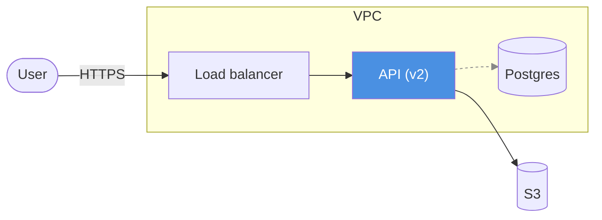

# Section 01: D2, Mermaid, PlantUML

Researched 2026-10-26. Every claim carries a URL. Statements marked "guess" are not verified.

Headline context that changes how to read this section: Terrastruct, the company behind D2, is shutting down. On 2026-09-05 Alexander Wang announced D2 is now a non-profit project fiscally sponsored by Hack Club (https://d2lang.com/blog/d2-non-profit/). On 2026-09-07 the previously closed-source TALA layout engine was released under MPL-2.0 and bundled into D2 v0.9.0 (https://d2lang.com/blog/tala-is-open-source/, https://github.com/d2lang/d2/releases). The GitHub repo moved from `terrastruct/d2` to `d2lang/d2` (old URLs redirect). This means the best "architecture-aware" open layout engine in the text-to-diagram space is now readable Go source, and the project is maintained part-time by one person seeking volunteers.

---

## D2 (Terrastruct, now d2lang / Hack Club)

### 1. Language

D2 stands for "Declarative Diagramming" (https://d2lang.com/tour/intro). The FAQ states the design philosophy: "The syntax is kept minimal and unstructured to make small diagrams with as little lines as possible," with large diagrams supported through IDE-style features (autoformatter, error messages, comments) (https://d2lang.com/tour/faq/). The parser reports multiple errors from one broken program, and there is an official autoformatter (`d2 fmt`) and a planned LSP (https://github.com/d2lang/d2).

Syntax sample (reconstructed from the docs at https://d2lang.com/tour/containers/, https://d2lang.com/tour/classes/, https://d2lang.com/tour/vars/):

```d2
direction: right
vars: { primary: "#4A90E2" }
classes: { svc: { style.fill: ${primary}; shape: rectangle } }

aws: AWS {
  vpc: VPC {
    api: API Server { class: svc }
    db: Postgres { shape: cylinder }
    api -> db: reads
  }
  s3: S3 { shape: cylinder }
  vpc.api -> s3: uploads
}
user -> aws.vpc.api: HTTPS
aws.vpc.db -> _.user: never   # `_` refers to the parent scope
```

Key language features, each verified on the linked doc page:

- **Containers and nesting.** Any object with a map body is a container. Children are addressed by dot-notation (`aws.vpc.api`). `_` refers to the parent container when writing a connection from inside a container to something outside it (https://d2lang.com/tour/containers/). Limitation stated in the FAQ: "objects can't belong to more than one container" (https://d2lang.com/tour/faq/). Overlapping or cross-cutting containers (an auto-scaling group spanning availability zones) have been requested since Dec 2022 and remain unimplemented; the maintainer floated `constraint`, `encompass` and `groups` keywords but noted "Dagre and ELK couldn't reliably keep grouped nodes close together." The FAQ answer quoted in Jul 2026 is "Not currently and not in the near future" (https://github.com/terrastruct/d2/discussions/328).
- **Edges.** `->`, `<-`, `<->`, `--`. Edge labels after a colon. Connections are addressed by index for programmatic edits (https://d2lang.com/tour/api/).
- **Classes.** `classes` block defines reusable attribute sets; apply with `class: name` or an array for multiple classes (applied left to right, later wins). Object attributes override class attributes. Applied classes are emitted as SVG `class` attributes so you can target them with CSS/JS (https://d2lang.com/tour/classes/).
- **Vars and substitutions.** `vars` block, `${name}` substitution, nested via dots, lexical scoping (closest scope wins), single quotes disable substitution, `...${x}` spreads maps/arrays. `vars.d2-config` holds per-file config (`theme-id`, `pad`, `layout-engine`, `tala-seeds`), but CLI flags and env vars take precedence (https://d2lang.com/tour/vars/, https://github.com/d2lang/d2/releases).
- **Imports.** `@file` imports a file as a map value; `...@file` spreads it into the enclosing map (only legal inside maps); `@file.key` imports one object; paths resolve relative to the importing file; only `.d2` files (https://d2lang.com/tour/imports/).
- **Multi-board composition.** Three keywords with different inheritance rules: `layers` (no inheritance, each is a fresh base), `scenarios` (inherit from the base board), `steps` (each inherits from the previous step). "Boards can't be visible at the same time, so exports must handle these more dynamic diagrams" (https://d2lang.com/tour/composition/). Objects can `link` to other boards for drill-down navigation (guess: the linking page exists in the sidebar as "Linking between boards"; I did not fetch it).
- **Grid diagrams.** `grid-rows` and/or `grid-columns` on a container; the first declared keyword is the dominant fill direction; `grid-gap`, `vertical-gap`, `horizontal-gap`; grids, sequence diagrams, and normal diagrams all nest inside grid cells. Cells in a column share width and cells in a row share height, so one long label pads the whole column (https://d2lang.com/tour/grid-diagrams/).
- **Sequence diagrams.** `shape: sequence_diagram` on a container. Unlike the rest of D2, declaration order matters (actors appear in defined order). Spans (activation bars) are nested objects on an actor that have connections; notes are nested objects without connections; groups (fragments) are containers inside the sequence diagram that hold connections. Actors used inside a group must be declared at top level first (https://d2lang.com/tour/sequence-diagrams/).
- **sql_table.** `shape: sql_table`; each key is a column, the primary value is the type, the constraint value is `primary_key`/`foreign_key`/`unique` (rendered PK/FK/UNQ) or any string. Foreign-key edges target exact rows "with the TALA or ELK layout engine" (https://d2lang.com/tour/sql-tables/).
- **Positioning hooks.** `near` with a constant (`top-left`, `center-right`, etc.) works everywhere. `near` set to another object's absolute ID "Works in TALA only". `top`/`left` absolute coordinates (both required together) are TALA only (https://d2lang.com/tour/positions/).
- **direction.** `direction: up|down|right|left` globally on all engines; per-container `direction` is TALA only, because "the other engines' hierarchical algorithms work in only one direction" (https://d2lang.com/tour/layouts).
- **Other.** Tooltips (HTML title text, so no Markdown), links to URLs (`#` must be escaped), icons from any URL, Markdown/LaTeX/code labels (edges too since 0.7.1), `cross` arrowhead, `--sketch` hand-drawn mode, legends (https://d2lang.com/tour/interactive/, https://d2lang.com/tour/sketch/, https://github.com/d2lang/d2/releases).

### 2. Layout

D2 ships three engines, selectable with `--layout`, `D2_LAYOUT`, or `vars.d2-config.layout-engine`. `d2 layout` lists engines, `d2 layout <engine>` lists that engine's flags (https://d2lang.com/tour/layouts).

**dagre (default).** Layered/hierarchical, "based on Graphviz's DOT algorithm". As of v0.8.2 the embedded JavaScript dagre 0.8.5 was replaced by a native Go port called "Dagro" that tracks dagre 3.1.1 behaviour, with a stated 7 to 9x median speedup; the release warns this "intentionally changes node ordering, coordinates, edge routes, self-loops, and compound sizing" (https://github.com/d2lang/d2/releases). D2's own docs list dagre's cons bluntly (https://d2lang.com/tour/dagre/):
- "Unmaintained. Development stopped in 2018."
- "Makes some inexplicable edge routing decisions occasionally" (links dagrejs/dagre#256, "Some strange layout decisions", open since Dec 2018: https://github.com/dagrejs/dagre/issues/256).
- "The layout is strictly hierarchical, even when the diagram isn't."
- "Container-to-container (or container-to-container-child) connections aren't natively supported. D2 adds a shim, but some core algorithm considerations are missed."
- "Multi-segment edges are curved rather than orthogonal, which can produce unattractive squiggly lines."

**ELK.** As of v0.8.2 the embedded ELK.js 0.8.2 was replaced by native Go `elk-go` with an "ELK.js 0.12.0 profile" (40 to 53x median speedup); DisCo was removed; ELK now routes ancestor-to-descendant connections around intermediate containers (https://github.com/d2lang/d2/releases). Exposed algorithms via `--elk-algorithm`: `layered` (default), `force`, `stress`, `mrtree`, `radial`. D2's stated pros: clean orthogonal routes, good crossing minimisation, "handles container-to-container routing natively, better than dagre", routes to exact SQL table rows. Cons: "Strictly hierarchical, like dagre", "Some routes have unnecessary bends", "Minimal consideration for symmetry" (https://d2lang.com/tour/elk/). The docs do not enumerate individual ELK layered options (nodeNodeBetweenLayers, padding, etc.); the user is told to run `d2 layout elk`.

**TALA ("Terrastruct's AutoLayout Algorithm").** Now MPL-2.0 and bundled since v0.9.0 (`--layout=tala`); runs client-side in the Playground and in the WASM build (https://d2lang.com/blog/tala-is-open-source/, https://github.com/d2lang/d2/blob/master/d2js/js/README.md). What makes it different, from the primary sources:
- "primarily an orthogonal layout engine", closer to "whiteboard" diagrams than the DAG-based layouts of dagre and ELK. "It is not limited to hierarchical, tree, or radial layouts" (https://d2lang.com/tour/tala/, https://d2lang.com/blog/tala-is-open-source/).
- It optimises several aesthetic objectives at once: "symmetry, median distance, flow, and clustering of like nodes", blending ideas from cited graph-drawing papers with original techniques (https://d2lang.com/blog/tala-is-open-source/).
- It runs 3 seeds by default and keeps the best-scoring layout; `--tala-seeds` / `D2_TALA_SEEDS` controls the count. Output is deterministic for the same seeds and input, but "adding one node can change the whole layout, unlike Dagre and ELK" (https://d2lang.com/blog/tala-is-open-source/, https://github.com/d2lang/d2/releases).
- Containers are "first-class"; `direction` per container; `near` another object; `top`/`left` locking with the engine still routing edges; partial positioning where pinned nodes keep coordinates and the rest are placed automatically. Labels are moved dynamically to avoid obstructions. Edges between grid cells use TALA's router instead of straight lines (https://d2lang.com/tour/tala/, https://d2lang.com/tour/grid-diagrams/).
- Explicitly tied to agents: "agentic use cases benefit from locked coordinates, since models can place nodes in 2D space but still struggle with routing" (https://d2lang.com/blog/tala-is-open-source/).
- Stated weaknesses: "It handles DAGs less well than Dagre or ELK" and "Runtime scales nonlinearly with diagram size" (https://d2lang.com/blog/tala-is-open-source/).
- Ports: the FAQ says "ports can't be specified yet" for any engine (https://d2lang.com/tour/faq/). The architecture-style "port" that TALA has is limited to sql_table rows.

Feature support matrix straight from the docs (https://d2lang.com/tour/layouts):

| Feature | dagre | ELK | TALA |
|---|---|---|---|
| `near` constant | yes | yes | yes |
| `near` another object | no | no | yes |
| `width`/`height` on containers | no | yes | yes |
| `top`/`left` locking | no | no | yes |
| per-container `direction` | no | no | yes |
| ancestor-to-descendant edge | shim | routed around containers since 0.8.2 | yes |

Grid edge routing: under dagre and ELK, connections between grid cells "are straight center-to-center segments with no path-finding"; the maintainer closed d2lang/d2#2635 ("Grid-Rows / Grid-Columns Breaks Nested Connections ... Overlapping Lines") as "not planned" because this is expected (https://github.com/terrastruct/d2/issues/2635, https://github.com/terrastruct/d2/issues/1145).

Engines are not pluggable in the sense of a stable API; D2 writes "shims" for dagre and ELK and says full support "would require forking them, which the team may eventually do" (https://d2lang.com/tour/layouts). The 0.8.2 move to native Go ports was effectively that fork.

### 3. Interactivity

Output is SVG (default), PNG, PDF, PPTX, GIF, ASCII (`.txt`, ELK/TALA only). SVG is "the most interactive format": links clickable, tooltips on hover (object shows an icon), `class` attributes for CSS/JS targeting. PDF keeps links but not animation; PNG numbers tooltips into an appendix (https://d2lang.com/tour/exports/, https://d2lang.com/tour/interactive/). Multi-board compositions export as an animated SVG with `--animate-interval` (the JS API exposes `animateInterval` and requires it to be > 0 to render multiple boards), or as paged PDF/PPTX, or GIF (https://github.com/d2lang/d2/blob/master/d2js/js/README.md, https://d2lang.com/tour/exports/). There is no built-in collapse/expand of containers or client-side perspective switching; views are separate boards. `--watch` live-reloads a browser preview; `--target` selects a board (https://github.com/d2lang/d2).

Tooling: official playground https://play.d2lang.com (source d2lang/d2-playground), official VS Code extension https://github.com/d2lang/d2-vscode, Vim plugin, Obsidian plugin. D2 Studio (the former paid IDE, "purely client-side, usable completely offline") is promised to be open-sourced (https://d2lang.com/blog/d2-non-profit/). Kroki renders D2 but SVG only (https://kroki.io/). GitHub does not natively render D2 (https://text-to-diagram.com/ lists "native GitHub rendering" as a feature row).

### 4. Agent / LLM friendliness

- **Programmatic API.** `d2oracle` (Go) provides pure AST-level `Create`, `Set`, `Delete`, `Rename`, `Move` plus `MoveIDDeltas`/`DeleteIDDeltas`/`RenameIDDeltas` for tracking ID changes; it auto-creates missing parent containers and renumbers colliding IDs (https://d2lang.com/tour/api/). `d2lib` compiles and renders. This is the strongest "edit a diagram as a structure, not as text" API among the three tools.
- **JS/WASM.** `@d2lang/d2` (alias `@terrastruct/d2`) runs in browser and Node via a web worker; `compile()` accepts `layout: 'dagre' | 'elk' | 'tala'`, `render()` returns SVG with `sketch`, `themeID`, `pad`, `animateInterval`, etc. (https://github.com/d2lang/d2/blob/master/d2js/js/README.md).
- **Validation.** `d2 --check` validates without rendering; errors include line and position and the parser reports multiple errors per run (https://github.com/d2lang/d2, https://lobehub.com/skills/svetlovtech-skills_and_agents-d2-diagrams).
- **MCP servers (all community).** h0rv/d2-mcp (Go, validate/compile without rendering, embedded cheat sheet), itsjool/d2-mcp (WASM, ships a "D2 agent skill" teaching LLMs the syntax), RecursiveFunctions/d2mcp and i2y/d2mcp (Go, incremental diagram building via d2oracle) (https://deepwiki.com/h0rv/d2-mcp, https://lobehub.com/mcp/itsjool-d2-mcp, https://github.com/i2y/d2mcp). The maintainer's stated non-goals for D2 core include "LLM integration in the diagramming tool" and "server-dependent features such as MCP, an API" but the goal list includes "serving as a strong harness for agents" and "a stable 1.0 with a formalized grammar" (https://d2lang.com/blog/d2-non-profit/).
- **LLM error rate.** I found no quantitative study of D2 validity. Indirect evidence: a Pintora author reports Gemini 3 Pro and Claude Sonnet 4.5 "generated a lot of syntactically incorrect code" for a niche language and names D2 alongside it (https://www.huy.rocks/everyday/12-01-2025-ai-teaching-an-llm-a-niche-diagraming-language); a community skill lists the common LLM mistakes as "undefined shape referenced in connection, invalid shape type, syntax errors (missing colons, brackets), and invalid property names" (https://lobehub.com/skills/svetlovtech-skills_and_agents-d2-diagrams). Guess: D2 is roughly 10x less represented in training data than Mermaid, so first-shot validity is lower, but the error messages are good enough for a fix loop.
- **Determinism.** dagre and ELK are deterministic. TALA is deterministic per seed but layout-unstable under small edits (https://d2lang.com/blog/tala-is-open-source/).
- **Position hints for agents.** TALA's `top`/`left` partial pinning is explicitly pitched as the agent story: the model places, the engine routes (https://d2lang.com/blog/tala-is-open-source/).

### 5. What it does well

- Terse syntax, no begin/end wrappers, nested containers are natural, `_` parent reference keeps cross-boundary edges readable.
- The only one of the three with a non-hierarchical, container-aware, symmetry-seeking orthogonal engine (TALA), now open source.
- Layers/scenarios/steps is a real multi-view model with inheritance, which maps onto "perspectives".
- Grid layouts give deterministic table/matrix structure for things auto-layout does badly.
- Sequence diagrams, sql_table with row-level edges, Markdown/LaTeX labels, icons, sketch mode, themes.
- d2oracle AST editing and ID-delta tracking.
- Native Go, no JS runtime, fast after 0.8.2/0.9.0 (SVG rendering "about 10x faster") (https://github.com/d2lang/d2/releases).

### 6. Where it fails and why

- **Default engine is the weakest.** dagre is the default; it is unmaintained upstream, strictly hierarchical, curves multi-segment edges, and needs a shim for any container-to-container edge (https://d2lang.com/tour/dagre/). Most D2 output people see online is dagre output, which is why D2 diagrams often still look like "hierarchy graphs".
- **Container labels overlap.** d2lang/d2#1812 "Container labels don't respect margins in Dagre and TALA" (open since Jan 2024): labels "cross the shape outline and overlap with other objects" (https://github.com/terrastruct/d2/issues/1812).
- **Grid plus edges.** No routing between grid cells on dagre/ELK; straight centre-to-centre lines cross everything (https://github.com/terrastruct/d2/issues/2635, https://github.com/terrastruct/d2/issues/1145).
- **No overlapping/cross-cutting containers**, which cloud diagrams need (AZ x ASG) (https://github.com/terrastruct/d2/discussions/328).
- **No ports** on shapes (https://d2lang.com/tour/faq/).
- **TALA instability and scaling.** One extra node can reflow the whole diagram; nonlinear runtime (https://d2lang.com/blog/tala-is-open-source/).
- **Not built for scale.** "D2 is not designed for big data" and is not tested on thousands of nodes (https://d2lang.com/tour/faq/).
- **Multiple views are static exports.** No in-SVG collapse/expand or perspective switcher; you get one SVG per board or an animated SVG.
- **Engine shim gaps.** Per-container direction, `near` object, `top`/`left`, container sizing: all absent on dagre and partly on ELK (https://d2lang.com/tour/layouts).
- **Governance risk.** Single part-time maintainer, company gone, "All contributions will be AI-driven, and AI will be used for review" (https://d2lang.com/blog/d2-non-profit/).

### 7. License and maturity

- License: MPL-2.0 for D2 and, since 2026-09-07, for TALA (https://github.com/d2lang/d2, https://d2lang.com/blog/tala-is-open-source/).
- Stars: 25.7k (https://github.com/d2lang/d2, fetched 2026-10-26).
- Releases: v0.7.1 (19 Aug 2026), v0.8.2 (28 Aug 2026), v0.9.0 (7 Sep 2026) (https://github.com/d2lang/d2/releases). First release 2022 (https://text-to-diagram.com/).
- Maintainers: Alexander Wang, part time, under Hack Club fiscal sponsorship, soliciting paid contributors funded by donations (https://d2lang.com/blog/d2-non-profit/).
- Written in Go; outputs SVG/PNG/PDF/PPTX/GIF/ASCII; no telemetry (https://github.com/d2lang/d2).

### 8. Ideas to steal

- Layers/scenarios/steps as three inheritance modes for boards; this is the cleanest text model of "perspectives" found.
- `_` parent reference and dotted absolute IDs for cross-container edges.
- TALA's objective mix (symmetry, median distance, flow, clustering) and its "pin some, route the rest" contract for agents. The code is now MPL-2.0 Go; read `d2layouts` in https://github.com/d2lang/d2.
- `classes` emitted as SVG class attributes for styling and scripting.
- Multi-error parser plus `--check` as the agent fix loop.
- d2oracle-style structural edit API with ID-delta maps.
- Running N seeds and scoring layouts aesthetically, then keeping the best.
- Grid containers for things that should never be auto-laid-out (tables, matrices, steps).

---

## Mermaid (mermaid.js.org)

### 1. Language

Mermaid is a JavaScript library with "20+ diagram types": flowchart, sequence, class, state, ER, Gantt, pie, git graph, mindmap, timeline, sankey, C4, user journey, block, architecture, use case (new in v12), and more (https://github.com/mermaid-js/mermaid). Each diagram type has its own grammar; there is no shared object model across families.

Flowchart sample (https://mermaid.js.org/syntax/flowchart.html):



- **Containers.** `subgraph id [Title] ... end`. Edges to and from a subgraph as a whole are allowed. A `direction` inside a subgraph applies only if no node inside links outside: "if any subgraph node links to the outside, the subgraph inherits the parent's direction" (https://mermaid.js.org/syntax/flowchart.html). Collapsible subgraphs arrived in v11.17.0 via `id@{ view: collapsed }` (crossing edges re-target the collapsed node) (same page).
- **Styling.** `classDef`, `class`, `style`, `linkStyle N` (by edge definition order, so inserting an edge renumbers every later style), `:::class` shorthand.
- **Special characters.** Node labels containing `(`, `)`, `[`, `{`, `|` must be quoted; `#` must be written `#35;`; a lowercase node text `end` breaks the chart; node IDs starting with `o` or `x` can create circle/cross edge types (https://mermaid.js.org/syntax/flowchart.html).
- **architecture-beta** (v11.1.0+): `group id(icon)[Title] in parent`, `service id(icon)[Title] in group`, `junction id`, edges with explicit ports `db:R --> L:server`, `{group}` modifier to attach an edge to a group boundary, `align row|column` directives (v11.16.0+), Iconify icon packs. Layout is cytoscape fcose (force-directed) with knobs `nodeSeparation`, `idealEdgeLengthMultiplier`, `edgeElasticity`, `numIter`, `seed`; "randomize: false does not guarantee identical renders" and "Layout knobs cannot separate siblings that overlap because of the layout heuristic (tracked in issue #6120)" (https://mermaid.js.org/syntax/architecture.html).
- **block-beta.** Explicit grid: `columns N`, `block:id:width`, `space`, `space:n`, nested composite blocks. The docs position it against flowcharts: "Flowcharts use automatic layout, which can move shapes to positions the author didn't intend. Block diagrams instead give the author full control" (https://mermaid.js.org/syntax/block.html).
- **C4 (experimental).** C4Context/Container/Component/Dynamic/Deployment with C4-PlantUML-compatible macros (`Person`, `System_Boundary`, `Rel_R`, ...). Layout "is not fully automatic. Shape positions follow the order of statements," `Lay_U/D/L/R` "are not planned", `UpdateLayoutConfig` sets shapes per row (default 4) and boundaries per row (default 2). No sprites, tags, links, legends (https://mermaid.js.org/syntax/c4.html).
- **mindmap** (indentation-based, cose-bilkent layout), **gitgraph**, **sequence** (participants, activations, `alt/opt/loop/par`, notes, autonumber), **class**, **state**.

### 2. Layout

- **Pre v12:** dagre-d3-es (a maintained ES fork of dagre-d3) for flowchart/class/state; ELK via the separate `@mermaid-js/layout-elk` package and `layout: elk` in YAML frontmatter (older form `%%{init: {"flowchart": {"defaultRenderer": "elk"}}}%%`).
- **v12.0.0 (released roughly Sept 2026, "one month ago" on the capture date):** ELK is bundled and is the default for flowchart, state, class, ER, requirement, and use case diagrams; `defaultRenderer` was removed (configs still setting it are silently ignored); `layout: dagre` restores the old engine; variants `elk.stress`, `elk.force`, `elk.mrtree`, `elk.sporeOverlap`, `elk.box`, `elk.rectpacking` and `elk.radial`; per-subgraph algorithm via `@{ algorithm: ... }`; the tiny build omits ELK and falls back to dagre; new default theme `redux-color` and look `neo` (https://newreleases.io/project/github/mermaid-js/mermaid/release/mermaid@12.0.0, https://mermaid.js.org/config/layouts.html). Other layouts: `cose-bilkent` (force, mindmaps) and `tidy-tree` (https://mermaid.js.org/config/layouts.html).
- **ELK options exposed** (YAML `config: elk:`): `mergeEdges: true|false`, `nodePlacementStrategy: SIMPLE | NETWORK_SIMPLEX | LINEAR_SEGMENTS | BRANDES_KOEPF` (default BRANDES_KOEPF), `cycleBreakingStrategy: GREEDY | DEPTH_FIRST | INTERACTIVE | MODEL_ORDER | GREEDY_MODEL_ORDER`, plus `forceNodeModelOrder` and `considerModelOrder` (https://mermaid.js.org/config/schema-docs/config-properties-elk.html, https://mermaid.js.org/intro/syntax-reference.html).
- **Edge labels are placed after layout.** A reimplementation project describing Mermaid's pipeline: labels are "placed at the segment midpoint, so it overlaps nodes and other labels and falls outside the viewBox", and layout reserves no room for them in flowchart, state, class and ER diagrams (https://github.com/jjbaumert/OgreNotes/issues/274; third-party but consistent with the many overlap reports below).
- **Manual hooks:** `~~~` invisible links (users report they have no visible placement effect: https://gitlab.com/gitlab-org/gitlab/-/issues/554190), `linkStyle`, subgraph `direction`, and the block-beta grid as the escape hatch. No coordinates, no ports (outside architecture-beta), no `near`.

### 3. Interactivity

Rendered SVG supports `click` callbacks and links, tooltips, and (v11.17+) collapsible subgraphs. Rendering happens in the browser, which is why GitHub, GitLab, Notion, Obsidian, Confluence, Jira, VS Code, draw.io and most Markdown tools embed it; the official Live Editor is https://mermaid.live. No multi-view model: a "perspective" is a separate code block. Mermaid Chart (commercial, now at https://mermaid.ai) adds a hosted editor, a shared canvas, AI generation from text, uploaded docs, or transcripts, an AI chat that keeps context, plugins for VS Code, JetBrains, Cursor, Claude, ChatGPT, GitHub Copilot, Google Docs, Jira and Confluence, a free Basic tier, paid tiers with more AI credits, and Enterprise with SSO. It states it has an MCP server (remote HTTP) that lets "Claude, VS Code, and Cursor ... generate, validate, and render diagrams" (https://mermaid.ai/, https://mcp.directory/publishers/mermaid-chart).

### 4. Agent / LLM friendliness

- **Training-data ubiquity.** Mermaid is what LLMs emit by default. GitHub renders it natively in Markdown.
- **Known failure modes** (consistent across many reports): unquoted parentheses or brackets inside `[...]` labels (`D[Core Service (Business Logic)]`) parse-fail; lowercase `end`; IDs beginning with `o`/`x`; `1. ` inside quoted labels misread as a list in some hosts; invented keywords (`actor` inside `graph TD`); semicolons in sequence messages (https://github.com/AsRanjan007/SDLC_Agents/pull/6, https://github.com/jregeimbal/homelab/pull/86, https://github.com/logancyang/obsidian-copilot/issues/3769, https://github.com/Kilo-Org/kilocode/issues/1675, https://github.com/awesome-skills/mermaid-syntax-skill). An ecosystem of fixers exists because of this: lvy010/mermaid-validator ("Ensure 100% correct Mermaid syntax from LLM outputs"), mermaidfix.com, the Claude Code "mermaid-syntax-skill". GenAIScript reports that "in most cases, the LLM is able to fix the syntax error and generate a valid diagram using the error message" (https://microsoft.github.io/genaiscript/blog/mermaids/).
- **MCP.** Official Mermaid Chart MCP (hosted) plus community hustcc/mcp-mermaid (validate, png/svg) and others (https://mcpservers.org/servers/hustcc/mcp-mermaid).
- **Validation.** `mermaid.parse()` in JS; no CLI `--check` equivalent without `@mermaid-js/mermaid-cli` and a headless browser.
- **Determinism.** dagre and ELK are deterministic; architecture-beta (fcose) needs `seed` for reproducibility (https://mermaid.js.org/syntax/architecture.html).
- **Layout instability across versions** is the agent-relevant risk: v11.16.0 changed subgraph direction handling and clipped incoming edges, v11.17.0 reverted part of it, v12 changed default engine and theme (https://github.com/mermaid-js/mermaid/issues/8066, https://github.com/mermaid-js/mermaid/issues/2509).

### 5. What it does well

- Everywhere: native rendering in GitHub, GitLab, Notion, Obsidian, Confluence, VS Code, draw.io.
- Best LLM recall of any diagram language.
- Sequence diagrams and gitgraph are solid; mindmap and timeline are quick wins.
- v12 ELK default with per-subgraph algorithms and `mergeEdges` is a real improvement over dagre; draw.io and GitLab adopted ELK rendering (https://www.drawio.com/blog/mermaid-elk-layout/, https://gitlab.com/gitlab-org/gitlab/-/merge_requests/242816).
- block-beta and architecture-beta `align` show the project knows auto-layout is not enough.

### 6. Where it fails and why

- **Subgraph direction is ignored whenever an edge crosses the boundary.** Maintainer knsv in Dec 2021: "the direction only works when the subgraph is 'isolated'." Issue #2509 (56 and 39 reaction comments) was closed in Jul 2026, but the fix shipped in 11.16.0 "broke cross-subgraph links, so it was reverted in 11.17.0" and a user reported in Sep 2026 the original example still fails (https://github.com/mermaid-js/mermaid/issues/2509). Duplicates: #6438 (maintainer: "the global layout is inherited during recursive layout and overrides the subgraph's own direction", and "no warning is shown"), #8066 (open, "every edge coming into that subgraph from outside stops at the subgraph border"), #6785, #6428, #4159, #3096 (https://github.com/mermaid-js/mermaid/issues/6438, https://github.com/mermaid-js/mermaid/issues/8066). Root cause: Mermaid lays out each subgraph recursively as a separate graph then nests the result; dagre has no compound-graph direction concept, so any cross-boundary edge forces the parent's rank direction.
- **Edge labels collide with nodes and each other** because layout does not reserve space for them; labels are dropped onto path midpoints after layout (https://github.com/jjbaumert/OgreNotes/issues/274, https://github.com/zkrebbekx/go-mermaid/issues/46, https://github.com/warpdotdev/warp/issues/10182).
- **Edges to a subgraph as a whole and edges to its members produce different layouts**, and `~~~` invisible links do not move subgraphs (https://gitlab.com/gitlab-org/gitlab/-/issues/554190).
- **Edge bundling at subgraph borders** after version changes: "several edges get bundled together where they cross a subgraph border" (Sep 2026, https://claudeissues.com/issue/92892-artifact-live-mermaid-renderer-pinned-to-11-16-1-lays-out-complex-flowcharts-inc).
- **Self-loops look awkward** (mermaid#6336 via https://forum.obsidian.md/t/mermaid-self-looping-in-diagrams-looking-weird/117077).
- **Node order follows statement order and rank**, not meaning; there is no `near`, no pinning, no per-node hints. The only remedies are `linkStyle` cosmetics, reordering source lines, and invisible edges, all of which are brittle.
- **architecture-beta uses a force layout**, so siblings overlap (#6120) and renders differ between runs unless seeded (https://mermaid.js.org/syntax/architecture.html).
- **C4 is a fixed row packer**, not a layout engine: positions follow statement order and "shapes per row" (https://mermaid.js.org/syntax/c4.html).
- **Parser fragility** with punctuation inside labels (section 4).
- **Breaking visual changes between minors** (11.16, 11.17, 12.0) make stored diagrams drift.
- Scale: a secondary source claims Mermaid's layout "collapses after about fifteen nodes" (opinion, https://www.besthub.dev/articles/why-d2-s-24k-star-open-source-diagram-language-beats-plantuml-and-mermaid-23470d5d142b).

### 7. License and maturity

- License: MIT (https://github.com/mermaid-js/mermaid).
- Stars: 90.9k (fetched 2026-10-26).
- Latest major: 12.0.0, with 12.1.0 published on npm (https://app.unpkg.com/mermaid@12.1.0/files/dist/rendering-util/layout-algorithms/elk/render.d.ts). Requires ES2024, Safari 17.4+, Node 22.12+ (https://newreleases.io/project/github/mermaid-js/mermaid/release/mermaid@12.0.0).
- Maintainers: Knut Sveidqvist (knsv) and the Mermaid Chart company; frequent releases.
- ELK itself is EPL-2.0 (Eclipse); Mermaid bundles the elkjs build.

### 8. Ideas to steal

- Being renderable inside Markdown hosts is the distribution story; design the new language so a Markdown fence can carry it, or ship a Mermaid export.
- block-beta's explicit `columns`/`space` grid and architecture-beta's `align row|column` and port syntax (`db:R --> L:server`) are the manual hooks users reach for.
- Collapsible subgraphs (`@{ view: collapsed }`) with edge re-targeting is the right semantics for collapse.
- Per-container layout algorithm selection (`@{ algorithm: elk.stress }`).
- The failure list above is a checklist of what a compound-graph layout must handle: cross-boundary edges without losing child direction, label space reservation, stable incremental layout.

---

## PlantUML

### 1. Language

PlantUML is Java, started 2009, and covers sequence, usecase, class, object, activity, component, deployment, state, timing, ER, Gantt, mindmap, WBS, JSON/YAML, network (nwdiag), wireframe (salt), ArchiMate, and more (https://plantuml.com/, https://text-to-diagram.com/). Every diagram sits between `@startuml` and `@enduml`. The preprocessor supports `!include` (including URLs), `!define`, `!procedure`, `!function`, `!pragma`, variables, and conditionals, which is what makes the C4-PlantUML macro library possible.

Deployment/component sample (https://plantuml.com/deployment-diagram, https://plantuml.com/class-diagram):

```plantuml
@startuml
left to right direction
skinparam linetype ortho
cloud "AWS" {
  node "VPC" as vpc {
    component "API Server" as api
    database "Postgres" as db
  }
  storage "S3" as s3
}
actor User
User -> api : HTTPS
api --> db : reads
api -right-> s3 : uploads
api -[hidden]down- s3
together { api db }
@enduml
```

- **Nesting.** Nestable elements: action, artifact, card, cloud, component, database, file, folder, frame, hexagon, node, package, process, queue, rectangle, stack, storage; braces nest arbitrarily (https://plantuml.com/deployment-diagram).
- **Edges.** `-->`, `..>`, `==>`, `~~>`, with inline `-[bold]->`, `-[dashed]->`, `-[#red,thickness=2]->`, and the layout-affecting `-[hidden]->`. Direction hints are embedded in the arrow: `-left->`, `-d->`, `-up->`; the docs say "Graphviz usually lays out diagrams well without them" but every real diagram ends up using them (https://plantuml.com/class-diagram).
- **Layout keywords.** `left to right direction` (whole diagram), `together { }` ("place them together, as if they were in the same package"), hidden links, `skinparam nodesep`/`ranksep`, `skinparam linetype ortho|polyline` (https://plantuml.com/class-diagram, https://forum.plantuml.net/15405/broken-class-diagram-when-linetype-set-to-ortho).
- **Styling.** `skinparam`, `<style>` CSS-like blocks, stereotypes, sprites, themes.
- **C4-PlantUML** (plantuml-stdlib, MIT, 7.4k stars) defines `Person`, `Person_Ext`, `System`, `SystemDb`, `SystemQueue`, `System_Ext`, `Container`, `ContainerDb`, `ContainerQueue`, `Component`, `Enterprise_Boundary`, `System_Boundary`, `Container_Boundary`, `Boundary`, `Rel`, `Rel_U/D/L/R`, `BiRel`, `Lay_U/D/L/R`, `Lay_Distance`, `LAYOUT_TOP_DOWN()`, `LAYOUT_LEFT_RIGHT()`, `LAYOUT_LANDSCAPE()`, `LAYOUT_WITH_LEGEND()`, `SHOW_LEGEND()`, `SHOW_FLOATING_LEGEND()`, `LAYOUT_AS_SKETCH()`, `HIDE_STEREOTYPE()`, `AddElementTag`/`AddRelTag`, plus deployment nodes and dynamic diagrams (https://github.com/plantuml-stdlib/C4-PlantUML).

### 2. Layout

- **Graphviz dot is the engine** for usecase, class, object, component, deployment, state, and legacy activity diagrams; PlantUML spawns `dot` per diagram and reads back SVG. Tested Graphviz versions 2.26.3 to 2.44, 9.0.0, 10.0.1; 2.39 to 2.42 "do not work very well" (https://plantuml.com/faq, https://plantuml.com/smetana02). Sequence, timing, Gantt, salt, mindmap/WBS and new-style activity diagrams use PlantUML's own placement code (teoz/classic), which is why sequence diagrams are reliable (https://plantuml.com/sequence-diagram).
- **Smetana** is a C-to-Java port of Graphviz/dot built into plantuml.jar; enable with `!pragma layout smetana` or `-Playout=smetana`. It removes the external process dependency. It orders nested vs simple elements differently from Graphviz ("Graphviz: nested element first, then simple element. Smetana: simple element first, then nested") (https://plantuml.com/smetana02, https://plantuml.com/deployment-diagram). `skinparam linetype ortho` silently does nothing on Smetana (https://mohammed-brueckner.com/plantuml-how-to/skinparam/).
- **ELK** via `!pragma layout elk` or `-Playout=elk`, bundled since V1.2024.6, officially "really an alpha-version", recommended for testing class and deployment diagrams, and maintainers are "collecting user feedback on whether to continue supporting ELK" (https://plantuml.com/elk). A forum answer notes "ELK doesn't respect positional hints" (https://forum.plantuml.net/15405/broken-class-diagram-when-linetype-set-to-ortho).
- **Algorithm family.** dot is the Sugiyama layered method (rank assignment by network simplex, ordering by median/transposition heuristics, coordinate assignment, spline routing). Clusters (nested elements) become Graphviz `subgraph cluster_*`, which dot handles as a compound graph but with known weaknesses: cluster edges are routed via `compound=true` lhead/ltail tricks, ranks are global across clusters, and there is no per-cluster rankdir.
- **Manual positioning hooks.** None absolute. Direction hints on arrows, hidden arrows, `together`, `nodesep`/`ranksep`, and ordering of declarations. A forum user concluded PlantUML "doesn't allow explicit node positions or per-node widths" (https://forum.plantuml.net/16836/how-to-produce-this-simple-dot-graph-graphviz-with-plantuml?show=16867). C4-PlantUML's `Lay_*` macros are hidden links under the hood (guess based on the forum and blog descriptions; the LayoutOptions page only says "the layout is determined by Graphviz": https://github.com/plantuml-stdlib/C4-PlantUML/blob/master/LayoutOptions.md, https://blog.mrhaki.com/2017/10/plantuml-pleasantness-layout-elements.html).

### 3. Interactivity

Output is PNG, SVG, PDF, EPS, LaTeX, ASCII, and base64; SVG keeps `[[url]]` hyperlinks and tooltips. No multi-view model, no collapse/expand, no in-diagram navigation beyond links; `newpage` splits sequence diagrams into pages. Rendering is server-side (plantuml.jar, PlantUML Server, Kroki, which outputs png/svg/pdf/txt/base64 for PlantUML and C4) (https://kroki.io/). GitHub does not render PlantUML natively; the project ships a browser extension "PlantUML for GitHub" instead (https://plantuml.com/news). Editors: VS Code (community), IntelliJ, Confluence/Jira plugins.

### 4. Agent / LLM friendliness

- **Training data.** Second only to Mermaid; the syntax is older and heavily documented.
- **Validity evidence.** A UML-feedback study reports GPT-4 "did not produce a single syntax error after 36 generations" while other models made several (https://arxiv.org/pdf/2507.23470). A 29-LLM OO design benchmark found syntax errors in 6.69% of outputs versus semantic problems in 86.23% (https://arxiv.org/pdf/2601.07602). A multi-diagram study found "system context diagrams achieves the lowest mean validity (58.3%), mainly because of C4-style stereotypes and extended skinparam blocks" while component and deployment diagrams reached 100% (https://www.scitepress.org/publishedPapers/2025/135947/pdf/index.html). So plain PlantUML compiles reliably; C4-PlantUML macros are the risk.
- **Official MCP.** `@plantuml/mcp-js` (npm, 2026-06-09) is a local Node MCP server compiled with TeaVM so it needs no Java (https://plantuml.com/news). Community: antoinebou12/uml-mcp (via Kroki).
- **Validation.** `java -jar plantuml.jar -syntax` / `-checkonly`; error images carry the line. The PlantUML server returns error text.
- **Determinism.** dot is deterministic for identical input, but any added node can reshuffle everything (section 6). Smetana vs Graphviz vs ELK give different layouts for the same source; PNG and SVG exports can differ too (https://forum.plantuml.net/16903/different-layouts-exports-with-plantuml-graphviz-diagram?show=16903).
- **No structural API.** The preprocessor is text; there is no AST API comparable to d2oracle.

### 5. What it does well

- Sequence diagrams: the richest in the field (participants types, `++`/`--` activation shorthand, `alt/opt/loop/par/break/critical/group`, `autonumber`, `teoz` parallel messages, boxes, delays, `newpage`) and laid out by PlantUML's own engine, not dot (https://plantuml.com/sequence-diagram).
- Breadth: every UML type plus Gantt, mindmap, WBS, JSON, YAML, network, wireframes, ArchiMate, C4.
- Deployment and component elements with real icons (cloud, node, database, queue, storage) and arbitrary nesting.
- Preprocessor: includes from URLs, macros, procedures, themes; this enabled C4-PlantUML and Archimate libraries.
- Mature, stable, huge install base; Kroki and PlantUML Server make it a drop-in service; MCP server exists.

### 6. Where it fails and why

The failure story is the same across a decade of forum threads and issues: dot is a layered DAG algorithm with no notion of "architecture", and the only levers are hints that fight it.

- **Layout entangles as diagrams grow.** 2014 forum request for a FreezeLayout command: about seven classes "looked fine, but adding more items made the layout tangled"; the maintainers "agreed that Graphviz's instability, where new nodes can reshuffle everything, is frustrating" (https://forum.plantuml.net/2538/new-command-better-control-the-layout-class-state-diagrams).
- **"GraphViz is not good enough"** (2016, 22 votes): hidden arrows and hidden groups "are fragile tricks that waste more time than a visual tool would"; maintainers pointed at OGDF as a possible replacement (https://forum.plantuml.net/4842/graphviz-is-not-good-enough).
- **Hidden-link hacks break on the next real edge.** A class diagram arranged with hidden relations and groups broke when real relations were added (https://forum.plantuml.net/8965/proposed-way-to-define-fixed-layout-in-class-diagrams?show=8969). The `layli` author: "you add hidden connections (-[hidden]-> and play with the line lengths. All of a sudden you discover that your simple diagram becomes a mess of crossing lines and kludges" (https://dev.to/dnnrly/introducing-layli-31mn).
- **Grids are faked.** "Graphviz was designed for graphs, not grids"; PlantUML emulates grids with invisible links, which only works when the diagram has no real links (https://forum.plantuml.net/1291/grid-layout-for-nodes-in-a-package).
- **Orthogonal lines lose labels.** With `linetype ortho`, Graphviz cannot attach labels to ortho edges, so PlantUML emits floating xlabels you cannot position (https://github.com/Gamperle/PlantumlTricks). plantuml/plantuml#384 "Relation label hidden with linetype ortho and short relation" and #2326 "skinparam linetype ortho shows label overlapping elements" (open, Sep 2025; a contributor notes "this bug has been open since 2018") (https://github.com/plantuml/plantuml/issues/384, https://github.com/plantuml/plantuml/issues/2326).
- **C4-PlantUML admits unpredictability.** Its LayoutOptions page: automatic layout is "one of the biggest advantages" and "one of the biggest disadvantages"; practices are "based on trial and error - not a code review"; "do not trust the first rendering"; "Do not create an 'All enclosing' boundary, since relationship processing struggles with it"; `Lay_*` is "a last resort"; "Layout could be changed based on bugfix" (https://github.com/plantuml-stdlib/C4-PlantUML/blob/master/LayoutOptions.md, https://github.com/plantuml-stdlib/C4-PlantUML).
- **One global rank direction.** `left to right direction` applies to the whole diagram; nested clusters cannot flow differently.
- **No positions, no ports, no pinning.** Direction hints and hidden edges are the only vocabulary (https://forum.plantuml.net/16836/how-to-produce-this-simple-dot-graph-graphviz-with-plantuml?show=16867).
- **External process and Java.** Graphviz version sensitivity, `EmptySvgException`, 4096 px default size cap, JVM heap for big diagrams (https://plantuml.com/faq).
- **Alternative engines are not better.** Smetana reorders nested elements and ignores ortho; ELK is alpha and ignores positional hints (https://plantuml.com/elk, https://plantuml.com/smetana02).

### 7. License and maturity

- License: user's choice of GPL-3.0-or-later (full build, includes DITAA), LGPL-3.0, Apache-2.0, EPL, or MIT builds which "miss few features (DITAA for example)" (https://plantuml.com/faq, https://plantuml.com/license, https://github.com/plantuml/plantuml). Generated images are not covered by the license. Graphviz itself is EPL-1.0 and runs as a separate process.
- Stars: 13.4k for plantuml/plantuml, 7.4k for C4-PlantUML (fetched 2026-10-26).
- Releases: V1.2026.9 on 2026-10-17; monthly-ish cadence; V1.2026.6 added the MCP server (https://plantuml.com/news). First release 2009.
- Maintainer: Arnaud Roques (plantuml org) with a small collaborator group; active forum.

### 8. Ideas to steal

- Sequence-diagram feature set and the fact that it uses its own purpose-built layout rather than a general graph engine; purpose-built layouts per diagram family beat general engines.
- Element vocabulary with built-in icons for deployment (cloud, node, database, queue, storage) and nesting by braces.
- Preprocessor and include-from-URL as a library mechanism (C4-PlantUML, ArchiMate, AWS icon sets).
- `together { }` as a soft grouping constraint and `Lay_Distance` as a numeric spacing hint; useful ideas even if the implementation on dot is fragile.
- The C4-PlantUML "what not to do" list is a spec for a compound-graph engine: all-enclosing boundaries must work, directed hints must be rare, the first render must be trustworthy.

---

## Cross-tool summary for the new product

| | D2 | Mermaid | PlantUML |
|---|---|---|---|
| Engine family | dagre (Sugiyama), ELK layered, TALA (orthogonal, multi-objective, container-aware) | ELK layered (v12 default), dagre, fcose for architecture-beta | Graphviz dot (Sugiyama), Smetana port, ELK alpha |
| Per-container direction | TALA only | no (bug-ridden) | no |
| Pin positions | TALA `top`/`left` | no (block-beta grid only) | no |
| Ports | sql_table rows only | architecture-beta T/B/L/R | no |
| Multi-view | layers/scenarios/steps | none | none |
| Collapse | none | subgraph `view: collapsed` | none |
| Structural API | d2oracle (Go), d2js | `mermaid.parse` | none |
| LLM recall | lowest of the three | highest | high |
| License | MPL-2.0 | MIT | GPL/LGPL/Apache/EPL/MIT |
| Stars | 25.7k | 90.9k | 13.4k (+7.4k C4) |
| Risk | one part-time maintainer | breaking layout changes between minors | dot is the ceiling |

The common root cause of "terrible layouts" across all three is the same: every default engine is Sugiyama-layered. Rank assignment places nodes by graph distance, not by meaning; containers are bolted on as clusters; cross-boundary edges force a single global direction; labels are an afterthought. TALA is the only engine in this set that was designed for boxes-in-boxes architecture, and as of September 2026 its Go source is MPL-2.0 and readable.
