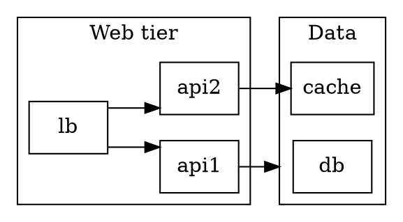

# 03. Layout engines and libraries

Scope: this section covers layout ENGINES, not end-user products. For each engine the subheadings are
adapted from the shared brief: 1. Model and API (what the input looks like), 2. Algorithm and layout
(phases, hierarchy, edge routing, constraints, determinism, performance), 3. Interactivity hooks
(incremental, pinning, from-sketch), 4. Agent friendliness (JS/WASM availability, option surface,
error behaviour), 5. Strengths, 6. Failure modes, 7. License and maturity, 8. Ideas to steal.

All versions, dates, sizes and star counts below were read on 2026-10-26 from the npm registry, the
GitHub API, and unpkg unless another source is cited. Numbers labelled "guess" were not verified.

Cross-cutting summary (details in each section):

| Engine | Family | Compound | Orthogonal edges | Author-controlled order | Browser build | SPDX |
|---|---|---|---|---|---|---|
| Graphviz dot | Sugiyama (Gansner 93) | clusters (recursive) | `splines=ortho`, no labels/ports | `ordering=out`, `rank=same`, `group` | `@hpcc-js/wasm-graphviz`, `@viz-js/viz` | EPL-2.0 |
| ELK layered | Sugiyama + ports | INCLUDE_CHILDREN or per-level | yes, default | model order strategies, partitions, layer constraints | `elkjs` (GWT, 1.6 MB) | EPL-2.0 OR GPL-3.0-or-later |
| dagre | Sugiyama | weak `compound: true` | no | none | native JS, 49 KB | MIT |
| yFiles | Sugiyama, TSM, organic, router | first class, recursive groups, tables | yes, with integrated labels | layer and sequence constraints, from-sketch | yFiles for HTML | commercial |
| Cytoscape.js | force (cose, fcose) + adapters | first class in the data model | `taxi` curve style only | fcose constraints | native JS, 436 KB | MIT |
| msagljs | Sugiyama, MDS, IPSepCola | subgraphs | rectilinear, bundling | none for Sugiyama | `@msagl/core` | MIT |

---

## Graphviz dot

### 1. Model and API

Input is the DOT language. Nodes, edges, attributes, and subgraphs. A subgraph whose name starts with
`cluster` is drawn as a box around its members ([clusterrank](https://graphviz.org/docs/attrs/clusterrank/)).
A representative architecture-style graph:



Attributes that matter for layout control (all from the official attribute reference):

- `rankdir` (TB, LR, BT, RL) sets flow direction ([dot layout page](https://graphviz.org/docs/layouts/dot/)).
- `rank=same|min|source|max|sink` on a subgraph pins nodes to one rank ([rank](https://graphviz.org/docs/attrs/rank/)).
- `constraint=false` on an edge: "If false, the edge is not used in ranking the nodes" ([constraint](https://graphviz.org/docs/attrs/constraint/)).
- `ordering=out|in`: outgoing edges appear left to right "in the same order in which they are defined in the input"; the graph attribute takes precedence over the node attribute, and the option is dot-only ([ordering](https://graphviz.org/docs/attrs/ordering/)).
- `group`: "Name for a group of nodes, for bundling edges avoiding crossings" ([group](https://graphviz.org/docs/attrs/group/)). The Graphviz forum explains that edges between nodes sharing a group value are made "more vertical" and crossings are avoided harder, but only for non-flat edges ([forum](https://forum.graphviz.org/t/how-to-align-nodes-using-a-group-attribute/1317)).
- `newrank=true`: "Whether to use a single global ranking, ignoring clusters." The original ranking is recursive on clusters, so a node "cannot be in a cluster and also be constrained by rank=same with a node not in the cluster"; newrank lifts that ([newrank](https://graphviz.org/docs/attrs/newrank/)).
- `nslimit`: "Sets number of iterations in network simplex applications"; used for x coordinates; "If defined, # iterations = nslimit * # nodes; otherwise, # iterations = INT_MAX" ([nslimit](https://graphviz.org/docs/attrs/nslimit/)).
- `compound=true` with `lhead`/`ltail` on an edge clips the edge at a cluster boundary: "If true, allow edges between clusters" ([compound](https://graphviz.org/docs/attrs/compound/)).
- `headport`/`tailport` accept a port name, a compass point (n, ne, e, se, s, sw, w, nw, c, `_`), or both; a port name that matches a compass name takes precedence ([portPos](https://graphviz.org/docs/attr-types/portPos/)).
- `concentrate=true`: "If true, use edge concentrators" ([concentrate](https://graphviz.org/docs/attrs/concentrate/)); it merges edges that share a head or tail, and older docs note it does not work for short edges because they have no virtual nodes to merge ([older reference](https://bazaar.launchpad.net/~ubuntu-branches/ubuntu/lucid/graphviz/lucid-security/revision/1/doc/Dot.ref)).
- `clusterrank=local|global|none`; `local` (default) lays each cluster out separately and inserts it as a unit; `global` and `none` turn cluster processing off ([clusterrank](https://graphviz.org/docs/attrs/clusterrank/)).

### 2. Algorithm and layout

dot implements Gansner, Koutsofios, North, and Vo, "A Technique for Drawing Directed Graphs", IEEE TSE
19(3), 1993 ([PDF](https://www.graphviz.org/documentation/TSE93.pdf)). The abstract, read from the PDF text:
"We describe a four-pass algorithm for drawing directed graphs. The first pass finds an optimal rank
assignment using a network simplex algorithm. The second pass sets the vertex order within ranks by an
iterative heuristic incorporating a novel weight function and local transpositions to reduce crossings.
The third pass finds optimal coordinates for nodes by constructing and ranking an auxiliary graph. The
fourth pass makes splines to draw edges."

Detail from the paper body:

- Rank assignment: network simplex over edge weight times length. Cycles are broken first by DFS, reversing back edges.
- Ordering: the paper argues the median beats the barycenter ("The median method consistently performs better than the barycenter method") and adds two innovations: an interpolated weighted median biased toward the side where vertices are more tightly packed, and a `transpose` pass that repeatedly swaps adjacent nodes when it reduces crossings. Iterations stop when crossings stop improving by a few percent. Flat edges (same-rank edges) are aimed left to right.
- Coordinates: the "priority method" (place nodes at the median of neighbours, in priority order) or, in the production implementation, a second network simplex on an auxiliary graph. The paper notes the auxiliary-graph method is exact but memory can become "a limitation" for large graphs.
- Splines: box-constrained spline routing around virtual-node boxes. The paper admits a "drawback is that the splines sometimes bend sharply to turn inside virtual node boxes or to avoid nearby" obstacles.

Hierarchy: clusters are laid out recursively and inserted as a unit (`clusterrank=local`). This is why
cross-cluster constraints historically did not work and why `newrank` exists. Edges to a cluster are faked
with `lhead`/`ltail` (the edge is really node to node, then clipped at the cluster box).

Edge routing: `splines=true` (default in dot) routes splines around nodes; `polyline`; `curved`;
`ortho` routes axis-aligned polylines, but "Currently, the routing does not handle ports or, in dot,
edge labels" ([splines](https://graphviz.org/docs/attrs/splines/)). dot prints "Warning: Orthogonal edges
do not currently handle edge labels" and suggests `xlabel` ([forum](https://forum.graphviz.org/t/better-edge-labels-on-ortho-edges/2425)).
A Graphviz maintainer (erg) called the missing ports, compass points and edge labels in ortho "a major
hole in the Graphviz code base", and another regular (steveroush) says ortho "fails miserably if ports
are specified", citing GitLab issue #1415 ([forum thread](https://forum.graphviz.org/t/regarding-graphvizs-orthogonal-edge-routing/1889)).

Edge labels are modelled as dummy nodes, which "guarantees adequate space for the labels, but for
complicated graphs, this can dramatically distort the layout" ([FAQ](https://graphviz.org/faq/)).

Pinning: `pin` and `pos` input are "neato, fdp only" ([pin](https://graphviz.org/docs/attrs/pin/),
[pos](https://graphviz.org/docs/attrs/pos/)). The forum answer is blunt: "dot does not allow pinning nodes"
([forum](https://forum.graphviz.org/t/how-to-pin-centrain-nodes-how-to-preserve-edges-between-graphs/1250/2)).
The one workaround is `dot | neato -n` to keep dot's node positions and re-route edges.

Determinism: dot is deterministic for identical input. Reordering input statements changes the result
because the ordering heuristic's initial order comes from input order.

Performance: C, fast for hundreds of nodes. `nslimit`, `nslimit1`, `mclimit`, `searchsize` are the knobs
when a large graph takes long ([dot attributes list](https://graphviz.org/docs/layouts/dot/)).

Other engines ([layouts page](https://graphviz.org/docs/layouts/)): `neato` (spring model, stress
majorization), `fdp` (force-directed), `sfdp` (multiscale force-directed for large graphs), `circo`
(circular), `twopi` (radial), `osage` ("draws clustered graphs" by packing), `patchwork` (squarified
treemap of a clustered graph), `nop` (pretty print). Only `osage` and `patchwork` treat clusters as the
primary structure. None of them are narrative; for architecture diagrams only dot and osage matter.

### 3. Interactivity hooks

None in the engine. Output is a static layout (`-Tjson`, `-Tsvg`, `-Tdot` with `pos`). Incremental or
mental-map-preserving layout does not exist for dot; neato `-n` and `pin` are the only partial-pin path.

### 4. Agent friendliness and browser builds

- `@hpcc-js/wasm-graphviz` 1.30.0 (2026-10-21), Apache-2.0, 2.08 MB unpacked, wraps Graphviz v16.1.0 per the repo README; API `Graphviz.load()` then `graphviz.dot(src)` ([repo](https://github.com/hpcc-systems/hpcc-js-wasm), 392 stars).
- `@viz-js/viz` 3.31.0 (2026-09-28), MIT, 4.99 MB unpacked, 4.4k stars; packages `viz`, `dot2svg`, `lang-dot` ([repo](https://github.com/mdaines/viz-js)).
- `d3-graphviz` 5.6.0 (2024-08-18), BSD-3-Clause, 1.8k stars, wraps `@hpcc-js/wasm` and adds animated transitions between DOT graphs and pan/zoom ([repo](https://github.com/magjac/d3-graphviz)). Last push 2025-02-08, so it is slow-moving.
- ELK also ships Graphviz wrappers (`org.eclipse.elk.graphviz.dot` etc.) that shell out to a binary ([ELK algorithms](https://eclipse.dev/elk/reference/algorithms.html)).

LLMs emit DOT fluently; it is the most common graph language in training data. The failure is not syntax,
it is that the author has almost no control over the result, so an agent cannot iterate toward a layout.

### 5. Strengths

- The reference Sugiyama implementation; 30 years of tuning. In an HN thread on Graphviz engines a commenter said for 50-plus node data-flow graphs "nothing else seems to produce layouts nearly as good as dot" ([HN](https://news.ycombinator.com/item?id=49707643)).
- Ranking with network simplex gives compact, balanced layers; `minlen`, `weight`, `constraint=false` give real control over rank.
- `ordering=out`, `group`, `rank=same`, `newrank` are enough to pin a narrative order when you know the trick.
- Many output formats, including `-Tjson` with full geometry, and WASM builds that run anywhere.

### 6. Failure modes

- Cannot pin positions in dot at all. Users resort to invisible nodes and edges to steer placement ([forum](https://forum.graphviz.org/t/graph-formatting-1-centralising-clusters-2-avoiding-edge-intersections/2274)).
- Clusters: a forum regular calls cluster placement "very difficult to adjust"; with `rankdir=LR` clusters stacked bottom-up and the only remedy offered was `packmode` ([forum](https://forum.graphviz.org/t/position-of-subgraphs-in-the-graph-dot/2516)). Clusters are laid out as islands, so edges between clusters often take long detours around the cluster box.
- Orthogonal routing is incompatible with edge labels and ports (see section 2), so "clean orthogonal with labels" is impossible in dot.
- Edge labels distort the whole layout because they are dummy nodes (FAQ).
- Layout is sensitive to input order; adding one node can rearrange the drawing.
- Spline edges bend sharply around virtual nodes (the paper itself says so). Long edges spanning many ranks become spaghetti.
- HN: "The syntax is pedantic and the resulting output is pretty ugly for all but the simplest graphs" (aezart); "none of the layout engine are very good, they essentially apply the same algorithm to all the things" (meh2frdf), who built their own engine for cloud architecture diagrams ([HN](https://news.ycombinator.com/item?id=49707643)).
- Splotch (the yFiles customer story) rejected Graphviz because "Its arrangement of nodes was hard to read" ([yWorks blog](https://www.yworks.com/blog/interactive-ai-generated-diagrams)).

### 7. License and maturity

- License: "Eclipse Public License - v 2.0" ([graphviz.org/license](https://graphviz.org/license/)). SPDX `EPL-2.0`. (The brief said EPL-1.0; the official page says 2.0.)
- Current engine version wrapped by hpcc-js: 16.1.0. Active, maintained by the Graphviz project (Magjac, Stephen North, et al.; GitLab issue tracker).
- Browser wrappers release monthly (hpcc 2026-10-21, viz 2026-09-28).

### 8. Ideas to steal

- `rank=same`, `rank=min/max`, `constraint=false`, `minlen`, `weight`: an edge-level and group-level vocabulary for steering rank that authors understand.
- `ordering=out` as a one-word "keep my authored order" switch.
- `group` as a hint to straighten a path (the "critical path" idea, in a cheaper form).
- `lhead`/`ltail` semantics: an edge to a container is still an edge to a node, clipped at the box. Simple, robust.
- Compass-point ports: a terse, author-friendly way to say "leave from the right side".

---

## Eclipse ELK (and elkjs)

### 1. Model and API

ELK is a Java library of layout algorithms; elkjs is the same code transpiled with GWT ("generated from
ELK's Java code base using GWT", [elkjs README](https://github.com/kieler/elkjs)). The input is a JSON graph:
nodes with `id`, `width`, `height`, `labels`, `ports`, `children`, `edges`, and `layoutOptions` on any
element; edges use `sources`/`targets` arrays; the output adds `x`, `y` and edge `sections` with
`startPoint`, `endPoint`, `bendPoints`, and optional `junctionPoints` for hyperedges ([JSON format](https://eclipse.dev/elk/documentation/tooldevelopers/graphdatastructure/jsonformat.html)).
An edge "can be defined under any node, not only the one connecting its endpoints, which supports
hierarchy-crossing edges" (same page). Labels need explicit `width`/`height`; "Layout algorithms don't
estimate text size".

```js
import ELK from 'elkjs/lib/elk.bundled.js';
const elk = new ELK();
const graph = {
  id: 'root',
  layoutOptions: { 'elk.algorithm': 'layered', 'elk.direction': 'RIGHT',
                   'elk.hierarchyHandling': 'INCLUDE_CHILDREN',
                   'elk.layered.considerModelOrder.strategy': 'NODES_AND_EDGES' },
  children: [
    { id: 'web', layoutOptions: { 'elk.padding': '[top=30,left=12,bottom=12,right=12]' },
      children: [ { id: 'lb', width: 80, height: 40 }, { id: 'api', width: 80, height: 40 } ] },
    { id: 'db', width: 80, height: 40 } ],
  edges: [ { id: 'e1', sources: ['lb'], targets: ['api'] }, { id: 'e2', sources: ['api'], targets: ['db'] } ]
};
const out = await elk.layout(graph);
```

API: `new ELK({ defaultLayoutOptions, algorithms, workerUrl })`, `layout(graph, { layoutOptions, logging, measureExecutionTime })`, `knownLayoutOptions()`, `knownLayoutAlgorithms()`, `terminateWorker()` ([README](https://github.com/kieler/elkjs)). Bundles: `elk-api.js`, `elk-worker.js`, `elk.bundled.js` (browser global), `main.js` (Node). Pass `workerUrl` to run in a Web Worker; Node needs the `web-worker` package or it falls back to the main thread (README). Coordinates are relative to the parent by default; `org.eclipse.elk.json.shapeCoords` and `edgeCoords` can be set to `ROOT` for flat global coordinates ([coordinate system](https://eclipse.dev/elk/documentation/tooldevelopers/graphdatastructure/coordinatesystem.html)).

Algorithms ([reference](https://eclipse.dev/elk/reference/algorithms.html)): `org.eclipse.elk.layered`,
`force`, `stress`, `mrtree`, `radial`, `rectpacking`, `box`, `disco`, `sporeOverlap`, `sporeCompaction`,
`topdownpacking`, `vertiflex` (new in 0.11, trees with vertical position constraints), `fixed`, `random`,
plus Graphviz and Libavoid wrappers. elkjs defaults include layered, stress, mrtree, radial, force, disco;
box, fixed, random are always in (README).

### 2. Algorithm and layout

ELK Layered is Sugiyama with ports, described in Schulze, Spönemann, von Hanxleden, "Drawing Layered Graphs
with Port Constraints", J. Vis. Lang. Comput. 25(2):89-106, 2014 ([PDF](https://rtsys.informatik.uni-kiel.de/~biblio/downloads/papers/jvlc13.pdf)).
From the abstract: the algorithm "progresses from relaxed to more restricted port constraint levels as it
executes", extends crossing minimisation and edge routing to ports, and "produces fewer edge crossings and
bends" than previous port-aware layouts; it also introduces "intermediate processors to structure
[algorithms] in a modular way". The port constraint ladder is FREE, FIXED_SIDE, FIXED_ORDER, FIXED_RATIO,
FIXED_POS ([portConstraints](https://eclipse.dev/elk/reference/options/org-eclipse-elk-portConstraints.html)).
The 2023 overview paper is Domrös, von Hanxleden, Spönemann, Rüegg, Schulze, "The Eclipse Layout Kernel",
[arXiv 2311.00533](https://arxiv.org/abs/2311.00533).

Phases, per the ELK blog post "Layered (overview)" ([2025-08-21](https://eclipse.dev/elk/blog/posts/2025/25-08-21-layered.html)):

1. Cycle breaking `elk.layered.cycleBreaking.strategy`: `GREEDY` (default), `INTERACTIVE`, `MODEL_ORDER`, `DEPTH_FIRST`, `GREEDY_MODEL_ORDER`, `SCC_CONNECTIVITY`, `SCC_NODE_TYPE`, `DFS_NODE_ORDER`, `BFS_NODE_ORDER`. Honors partitions, `layerConstraint` FIRST/LAST, and `priority.direction`.
2. Layer assignment `elk.layered.layering.strategy`: `NETWORK_SIMPLEX` (default), `LONGEST_PATH`, `LONGEST_PATH_SOURCE`, `COFFMAN_GRAHAM`, `INTERACTIVE`, experimental `STRETCH_WIDTH`, `MIN_WIDTH`, `BF_MODEL_ORDER`, `DF_MODEL_ORDER`. Post-processing: node promotion (`layering.nodePromotion.strategy`: NONE, NIKOLOV, NIKOLOV_PIXEL, ..., `MODEL_ORDER_LEFT_TO_RIGHT`, [ref](https://eclipse.dev/elk/reference/options/org-eclipse-elk-layered-layering-nodePromotion-strategy.html)) and layer unzipping (0.10).
3. Crossing minimisation `elk.layered.crossingMinimization.strategy`: `LAYER_SWEEP` (default, barycenter), `MEDIAN_LAYER_SWEEP` (0.11), `INTERACTIVE`, `NONE`; post-processing greedy switch `greedySwitch.type`.
4. Node placement `elk.layered.nodePlacement.strategy`: `SIMPLE` ("not intended for a serious use case"), `INTERACTIVE`, `LINEAR_SEGMENTS`, `BRANDES_KOEPF` (default), `NETWORK_SIMPLEX`; post compaction `compaction.postCompaction.strategy` NONE, LEFT, RIGHT, LEFT_RIGHT_CONSTRAINT_LOCKING, LEFT_RIGHT_CONNECTION_LOCKING, EDGE_LENGTH ([ref](https://eclipse.dev/elk/reference/options/org-eclipse-elk-layered-compaction-postCompaction-strategy.html)); BK options `bk.edgeStraightening` and `bk.fixedAlignment`; network simplex `nodeFlexibility` for straightening; 0.12 adds "an option to run a second node placer after using the Network node flexibility option" ([0.12 notes](https://eclipse.dev/elk/downloads/releasenotes/release-0.12.0.html)).
5. Edge routing `elk.edgeRouting`: `ORTHOGONAL` (default), `POLYLINE`, `SPLINES` (with `splines.mode` SLOPPY default) ([layered option table](https://eclipse.dev/elk/reference/algorithms/org-eclipse-elk-layered.html)).

Author-controlled ordering (the key feature for narrative diagrams), from the ELK blog "Layered:
Constraining the Model" ([2023-01-09](https://eclipse.dev/elk/blog/posts/2023/23-01-09-constraining-the-model.html)) and the option pages:

- `elk.layered.considerModelOrder.strategy` = `NONE` | `NODES_AND_EDGES` | `PREFER_EDGES` | `PREFER_NODES`: "Preserves the order of nodes and edges in the model file if this does not lead to additional edge crossings. Depending on the strategy this is not always possible since the node and edge order might be conflicting" ([ref](https://eclipse.dev/elk/reference/options/org-eclipse-elk-layered-considerModelOrder-strategy.html)). `NODES_AND_EDGES` "preserves both orders, which can add crossings when they conflict" (blog).
- `elk.layered.crossingMinimization.forceNodeModelOrder=true`: "The node order given by the model does not change to produce a better layout ... This assumes that the node model order is already respected before crossing minimization. This can be achieved by setting considerModelOrder.strategy to NODES_AND_EDGES" ([ref](https://eclipse.dev/elk/reference/options/org-eclipse-elk-layered-crossingMinimization-forceNodeModelOrder.html)).
- `considerModelOrder.crossingCounterNodeInfluence` and `crossingCounterPortInfluence` weight order violations against crossings; the blog suggests about 0.1.
- To freeze everything: `crossingMinimization.strategy=NONE` and `greedySwitch.type=OFF` (blog).
- `elk.layered.considerModelOrder.components` orders connected components by model order instead of size (0.9).
- `considerModelOrder.portModelOrder=true` keeps port order (0.9).
- Group model order (0.11): `groupModelOrder.cmGroupOrderStrategy`, `cbGroupOrderStrategy`, `cycleBreakingId`, `crossingMinimizationId`, `componentGroupId` let node types be ordered as groups ([0.11 notes](https://eclipse.dev/elk/downloads/releasenotes/release-0.11.0.html)).
- `elk.layered.thoroughness` (default 7): "How much effort should be spent to produce a nice layout"; the blog warns it "limits the number of random tries, so the best ordered solution is not guaranteed unless it is increased".
- The academic basis: Domrös, Riepe, von Hanxleden, "Model Order in Sugiyama Layouts", IVAPP 2023 ([SciTePress](https://scitepress.org/PublishedPapers/2023/116567)); follow-up poster "Determining Sugiyama Topology with Model Order", GD 2024 ([LIPIcs](https://drops.dagstuhl.de/entities/document/10.4230/LIPIcs.GD.2024.48)).

Layer assignment by the author:

- `elk.partitioning.activate=true` plus `elk.partitioning.partition=<int>` per node: "Nodes with lower partition IDs will appear to the left of nodes with higher partition IDs" ([partition](https://eclipse.dev/elk/reference/options/org-eclipse-elk-partitioning-partition.html), [activate](https://eclipse.dev/elk/reference/options/org-eclipse-elk-partitioning-activate.html)). Caveat from issue #860: `nodePlacement NETWORK_SIMPLEX slows down drastically when enabling partitioning` ([elk#860](https://github.com/eclipse-elk/elk/issues/860)). Also partitions "work for children of the root node, but not for their children" under INCLUDE_CHILDREN ([elk#773](https://github.com/eclipse-elk/elk/issues/773)).
- `elk.layered.layering.layerConstraint` = `NONE` | `FIRST` | `FIRST_SEPARATE` | `LAST` | `LAST_SEPARATE` ([ref](https://eclipse.dev/elk/reference/options/org-eclipse-elk-layered-layering-layerConstraint.html)). The blog calls it "quite basic".
- `elk.layered.layering.layerId` and `crossingMinimization.positionId` with `generatePositionAndLayerIds` let you read back and later replay layer/position assignment.
- Interactive constraints: set cycleBreaking and layering to `INTERACTIVE`, `crossingMinimization.semiInteractive=true` ("Preserves the order of nodes within a layer but still minimizes crossings between edges connecting long edge dummies. Derives the desired order from positions specified by the org.eclipse.elk.position layout option", [ref](https://eclipse.dev/elk/reference/options/org-eclipse-elk-layered-crossingMinimization-semiInteractive.html)), `separateConnectedComponents=false`, and give every node an `elk.position`. `elk.layered.interactiveReferencePoint` = `CENTER` | `TOP_LEFT` picks which node point is read ([ref](https://eclipse.dev/elk/reference/options/org-eclipse-elk-layered-interactiveReferencePoint.html)). `layerChoiceConstraint` and `positionChoiceConstraint` exist but "ELK only specifies these constraints. Evaluating and enforcing them is outside ELK's scope ... Without a second layout run, the constraints are not applied correctly" (blog). In-layer relative constraints `inLayerPredOf`/`inLayerSuccOf` are listed as options with default `null` and were still "planned" in the 2023 blog.
- `elk.alignment` = AUTOMATIC | LEFT | RIGHT | TOP | BOTTOM | CENTER, "the exact meaning depends on the used algorithm" ([ref](https://eclipse.dev/elk/reference/options/org-eclipse-elk-alignment.html)). Not a cross-node alignment constraint.

Hierarchy:

- `elk.hierarchyHandling` = `INHERIT` (default, behaves as SEPARATE_CHILDREN at root) | `INCLUDE_CHILDREN` | `SEPARATE_CHILDREN`. "Setting a node's hierarchy handling to INCLUDE_CHILDREN will lay out that node and all of its descendants in a single layout run ... Including multiple levels of hierarchy in a single layout run may allow cross-hierarchical edges to be laid out properly" ([ref](https://eclipse.dev/elk/reference/options/org-eclipse-elk-hierarchyHandling.html)).
- Limitation, direction per compound: elkjs #26 asked for a different `elk.direction` on children under INCLUDE_CHILDREN; maintainer uruuru: "Due to the way we handle the hierarchical edges, it is not possible at the moment", closed 2020 as "not something we plan to work on". In 2023 a user noted `SEPARATE_CHILDREN` on the child gives a different direction "but the hierarchical edges are not allowed anymore"; Domrös pointed to elk#891 ([elkjs#26](https://github.com/kieler/elkjs/issues/26)).
- elk#891 (open since 2022-11-17, by a committer): "`hierarchyhandling: INCLUDE_CHILDREN` is generally a little bit buggy and requires that the graphs are handled a little bit different than everything else, which often creates problems." Proposes a new mode that creates dummy ports and lays out levels separately ([elk#891](https://github.com/eclipse-elk/elk/issues/891)).
- elk#773 (open): under INCLUDE_CHILDREN, "due to cross-hierarchy edge handling it's not possible to influence the aspect ratio on the inside" (uruuru), so unconnected children inside a compound ignore `aspectRatio`/direction ([elk#773](https://github.com/eclipse-elk/elk/issues/773)).
- Recent crashes: elk#1192 (2026-06, open) `IllegalStateException: Expected 1 hierarchical ports, but found only 0` with INCLUDE_CHILDREN + FIXED_ORDER, reproduced in elkjs 0.11.1; elk#1173 INCLUDE_CHILDREN + forceNodeModelOrder NPE; elkjs#396 INCLUDE_CHILDREN + postCompaction EDGE_LENGTH "Invalid hitboxes" ([issue search](https://github.com/eclipse-elk/elk/issues?q=INCLUDE_CHILDREN)).
- `elk.layered.mergeHierarchyEdges` (default true) and `elk.layered.mergeEdges` ("all such incoming edges share an input port, and all outgoing edges share an output port", [ref](https://eclipse.dev/elk/reference/options/org-eclipse-elk-layered-mergeEdges.html)) give a bus-like look.
- `elk.padding` (default 12) is the inset inside a compound; `elk.spacing.nodeNode` (20), `elk.layered.spacing.nodeNodeBetweenLayers` (20), `edgeNodeBetweenLayers` (10), `edgeEdgeBetweenLayers` (10), `elk.spacing.componentComponent` (20) control the rest ([option table](https://eclipse.dev/elk/reference/algorithms/org-eclipse-elk-layered.html)).

Top-down layout (0.9, [notes](https://eclipse.dev/elk/downloads/releasenotes/release-0.9.0.html)):
`elk.topdownLayout=true` means "hierarchical layout will be computed first for the root node and then for
its children recursively", each child layout then scaled down to fit the parent's space; parallel nodes
need hierarchical children, hierarchical nodes need a fixed graph size; "not supported when Hierarchy
Handling is set to INCLUDE_CHILDREN" ([ref](https://eclipse.dev/elk/reference/options/org-eclipse-elk-topdownLayout.html)).
Options `elk.topdown.nodeType` (HIERARCHICAL_NODE default), `hierarchicalNodeWidth` (150),
`hierarchicalNodeAspectRatio` (1.414), `scaleFactor`. The paper is Kasperowski and von Hanxleden, "Top-Down
Drawings of Compound Graphs", [arXiv 2312.07319](https://arxiv.org/abs/2312.07319): the idea "utilizes scale to
hide low-level details at high zoom levels" and is aimed at the macroscale where bottom-up layout "struggle[s]".
0.10 made it work "without a size approximator", and 0.11 added size approximators ([0.10](https://eclipse.dev/elk/downloads/releasenotes/release-0.10.0.html), [0.11](https://eclipse.dev/elk/downloads/releasenotes/release-0.11.0.html)).

Rectangle packing `org.eclipse.elk.rectpacking` ([ref](https://eclipse.dev/elk/reference/algorithms/org-eclipse-elk-rectpacking.html)):
"Algorithm for packing of unconnected boxes, i.e. graphs without edges. The given order of the boxes is
always preserved and the main reading direction of the boxes is left to right." Two phases: width
approximation, then row placement that "bundles rectangles with a similar height in blocks", a compaction
step, then expansion "to fill their bounding box and eliminate empty unused spaces". Options: aspect ratio
(1.3), `PackingStrategy.COMPACTION`, `WidthApproximationStrategy.GREEDY`, `OptimizationGoal.MAX_SCALE_DRIVEN`,
whitespace elimination, target width. This is the natural engine for "pack these sibling boxes inside a
container" when there are no edges, and it is what top-down layout composes with layered.

Wrapping: `elk.layered.wrapping.strategy` = OFF | SINGLE_EDGE | MULTI_EDGE splits a long layered drawing
into chunks placed side by side; "edges that connect different chunks are 'wrapped' around" and cut points
are chosen by `wrapping.cutting.strategy` (MSD) or `cutting.cuts` ([ref](https://eclipse.dev/elk/reference/options/org-eclipse-elk-layered-wrapping-strategy.html)).

Labels: `elk.edgeLabels.placement` CENTER | HEAD | TAIL ([ref](https://eclipse.dev/elk/reference/options/org-eclipse-elk-edgeLabels-placement.html)),
`elk.layered.edgeLabels.sideSelection` ALWAYS_UP | ALWAYS_DOWN | DIRECTION_UP | DIRECTION_DOWN | SMART_UP |
SMART_DOWN ([ref](https://eclipse.dev/elk/reference/options/org-eclipse-elk-layered-edgeLabels-sideSelection.html)),
`edgeLabels.centerLabelPlacementStrategy` MEDIAN_LAYER, `edgeLabels.inline`. Centre labels become label
dummy nodes in a layer, like dot.

Ports: `elk.port.side`, `elk.port.index`, `elk.port.borderOffset`, `elk.portConstraints`,
`elk.portAlignment.*`, `elk.layered.allowNonFlowPortsToSwitchSides`, `elk.layered.portSortingStrategy`.

Determinism: `elk.randomSeed` default 1; layered is deterministic for identical input and options.

Performance: elkjs runs in a worker; the README says execution times are in whole milliseconds. No
published benchmark; INCLUDE_CHILDREN is the slow and fragile path (issues above). `nodePlacement
NETWORK_SIMPLEX` with partitioning is reported as "drastically" slower (elk#860).

### 3. Interactivity hooks

`elk.interactiveLayout`, the `INTERACTIVE` strategies, `elk.position`, `semiInteractive` and
`interactiveReferencePoint` give a crude "layout from sketch". The README lists incremental or dynamic
layout as an open topic (#100, elk#355, elk#627) and standalone edge routing as elk#315 (now partly covered
by the Libavoid wrapper with a `timeout` option since 0.10). `elk.fixed` honours `elk.position` for pure
pass-through.

### 4. Agent friendliness

- One JSON document in, one out; options are flat string keys, which LLMs handle well. The option
  namespace is huge (153 options on the layered page alone) and the layered defaults are mostly sane.
- Danger: "If a layout option's suffix is not unique, the option may be ignored" (README), so an agent that
  guesses an option name gets silent no-ops. Invalid hierarchical crossing-minimisation configurations
  are "now reported rather than silently fixed" since 0.9.
- Size: `elk.bundled.js` is 1,609,707 bytes and `elk-worker.min.js` 1,595,334 bytes on unpkg for 0.12.0
  (measured); unpacked package 8.05 MB. The README warns about GWT artefacts ("g is not defined",
  "Can't resolve web-worker") with React and webpack.
- React Flow's layouting guide calls elkjs "the most configurable option", with sub-flow layout and edge
  routing, but "the most complicated option", largest bundle "by a wide margin", and "doesn't often
  recommend elkjs because of its complexity" ([reactflow.dev](https://reactflow.dev/learn/layouting/layouting)).
- Mermaid 12 switched its default to ELK: "ELK, which handles larger and more complex diagrams well and is
  bundled with Mermaid"; `layout: dagre` restores the old engine ([Mermaid flowchart docs](https://mermaid.js.org/syntax/flowchart.html)).
  mermaid 12.2.0 depends on `elkjs ^0.9.3` (npm registry), three minors behind.
- Ports: Dart (`elk` on pub.dev), Go (`elk-go`, used by D2) exist as re-implementations.

### 5. Strengths

- The only open-source layered engine with real port constraints, orthogonal routing by default, model
  order, partitions, layer constraints, compound layout, wrapping, and top-down layout.
- Deterministic, pure function, runs in a worker, no DOM.
- Deep academic lineage (Kiel RTSYS group; KIELER, KLay, now ELK) with papers for every phase.
- In the HN Graphviz thread one commenter said ELK "gave the best results" among the declarative tools they tried.
- Active: ELK 0.12.0 2026-07-22, 0.11.0 2025-09-15, 0.10.0 2025-03-19, 0.9.1 2024-04-05 (GitHub releases). elkjs tracks within days (0.12.0 2026-07-17).

### 6. Failure modes

- Compound graphs are the weak spot: INCLUDE_CHILDREN is "a little bit buggy" by the maintainers' own
  words (elk#891), cannot vary direction per compound (elkjs#26), ignores inner aspect ratio (elk#773),
  does not combine with top-down layout, and keeps producing exceptions (elk#1192, #1173, elkjs#396).
  SEPARATE_CHILDREN is robust but then cross-hierarchy edges must go through explicit hierarchical ports.
- Edge spaghetti in wide graphs: long edges become dummy chains; `mergeEdges` helps but there is no edge
  bundling. elkjs#204 "Edges don't want to be orthogonal", #162 "Port-to-Port Edge Overlap", elk#1174 "How
  do you make edges avoid touching each other?" (12 comments) show that edges touch and overlap in practice.
- Labels: elk#764 "Edge labels are overlapped" (open), elk#1091 PREFER_NODES ignored when `mergeEdges` and
  labelled edges combine, elkjs#138 wrong edge label placement for parent nodes.
- Spacing inside hierarchy: elkjs#166 "spacing between nested nodes and node padding is not always applied";
  elkjs#189 and elk#1014 "Nodes proceeding hierarchies are not centered".
- Layer constraints across compounds: elkjs#327 "Hierarchical layout, layer constraints not respected" for
  swimlane-style graphs.
- No built-in text measurement; the caller must size every label.
- Node placement is "centered on connections" (BK), so a diagram with few edges looks staggered rather than
  gridded, unless `nodePlacement.strategy=NETWORK_SIMPLEX` or `SIMPLE` plus compaction is used.
- Bundle size and GWT quirks.

### 7. License and maturity

- ELK: EPL-2.0; 0.12.0 "Adds GPL-3.0 as a secondary license" ([0.12 notes](https://eclipse.dev/elk/downloads/releasenotes/release-0.12.0.html)). elkjs npm license field: `EPL-2.0 OR GPL-3.0-or-later`; the repo LICENSE.md is "Eclipse Public License - v 2.0".
- elkjs 0.12.0 (2026-07-17), 2,854 stars; ELK repo 379 stars. Maintainers: Kiel University RTSYS group (von Hanxleden, Domrös) with contributors spoenemann, le-cds, uruuru, eNBeWe (README). The 0.11.0 mailing-list note says "two committers were retired with this release" ([elk-dev](https://www.eclipse.org/lists/elk-dev/msg00258.html)).
- Cadence: roughly two minor releases a year since 0.9 (0.9.1 Apr 2024, 0.10 Mar 2025, 0.11 Sep 2025, 0.12 Jul 2026).

### 8. Ideas to steal

- Model order as a first-class layout input (`NODES_AND_EDGES`, `forceNodeModelOrder`): the author's
  source order IS the narrative order. This is the single most valuable idea for an agent-authored
  language.
- Partitions as "columns the author names" and layer constraints FIRST/LAST as "entry" and "exit".
- Intermediate processors: a layout pipeline as a list of small passes, so a constraint can be injected
  between phases.
- Top-down layout: lay out the parent first, give each child a fixed box and a scale factor, then lay out
  inside. This is the Ilograph look (nested boxes that fit) and sidesteps the INCLUDE_CHILDREN mess.
- Rectpacking with preserved order and aspect ratio for edge-free siblings.
- `generatePositionAndLayerIds` to persist a layout decision and replay it (stable diagrams across edits).
- Wrapping for long pipelines.

---

## dagre (@dagrejs/dagre)

### 1. Model and API

A graphlib `Graph` with `setGraph({ rankdir, align, nodesep, edgesep, ranksep, marginx, marginy,
acyclicer, ranker })`, `setNode(id, { width, height })`, `setEdge(v, w, { minlen, weight, width, height,
labelpos, labeloffset }, name)`, `setParent(child, parent)` when the graph is created with `{ compound: true }`,
then `dagre.layout(g)`, after which nodes have `x`, `y` and edges have `points` ([wiki](https://github.com/dagrejs/dagre/wiki)).

```js
import { Graph, layout } from '@dagrejs/dagre';
const g = new Graph({ compound: true, multigraph: true }).setGraph({ rankdir: 'LR', ranker: 'network-simplex' })
  .setDefaultEdgeLabel(() => ({}));
g.setNode('web', { label: 'Web' });            // cluster
g.setNode('lb', { width: 80, height: 40 }); g.setParent('lb', 'web');
g.setNode('db', { width: 80, height: 40 });
g.setEdge('lb', 'db', { minlen: 2 });
layout(g);
```

Options (wiki): `rankdir` TB | BT | LR | RL; `align` UL | UR | DL | DR; `nodesep` 50; `edgesep` 10;
`ranksep` 50; `acyclicer` undefined | `greedy`; `ranker` `network-simplex` | `tight-tree` | `longest-path`.
Edge `labelpos` l | c | r and `labeloffset` 10. The wiki does not document `compound`; it is a graphlib
constructor flag. Since 3.0 (2026-03) clusters can carry their own `rankdir` (PR #511, merged; "The layout
pipeline now recursively applies layout for clusters with a custom rankdir").

### 2. Algorithm and layout

The wiki credits: Gansner et al. for the layered skeleton and network simplex; Jünger and Mutzel for
2-layer crossing minimisation; Barth et al. for bilayer cross counting; Brandes and Köpf for coordinate
assignment "with adjustments for widely varying node and edge sizes"; Sander, "Layout of Compound Directed
Graphs", for clustering; and two Forster papers on crossing reduction for layered compound graphs
([wiki](https://github.com/dagrejs/dagre/wiki)). So: cycle removal (DFS or greedy FAS), rank with network
simplex, normalise long edges into dummy chains, barycenter order with cross counting, Brandes-Köpf x
coordinates, and edge points through the dummy nodes. There is no edge routing phase: edge `points` are
the dummy node centres, so edges are polylines (or splines drawn by the renderer through those points).

Compound support: clusters are border-dummy-node boxes (the "type-2 conflict" handling for border dummies
was recently optimised, PR #518/#520). It is the Sander approach without the Forster-style constrained
crossing reduction fully realised. Issue #13 "Clustering support" has been open since 2012-10-14 with 32
comments, most of them "+1" and "any news about clustering support and linking graphs and subgraphs?"
([#13](https://github.com/dagrejs/dagre/issues/13)). Edges from a node to a cluster are not supported
("Cannot set property 'rank' of undefined", [#238](https://github.com/dagrejs/dagre/issues/238), open since
2018), and React Flow's guide notes "an open Dagre issue breaks sub-flow layout when sub-flow nodes connect
to nodes outside the sub-flow" ([reactflow.dev](https://reactflow.dev/learn/layouting/layouting)). The brand-new
per-cluster direction feature already has a hole: an edge from a child of an LR cluster to an outside node
returns `{}` with no points ([#525](https://github.com/dagrejs/dagre/issues/525), opened 2026-10-15).

Port constraints: requested in 2013 ([#106](https://github.com/dagrejs/dagre/issues/106)), still open.
No orthogonal routing, no labels avoidance beyond the label dummy node, no partitions, no model order.
Determinism: deterministic, but reordering input changes output ([#85](https://github.com/dagrejs/dagre/issues/85)
"Reordering of elements result in a different (sub-optimal) graph").

Performance: fast; `dagre.min.js` is 49,326 bytes (measured on unpkg for 3.1.3). React Flow calls it "close to a
drop-in solution" that "favors speed over the most optimal layout".

### 3. Interactivity hooks

None. No from-sketch, no pinning, no incremental mode.

### 4. Agent friendliness

Tiny API, five graph options, trivially emitted by an LLM. It is what most "AI generates a flow" demos use
through React Flow. The ceiling is low: nothing an agent can say will produce orthogonal edges, ports, or
good containers.

### 5. Strengths

- Small, synchronous, MIT, no worker, no GWT. The React Flow guide "highly recommend[s] dagre" for
  tree-like flows.
- Fine for pure DAG flowcharts with uniform nodes and no containers.
- Revived: maintainers cpettitt, lutzroeder, davidnewell listed on npm; v1.0.0 tagged 2023-05-10 after
  v0.8.5 (2019-12-03), i.e. a 3.5-year gap; v2.0.0 2025-11-20 (tooling modernisation, adds `dagre.esm.js`),
  v3.0.0 2026-03-22, v3.1.3 2026-10-24 (npm). The legacy `dagre` package is frozen at 0.8.5 (2019).

### 6. Failure modes

- Clusters: the oldest open issue in the repo; no node-to-cluster edges; clusters sized by border dummies so
  padding is poor (forks exist just to add cluster padding, e.g. WhimsicalCode's).
- No edge routing: edges pass straight through dummy node positions and cross nodes in wide graphs.
- Multi-edge labels drift ([#195](https://github.com/dagrejs/dagre/issues/195)) unless each edge gets a unique name.
- Mermaid's long-standing "flowchart looks like a hierarchy, not a story" complaint is mostly dagre; Mermaid 12 moved the default to ELK (see ELK section).
- Forks: `dagre-d3-es` 7.0.14 (tbo47, MIT, ES-module port of dagre-d3) is what Mermaid still pins for the dagre path; the fork tracks the old 0.8 algorithm, not the 3.x line.

### 7. License and maturity

MIT. 5,838 stars, last push 2026-10-24. Releases above. 171 open issues, 1 open PR (GitHub page).

### 8. Ideas to steal

- The size budget: a layered engine can be 50 KB if it does only the core pipeline. A custom engine
  should start from this pipeline, not from elkjs's.
- Per-cluster `rankdir` in 3.0 is the feature ELK refuses (elkjs#26); worth watching how they resolve #525.

---

## yFiles (yWorks)

### 1. Model and API

yFiles for HTML is a commercial TypeScript SDK (current docs are 3.0.0.x). Layouts are classes applied to
an `IGraph` with a companion `LayoutData` object carrying per-item constraints:

```ts
const layout = new HierarchicalLayout({ layoutOrientation: 'left-to-right', fromSketchMode: false,
  edgeLabelPlacement: 'integrated', groupLayeringPolicy: 'recursive-compact', gridSpacing: 10 });
const data = new HierarchicalLayoutData();
data.layerConstraints.placeAtTop(entryNode);
data.layerConstraints.placeInSameLayer(api1, api2);
data.sequenceConstraints.placeNodeBeforeNode(lb, api1);
data.criticalEdgePriorities = e => e.tag.critical ? 10 : 0;
data.nodePortCandidates = n => NodePortCandidates.fromSides('right');
await graph.applyLayoutAnimated(layout, '1s', data);
```

(Option names from the developer guide and API; the snippet is illustrative.)

### 2. Algorithm and layout

Hierarchical layout ([dev guide](https://docs.yfiles.com/yfiles-html/dguide/hierarchical_layout/),
[API](https://docs.yfiles.com/yfiles-html/api/HierarchicalLayout/)): Sugiyama in three phases "layering,
sequencing, and drawing". The docs never use the word Sugiyama. What makes it best in class is the
constraint and polish surface, all from the guide:

- Layering: `fromScratchLayeringStrategy` HIERARCHICAL_OPTIMAL, HIERARCHICAL_TIGHT_TREE, BFS, FROM_SKETCH, USER_DEFINED.
- Layer constraints: `HierarchicalLayoutData.layerConstraints` with `placeAtTop`, `placeAtBottom`, `placeInSameLayer`, `placeInOrder`, each with optional minimum distance and priority.
- Sequence constraints: `sequenceConstraints` with `placeNodeAtHead`, `placeNodeAtTail`, `placeNodeBeforeNode`; "Constraints set on a group child will be applied to the parent node instead" ([SequenceConstraintData](https://docs.yworks.com/yfiles-html/api/SequenceConstraintData.html)).
- Groups: `groupLayeringPolicy` IGNORE_GROUPS | RECURSIVE (default) | RECURSIVE_COMPACT ("adds a step to reduce layers within groups"); `groupAlignmentPolicy`; `recursiveEdgePolicy` DIRECTED | UNDIRECTED | OFF keeps attachment sides stable across collapse/expand; incremental folding via `alternativeGroupBounds`, `alternativeEdgePaths`, `folderNodes`; `groupBorderCrossingCosts` ("By default, crossing a group border costs more than crossing another edge").
- Tabular groups: `tabularGroups` draws a group as a single row or column; children on one layer spaced by `tabularGroupChildDistance`; order by implied crossing minimisation or `tabularGroupChildComparators`.
- Tables and swimlanes: `LayoutGrid` partitions the area into cells, "can model vertical/horizontal swimlanes"; nodes get a `LayoutGridCellDescriptor` (single cell, dynamic, or span via `createCellSpanDescriptor`, `createRowSpanDescriptor`, `createColumnSpanDescriptor`); `optimizeRowOrder`/`optimizeColumnOrder` let the layout reorder lanes to shorten edges; group nodes can span cells ([LayoutGrid](https://docs.yfiles.com/yfiles-html/api/LayoutGrid/)).
- Subcomponents: `HierarchicalLayoutSubcomponentDescriptor.layoutAlgorithm` lays out a node subset with another algorithm (tree, organic) inside the hierarchical frame; `placementPolicy` ISOLATED | ALWAYS_INTEGRATED | AUTOMATIC.
- Ports: `LayoutPortCandidate`, `NodePortCandidates`, `EdgePortCandidates`; "PortCandidates with multiple directions (e.g. EAST or WEST) are not supported ... define multiple candidates instead"; for group nodes only free edge port candidates are supported ([API search result](https://docs.yfiles.com/yfiles-html/api/HierarchicalLayout/)). `portAssignment` DEFAULT | ON_GRID | ON_SUBGRID.
- Edge routing: `defaultEdgeDescriptor` / `RoutingStyleDescriptor` orthogonal (default), polyline, octilinear, curved; `backLoopRouting` sends back edges out the bottom and in the top; `edgeDirectedness` 1 | -1 | 0 (undirected edges try to share a layer).
- Edge grouping and buses: `sourceGroupIds`, `targetGroupIds`, `automaticEdgeGrouping` ("routed in a bus-style manner"), `GridComponentDescriptor` / `gridComponents` for bus-node grids.
- Labels: `edgeLabelPlacement` INTEGRATED (default on HierarchicalLayout: "Default is integrated placement") places edge labels during layout so they never collide; `nodeLabelPlacement` CONSIDER (default).
- Critical path: `criticalEdgePriorities` aligns nodes along the highest-priority chain; "Critical path edges don't get higher crossing costs automatically. You must set those separately" via `edgeCrossingCosts`.
- Alignment and grid: `gridSpacing` (nodes and bends on a grid), `gridReference`, per-node alignment in `HierarchicalLayoutNodeDescriptor`, `nodeMargins`.
- Spacing: `minimumLayerDistance` 20, `nodeDistance` 30, `edgeDistance`, `nodeToEdgeDistance`; `componentArrangementPolicy`; `stopDuration` soft time limit.
- From sketch: `fromSketchMode` ("Calculates the layout from the current sketch so new elements can be inserted incrementally"), `incrementalNodes`, `incrementalEdges`, `incrementalNodeHints` INCREMENTAL | INCREMENTAL_WITH_LAYERS_FROM_SKETCH | KEEP_RELATIVE_ORDER (default) | FROM_SKETCH | EXACT_COORDINATES | INCREMENTAL_GROUP.

Orthogonal layout ([guide](https://docs.yfiles.com/yfiles-html/dguide/orthogonal_layout/)): "topology-shape-metrics approach" (Tamassia), three phases "calculating edge crossings, computing bends, and determining final coordinates"; `layoutMode` STRICT | FORCED_STRAIGHT_LINE | RELAXED; `gridSpacing`; `fromSketchMode`; substructure styles `chainSubstructureStyle`, `cycleSubstructureStyle`, `treeSubstructureStyle`; grouped graphs supported but force STRICT mode and disable substructures and from-sketch.

Organic layout ([guide](https://docs.yfiles.com/yfiles-html/dguide/organic_layout/)): force-directed with constraints (`OrganicLayoutData.constraints`: alignment on a line, shapes on a rectangle or ellipse), substructure detection (groups, cycles, stars, chains, parallel, trees), `compactnessFactor`, `deterministic` flag, group handling `FREE | FIX_CONTENTS | FIX_BOUNDS`.

EdgeRouter ([API](https://docs.yfiles.com/yfiles-html/api/EdgeRouter/)): a standalone router that "applies orthogonal, octilinear or curved routes" and leaves nodes alone. Four steps: build an `IRouterPartition` of `PartitionCell`s, cheapest path per edge, coordinate assignment, then sloped or curved segment insertion. `gridSpacing`, `minimumNodeToEdgeDistance` 10, `sourceGroupIds`/`targetGroupIds`, port groups, `buses` of `EdgeRouterBusDescriptor` with optional `busPoints`, `edgeLabelPlacement` GENERIC (default) | INTEGRATED ("can significantly increase runtime and change routes") | IGNORE, `rerouting`, `stopDuration`, `EdgeRouterCosts.LOW_QUALITY`. Respects `LayoutGrid` cells.

Other layouts in the product: tree, radial, circular, series-parallel, tabular, partial layout (lay out a subgraph into a fixed context), plus "generic labeling" as a separate stage. (The guide index page returned 404 on fetch; names are from the API pages above and the yFiles pricing/product pages.)

### 3. Interactivity hooks

From-sketch and incremental modes on hierarchical, orthogonal, and router; partial layout; `graph.applyLayoutAnimated`. The product also ships the full interactive canvas (editing, folding, grouping), so layout and interaction are co-designed (e.g. `recursiveEdgePolicy` exists so collapsing a group does not flip edge sides).

### 4. Agent friendliness

yWorks' own account ([blog, Oct 2025](https://www.yworks.com/blog/democratizing-graph-visualization-with-agents)):
early LLMs "often hallucinated our API"; the fix was retrieval over machine-readable docs and MCP tools
that "find API members by name or description, inspect class hierarchies ... locate demos". Crucially they
"deliberately kept LLMs out of the layout and algorithm critical path, since they are poor at precise
symbolic calculation without tools. The layout engine stays deterministic". The Splotch case study
([blog](https://www.yworks.com/blog/interactive-ai-generated-diagrams)): LLM output "couldn't drive a readable
layout, and early attempts produced overlapping nodes"; they built "a protocol that maps LLM text to a data
model" and valued yFiles for "coexisting edits: AI-suggested and manual changes can be applied over many
iterations without losing the layout" (from-sketch mode). They tried and rejected Graphviz ("hard to read"),
ReactFlow ("no layout engine that could handle LLM output"), D3 and Mermaid ("couldn't handle AI-driven
changes dynamically").

`yfiles-jupyter-graphs` (243 stars) is a Jupyter widget "powered by yFiles for HTML" under a bespoke "yFiles
Graphs for Jupyter Free License" (repo LICENSE.md), not OSS; it exposes hierarchical, organic, circular and
other layouts to Python.

### 5. Strengths

Why outputs look human:

- Integrated edge labeling (labels are placed during routing, never overlap, never distort layers).
- Uniform orthogonal routing with grid snapping, bus routing and edge grouping, and back-loop routing so the main direction reads cleanly.
- Groups with real insets, recursive-compact layering, tabular groups, and tables/swimlanes with lane reordering.
- Critical path alignment and per-edge crossing costs so the "story" chain is straight.
- Layer and sequence constraints with priorities, plus from-sketch for stability across edits.
- Deterministic, time-boxed (`stopDuration`), and one API across hierarchic, orthogonal, organic, router.

### 6. Failure modes

- Cost and closed source (next section). No OSS or self-hosted free tier; a free trial only.
- Heavy SDK; agents hallucinate the API without yWorks' MCP tools (their own words).
- Group nodes cannot have node port candidates; orthogonal layout drops substructures and from-sketch when groups are present; organic constraints only within one group.
- Integrated labeling and rerouting cost runtime on dense graphs ("Runtime grows for large graphs with densely packed nodes").

### 7. License and maturity

Commercial, per year, net of VAT, from the pricing page ([yfiles.com/pricing](https://www.yfiles.com/pricing)):
yFiles for HTML Single Developer 9,200 EUR / 11,000 USD (1 named developer, 1 domain); Project License
18,400 EUR / 22,000 USD (3 floating seats, 2 domains); Site License 55,200 EUR / 66,000 USD (unlimited
developers at one site, 4 domains). Add-ons for unrestricted domains and VSDX export are unpriced. A separate
license-types page describes a one-time purchase with optional maintenance ([license types](https://www.yworks.com/products/yfiles-for-html/license-types)),
which conflicts with the "per year" wording on the pricing page; treat the exact term as unverified.
yWorks GmbH (Tübingen) has shipped yFiles since 2000; yFiles for HTML 3.0 is current. Mature, closed.

### 8. Ideas to steal

- Integrated edge labeling as a layout phase, not a post-process.
- Layer constraints with priorities and `placeInSameLayer`, and sequence constraints `placeNodeBeforeNode`: a tiny constraint vocabulary that covers most narrative needs.
- `criticalEdgePriorities`: name the main path and the engine straightens it.
- `recursiveEdgePolicy` and `incrementalNodeHints`: stability across collapse/expand and edits is a design goal, not an afterthought.
- Tabular groups and `LayoutGrid` swimlanes with automatic lane reordering.
- Bus routing (`EdgeRouterBusDescriptor`) for fan-in/fan-out to shared services.
- `stopDuration`: a time budget rather than an iteration count.
- Keep the LLM out of geometry; it authors structure and constraints only.

---

## Cytoscape.js

### 1. Model and API

Elements are JSON: `{ data: { id, parent, source, target }, position }`. Compound membership is the `parent`
field; "A compound parent node does not have independent dimensions", its bounds are inferred from
descendants; `eles.move()` changes the parent later ([docs](https://js.cytoscape.org/#notation/compound-nodes)).
Styling is a CSS-like stylesheet; layouts run via `cy.layout({ name, ... }).run()`.

```js
const cy = cytoscape({ container, elements: [
  { data: { id: 'web' } }, { data: { id: 'lb', parent: 'web' } }, { data: { id: 'db' } },
  { data: { id: 'e1', source: 'lb', target: 'db' } } ],
  style: [ { selector: 'edge', style: { 'curve-style': 'taxi', 'taxi-direction': 'rightward' } } ],
  layout: { name: 'fcose', quality: 'proof' } });
```

### 2. Algorithm and layout

Built-in layouts ([docs](https://js.cytoscape.org/#layouts)): `null`, `random`, `preset` (positions you
supply), `grid`, `circle`, `concentric`, `breadthfirst` (hierarchical by BFS with `direction`, `roots`,
`depthSort`), and `cose` (compound spring embedder, "has additional logic to support compound graphs well").
Extensions: `cytoscape-fcose` 2.2.0 (2023-01, MIT, 187 stars): "spectral layout for speed with force-directed
layout for aesthetics", "full support for compound graphs", constraints for fixed node, alignment
(vertical/horizontal), and relative placement (above/below/left/right with a gap)
([repo](https://github.com/iVis-at-Bilkent/cytoscape.js-fcose)); `cytoscape-cose-bilkent` (138 stars, points
users to fcose as faster); `cytoscape-cola` (171 stars, WebCoLa with `alignment`, `flow: { axis, minSeparation }`,
`gapInequalities`, "supports noncompound and compound graphs well"); `cytoscape-dagre` 4.0.1 (2026-08-28);
`cytoscape-elk` 2.3.0 (2024-11-26, 56 stars); `cytoscape-klay` ("KLayJS is deprecated upstream in favour of
elkjs ... consider cytoscape.js-elk", [README](https://github.com/cytoscape/cytoscape.js-klay)); AVSDF and CiSE for
circular.

Edge drawing is a style, not a layout: `curve-style` `haystack` (default, "Fast, bundled straight edges.
Loops and compound parents are unsupported"), `straight`, `straight-triangle`, `bezier` (bundled), `unbundled-bezier`,
`segments` and `round-segments` (manual `segment-distances`/`segment-weights`), `taxi` and `round-taxi`
("Right-angled lines, hierarchically bundled") with `taxi-direction`, `taxi-turn`, `taxi-turn-min-distance`,
`taxi-radius` ([docs](https://js.cytoscape.org/#style/edge-line)). `taxi` is a fixed-shape orthogonal edge
(one turn), not an obstacle-avoiding router.

Determinism: cose/fcose are randomised unless `randomize: false` with preset positions; fcose's spectral
seed is deterministic but the force phase can drift. breadthfirst and dagre adapters are deterministic.

Performance: canvas renderer handles thousands of elements; `cytoscape.min.js` 435,649 bytes (unpkg 3.34.4).

### 3. Interactivity hooks

This is the strength: pan/zoom, selection, drag, events, `preset` layout to restore positions, animated
layouts, compound collapse via `cytoscape-expand-collapse` extension, and `eles.layout()` on a subset.

### 4. Agent friendliness

JSON elements are trivial to emit. But the agent can only choose a layout name and tweak force parameters;
there is no vocabulary for "this before that" except fcose's relative-placement constraints, which must be
expressed per node pair.

### 5. Strengths

Compound nodes in the data model with layouts that understand them (fcose, cose-bilkent, cola, elk, klay);
mature renderer and interaction; MIT; 11,253 stars; 3.34.4 (2026-10-15); monthly releases.

### 6. Failure modes

For architecture diagrams: force layouts are not narrative (no flow direction, no layers, no reading order);
no edge routing (edges are straight, bezier, or one-turn taxi, and cross nodes freely); fcose is the only
compound-aware constraint layout and it is still a force layout; breadthfirst is a tree only; to get a
layered result you plug in dagre or elk and inherit their compound problems. fcose has not released since
2023-01 (repo pushed 2026-04). Mermaid uses cytoscape + fcose/cose-bilkent only for mindmaps (npm deps).

### 7. License and maturity

MIT core and first-party extensions ([factsheet on js.cytoscape.org](https://js.cytoscape.org/)). University
of Toronto (Bader lab) with Bilkent i-Vis contributing layouts.

### 8. Ideas to steal

- `parent` in data is all a compound model needs; the engine infers the box.
- `taxi` edges: a cheap, always-clean orthogonal edge for simple cases.
- fcose constraint vocabulary: fixed, align, relative placement with gap.
- Layout as a pluggable extension with a tiny interface (`name`, `run`, positions), so engines compete.

---

## Other JS layout libraries (brief)

### d3-dag

`d3-dag` 1.2.2 (2026-07-05), MIT, 1,527 stars, TypeScript, active (v1.2.x in 2026). Layouts: `sugiyama`
(default), `zherebko` (linear topological), `grid`. Sugiyama operators: layering (`layeringSimplex`,
`layeringLongestPath`, `layeringTopological`), decrossing (`decrossTwoLayer` with DFS/two-layer heuristics,
`decrossOpt` exact ILP), coordinate assignment (`coordQuad` quadratic, `coordGreedy`, `coordSimplex`);
"fast", "medium", "slow" quality presets ([repo](https://github.com/erikbrinkman/d3-dag)). No compound nodes,
no ports, no edge routing beyond dummy points. Good reference code for an exact decrossing option.

### @antv/layout (G6)

`@antv/layout` 2.0.0 (2026-02-11), MIT, 280 stars; layouts: ForceAtlas2, Force, Fruchterman, D3Force,
D3Force3D, Dagre, AntVDagre, Circular, Concentric, Radial, Grid, MDS, ComboCombined ("Composite layout for
combos/subgraphs with per-level strategies and consistent bounds/spacing"), optional `enableWorker`
([repo](https://github.com/antvis/layout)). G6 adds tree layouts `compact-box`, `mindmap`, `dendrogram`,
`indented` ([G6 docs](https://g6.antv.antgroup.com/en/manual/layout/overview)). AntVDagre is dagre with
tweaks (radial mode, `nodeOrder`, `preset` for incremental), still no routing or ports. ComboCombined is the
interesting bit: outer layout for combos, inner layout per combo, with consistent bounds. Alibaba-maintained;
docs are Chinese-first.

### graphology + sigma

`graphology` 0.26.0 (2025-01-26), MIT, 1,763 stars; `sigma` 4.0.3 (2026-10-15), MIT, 12,204 stars (WebGL
renderer). Standard library layouts: `graphology-layout` (circular, random, circlePack), `layout-forceatlas2`,
`layout-noverlap`, `layout-force` ([docs](https://graphology.github.io/standard-library/layout.html)). No
hierarchical or layered layout at all; network-science oriented. Not a candidate for architecture diagrams.

### msagljs (@msagl/core)

`@msagl/core` 1.1.24 (2026-04-24), MIT, 175 stars, pushed 2026-10-26 (active; the old `msagl-js` package is
deprecated at 1.1.10). Port of Microsoft Automatic Graph Layout (.NET, 1,502 stars). Modules `core`,
`drawing`, `parser` (DOT, JSON, JGF), `renderer-svg`, `renderer-webgl`; "currently under development"
([docs intro](https://microsoft.github.io/msagljs/docs/intro)). `layoutType`: `'Sugiyama LR' | 'Sugiyama TB' |
'Sugiyama BT' | 'Sugiyama RL' | 'IPSepCola' | 'MDS'` (default picks IPSepCola for undirected, Sugiyama otherwise);
`edgeRoutingMode`: `Spline`, `SplineBundling`, `StraightLine`, `SugiyamaSplines`, `Rectilinear`,
`RectilinearToCenter`, `None`; subgraphs via `new Graph('a')` added as a node (clusters). The Sugiyama
"closely follows the paper of Dot/Graphviz authors" with GLEE differences and edge bundling (Pupyrev,
Nachmanson, Kaufmann, "Improving Layered Graph Layouts with Edge Bundling"); "The constraint functionality for
Sugiyama scheme is not implemented yet" ([configuration docs](https://github.com/microsoft/msagljs/blob/main/website/docs/configuration.md)).
So: real rectilinear routing and bundling in MIT JS, but no author constraints on the layered layout. Ships an
"Agent Skill" for AI coding agents (README). Worth benchmarking for its router alone.

### vis-network

`vis-network` 10.1.3 (2026-10-25), `(Apache-2.0 OR MIT)`, 3,634 stars. Hierarchical layout options:
`direction` UD | DU | LR | RL, `sortMethod` hubsize | directed, `shakeTowards` roots | leaves,
`levelSeparation` 150, `nodeSpacing` 100, `treeSpacing` 200, `blockShifting`, `edgeMinimization`,
`parentCentralization`; enabling it switches physics to "hierarchical repulsion" and the physics "determines
the final layout" ([docs](https://visjs.github.io/vis-network/docs/network/layout.html)). A tree-ish heuristic
with physics on top; no compound, no routing. Not a candidate.

### springy

`springy` 2.8.0 (2018-03-01), MIT, 1,881 stars, "A force directed graph layout algorithm in JavaScript". Dead and
force-only.

### jsPlumb

Community edition moved to `jsplumb/community-edition` (372 stars), "dual-licensed under both MIT and GPLv2",
"quite old now"; the README redirects to VisuallyJs, "free for non-commercial usage"
([README](https://github.com/jsplumb/community-edition)). It is a connector and endpoint renderer (DOM/SVG) with
no layout in the community edition; layouts are in the commercial Toolkit. Not a layout engine.

### React Flow / xyflow

`@xyflow/react` 12.12.0 (2026-09-24), MIT, 38,791 stars. "React Flow doesn't ship its own layout solution." Its
guide ranks dagre (simplest, tree-like, "an open Dagre issue breaks sub-flow layout when sub-flow nodes connect
to nodes outside the sub-flow", no edge routing), d3-hierarchy (single root, uniform sizes), d3-force
(non-tree, iterative, custom rectangular collision), and elkjs (most configurable, sub-flows and edge routing,
largest bundle, async, "we don't often recommend elkjs because of its complexity"). Edge routing is "more
limited": `react-flow-smart-edge`, a Pro example using libavoid for obstacle avoidance, and an editable-edge
example ([reactflow.dev](https://reactflow.dev/learn/layouting/layouting)). Conclusion: the standard
interactive canvas, which is exactly why the layout engine is the differentiator.

---

## Takeaways for a new engine

1. Every open-source option is Sugiyama. The gap is not the algorithm, it is the constraint vocabulary on top of it, and compound handling. ELK has the vocabulary (model order, partitions, layer constraints, ports) but its one-run compound mode is admittedly buggy; dagre has neither.
2. yFiles proves the recipe for "looks human": integrated labels, orthogonal routing with buses, groups with insets and compact layering, critical-path straightening, swimlanes, and from-sketch stability. None of it is magic; it is a list of extra passes.
3. ELK top-down layout plus rectpacking is the open-source route to Ilograph-style nested boxes: lay out the parent, give children fixed boxes, lay out inside. It avoids INCLUDE_CHILDREN entirely.
4. msagljs is the only MIT JS code with rectilinear routing and bundling; ELK's Libavoid wrapper is the EPL alternative. A custom engine could do layering itself and borrow a router.
5. For an agent-authored language, source order must be layout order (ELK `NODES_AND_EDGES` plus `forceNodeModelOrder`), and the constraint words should be yFiles-sized: same layer, before, first, last, critical, side.
